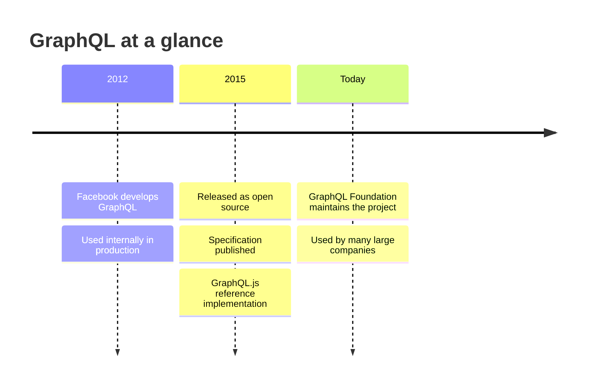
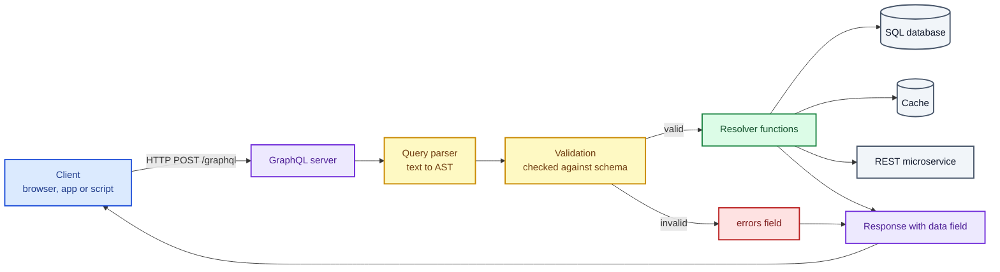
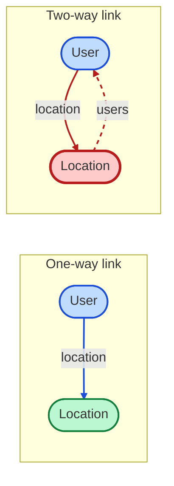
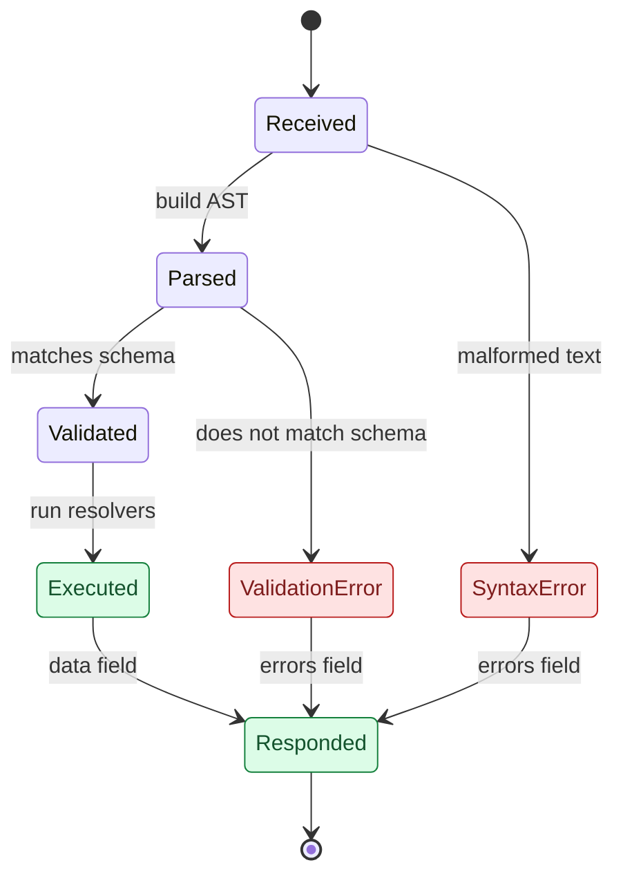
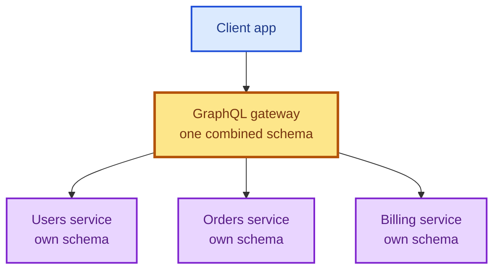
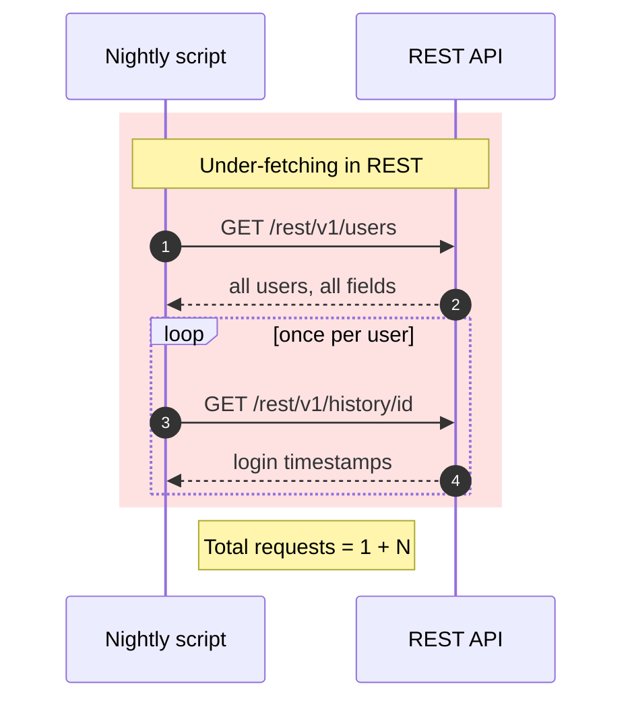
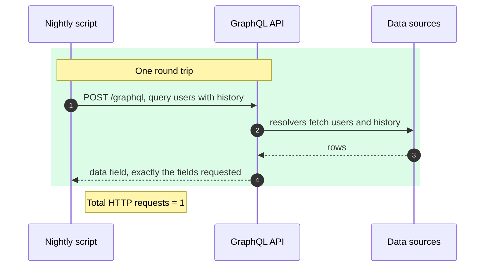
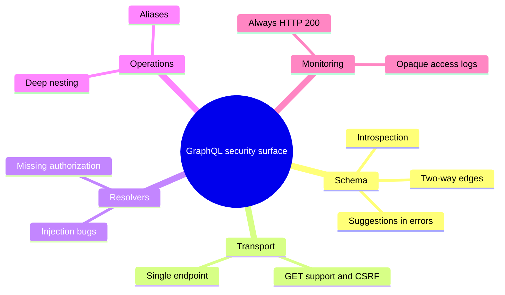
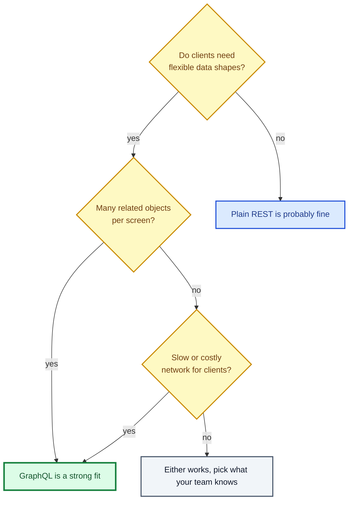

# A Primer on GraphQL: How It Works, How It Differs from REST, and Why Security People Care

I have spent a lot of time poking at APIs, and GraphQL is the one that changed how I think about them. On the surface it looks like a friendlier way to ask a server for data. Underneath, it shifts where decisions are made, how errors are reported, how logs look, and which bugs show up. In this post I walk through everything I consider foundational: what GraphQL is, where it came from, how a request travels through a server, how it compares with REST, and what all of that means if you test or defend these systems.

Every code sample in this post is something I actually ran. At the end I include the full script so you can reproduce each result on your own machine.

> [!NOTE]
> I use the word "hacker" in the original, curious sense: someone who studies how a system really behaves and where it deviates from what its designers intended. Only test systems that you own or have explicit written permission to test.

---

## Table of Contents

1. [The 60-second version](#the-60-second-version)
2. [What GraphQL actually is](#what-graphql-actually-is)
3. [Origins and who maintains it](#origins-and-who-maintains-it)
4. [Where GraphQL gets used](#where-graphql-gets-used)
5. [The specification: a blueprint worth reading](#the-specification-a-blueprint-worth-reading)
6. [How a GraphQL request travels](#how-a-graphql-request-travels)
7. [The schema](#the-schema)
8. [Operations: query, mutation, subscription](#operations-query-mutation-subscription)
9. [The parser and the resolvers](#the-parser-and-the-resolvers)
10. [The problems GraphQL solves](#the-problems-graphql-solves)
11. [REST versus GraphQL, side by side](#rest-versus-graphql-side-by-side)
12. [Other differences that surprise people](#other-differences-that-surprise-people)
13. [Why generic security tools struggle](#why-generic-security-tools-struggle)
14. [Your first query](#your-first-query)
15. [Run it yourself](#run-it-yourself)
16. [Cheat sheet and common mistakes](#cheat-sheet-and-common-mistakes)
17. [Summary](#summary)
18. [Appendix: the full tested script](#appendix-the-full-tested-script)

---

## The 60-second version

If you only have a minute, here is what I would want you to leave with.

| Question | Short answer |
|---|---|
| What is it? | An open source query and manipulation language for APIs |
| Who made it? | Facebook, starting in 2012; open sourced in 2015 |
| Who maintains it now? | The GraphQL Foundation |
| How do clients talk to it? | Usually an HTTP POST to a single endpoint such as `/graphql` |
| What is its big selling point? | The client names exactly the fields it wants, and gets only those |
| What does it replace? | Many fixed REST endpoints and the extra round trips they cause |
| What is the catch for defenders? | Errors arrive with HTTP 200, logs look identical, and rich nesting invites abuse |
| What is the opportunity for testers? | Many tools and teams still assume REST rules, and GraphQL breaks them |

---

## What GraphQL actually is

An API is a contract that lets two programs exchange information as requests and responses, following agreed rules. In the most common picture, a web browser such as Chrome or Firefox plays the role of the client, also called the consumer. It talks to an application server through the application's API to read or change something. The consumer is not always a browser, though. Another server on the network can be a GraphQL consumer just as easily, and so can a mobile app, a smart TV app, or a script running on a cron job.

GraphQL is a language for that conversation. The defining trait is that the consumer asks for specific data and receives nothing extra. Compare that with the classic REST arrangement, where the server publishes a fixed data shape for each endpoint and the client has to throw away whatever it does not need.

That design has a security upside. When a server only returns what was explicitly requested, there are fewer chances for accidental information disclosure. Over-sharing is a real problem: a response that carries more fields than the page needs might quietly include personally identifiable information, and for companies under heavy regulation that can turn into a serious incident.

I want to be careful, though, because "only returns what you ask for" does not mean "only returns what you are allowed to see." GraphQL does not decide authorization for you. That job still belongs to the code behind the API, and I come back to it several times below.

> [!IMPORTANT]
> GraphQL reduces accidental over-sharing at the protocol level. It does not replace authentication or authorization. A client can still ask for a sensitive field that the server forgot to protect.

### The components in plain words

Four ideas carry most of the weight, and I will use these words throughout:

| Term | What it means | Analogy |
|---|---|---|
| Schema | The catalog of types and fields a client may ask about | A restaurant menu |
| Query parser | Reads the incoming text and checks it is well formed and valid | A waiter who checks your order makes sense |
| Resolver | A function that fetches the value for one field | The kitchen station that prepares one dish |
| Operation | The kind of request: query, mutation or subscription | Ordering, changing an order, or asking to be notified |

---

## Origins and who maintains it

Facebook developed GraphQL in 2012 and ran it in production for a few years before releasing it as open source in 2015. In that same year Facebook published a formal specification and a reference implementation called GraphQL.js, written in JavaScript.

Today the project is looked after by the GraphQL Foundation, an organization founded by global technology companies. It funds mentorship and project grants for maintainers, manages policy around the GraphQL trademark, provides legal support, and supports community infrastructure.



---

## Where GraphQL gets used

Nearly any application or device can speak GraphQL. It tends to appeal to teams whose clients ask for a lot of related data at once, because the REST equivalent would be many separate calls. Fewer calls can mean lower bandwidth use and a snappier client.

Here is the example I like. Picture a weather dashboard that gathers information from several third-party weather providers and is viewed on mobile phones over slow connections. If the dashboard had to call each provider, then filter and merge the results on the device, the experience would be sluggish. With a GraphQL layer in front, the phone sends one request describing the combined shape it wants and gets one response back. Fewer round trips between client and server is the whole trick.

Large companies use it at scale. The list includes Facebook, Atlassian, GitHub, and GitLab, serving hundreds of millions of people on phones, desktops, and even smart TVs.

> [!TIP]
> If you are assessing a target and see a big-name platform, there is a decent chance some part of its stack speaks GraphQL. It is worth looking for, even if the main product feels like a classic REST site.

---

## The specification: a blueprint worth reading

When Facebook published the specification in 2015, it laid out rules, design principles, and standard practices that every implementation is supposed to follow. Think of it like an RFC: a reference that many language communities can build against. I like the word "blueprint" for it.

For anyone who tests applications, the specification is a gift. It tells you how a GraphQL server is meant to behave, so you can check whether the server in front of you actually conforms. Implementations drift from the standard all the time, for practical or accidental reasons. Every deviation is a place where a bug might live, and some of those bugs have security consequences.

---

## How a GraphQL request travels

Before I go deeper into each piece, here is the big picture. When a client wants something, such as a list of usernames and emails, it sends a GraphQL query to the server using the HTTP POST method.

That already breaks a habit. In a lot of web development, reading data is done with GET and POST is reserved for writes. GraphQL commonly uses POST for everything, reads included. I come back to the GET question later because it matters for security.

On the server, a query parser reads the text and checks that it is properly formatted and supported. Part of that check is comparing the query to the application's schema. If the query is valid, resolver functions produce the answer.



Notice the layering. GraphQL is a query layer that sits between the client and your application logic. The data itself may live in a SQL database, a cache, the local filesystem, or behind other web services. The client neither knows nor cares.

---

## The schema

The schema describes what a client can ask for. It is written in the Schema Definition Language, or SDL. Here is the smallest useful example, which defines two object types:

```graphql
type User {
  username: String
  email: String
}

type Location {
  latitude: Int
  longitude: Int
}
```

An object type is the basic building block. It represents a piece of data you can fetch from the service. Object types have fields, and each field has a type. In the snippet above, `User` has two fields, `username` and `email`, both of the built-in `String` scalar type. `Location` has `latitude` and `longitude`, both of the `Int` scalar type.

> [!NOTE]
> The naming convention is that field names start lowercase (`users`) and type names start uppercase (`User`). It is only a convention, but nearly every schema follows it, which makes schemas easy to skim.

### Nodes and edges

Right now those two types are unrelated islands. GraphQL lets you link types, so it helps to picture the schema as a graph. Each object type is a node. A link between nodes is an edge. An edge is just a field whose type is another object type.

Suppose I want to return a user's most recent login location whenever someone queries that user. I add a `location` field to `User` and point it at `Location`:

```graphql
type User {
  username: String
  email: String
  location: Location
}

type Location {
  latitude: Int
  longitude: Int
}
```

Now a client can request a `User` and reach into its `Location`. The reverse is not possible yet. Nobody can start at a `Location` and walk to a username, because I never defined that edge. That is a one-way link.

Edges can also go both ways. If clients need to fetch a location and see which users logged in there, I would add a `users` field to `Location`. That is a legitimate and often useful design.



> [!WARNING]
> Two-way links are where denial-of-service trouble tends to begin. A cycle in the schema means a client can nest a query as deep as it likes: users, then locations, then users again, then locations again, and so on. Each level multiplies the work the server has to do. If you build a schema with cycles, you need controls such as depth limits and complexity limits. If you test one, deeply nested queries are a natural thing to try, in an authorized environment.

I verified the one-way edge with my demo server. Querying `username` and `location` together returned the nested object for each user:

```json
{
  "data": {
    "users": [
      { "location": { "latitude": 31, "longitude": 73 }, "username": "dsmith" },
      { "location": { "latitude": 33, "longitude": 72 }, "username": "clarry" }
    ]
  }
}
```

---

## Operations: query, mutation, subscription

Once a schema exists, clients use the declarative GraphQL query language to interact with it. Every request starts by naming the operation type. There are three.

| Operation | Keyword | Purpose | Changes data? |
|---|---|---|---|
| Query | `query` | Read-only fetches | No |
| Mutation | `mutation` | Writes: create, update, delete. Can also read back the result | Yes |
| Subscription | `subscription` | Real-time updates pushed from server to client, commonly over WebSocket | No, but it streams events |

The empty shells look like this:

```graphql
query {
}

mutation {
}

subscription {
}
```

Before a client can use any of them, the developer must have defined the operation in the schema and exposed the fields. Here is a complete schema with an entry point for reading users:

```graphql
type User {
  username: String
  email: String
  location: Location
}

type Location {
  latitude: Int
  longitude: Int
}

type Query {
  users: [User]
}

schema {
  query: Query
}
```

The square brackets around `User` mean the `users` field returns a list. With that entry point available, this query is legal:

```graphql
query {
  users {
    username
    email
  }
}
```

Reading it is easy: ask for all users, and for each one give me the `username` and the `email`. It reads data without changing it, so it is a `query` rather than a `mutation`. Whitespace between tokens is flexible. One space or five makes no difference to the result.

> [!TIP]
> When you are looking at an unfamiliar GraphQL API, the first thing I check is which of the three operation types exist. A schema that exposes `mutation` deserves much more attention than a read-only one, because writes are where authorization mistakes get expensive.

---

## The parser and the resolvers

What happens when the server receives that text? The query parser turns the query string into an abstract syntax tree, or AST, and validates it against the schema. An AST is a hierarchical object representing the query. It contains fields, arguments, and other details, and different language parsers can easily walk it.

I confirmed that with a tiny script. Parsing `query { users { username email } }` and inspecting the tree gave me the top-level field and its two children:

```json
{ "top": "users", "fields": ["username", "email"] }
```

GraphQL is strongly typed. If a field is defined as an `Int` and the client supplies a `String`, the server rejects it with an error. That lets development teams lean on the API layer for a lot of type validation instead of rewriting it everywhere.

I also tested a validation failure. Selecting an object-typed field without choosing any sub-fields is invalid, and the server said so clearly:

```text
Field 'location' of type 'Location' must have a selection of subfields. Did you mean 'location { ... }'?
```



### Resolvers do the real work

Once a query is valid, resolver functions produce the data. A resolver is responsible for one field. Every field has a corresponding resolver, and each one decides how to get its value. It might query a MySQL `users` table, read from a cache, read a file from disk, or call another service over a REST API.

I made this concrete in the demo. I counted resolver calls for a query that fetches users and each user's login history. The `users` resolver ran once, and the `history` resolver ran twice, once per user:

```json
{ "users": 1, "history": 2 }
```

That behavior is the heart of both GraphQL's flexibility and its performance pitfalls. A naive resolver per field can trigger one database query per row, a pattern known as the N+1 problem. It is also exactly where vulnerabilities tend to hide. Resolvers are ordinary code, and poorly written ordinary code has bugs: injection flaws, missing authorization checks, unsafe file access, and server-side request forgery when they fetch URLs.

> [!CAUTION]
> Do not assume that because the GraphQL layer validates types, the data behind it is safe. Type checks stop a string from being used as an integer. They do not stop a perfectly valid string from being a SQL injection payload when a careless resolver concatenates it into a query.

A common real-world setup is GraphQL as a consolidation layer in front of several REST microservices, particularly in companies migrating gradually from REST. The client sees one clean GraphQL API. Behind the curtain, resolvers fan out to older REST services that the client never touches.

Clients do not need special software. Libraries such as Apollo Client (for TypeScript) and Relay (for JavaScript) are popular, but a command-line tool such as cURL can send a GraphQL request just as well.

---

## The problems GraphQL solves

GraphQL speeds up client-server interactions by sparing the client from making many requests to assemble a complete data set. Because the client defines the exact shape of the response, two classic performance problems go away.

| Problem | Meaning | Typical REST symptom |
|---|---|---|
| Over-fetching | The server returns data the client does not use | You wanted emails, but got every field for every user |
| Under-fetching | The server returns too little, so the client must ask again | You got the user list, then need one extra call per user |

GraphQL also offers two features for combining services.

**Schema stitching** builds a single GraphQL schema out of several underlying GraphQL services. If different microservices each publish their own schema and endpoint, a gateway can stitch them into one big schema. Clients then integrate with a single point.

**Schema federation** is a lower-maintenance cousin. Instead of manually stitching schemas together, you tell the gateway where to find the other schemas, and it assembles them automatically.



The security note is simple and important. The more complex a system is, the more places its internal seams can fail. Stitched and federated setups can accidentally expose data that a client should never reach, for example when one service assumes another has already checked permissions.

---

## REST versus GraphQL, side by side

Let me make the comparison concrete with the scenario I used in my tests. Imagine a Users Administration page backed by this table:

| User ID | Username | Email | First name | Last name | State |
|---|---|---|---|---|---|
| 1 | dsmith | david@example.com | David | Smith | Disabled |
| 2 | clarry | chris@example.com | Chris | Larry | Enabled |

### The REST version

In a REST design, the application exposes routes at which clients perform actions with specific HTTP methods. Two are relevant here:

| Method | Endpoint | Description |
|---|---|---|
| GET | `/rest/v1/users` | Returns all users and their information |
| GET | `/rest/v1/history/<user_id>` | Returns login timestamps for one user |

Fetching the user list returns every field for every user:

```json
[
  {
    "email": "david@example.com",
    "first_name": "David",
    "id": 1,
    "last_name": "Smith",
    "state": "disabled",
    "username": "dsmith"
  },
  {
    "email": "chris@example.com",
    "first_name": "Chris",
    "id": 2,
    "last_name": "Larry",
    "state": "enabled",
    "username": "clarry"
  }
]
```

That is over-fetching. If an administrator only wanted email addresses, the client must download everything and discard the rest.

Now picture a nightly script that hunts for suspicious activity by flagging logins outside working hours, say 9 AM to 5 PM. The history endpoint requires a user ID, but the script does not know any IDs. It must first call the users endpoint to collect them, then call the history endpoint once per user. In my test with two users, the script needed three requests in total:

```json
["/rest/v1/users", "/rest/v1/history/1", "/rest/v1/history/2"]
```

That is under-fetching. With 1,000 users, it becomes 1,001 requests.



### The GraphQL version

Now replace the REST API with GraphQL, where the schema defines an edge between `users` and `history`. The same admin page needs one request:

```graphql
query {
  users {
    id
    email
    first_name
    last_name
    state
    history {
      last_login_timestamp
    }
  }
}
```

And if I only want emails, I simply ask for emails:

```graphql
query {
  users {
    email
  }
}
```

The response contains nothing else:

```json
{
  "data": {
    "users": [
      { "email": "david@example.com" },
      { "email": "chris@example.com" }
    ]
  }
}
```

For the intrusion-hunting script, I ask for emails and login timestamps together, in a single request:

```graphql
query {
  users {
    email
    history {
      last_login_timestamp
    }
  }
}
```



| Scenario with N users | REST requests | GraphQL requests |
|---|---|---|
| Emails only | 1 (but all fields returned) | 1 (only emails returned) |
| Users plus login history | 1 + N | 1 |
| Two users (my test) | 3 | 1 |
| 1,000 users | 1,001 | 1 |

> [!NOTE]
> GraphQL moves the work, it does not delete it. The server still fetches history for each user, as my resolver counter showed. What you save is network round trips between the client and the server, which is often the expensive part, especially on slow mobile connections.

GraphQL response data does not have to be JSON, but JSON is by far the most common serialization.

---

## Other differences that surprise people

If you have tested REST applications, several GraphQL behaviors will feel odd, because GraphQL does not always follow the HTTP conventions you are used to.

### HTTP methods

REST uses methods to signal intent: GET to read, POST to create or update. GraphQL usually sends everything through POST, whether the operation reads, writes, or deletes.

However, many GraphQL servers will also accept queries over GET. I tested this on my demo server and it worked:

```text
GET /graphql?query={ users { username } }  ->  HTTP 200 with data
```

> [!WARNING]
> If a server answers state-changing or sensitive operations over GET, you can run into cross-site request forgery (CSRF) risks, because browsers will happily send GET requests cross-site with the victim's cookies. Always test whether a GraphQL endpoint accepts GET. I will cover CSRF properly in a later post.

### Endpoint paths

A GraphQL service is usually exposed at `/graphql`, sometimes versioned as `/v1/graphql` or `/v2/graphql`. Whichever path it uses, it stays the same for every request. REST scatters resources across many endpoints, each with its own controls and permitted methods. A `/history` route might allow only GET, while `/users` allows GET and POST.

GraphQL puts intent in the request body instead. The query or mutation keyword tells the server what you want, and the URL never changes.

### HTTP status codes

This is the one that trips up most people. In REST, status codes carry meaning: 200 for success, 404 for missing resources, 401 for unauthorized. In GraphQL, the status is almost always 200, even when the operation failed because of an authorization error or a nonexistent resource. Failures are reported in an `errors` array inside the body.

I sent a query with a typo in a field name and checked the status. It was 200, and the body explained the problem:

```json
{
  "errors": [
    {
      "locations": [{ "column": 17, "line": 1 }],
      "message": "Cannot query field 'usernam' on type 'User'. Did you mean 'username'?"
    }
  ]
}
```

Notice the helpful suggestion. Servers often propose correct field names when you get one slightly wrong. That is convenient for developers and equally convenient for someone mapping a schema by trial and error, even when introspection is turned off. The exact wording of the message differs between implementations, so do not hard-code against it.

A non-200 status does appear when something breaks badly, such as a database outage, in which case you may see a 500.

| Aspect | REST | GraphQL |
|---|---|---|
| HTTP methods | GET, POST, PUT, DELETE chosen by intent | Mostly POST; GET sometimes accepted |
| Endpoints | One per resource | Usually one, such as `/graphql` |
| Where intent lives | Method plus URL | Operation and fields in the body |
| Success and failure | Status codes (200, 401, 404, and so on) | Usually 200, with an `errors` field on failure |
| Response shape | Fixed by the server | Chosen by the client |



---

## Why generic security tools struggle

Because of these differences, the way we approach security analysis, intrusion detection, and penetration testing has to change. Traditional web application scanners are built around the HTTP standard in RFC 2616 and assume that applications return sensible status codes. A brute-force module might declare success whenever it sees a 200 OK. Against GraphQL, that assumption produces false positives, because 200 does not mean what the tool thinks it means.

Defenders feel the same pain in the logs. Here is what a GraphQL access log looks like:

```text
172.17.0.1 - - [04:31:01] "POST /graphql HTTP/1.1" 200 -
172.17.0.1 - - [04:31:05] "POST /graphql HTTP/1.1" 200 -
172.17.0.1 - - [04:31:37] "POST /graphql HTTP/1.1" 200 -
```

Every line is identical. The log cannot tell you whether those requests were harmless reads, failed login guesses, or attempts to dump a database. To get useful signal, you need specialized tooling and logging that captures the operation inside the body.

This is also an opening for testers. Teams often adopt new technology without customizing their defenses for it. Because GraphQL does not follow standard status code conventions, it may slip past web application firewalls, and it can go unnoticed by operators who watch for spikes in HTTP error codes without realizing GraphQL behaves differently.

There is a subtler trick that I confirmed on my demo server. A single request can carry several aliased selections:

```graphql
query {
  a: users { email }
  b: users { username }
}
```

Both came back in one HTTP request, under the keys `a` and `b`. A rate limiter that counts HTTP requests would see one request, while the server did the work of two or two hundred.

> [!CAUTION]
> Rate limits, alerting, and WAF rules written for REST count requests or watch status codes. Neither works well here. Defenders should limit and monitor by operation cost, depth, and alias count. Testers should only probe this on systems they are authorized to test.

---

## Your first query

Enough theory. GraphQL servers commonly ship with a graphical interface for writing queries, in the form of an IDE-like web page. Two well-known ones are GraphiQL Explorer (pronounced "graphical," with a lowercase `i`) and GraphQL Playground. Depending on the implementation, they come bundled or as an additional package.

GraphiQL gives you auto-completion, generated schema documentation, error highlighting, query history, and support for variables. Those features make a newcomer productive quickly, and they help testers just as much.

The workflow is straightforward:

1. Open the interface in a browser.
2. Type a query in the left pane.
3. Press the play button.
4. Read the result in the right pane.

Start with this one:

```graphql
query {
  users {
    email
    first_name
    last_name
  }
}
```

As you type, a dropdown offers completions. That feature depends on introspection, GraphQL's self-documenting capability, which lets a client ask the server to describe its own schema. I tried this too. Asking the demo server for its schema returned the root query type and the list of user-defined types:

```json
{
  "queryType": "Query",
  "types": ["Boolean", "History", "Int", "Location", "Query", "String", "User"]
}
```

The Docs tab uses the same information to render documentation automatically.

By default, GraphQL servers are unauthenticated, which is what lets these graphical tools talk to them freely. Protecting the graphical page alone does not accomplish much, since anyone can use cURL or a script to hit the API directly. The API itself has to enforce access control.

> [!WARNING]
> An exposed GraphiQL or Playground page plus enabled introspection hands a visitor a full map of the API. In production, I would turn off the IDE and disable introspection unless there is a real need for it, and I would still enforce authorization on every resolver, because hiding the map is never a substitute for locking the doors.

---

## Run it yourself

I built a self-contained demo so you can reproduce everything above without depending on any external lab. It uses Python, the `graphql-core` library (I used version 3.3.0), and Flask. It defines a REST API and a GraphQL API over the same two-user data set, then runs twelve checks that each assert the behavior I described.

### Setup

```bash
python3 -m venv .venv
source .venv/bin/activate
pip install graphql-core flask
python graphql_demo.py
```

### Expected end of output

```text
=== Resolver calls for one query ===
{
  "users": 1,
  "history": 2
}

=== Aliases: two top-level selections in one request ===
{ ... }

ALL CHECKS PASSED
```

The full script is in the appendix. If you prefer to run a real server and talk to it with cURL, you can append `app.run(port=5000)` to the script and then send requests like these:

```bash
# POST, the usual GraphQL transport
curl -s -X POST http://127.0.0.1:5000/graphql \
  -H "Content-Type: application/json" \
  -d '{"query":"query { users { email } }"}'

# GET, worth testing on any target you are authorized to assess
curl -s -G http://127.0.0.1:5000/graphql \
  --data-urlencode 'query={ users { username } }'
```

> [!NOTE]
> The tests in this post ran against Flask's built-in test client rather than a network socket. The results are the same, since the app code is identical, but I mention it so you know exactly what I verified.

---

## Cheat sheet and common mistakes

### Quick reference

| I want to... | I write... |
|---|---|
| Read data | `query { field { subfield } }` |
| Change data | `mutation { ... }` |
| Get live updates | `subscription { ... }` |
| Return a list | A field typed like `[User]` |
| Link two types | A field whose type is another object type |
| Ask the server about its schema | An introspection query such as `{ __schema { types { name } } }` |
| Run two selections in one request | Aliases such as `a: users { ... }` and `b: users { ... }` |

### Mistakes I see (and made myself)

| Mistake | Why it hurts | Better approach |
|---|---|---|
| Treating HTTP 200 as success | The failure is inside `errors` | Always inspect the body |
| Trusting a scanner that only reads status codes | False positives and false negatives | Use GraphQL-aware tooling |
| Assuming the schema enforces permissions | It only describes shape | Authorize inside resolvers |
| Leaving two-way edges unlimited | Deep nesting can exhaust the server | Add depth and cost limits |
| Counting HTTP requests for rate limiting | Aliases hide the real workload | Rate limit by operation cost |
| Forgetting to test GET | Opens the door to CSRF | Test both methods |
| Shipping the IDE to production | Gives away the schema | Disable it or put it behind auth |

### When would I choose GraphQL?



---

## Summary

GraphQL is a query language for APIs that lets the client describe precisely what it wants and get exactly that. It came from Facebook in 2012, went open source in 2015, and is now stewarded by the GraphQL Foundation. A request enters through a single endpoint, usually by POST. A parser turns it into an AST and validates it against the schema. Resolver functions then fetch each field from databases, caches, files, or other services.

Compared with REST, it solves over-fetching and under-fetching, and my tests showed the effect directly: three REST requests collapsed into one GraphQL request, and a REST response full of unused fields became a response with only emails.

For anyone concerned with security, the differences matter just as much as the benefits. Status codes are nearly always 200. Logs look uniform. GET support can introduce CSRF. Two-way schema edges and aliases can drive denial-of-service conditions. Resolvers carry all the usual application bugs, and introspection plus friendly error hints make schema discovery easy. Standard scanners and REST-minded monitoring will misread all of this unless they are made GraphQL-aware.

If you remember one sentence from this post, make it this: **in GraphQL, the HTTP layer tells you almost nothing, so you have to read the body.**

In the next posts I plan to go deeper into the lower-level mechanics of the language, introspection, discovery of exposed interfaces, denial-of-service patterns, and CSRF.

---

## Appendix: the full tested script

This is the exact file I ran. Save it as `graphql_demo.py`.

```python
"""
Tested demo for the GraphQL primer blog post.
Runs a tiny REST API and a tiny GraphQL API over the same data,
then compares them. Requires: pip install graphql-core flask
"""
import json
from flask import Flask, jsonify, request
from graphql import (
    build_schema, graphql_sync, parse, validate, GraphQLError,
)

# ---------------------------------------------------------------- data
USERS = [
    {"id": 1, "username": "dsmith", "email": "david@example.com",
     "first_name": "David", "last_name": "Smith", "state": "disabled",
     "location": {"latitude": 31, "longitude": 73}},
    {"id": 2, "username": "clarry", "email": "chris@example.com",
     "first_name": "Chris", "last_name": "Larry", "state": "enabled",
     "location": {"latitude": 33, "longitude": 72}},
]
HISTORY = {1: ["02:03:37", "03:05:55"], 2: ["02:03:37", "03:05:55"]}

# ---------------------------------------------------------------- schema (SDL)
SDL = """
type Location {
  latitude: Int
  longitude: Int
}

type History {
  last_login_timestamp: [String]
}

type User {
  id: Int
  username: String
  email: String
  first_name: String
  last_name: String
  state: String
  location: Location
  history: History
}

type Query {
  users: [User]
}

schema {
  query: Query
}
"""

schema = build_schema(SDL)

# ---------------------------------------------------------------- resolvers
RESOLVER_CALLS = {"users": 0, "history": 0}


def resolve_users(_root, _info):
    RESOLVER_CALLS["users"] += 1
    return USERS


def resolve_history(user, _info):
    RESOLVER_CALLS["history"] += 1
    return {"last_login_timestamp": HISTORY[user["id"]]}


schema.query_type.fields["users"].resolve = resolve_users
schema.type_map["User"].fields["history"].resolve = resolve_history

# ---------------------------------------------------------------- Flask app
app = Flask(__name__)
REST_HITS = []


@app.get("/rest/v1/users")
def rest_users():
    REST_HITS.append("/rest/v1/users")
    return jsonify([{k: v for k, v in u.items() if k != "location"} for u in USERS])


@app.get("/rest/v1/history/<int:user_id>")
def rest_history(user_id):
    REST_HITS.append(f"/rest/v1/history/{user_id}")
    return jsonify(HISTORY[user_id])


@app.route("/graphql", methods=["GET", "POST"])
def graphql_endpoint():
    if request.method == "POST":
        payload = request.get_json(force=True)
        query = payload.get("query")
    else:  # GET support (the CSRF-relevant behaviour)
        query = request.args.get("query")
    result = graphql_sync(schema, query)
    body = {}
    if result.data is not None:
        body["data"] = result.data
    if result.errors:
        body["errors"] = [e.formatted for e in result.errors]
    return jsonify(body)  # always HTTP 200, like most GraphQL servers


def show(title, obj):
    print(f"\n=== {title} ===")
    print(json.dumps(obj, indent=2) if not isinstance(obj, str) else obj)


if __name__ == "__main__":
    c = app.test_client()

    # 1. REST over-fetching
    r = c.get("/rest/v1/users")
    show("REST /rest/v1/users (over-fetching: we only wanted emails)", r.get_json())

    # 2. REST under-fetching: N+1 requests to get login history
    REST_HITS.clear()
    users = c.get("/rest/v1/users").get_json()
    for u in users:
        c.get(f"/rest/v1/history/{u['id']}")
    show("REST requests needed for users + history", REST_HITS)
    assert len(REST_HITS) == 1 + len(USERS)

    # 3. GraphQL: only emails
    q = "query { users { email } }"
    r = c.post("/graphql", json={"query": q})
    show("GraphQL: emails only", r.get_json())
    assert r.get_json() == {"data": {"users": [{"email": "david@example.com"},
                                               {"email": "chris@example.com"}]}}

    # 4. GraphQL: users + nested history in ONE request
    q = "query { users { email history { last_login_timestamp } } }"
    r = c.post("/graphql", json={"query": q})
    show("GraphQL: users + history, one HTTP request", r.get_json())
    assert r.status_code == 200

    # 5. Nested location edge (one-way link)
    q = "query { users { username location { latitude longitude } } }"
    r = c.post("/graphql", json={"query": q})
    show("GraphQL: one-way edge User -> Location", r.get_json())

    # 6. Error with HTTP 200
    q = "query { users { usernam } }"
    r = c.post("/graphql", json={"query": q})
    show(f"GraphQL: typo in field name -> HTTP {r.status_code}", r.get_json())
    assert r.status_code == 200 and "errors" in r.get_json()

    # 7. GET support
    r = c.get("/graphql", query_string={"query": "{ users { username } }"})
    show(f"GraphQL over GET -> HTTP {r.status_code}", r.get_json())
    assert r.status_code == 200 and "data" in r.get_json()

    # 8. Strong typing: wrong argument type / invalid selection
    ast = parse("query { users { location } }")
    errs = validate(schema, ast)
    show("Validation: selecting an object field without sub-selection",
         [e.message for e in errs])
    assert errs

    # 9. AST peek
    ast = parse("query { users { username email } }")
    op = ast.definitions[0]
    fields = [s.name.value for s in op.selection_set.selections[0].selection_set.selections]
    show("AST: parsed top-level field and sub-fields", {"top": "users", "fields": fields})

    # 10. Introspection (what GraphiQL uses for autocomplete)
    q = '{ __schema { queryType { name } types { name } } }'
    res = graphql_sync(schema, q)
    names = sorted(t["name"] for t in res.data["__schema"]["types"] if not t["name"].startswith("__"))
    show("Introspection: user-defined types", {"queryType": res.data["__schema"]["queryType"]["name"],
                                              "types": names})

    # 11. Resolver-per-field proof
    RESOLVER_CALLS.update(users=0, history=0)
    graphql_sync(schema, "query { users { email history { last_login_timestamp } } }")
    show("Resolver calls for one query", RESOLVER_CALLS)
    assert RESOLVER_CALLS == {"users": 1, "history": 2}

    # 12. Alias batching: many operations in ONE HTTP request (security relevant)
    q = "query { a: users { email } b: users { username } }"
    r = c.post("/graphql", json={"query": q})
    show("Aliases: two top-level selections in one request", r.get_json())

    print("\nALL CHECKS PASSED")
```
