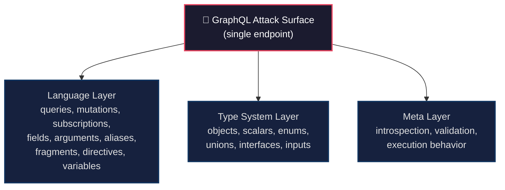
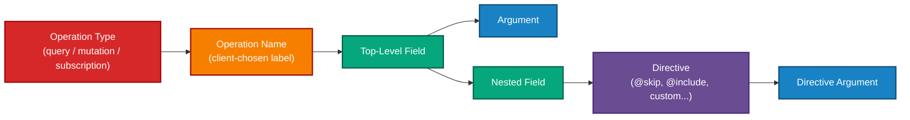
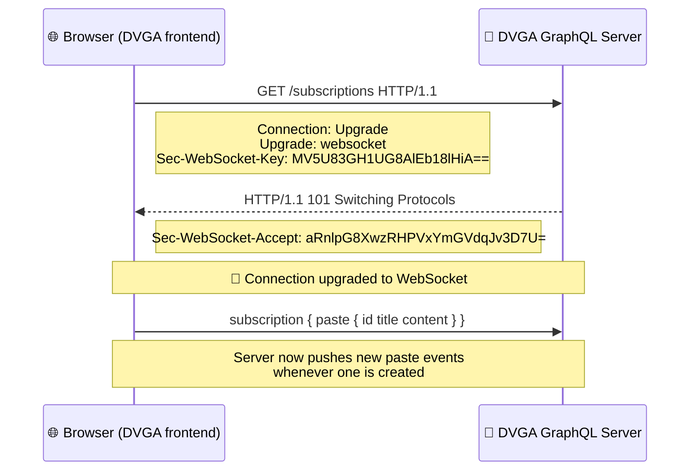
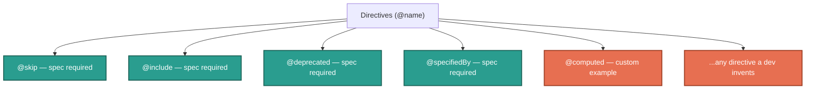
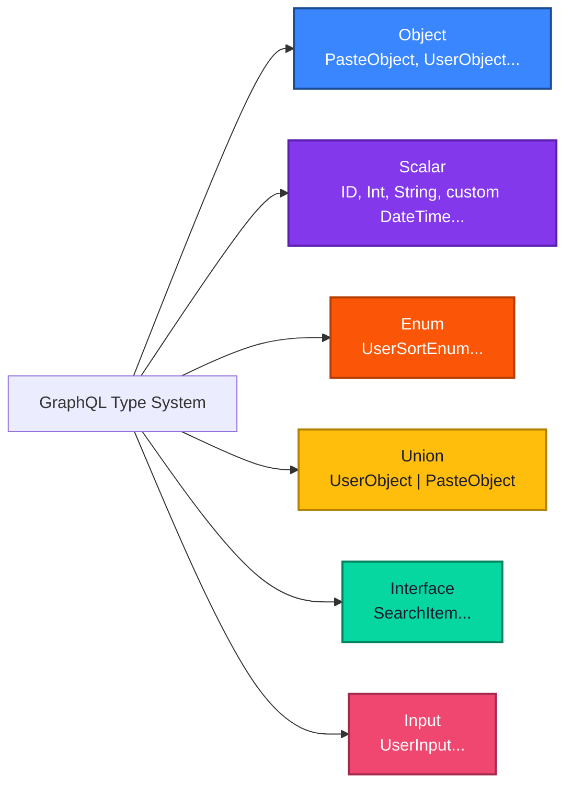
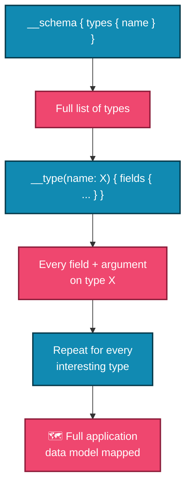

# Mapping the GraphQL Attack Surface: Everything I Look At Before I Start Hacking

Once my [GraphQL security lab](./graphql-security-lab-setup.md) was up and running — Kali, Docker, Altair, DVGA, the whole stack — I had somewhere to practice. But before I started firing off payloads, I forced myself to slow down and actually understand *what I was looking at*. I've learned the hard way, across plenty of REST engagements, that hacking a technology you don't fully understand is slow, sloppy, and easy to miss things in.

So this post is my walkthrough of GraphQL's attack surface: the language features and type system that make GraphQL powerful for developers — and, as it turns out, equally interesting for people like me. I'm going to go feature by feature, the same way I worked through it myself, and call out exactly where each feature starts to look less like a convenience and more like a potential weakness.

---

## What I Mean by "Attack Surface"

I like the physical-building analogy, because it's the one that made this click for me. Picture a building with a front door, a side door, and a dozen windows. Every one of those openings is a *possible* way in — not necessarily a way in *today*, but a candidate I'd check if I were casing the place.

An attack surface is the sum of every one of those entry points across a system: every endpoint, every parameter, every feature that accepts client input. The bigger and more complex the system, the more doors and windows exist, and the higher the odds that at least one of them is unlocked.

GraphQL complicates this in an interesting way. Unlike REST, where the attack surface is spread across dozens (or hundreds) of distinct URLs, GraphQL exposes almost everything through a *single* endpoint. That doesn't shrink the attack surface, though — it just moves it. Instead of enumerating URLs, I'm now enumerating *language features*: operations, fields, arguments, directives, fragments, aliases, and the type system underneath all of it. Each of those is a window I need to check.



Every section below maps to one branch of that diagram.

---

## The Language, From a Client's Point of View

GraphQL requests are built out of a handful of composable pieces. The first time I looked at a real-world query, it looked dense — operation keywords, nested curly braces, `$` symbols, `@` symbols — but once I broke it into its components, the structure clicked fast.

Here's how I mentally map a typical query:



| # | Component | What It Actually Does |
|---|---|---|
| 1 | Operation type | Declares how the client wants to interact with the server: `query`, `mutation`, or `subscription`. |
| 2 | Operation name | A label the *client* makes up to identify the request. |
| 3 | Top-level field | The entry-point function returning a unit of data; may contain nested fields. |
| 4 | Argument (on a field) | A parameter that tailors what a field returns. |
| 5 | Value | The actual data handed to an argument. |
| 6 | Field | A nested function returning its own unit of data, possibly with its own sub-selection. |
| 7 | Directive | A decorator (`@something`) that changes how a field is validated or executed. |
| 8 | Argument (on a directive) | A parameter tailoring a directive's behavior. |
| 9 | Argument (on a field, again) | Same concept as #4, reused at deeper nesting levels. |

I treat each row in that table as its own mini attack surface. Let me go through them in the order I actually investigate them during testing.

---

## Queries, Mutations, and Subscriptions

### Mutations: Where the Real Fun Starts

Queries are great for reading data, but as a hacker, I get a lot more interested once I find out what I can *write*. That's what mutations are for.

```graphql
mutation {
  editPaste(id: 1, content: "My first mutation!") {
    paste {
      id
      title
      content
    }
  }
}
```

This single request does two things at once: it modifies the paste with ID `1`, and it immediately reads back the updated object. That read-after-write pattern is extremely common in GraphQL mutations, and it's convenient — for me and for legitimate developers alike.

> **Note:** Just like REST doesn't technically forbid a `GET` request from mutating data (even though it's against convention), nothing stops a GraphQL implementation from allowing a `query` operation to quietly write data too. I always test this explicitly — I don't assume `query` means "read-only" just because that's the spec's intent.

### Subscriptions: The Bidirectional Oddball

Subscriptions are the operation type I see least often in the wild, but they matter because they open up a completely different transport layer: WebSockets (though the spec doesn't technically mandate it — some implementations use other transports).

Here's the flow I observed while watching DVGA's subscription traffic in my browser's dev tools:



The handshake is a normal HTTP request that asks the server to switch protocols (`Upgrade: websocket`). The server agrees with a `101 Switching Protocols` response, and from that point on, client and server exchange messages over a persistent connection instead of request/response HTTP calls.

To test this myself in Altair, I clicked the two-arrow subscription icon in the sidebar and set the subscription URL to:

```
ws://localhost:5013/subscriptions
```

Then, from a second Altair tab, I fired a mutation to create a new paste:

```graphql
mutation {
  createPaste(title: "New paste", content: "Test", public: false) {
    paste {
      id
      title
      content
    }
  }
}
```

The moment that mutation succeeded, my subscription tab lit up with the new paste data — pushed to me automatically, no polling required.

> **Caution:** WebSocket connections carry their own risk category I didn't have to think about with plain HTTP. Two stand out to me:
> - **Cross-site WebSocket hijacking (CSWSH)** — happens when the server doesn't validate the `Origin` header during the handshake, letting a malicious page on another domain ride a victim's authenticated session.
> - **Man-in-the-middle (MITM) exposure** — if the WebSocket traffic isn't wrapped in TLS (`wss://` instead of `ws://`), anyone on the network path can read or tamper with subscription data in transit.

---

## Operation Names: A Client-Controlled Label I Don't Trust

Here's something that surprised me the first time I noticed it: operation names are entirely made up by the client. The server doesn't assign them, validate their meaning, or care whether they accurately describe what the operation does.

A document with a single, unnamed query is valid shorthand:

```graphql
{
  pastes {
    title
  }
}
```

The moment I need more than one operation of the same type in a single document, I have to name them:

```graphql
query getPasteTitles {
  pastes {
    title
  }
}

query getPasteContent {
  pastes {
    content
  }
}
```

That sounds harmless — until I think about it from a logging and monitoring angle. If an analyst (or an automated detection rule) is watching GraphQL traffic and keying off operation names to understand intent, I can trivially defeat that. Nothing stops me from naming a destructive mutation `getPastes` while it actually deletes every paste in the database. The operation name is *decoration* — the real behavior lives entirely in the selected fields and resolver logic underneath it.

> **Note:** Some implementations also accept special characters inside operation names. If those names get logged, forwarded to a SIEM, or passed into any downstream system without sanitization, that's a client-controlled string landing somewhere it probably shouldn't — a classic injection smell.

There's a second, subtler point here too: the same logical request can be expressed through *multiple different documents* — shorthand, named, with fragments, without — and all of them are functionally equivalent. That flexibility is great for developer ergonomics, but it also means anyone building parsing or detection logic around GraphQL traffic has to account for a much wider variety of valid request shapes than a REST API would ever produce.

---

## Fields: The Building Blocks, and a Free Hint When I Guess Wrong

Fields are the actual units of data inside a selection set — the stuff between the curly braces:

```graphql
{
  id
  title
  content
}
```

Fields nest. A top-level field can have its own selection set:

```graphql
{
  id
  title
  content
  owner {
    name
  }
}
```

I'll flag something now that I'll come back to properly in a future post: circular field relationships (an object referencing another object, which references the first one back) can make queries recursively deep. If the server doesn't cap query depth or complexity, that's a resource-exhaustion opportunity waiting to happen.

The feature I find genuinely useful as an attacker, though, is **field suggestions**. If I misspell a field name, a lot of GraphQL servers try to be helpful:

```graphql
query {
  pastes {
    titl
  }
}
```

```json
"Cannot query field \"titl\" on type \"PasteObject\". Did you mean \"title\"?"
```

That little "did you mean" message is a gift. It means I can discover field names I never explicitly knew about just by deliberately typo-ing guesses and reading the error messages — which matters enormously on servers where introspection has been disabled. I'll go much deeper on automating this technique in a dedicated reconnaissance post, but it's worth planting the flag here: **helpful error messages are an information-disclosure vector.**

---

## Arguments: Where Client Input Meets Server Logic

Arguments let me tailor what a field returns. Without one, this query returns every user in DVGA:

```graphql
query {
  users {
    id
    username
  }
}
```

With an `id` argument, it's filtered down to one:

```graphql
query {
  users(id: 1) {
    id
    username
  }
}
```

```json
{
  "data": {
    "users": [
      { "id": "1", "username": "admin" }
    ]
  }
}
```

Arguments can live at any nesting level, including on nested fields themselves:

```graphql
query {
  users(id: 1) {
    username(capitalize: true)
  }
}
```

```json
{
  "data": {
    "users": [
      { "username": "Admin" }
    ]
  }
}
```

Order doesn't matter, either — `pastes(limit: 1, public: true)` behaves identically to `pastes(public: true, limit: 1)`. That's a spec guarantee, not an implementation detail.

What I actually care about as a tester is *validation depth*. GraphQL's type system guarantees basic type correctness — pass an integer where a string is expected and the request gets rejected before it even reaches application logic. But type-correctness isn't the same as *semantic* correctness. A string argument that's "supposed" to be an email address still has to be validated by the application (or a custom scalar library) to confirm it actually looks like one.

> **Caution:** This gap between "type-valid" and "safe" is exactly where custom scalar libraries matter — and where they can go wrong. A good example I keep in my back pocket: **CVE-2021-29921**, a vulnerability in Python's built-in `ipaddress` library that could let an attacker bypass IP-based access controls through malformed input. If a GraphQL implementation leaned on that library for a custom IP-address scalar without patching it, the GraphQL layer would never have flagged the bad input — it looked like a valid string the whole way through.

Because argument values are entirely client-controlled, they're also my primary candidate for injection testing later on — SQL, NoSQL, command, you name it, depending on what's sitting behind the resolver.

---

## Aliases: Renaming Fields, and Quietly Multiplexing Requests

Aliases let me rename a field's key in the response:

```graphql
query {
  pastes {
    myalias: title
  }
}
```

```json
{
  "data": {
    "pastes": [
      { "myalias": "My Title!" }
    ]
  }
}
```

That looks purely cosmetic at first. But aliases earn their keep the moment I want to call the *same* field twice with *different* arguments in a single request. Without an alias, GraphQL refuses:

```graphql
query {
  pastes(public: false) {
    title
  }
  pastes(public: true) {
    title
  }
}
```

```json
{
  "errors": [
    {
      "message": "Fields \"pastes\" conflict because they have differing arguments. Use different aliases on the fields to fetch both if this was intentional."
    }
  ]
}
```

Adding aliases resolves the conflict and effectively lets me run two "sub-queries" in parallel inside one HTTP request:

```graphql
query {
  queryOne: pastes(public: false) {
    title
  }
  queryTwo: pastes(public: true) {
    title
  }
}
```

```json
{
  "data": {
    "queryOne": [{ "title": "My Title!" }],
    "queryTwo": [{ "title": "Testing Testing" }]
  }
}
```

> **Note:** Most implementations restrict aliases to alphanumeric characters — special characters typically throw a syntax error. (Interesting exception: I'll touch on `graphql-php`'s looser handling of this later, because it's a good fingerprinting signal.)

This looks harmless on the surface, but I want to flag two things I plan to weaponize later:

- **Denial of service** — if there's no cap on how many aliased copies of an expensive field I can request in one document, I can multiply server load dramatically with a single HTTP call.
- **Authentication bypass potential** — some rate-limiting and brute-force protections are built around counting *HTTP requests*, not counting *individual operations inside a request*. Aliases let me pack dozens of login attempts into a single request that only registers as "one" to a naive rate limiter.

---

## Fragments: Reusable Field Sets (and a Circular Trap)

Fragments exist purely for developer convenience — define a reusable chunk of fields once, reference it wherever needed:

```graphql
fragment CommonFields on PasteObject {
  title
  content
}

query {
  pastes {
    ...CommonFields
  }
}
```

The `...` spread operator pulls the fragment's fields into the selection set. There's no built-in limit on how many times a fragment can be referenced inside a query, and fragments can reference each other.

That last point is the one I underline in my notes: **fragments can be constructed to reference one another in a cycle.** If a server's query validator doesn't detect circular fragment references before attempting to execute the query, that's another resource-exhaustion vector — conceptually similar to the circular field relationships I mentioned earlier, except expressed through fragment composition instead of raw nesting.

---

## Variables: Cleaner Syntax, Same Underlying Risk

Variables let me parameterize a query instead of hardcoding values directly into the document string — useful for avoiding costly string-building at runtime, and standard practice in any serious GraphQL client.

```graphql
query publicPastes($status: Boolean!) {
  pastes(public: $status) {
    id
    title
    content
  }
}
```

The `$status` variable is typed as `Boolean!` — the trailing `!` marks it as required. In Altair, I supply the actual value through the dedicated Variables pane:

```json
{
  "status": false
}
```

From a security standpoint, variables don't introduce a fundamentally new risk — they're still client-controlled input, just structured slightly differently. I mention them mainly because every automated testing tool I use (including several from my toolkit post) needs to understand the variables pane separately from the query body, so it's worth being comfortable with the syntax before trying to script anything against it.

---

## Directives: Arguments' More Powerful Sibling

Directives decorate a field with `@name` syntax and can change how that field is validated, processed, or executed. They come in two flavors — **query-level** (used by clients inside requests) and **schema-level** (defined by developers inside the schema itself).

| # | Directive | What It Does | Where It Lives |
|---|---|---|---|
| 1 | `@skip` | Conditionally removes a field from the response | Query |
| 2 | `@include` | Conditionally includes a field in the response | Query |
| 3 | `@deprecated` | Marks a schema field or type as no longer supported | Schema |
| 4 | `@specifiedBy` | Points to a spec URL for a custom scalar type | Schema |

These four are **spec-required** — every compliant implementation has to support them.

### `@skip` in Action

```graphql
query pasteDetails($pasteOnly: Boolean!) {
  pastes {
    id
    title
    content
    owner @skip(if: $pasteOnly) {
      name
    }
  }
}
```

```json
{ "pasteOnly": true }
```

With `pasteOnly` set to `true`, the entire `owner` field — and anything nested inside it — gets dropped from the response. `@include` works the same way, just inverted: the field only appears when its condition evaluates to `true`.

### `@deprecated`, From the Schema Side

Unlike `@skip`/`@include`, I don't send `@deprecated` in a request — it lives in the schema definition itself, flagging a field as obsolete:

```graphql
type PasteObject {
  userAgent: String
  ipAddr: String @deprecated(reason: "We no longer log IP addresses")
  owner: OwnerObject
}
```

That `reason` string is pure gold during recon. It shows up in introspection responses and IDE documentation panes, and it often tells me *why* something changed — which, every so often, leaks internal implementation detail ("we no longer log IP addresses" tells me they used to, and implies there might be an old code path still referencing it somewhere).

### Custom Directives: Powerful, and Completely Unregulated

Implementations are free to invent their own directives. A popular example is `@computed`, which lets a schema derive one field's value from others without writing a dedicated resolver:

```graphql
type User {
  firstName: String
  lastName: String
  fullName: String @computed(value: "$firstName $lastName")
}
```

Here's the part that matters to me as a hacker: **the GraphQL spec barely regulates directive behavior.** It defines the syntax, but what a directive actually *does* under the hood is entirely up to the implementation. That means:

- Directive behavior is a strong fingerprinting signal — different implementations support different default and custom directives, and the differences help me narrow down what I'm actually facing.
- A vulnerability inside a widely used custom directive (in a popular open-source GraphQL library, say) could simultaneously affect every organization using that library — a single flaw with a very wide blast radius.



---

## The Type System, From the Server's Side

If the language layer is how I *ask* for things, the type system is what defines what's actually *there* to ask for. GraphQL has six kinds of types, and I've learned to treat each one as a slightly different flavor of attack surface.



### Objects

Object types group related fields into a domain concept. Here's DVGA's `PasteObject`:

```graphql
type PasteObject {
  id: ID!
  title: String
  content: String
  public: Boolean
  userAgent: String
  ipAddr: String
  ownerId: Int
  burn: Boolean
  owner: OwnerObject
}
```

The `!` after `ID` marks it as **non-null** — every paste must have one, while every other field is allowed to be `null`. I pay attention to that `owner: OwnerObject` link, too: it's a one-way relationship that lets me pull `Owner` fields through a `Paste` query, which is exactly the kind of object-graph traversal I'd want to map out early in any engagement — it often reveals more than the "obvious" top-level fields do.

### Scalars

Scalars are the primitive, fieldless value types: `ID`, `Int`, `Float`, `String`, `Boolean`, plus any custom scalars an implementation defines:

```graphql
scalar DateTime

type PasteObject {
  id: ID!
  title: String
  createdAt: DateTime!
}
```

Custom scalars can self-document with `@specifiedBy`:

```graphql
scalar UUID @specifiedBy(url: "https://tools.ietf.org/html/rfc4122")
```

The security takeaway here is the same one I flagged under Arguments: a custom scalar is only as safe as its validation logic. A well-built custom scalar library (like `graphql-scalars` for JavaScript) centralizes that validation so individual developers don't have to reinvent it — but any bug in that shared library becomes a bug in every field that uses it.

### Enums

Enums restrict a field to a fixed set of string values:

```graphql
enum UserSortEnum {
  ID
  EMAIL
  USERNAME
  DATE_JOINED
}

input UserOrderType {
  sort: UserSortEnum!
}

type Query {
  users(limit: Int, order: UserOrderType): UserObject!
}
```

```graphql
query {
  users(limit: 100, order: { sort: ID })
}
```

This one's sneaky. Letting clients sort by `ID` sounds innocent, but it hands me a reliable way to find the *first* record ever created in a table — and in most systems, user ID `1` (or the lowest ID in the table) tends to be a founder account, a seed admin, or some other high-value target. Sorting options are a convenience feature with a quiet reconnaissance side effect.

### Unions

A union lets a single field return objects of multiple different types in one response — handy for search features:

```graphql
query {
  search(keyword: "p") {
    ... on UserObject {
      username
    }
    ... on PasteObject {
      title
      content
    }
  }
}
```

```json
{
  "data": {
    "search": [
      { "title": "This is my first paste", "content": "What does your room look like?" },
      { "id": "2", "username": "operator" }
    ]
  }
}
```

The schema side looks like this:

```graphql
union SearchResults = UserObject | PasteObject

type Query {
  search(keyword: String): [SearchResults!]
}
```

One request, two object types, merged into a single response — which is exactly why I always test search/lookup endpoints for union types. They're a fast way to enumerate multiple object classes without writing multiple separate queries.

### Interfaces

Interfaces look similar to unions but work differently: every object implementing an interface *must* expose the same shared fields.

```graphql
interface SearchItem {
  keywords: [String!]
}

type UserObject implements SearchItem {
  id: ID!
  username: String!
  keywords: [String!]
}

type PasteObject implements SearchItem {
  id: ID!
  title: String
  content: String
  keywords: [String!]
}

type Query {
  search(keyword: String): [SearchItem!]!
}
```

> **Caution:** This is the type-system feature I personally flag hardest during authorization reviews. If a development team implements field-level access control using custom schema directives, and an interface's shared field *isn't* decorated with the right authorization directive on every single implementing type, that field quietly leaks through the one place the developer forgot. Large schema files can run thousands of lines — it's an easy thing to miss once, and I only need it missed once.

### Inputs

Input types package complex argument data into a single reusable structure — essentially an object type that can only be used as an argument value, never returned as a response.

```graphql
mutation newUser($input: UserInput!) {
  createUser(userData: $input) {
    user {
      username
    }
  }
}
```

```json
{
  "input": {
    "username": "tom",
    "password": "secret",
    "email": "tom@example.com"
  }
}
```

Same story as scalars and arguments: input types are only as trustworthy as the validation behind them. A broken or missing validation rule on an input field is a direct path to bypassing registration logic, authentication flows, or injecting malformed data straight into the backend.

---

## Introspection: The Gift That Keeps on Giving

If I had to pick one GraphQL feature that most changes how I approach recon compared to REST, it's introspection. It's a built-in, spec-required system that lets a client ask the server to describe its own schema — queries, mutations, subscriptions, types, fields, directives, all of it.

There are seven introspection types I keep reference to:

| Introspection Type | What I Use It For |
|---|---|
| `__Schema` | The top-level entry point — everything about the schema in one place. |
| `__Type` | Deep-dive into a specific type: its fields, kind, and structure. |
| `__TypeKind` | Tells me what *category* a type is — scalar, object, interface, union, enum, etc. |
| `__Field` | Full detail on a single field of an object or interface. |
| `__InputValue` | Argument and directive-argument metadata. |
| `__EnumValue` | The individual values a given enum can take. |
| `__Directive` | Everything about a built-in or custom directive. |

A broad schema sweep looks like this:

```graphql
query {
  __schema {
    types {
      name
    }
  }
}
```

```json
{
  "data": {
    "__schema": {
      "types": [
        { "name": "PasteObject" },
        { "name": "ID" },
        { "name": "String" },
        { "name": "OwnerObject" },
        { "name": "UserObject" }
      ]
    }
  }
}
```

The built-in scalars (`ID`, `String`) don't interest me much. The custom ones — `PasteObject`, `OwnerObject`, `UserObject` — absolutely do, because those are application-specific and tend to map directly to real business logic and real data. From there, I drill into a specific type:

```graphql
query {
  __type(name: "PasteObject") {
    name
    kind
    fields {
      name
      type {
        name
        kind
      }
    }
  }
}
```

```json
{
  "__type": {
    "name": "PasteObject",
    "kind": "OBJECT",
    "fields": [
      { "name": "id", "type": { "name": null, "kind": "NON_NULL" } },
      { "name": "title", "type": { "name": "String", "kind": "SCALAR" } },
      { "name": "content", "type": { "name": "String", "kind": "SCALAR" } },
      { "name": "owner", "type": { "name": "OwnerObject", "kind": "OBJECT" } }
    ]
  }
}
```

That response is a complete map of every field I can legally query on `PasteObject`, along with the exact type of each one. Multiply that across every type in the schema, and introspection effectively hands me the equivalent of a REST API's full OpenAPI/Swagger definition — for free, in a single request, assuming it hasn't been disabled.



> **Note:** Plenty of production APIs disable introspection on purpose, precisely because of how much it reveals. That doesn't mean schema discovery is off the table — it just means I have to work for it indirectly, through field suggestions and other inference techniques I mentioned earlier. More on that in a future recon-focused post.

---

## Validation, Execution, and Why Implementation Choices Matter

Every GraphQL request gets validated against the schema before it's ever executed. Document, operation, field, argument, fragment, value, directive, variable — the spec defines validation rules across all of these categories, and a request that fails any of them never reaches resolver logic at all.

Here's the catch, and it's a big one for me as a tester: **the spec defines *what* must be validated, but leaves a lot of room in *how* implementations get there.** The spec itself says, roughly, that any implementation can fulfill these requirements "in any way as long as the perceived result is equivalent." That's a wide berth.

A concrete example I like: `graphql-php` is a mature, spec-based PHP implementation, built on the same reference model as GraphQL.js. And yet its handling of aliases differs from many other implementations — it tolerates special characters (like `$`) in alias names that most other servers reject outright. That's a small, specific divergence, but it's exactly the kind of signal fingerprinting tools look for to figure out which implementation they're actually talking to — which in turn tells me which known quirks and weaknesses are relevant to this particular target.

> **Note:** This is also why a security framework like the **GraphQL Threat Matrix** exists — a community-maintained reference that tracks how different implementations handle validation, what their default security posture looks like, and which known issues apply to each. I treat it as a cheat sheet once I've fingerprinted which implementation I'm up against.

I think about validation gaps the same way I'd think about a building inspector who checks that every door *exists* but doesn't check whether it actually *locks*. The schema guarantees structural correctness. It says nothing about whether the application logic behind a validated request is itself safe.

---

## The Common Weakness Categories I Keep in My Head

By this point, I've walked through just about every language feature and type-system concept GraphQL offers. Here's how I bucket them into the weakness categories I actually test for.

```mermaid
flowchart TB
    classDef dos fill:#d62828,stroke:#780000,color:#fff,stroke-width:2px;
    classDef info fill:#f77f00,stroke:#9c4a00,color:#fff,stroke-width:2px;
    classDef auth fill:#277da1,stroke:#164a63,color:#fff,stroke-width:2px;
    classDef inj fill:#6a4c93,stroke:#432c63,color:#fff,stroke-width:2px;

    W["Common GraphQL\nWeakness Categories"]
    W --> DOS["Denial of Service"]:::dos
    DOS --> DOS1["Deeply nested fields"]
    DOS --> DOS2["Aliased query multiplication"]
    DOS --> DOS3["Circular fragments"]

    W --> INFO["Information Disclosure"]:::info
    INFO --> INFO1["Introspection"]
    INFO --> INFO2["Field suggestions"]
    INFO --> INFO3["Verbose error messages"]

    W --> AUTH["Auth / AuthZ Flaws"]:::auth
    AUTH --> AUTH1["No spec guidance → DIY auth"]
    AUTH --> AUTH2["Aliases defeating rate limits"]
    AUTH --> AUTH3["Interface fields missing authz directives"]

    W --> INJ["Injections"]:::inj
    INJ --> INJ1["Query arguments"]
    INJ --> INJ2["Field arguments"]
    INJ --> INJ3["Directive arguments"]
    INJ --> INJ4["Mutation input"]
```



### Denial of Service

GraphQL's flexibility — nested field relationships, aliases, directives, fragments — gives clients an enormous amount of control over how a query is structured and executed. That's the whole value proposition of GraphQL for legitimate developers. It's also precisely why a poorly guarded server can be pushed into expensive, resource-exhausting queries by a client crafting requests specifically to be as heavy as possible.

### Information Disclosure

Between introspection (when enabled), field suggestions (which often work even when introspection is disabled), and verbose error messages, GraphQL servers tend to be chattier than REST APIs by default. Every one of those channels is a potential leak of schema structure, internal naming conventions, or outright sensitive data if PII-bearing fields aren't properly access-controlled.

### Authentication and Authorization Flaws

The GraphQL spec is silent on authentication and authorization entirely — it's left as an exercise for the implementer. That void means every GraphQL API's auth model is custom-built, which in practice means every GraphQL API's auth model has its own unique set of mistakes. Brute-force protection gaps, logic flaws, and outright broken access control all show up here — and GraphQL-specific tricks like alias-based request bundling make some of the classic protections (simple per-request rate limiting, for instance) weaker than their designers intended.

### Injections

Query arguments, field arguments, directive arguments, and mutation inputs are all avenues for client-controlled data to reach backend systems. GraphQL isn't exempt from the same OWASP Top 10 injection concerns that affect REST and SOAP — if untrusted input reaches a database query, shell command, or template engine without proper sanitization, the fact that it arrived via a GraphQL argument instead of a REST query parameter doesn't make it any less dangerous.

| Weakness Category | Primary GraphQL-Specific Enablers | What I Test First |
|---|---|---|
| Denial of Service | Nested fields, aliases, fragments, directives | Query depth/complexity limits |
| Information Disclosure | Introspection, field suggestions, verbose errors | Whether introspection is actually disabled in prod |
| Auth / AuthZ | No spec guidance, custom implementations | Alias-based brute-force, interface field leaks |
| Injection | Arguments, mutation inputs | Any field touching a database, shell, or filesystem |

---

## Wrapping Up This Pass

Working through GraphQL's language and type system from a hacker's perspective changed how I read a schema. I don't see `title`, `content`, and `owner` as "just fields" anymore — I see a selection set that tells me exactly how deep I can traverse an object graph, which nested relationships exist, and where authorization checks might have been forgotten. I don't see directives as cosmetic syntax — I see unregulated, implementation-specific behavior that doubles as a fingerprinting signal. And introspection, when it's left enabled, stopped looking like a developer convenience and started looking like a server handing me its own blueprint.

None of this is exploitation yet — that's deliberate. I wanted a complete mental map of the terrain before touching a single payload. With that map in hand, the next logical step is fingerprinting exactly which implementation I'm up against (so I know which quirks and default behaviors actually apply to my target), and from there, working methodically through each weakness category: DoS first, then information disclosure, then authentication and authorization, then injection.

If you're following along in your own lab, my advice is the same advice I gave myself: resist the urge to skip straight to the "fun" exploitation chapters. Every feature I covered here — queries, mutations, subscriptions, fields, arguments, aliases, fragments, variables, directives, and the full type system — is going to come back as a building block in an actual attack technique later. The time I spent understanding *why* each feature exists is exactly what made the exploitation techniques make sense once I got there, instead of feeling like memorized tricks with no underlying logic.

Next up: fingerprinting the implementation behind a target GraphQL server, before I ever send a single "attack" query.
