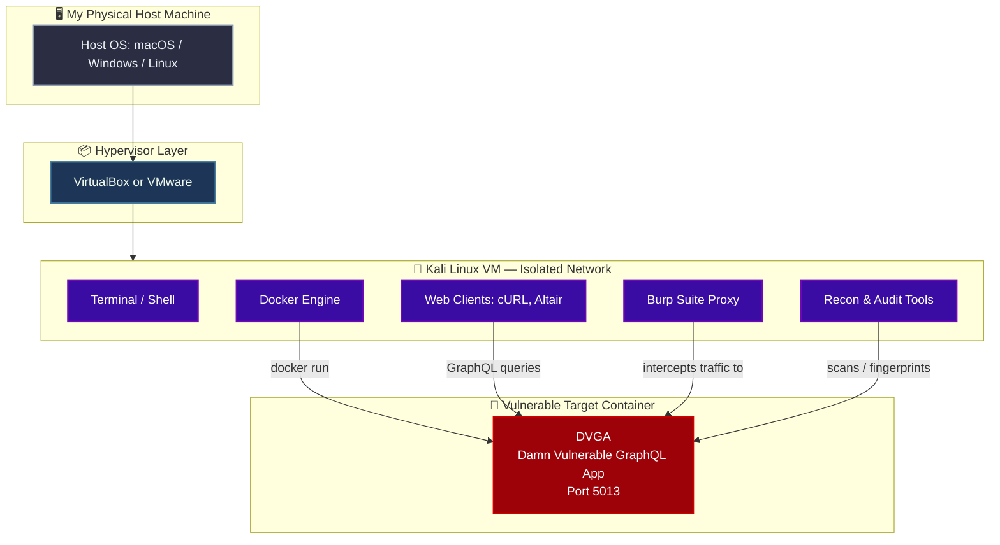
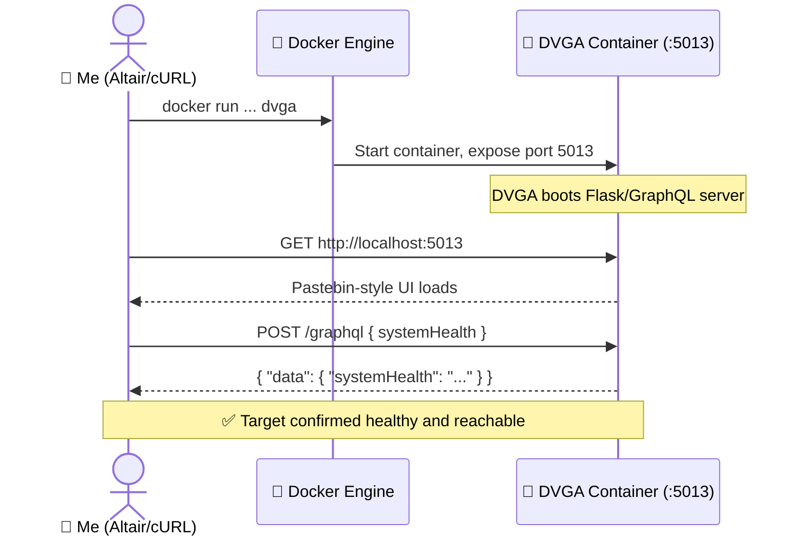
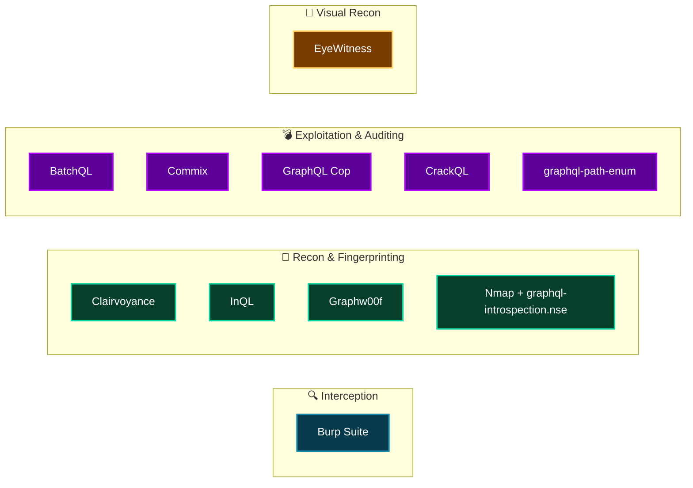

# Setting Up My Own GraphQL Security Lab (From Zero to Hacking-Ready)

I've spent a fair bit of time testing REST APIs, but the first time I sat down to seriously test a GraphQL API, I realized my usual toolkit wasn't going to cut it. GraphQL doesn't play by REST's rules — there's a single endpoint, a flexible query language, introspection, batching, and a completely different error-handling model. None of my muscle memory from years of REST testing transferred cleanly.

So before I went anywhere near a real GraphQL target, I decided to build myself a proper lab: an isolated environment with the right offensive tools, plus an intentionally vulnerable GraphQL server I could break (safely, repeatedly, and without getting anyone upset with me). This post walks through exactly how I built that lab, why I made the choices I made, and what I'd tell a friend who wanted to do the same thing.

If you're planning to learn offensive GraphQL testing — whether for a certification, a pentest engagement, or just curiosity — this is the groundwork I think everyone should lay first.

---

## Why I Didn't Just Wing It

When I run into a technology I don't know well during an engagement, my first instinct is to Google known vulnerabilities and public exploits. That works great for mature, well-documented technologies — think Apache, WordPress, or old-school SOAP services — because the security community has spent *years* poking at them. Every edge case has probably already been written up somewhere.

GraphQL is younger. The knowledge base is thinner, the tooling is less standardized, and if you've never used GraphQL-specific tools before, you'll burn precious engagement time just figuring out how to retool. I didn't want to be learning Altair's UI or fumbling with Docker flags *during* a live test. I wanted all of that friction removed ahead of time.

That's the whole point of a dedicated lab: it lets me fail safely, over and over, until the tools and the attack patterns become second nature. By the time I run into GraphQL "in the wild," I want muscle memory, not a Stack Overflow tab open in the background.

---

## The Lab, At a Glance

Before I get into the weeds, here's the mental model I was building toward. My host machine stays clean — everything risky lives inside an isolated virtual machine, and the actual vulnerable application lives inside a container *within* that VM. Three layers of separation between "my real computer" and "the deliberately broken software."



Everything in purple is where I spend most of my time. Everything in red is the thing I'm trying to break. The host (dark gray) never touches the vulnerable code directly — and that separation is the single most important decision in this whole setup.

> **Note:** I'm deliberately not naming a specific physical computer requirement here. Any modern laptop with 8GB+ RAM and a few dozen gigabytes of free disk space will handle this lab comfortably. The VM is the bottleneck, not your host.

---

## Ground Rules I Set for Myself

Before installing a single package, I wrote down a short list of rules I follow every time I spin up a hacking lab, GraphQL or otherwise. I'm sharing them because I've seen people skip this step and regret it.

| Rule | Why It Matters |
|---|---|
| Never expose the lab to the public internet | Vulnerable apps and outdated software are magnets for opportunistic bots and automated scanners. |
| Only run the lab on networks I trust | Anyone sharing my Wi-Fi could reach and attack the same vulnerable app I'm hosting. |
| Use a hypervisor (VirtualBox/VMware) | Keeps the vulnerable stack fully isolated from my daily-driver OS. |
| Take VM snapshots regularly | Lets me roll back instantly if I break something experimenting — which I will. |

> **Caution:** Don't treat these as optional "best practices to consider." An intentionally vulnerable GraphQL server is, by design, easy to compromise. If it's reachable from the internet, it *will* get found and abused — it's not a matter of if, just when.

---

## Step 1 — Standing Up Kali Linux

I chose Kali Linux as the base OS for this lab because it's Debian-based, maintained by Offensive Security, and ships with a huge chunk of the dependencies and libraries I'd otherwise have to install by hand.

I grabbed a prebuilt Kali image for VirtualBox from Kali's official download page and imported it following their standard installation guide. After my first boot, I was greeted with the default login screen — Kali ships with a default account (`kali` / `kali`) that I immediately used to get in and start updating.

```bash
# Update package lists and upgrade everything
sudo apt update -y
sudo apt upgrade -y
sudo apt dist-upgrade -y
```

> **Note:** `sudo` will prompt for your password — that's the same `kali` password you used to log in, assuming you haven't changed it yet (and you probably should, eventually).

I keep a terminal window open through this entire process, because practically every tool I install from here on out gets installed via command line.

---

## Step 2 — Getting My Web Clients Ready

GraphQL APIs are still just HTTP under the hood, so I need HTTP clients to talk to them. I installed two: one for the command line, one with a GUI.

### cURL — My Command-Line Workhorse

I lean on cURL constantly, not just for GraphQL. Being comfortable at the command line matters a lot in this line of work — it lets me automate repetitive tasks and keeps me productive even when I don't have a graphical environment available (which happens more often than you'd think on an engagement).

```bash
# Install curl
sudo apt install -y curl

# Sanity check: does it work at all?
curl lab.blackhatgraphql.com
```

If that last command returns a friendly greeting, cURL is successfully sending requests and getting responses back. Simple, but it confirms my networking stack is behaving.

### Altair — A GUI When I Want One

As useful as GraphiQL Explorer is, it's usually bundled *with* a target application — meaning I won't have it available when I'm attacking somebody else's server. Altair solves that: it's a standalone GraphQL client (desktop app or browser extension) that connects to *any* GraphQL endpoint I point it at, giving me the same kind of auto-completion and schema browsing GraphiQL offers.

I downloaded the Linux AppImage build straight to my desktop inside the VM:

```bash
cd ~/Desktop
ls -l altair*
# -rwxr--r-- 1 kali kali 88819862 altair_x86_64_linux.AppImage

chmod u+x altair_x86_64_linux.AppImage
./altair_x86_64_linux.AppImage
```

Once it launched, I pointed it at a public test endpoint to confirm it worked end-to-end, entering a simple query:

```graphql
query {
  users {
    username
  }
}
```

Hitting "Send Request" gave me a populated response, which told me Altair was correctly resolving and querying the endpoint. From here on, Altair becomes my default GUI client any time I want schema autocomplete, query history, or custom headers (which matters a lot once I start testing authenticated GraphQL APIs).

---

## Step 3 — Deploying a Target I'm Allowed to Break

A lab with only clients and no target is pretty useless. I needed something deliberately broken to practice against — something that simulates real-world GraphQL misconfigurations without putting anyone's actual data or infrastructure at risk.

### Why Docker

I used Docker to deploy my target application because it packages the app and all its dependencies into a single, reproducible container. That means I don't have to fight dependency conflicts on my VM, and if I trash the container experimenting, I can just tear it down and redeploy in seconds.

```bash
# Install Docker
sudo apt install -y docker.io

# Make sure Docker starts automatically on reboot
sudo systemctl enable docker --now

# Confirm it installed correctly
sudo docker
```

### Deploying DVGA (Damn Vulnerable GraphQL Application)

For the actual target, I went with **DVGA** — the Damn Vulnerable GraphQL Application. It's purpose-built to simulate real design- and configuration-level GraphQL vulnerabilities: denial of service, information disclosure, code execution, authentication bypass, SQL injection, broken authorization, and more. It's become something close to a standard practice target in the GraphQL security space, with built-in "beginner" and "expert" modes and a self-repair mechanism if I manage to break it too badly.

> **Note:** "Damn vulnerable" is a naming convention you'll see across the security community (Damn Vulnerable Web App, Damn Vulnerable iOS App, etc.) — it signals the app is *intentionally* broken for training purposes, not a real product with accidental flaws.

Here's how I got it running:

```bash
# Make sure git is available
sudo apt install git -y

# Clone the DVGA repository
cd ~
git clone -b blackhatgraphql https://github.com/dolevf/Damn-Vulnerable-GraphQL-Application.git
cd Damn-Vulnerable-GraphQL-Application

# Build the Docker image
sudo docker build -t dvga .

# Run the container
sudo docker run -t --rm -d --name dvga -p 5013:5013 -e WEB_HOST=0.0.0.0 dvga

# Confirm it's running
sudo docker container ps
```

A healthy `docker container ps` output shows the container `Up`, with port `5013` mapped from the container to my host. From there, opening `http://localhost:5013` in a browser loads the DVGA front end — which, interestingly, is styled a lot like Pastebin: a simple app for submitting and sharing text "pastes," complete with titles, content, author metadata, and even fake IP/user-agent info attached to each paste. That familiar, low-stakes UI is exactly why it works so well as a teaching tool — it's instantly understandable, which leaves all my attention free for the GraphQL internals underneath it.



---

## Step 4 — Confirming the Target Actually Works

Before trusting any lab, I always run one sanity-check query. I opened Altair, pointed it at `http://localhost:5013/graphql`, and ran:

```graphql
query {
  systemHealth
}
```

> **Caution:** GraphQL field names are case-sensitive. `systemHealth` is not the same as `SystemHealth` or `systemhealth` — a typo here just returns an error that has nothing to do with your lab being broken. I've chased my own tail on this more than once.

A successful response confirmed my whole stack — Kali, Docker, DVGA, and Altair — was wired together correctly. At that point, I had a working environment to actually start learning on.

---

## Step 5 — Loading Up My Hacking Toolkit

With a target running, the next job was arming myself with tools built specifically (or adapted) for GraphQL security testing. I grouped these mentally into four buckets: traffic interception, reconnaissance/fingerprinting, exploitation/scanning, and reporting/visual recon.



Here's the breakdown, with install commands and what each tool actually does for me.

### Burp Suite — Watching Every Request

Burp Suite sits between my browser and the target, letting me intercept, inspect, and replay every request before it leaves my machine. For GraphQL testing specifically, this means I can see the raw query/mutation payload before it's sent — and tamper with it.

```bash
sudo apt install burpsuite -y
```

To test it, I opened Burp, created a **Temporary Project** with **Burp Defaults**, clicked **Proxy ▸ Intercept ▸ Open Browser**, and navigated to `http://localhost:5013/graphiql`. Burp's Intercept tab lit up (usually orange) showing the in-flight request — proof the proxy was working. Clicking **Intercept Is On** released the request to DVGA.

> **Note:** Burp's built-in embedded browser doesn't require any extra certificate setup — it's ready to intercept out of the box, which saves a step compared to configuring Burp as a proxy for Firefox or Chrome manually.

### Clairvoyance — Mapping Schemas Without Introspection

Production GraphQL APIs often *disable* introspection on purpose, because exposing the full schema makes a hacker's job considerably easier. Clairvoyance gets around that by abusing GraphQL's **field suggestion** feature — essentially brute-forcing the schema using a wordlist and watching how the server reacts to near-miss field names.

```bash
cd ~
git clone https://github.com/nikitastupin/clairvoyance.git
cd clairvoyance
python3 -m clairvoyance -h
```

### InQL — Schema Analysis, the Easy Way

Built by Doyensec, InQL leans on introspection (when it's available) and exports the discovered schema into formats that are much easier to read than raw JSON. It also flags potential denial-of-service risk areas in a schema.

```bash
cd ~
git clone https://github.com/doyensec/inql.git
cd inql
sudo python3 setup.py install
inql -h
```

> **Note:** InQL also ships as a Burp Suite extension ("Introspection GraphQL Scanner") via the BApp Store, if you'd rather work inside Burp than the CLI.

### Graphw00f — Fingerprinting the Backend Implementation

GraphQL servers don't typically announce which implementation (graphql-php, Graphene, Ariadne, etc.) they're running. Graphw00f figures that out anyway, by sending a mix of valid and malformed queries and comparing the subtle differences in error responses. Knowing the backend engine matters because different implementations ship with very different default security postures.

```bash
cd ~
git clone https://github.com/dolevf/graphw00f.git
cd graphw00f
python3 main.py --help
```

### BatchQL — Hunting DoS, CSRF, and Info Disclosure

Named after GraphQL's batching feature (sending multiple operations in a single HTTP request), BatchQL audits for flaws tied to denial of service, cross-site request forgery, and information disclosure.

```bash
cd ~
git clone https://github.com/assetnote/batchql.git
cd batchql
python3 batch.py -h
```

### Nmap + the GraphQL Introspection NSE Script

Nmap barely needs an introduction — it's been the standard for port scanning since 1997. I extended it with a custom Lua script that identifies GraphQL endpoints and attempts an introspection query against them automatically during a scan.

```bash
sudo apt install nmap -y

cd ~
git clone https://github.com/dolevf/nmap-graphql-introspection-nse.git
cd nmap-graphql-introspection-nse
sudo cp graphql-introspection.nse /usr/share/nmap/scripts

nmap --script-help graphql-introspection.nse
```

### Commix — Automated Command Injection

Commix fuzzes HTTP requests (query parameters, bodies, headers) looking for command injection flaws, and can go a step further by spawning an interactive shell on a vulnerable target.

```bash
sudo apt install commix -y
commix -h
```

### graphql-path-enum — Mapping Authorization Paths

Written in Rust, this tool enumerates the different query paths that can reach a specific piece of data — incredibly useful for spotting broken authorization, where a field is protected on one path but reachable via another.

```bash
cd ~
wget "https://gitlab.com/dee-see/graphql-path-enum/-/jobs/artifacts/v1.1/raw/target/release/graphql-path-enum?job=build-linux" -O graphql-path-enum
chmod u+x graphql-path-enum
./graphql-path-enum -h
```

### EyeWitness — Visual Recon at Scale

When I'm scanning dozens (or hundreds) of hosts, I don't want to manually open every single one in a browser. EyeWitness uses a headless browser to capture screenshots automatically, so I can eyeball what's running across a whole target list at once.

```bash
sudo apt install eyewitness -y
eyewitness -h
```

### GraphQL Cop — Fast Vulnerability Auditing

A purpose-built auditing tool that checks a GraphQL server against a set of known common attacks (information disclosure, DoS patterns) and reports back quickly — great as an early triage step before diving deeper manually.

```bash
sudo apt install python3-pip -y
cd ~
git clone https://github.com/dolevf/graphql-cop.git
cd graphql-cop
pip3 install -r requirements.txt
python3 graphql-cop.py -h
```

### CrackQL — Brute-Forcing, GraphQL-Style

CrackQL uses GraphQL's own language features to optimize brute-force attacks against actions that require authentication — think login mutations, OTP verification, or password reset flows.

```bash
git clone https://github.com/nicholasaleks/CrackQL.git
cd CrackQL
pip3 install -r requirements.txt
python3 CrackQL.py -h
```

---

## My Full Toolkit, At a Glance

Once everything was installed, here's the reference table I keep pinned for myself:

| Tool | Language | Primary Use Case | Install Method |
|---|---|---|---|
| cURL | C | Command-line HTTP/GraphQL requests | `apt install curl` |
| Altair | Electron (JS) | GUI GraphQL client, schema browsing | AppImage download |
| Burp Suite | Java | Intercepting proxy, manual testing | `apt install burpsuite` |
| Clairvoyance | Python | Schema recon without introspection | `git clone` |
| InQL | Python | Schema export/analysis via introspection | `git clone` + `setup.py` |
| Graphw00f | Python | Backend implementation fingerprinting | `git clone` |
| BatchQL | Python | DoS / CSRF / info disclosure auditing | `git clone` |
| Nmap + NSE script | C / Lua | Network + GraphQL endpoint discovery | `apt install nmap` + script |
| Commix | Python | Command injection fuzzing & exploitation | `apt install commix` |
| graphql-path-enum | Rust | Authorization path enumeration | prebuilt binary |
| EyeWitness | Python | Automated screenshotting at scale | `apt install eyewitness` |
| GraphQL Cop | Python | Quick common-vulnerability audit | `git clone` + `pip install` |
| CrackQL | Python | GraphQL-aware brute forcing | `git clone` + `pip install` |

---

## Locking It In: Snapshots

The very last thing I did once everything installed cleanly was take a VirtualBox snapshot of the whole VM. Think of it as a save point in a video game — if I break something badly during an exercise later (which, again, I will), I can roll straight back to this known-good state instead of reinstalling everything from scratch.

> **Note:** I take a fresh snapshot after any *major* milestone — right after initial tool setup, and again after finishing each new topic I study. Cheap insurance against wasted afternoons.

---

## What My Lab Gives Me Going Forward

By the end of this setup, I had:

- A fully isolated Kali VM, separated from my host OS and off the public internet
- Two working HTTP/GraphQL clients (cURL and Altair) for querying targets
- A Dockerized, intentionally vulnerable target (DVGA) simulating real-world GraphQL flaws
- A complete offensive toolkit spanning interception, recon, fingerprinting, exploitation, and visual scanning
- A snapshot I can always roll back to

None of this makes me a GraphQL hacking expert on its own — that part comes from actually using these tools against DVGA, breaking things, reading error messages, and iterating. But this lab removes every bit of setup friction between me and that learning. The next time I show up to an engagement and the target happens to be GraphQL-backed, I'm not fumbling with installation steps — I'm already warmed up.

If you're setting up something similar, my biggest piece of advice is this: don't rush the isolation step. It's tempting to skip VirtualBox and just run Docker locally on your main machine "just this once." Don't. The entire point of DVGA is that it's broken on purpose, and broken-on-purpose software has a way of becoming a real liability the moment it's reachable by something you didn't intend.
