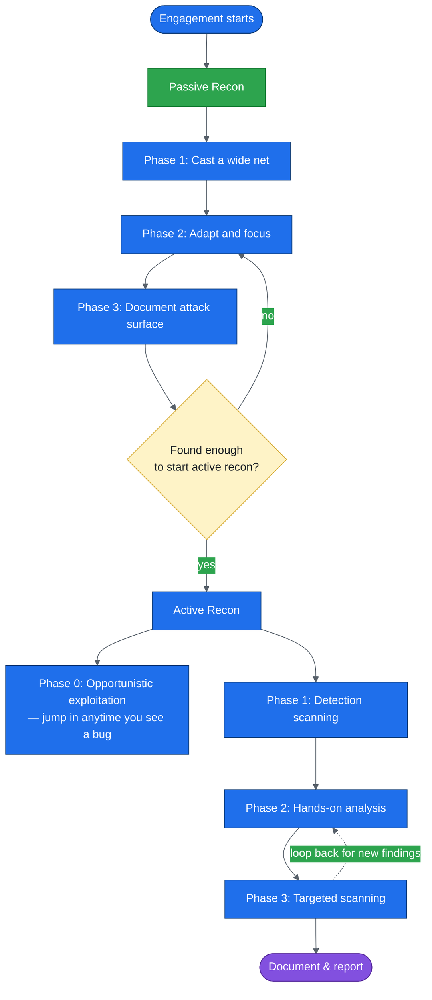
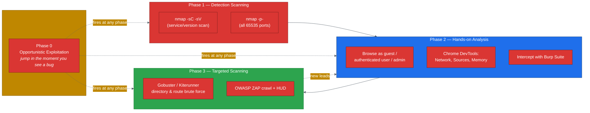

# API Discovery: How I Find APIs Before I Ever Attack Them

*A deep dive into passive and active reconnaissance for API penetration testing, with tested Python helper scripts you can actually run.*

> **Scope note:** everything below is written for authorized security testing — bug bounty programs you're enrolled in, pentest engagements you're contracted for, or lab targets like crAPI that you've deployed yourself. Running active recon (port scans, brute-forcing, DevTools probing) against systems you don't own or have written permission to test is illegal in most jurisdictions. I'll say this once here and then get out of your way.

## Why I start every API engagement with discovery, not attacking

I've lost count of how many times I've heard "just throw a scanner at it" from someone new to API testing. It doesn't work. APIs don't look like websites — there's no link structure to crawl, no obvious login form screaming "attack me here," and a huge amount of the attack surface is simply *invisible* until you go looking for it. A `/v2/` endpoint that was supposed to be internal-only, a staging subdomain someone forgot to take down, a Swagger file sitting in a public S3 bucket — none of that shows up by pointing Burp's scanner at the homepage.

So before I touch a single injection payload, I spend real time just *finding* the API. In my experience, this phase decides the outcome of the whole engagement more than any individual exploit does. You can't attack what you can't see, and the parts of an API that nobody remembers to defend are usually the parts nobody remembers exist.

This post walks through my discovery methodology in two halves — passive reconnaissance (looking without touching) and active reconnaissance (touching, carefully) — and I've written and tested small Python tools along the way so you can follow along instead of just reading theory. I ran every script in this post against a disposable local target before publishing, and I'll show you the output.

---

## The mental model: passive first, then active

Here's the shape of the whole process. I keep this diagram taped to the inside of my skull:



Notice the loop in active recon. This process is **not linear**. I constantly bounce between hands-on analysis and targeted scanning — a finding in one feeds the other, and Phase 0 (opportunistic exploitation) can fire at literally any moment. If I stumble onto an obvious vuln three minutes into a scan, I don't finish the scan out of some misplaced sense of procedure. I chase the bug, then come back.

---

## Part 1: Passive Reconnaissance

Passive recon means gathering information about a target **without directly touching its systems**. The target never sees you coming — you're only consuming data that's already public. This matters for two reasons: it keeps you quiet during the early stages of an engagement, and it's often shockingly productive. I've found working, unauthenticated API keys sitting in public GitHub commits before I'd sent a single packet to the target's infrastructure.

### What I'm hunting for

| Target | Why it matters |
|---|---|
| API endpoints | Become your active-recon targets later |
| Credentials (keys, tokens, passwords) | Let you test as an authenticated user, or skip straight to an instant win |
| Version information | Flags outdated software and known CVEs |
| API documentation | Tells you exactly how the API is meant to work, which tells you how to break it |
| Business purpose | Points you toward business-logic flaws specific to that industry |

> **Caution — stop and report immediately:** If passive recon turns up live API keys, JWTs, full PII (SSNs, card numbers, full names + emails), treat that as a critical finding right then. Don't keep digging for "more cool stuff" before you've documented and reported it. Scope creep on a live secret is how good-faith research turns into a legal problem.

### The three-phase passive process

**Phase One — cast a wide net.** Start broad. General search engines, Shodan, and historically ProgrammableWeb (more on that below) to understand the target's general API footprint and business context. Pair that with DNS mapping tools like DNS Dumpster or OWASP Amass to map the hosts tied to the target's domain.

**Phase Two — adapt and focus.** Take what Phase One gave you and narrow it. If you learned the target uses a particular framework or naming convention, bake that into your next round of searches. Check GitHub for the organization's repos. Run a tool like Pastehunter against paste sites.

**Phase Three — document the attack surface.** This is the unglamorous part everyone skips and regrets skipping. Screenshot everything. Keep a running task list. When you're elbow-deep in active recon three days later wondering "didn't I see something about a `/legacy/` subdomain?" — that list is what saves you.

### Google dorking for APIs

Google dorking (or "Google hacking") is the practice of using advanced search operators to surface things a normal search wouldn't. For APIs, a few operators do most of the work:

| Operator | Purpose |
|---|---|
| `intitle:` | Searches page titles |
| `inurl:` | Searches for words in the URL |
| `filetype:` | Searches for a specific file extension |
| `site:` | Limits results to one site |

A bare `inurl:/api/` returns millions of results — useless. Scope it to a target (`site:example.com inurl:/api/` or `intitle:"example api key"`) and the signal-to-noise ratio improves fast. Offensive Security's Google Hacking Database (GHDB) maintains a library of pre-built dorks for exactly this kind of hunting, including queries that surface exposed `api.txt` files and leaked keys.

Rather than writing these dorks by hand every engagement, I wrote a tiny generator. It doesn't query Google or Shodan for you — I'm not going to automate scraping a search engine's results page, and you shouldn't either, since that tends to violate the engine's terms of service. It just builds the query strings so you can paste them in yourself.

```python
#!/usr/bin/env python3
"""dork_builder.py - turn a target domain into a checklist of API-focused
Google dorks and Shodan queries. It only builds strings; it never sends
anything to a search engine, so it is safe to run anywhere.

Usage:
    python3 dork_builder.py example.com
    python3 dork_builder.py example.com --engine google
"""
import argparse
import re
import sys

DOMAIN_RE = re.compile(r"^(?=.{1,253}$)([a-z0-9-]{1,63}\.)+[a-z]{2,63}$", re.I)

GOOGLE_TEMPLATES = [
    ('site:{d} inurl:/api/', "API paths indexed on the target"),
    ('site:{d} inurl:"/v1/" OR inurl:"/v2/"', "versioned API paths"),
    ('site:{d} inurl:swagger OR inurl:openapi OR inurl:api-docs', "public API documentation"),
    ('site:{d} filetype:json', "JSON files, sometimes API specs or configs"),
    ('site:{d} intitle:"api documentation" OR intitle:"developer portal"', "developer portals"),
    ('intitle:"{o} api key"', "pages that mention keys for the organization"),
    ('site:{d} intitle:"index of" "api"', "open directory listings that mention api"),
    ('site:{d} ext:env OR ext:yml OR ext:json intext:"api_key"', "config files with key names"),
]

SHODAN_TEMPLATES = [
    ('hostname:"{d}"', "baseline: everything Shodan knows for the domain"),
    ('hostname:"{d}" "content-type: application/json"', "hosts that answered with JSON"),
    ('hostname:"{d}" "content-type: application/xml"', "hosts that answered with XML"),
    ('hostname:"{d}" "200 OK"', "requests that succeeded when Shodan scanned"),
    ('hostname:"{d}" "wp-json"', "WordPress REST API"),
]


def build(domain: str, engine: str = "all"):
    domain = domain.strip().lower()
    if not DOMAIN_RE.match(domain):
        raise ValueError(f"'{domain}' does not look like a domain name")
    org = domain.split(".")[-2]
    rows = []
    if engine in ("all", "google"):
        rows += [("google", t.format(d=domain, o=org), why) for t, why in GOOGLE_TEMPLATES]
    if engine in ("all", "shodan"):
        rows += [("shodan", t.format(d=domain, o=org), why) for t, why in SHODAN_TEMPLATES]
    return rows


def main(argv=None):
    ap = argparse.ArgumentParser(description=__doc__, formatter_class=argparse.RawDescriptionHelpFormatter)
    ap.add_argument("domain")
    ap.add_argument("--engine", choices=["all", "google", "shodan"], default="all")
    args = ap.parse_args(argv)
    try:
        rows = build(args.domain, args.engine)
    except ValueError as exc:
        print(f"error: {exc}", file=sys.stderr)
        return 2
    for engine, query, why in rows:
        print(f"[{engine:6}] {query}\n         -> {why}")
    return 0


if __name__ == "__main__":
    sys.exit(main())
```

I tested it against a throwaway domain to confirm the output, and against a garbage string to confirm it fails cleanly instead of building a broken query:

```text
$ python3 dork_builder.py example.com --engine shodan
[shodan] hostname:"example.com"
         -> baseline: everything Shodan knows for the domain
[shodan] hostname:"example.com" "content-type: application/json"
         -> hosts that answered with JSON
[shodan] hostname:"example.com" "content-type: application/xml"
         -> hosts that answered with XML
[shodan] hostname:"example.com" "200 OK"
         -> requests that succeeded when Shodan scanned
[shodan] hostname:"example.com" "wp-json"
         -> WordPress REST API

$ python3 dork_builder.py "not a domain"
error: 'not a domain' does not look like a domain name
(exit code 2)
```

> **Note:** I keep the Shodan and Google templates separate on purpose. Shodan's query syntax looks similar to Google's but isn't the same grammar, and copy-pasting a Google dork straight into Shodan (or vice versa) is a classic way to get zero results and assume the target has no exposure, when really you just asked the wrong engine the wrong way.

### A word on API directories — and why I no longer open ProgrammableWeb

If you've read older API hacking material, you'll see ProgrammableWeb mentioned constantly as *the* API directory — a searchable catalog of tens of thousands of public APIs, complete with endpoint info, changelogs, and SDK links. I want to be upfront about something: **ProgrammableWeb shut down in 2022–2023** after seventeen years of operation, and the domain now redirects to a MuleSoft notice saying so. If you go looking for it today expecting a living directory, you'll find a tombstone instead.

That doesn't make the underlying technique obsolete — "find a catalog of known APIs for this industry and see if your target is listed" is still a good instinct — it just means the specific tool changed. These days I lean on alternatives like RapidAPI's directory and APIs.guru for public API catalogs, plus plain search-engine and GitHub reconnaissance for anything that isn't in a formal directory (which, honestly, is most of what I actually test). I mention this mainly because I still see newer guides pointing readers at a dead link, and nothing wastes an evening faster than that.

### Shodan: finding APIs by their fingerprint, not their name

Shodan continuously scans the public IPv4 space and indexes what it finds — open ports, banners, response headers. Because APIs reliably respond with `Content-Type: application/json` or `application/xml`, you can find them even when there's no naming convention to search for. A basic pattern:

```text
hostname:"targetname.com" "content-type: application/json"
```

This is especially useful against targets with no public developer docs, where you're working from almost nothing but a company name and a hunch that they run *something* API-shaped.

### OWASP Amass: mapping subdomains at scale

Amass pulls OSINT from dozens of sources — certificate transparency logs, search engines, the Wayback Machine, and more — to map a target's subdomains. A passive scan looks like this:

```bash
amass enum -passive -d twitter.com
```

A quick note on syntax drift: older write-ups (including the book this post is partly inspired by) show single-dash flags like `-passive`. Current Amass releases accept both `-passive` and `--passive` — check `amass enum -h` against whatever version you've actually got installed, since tool flags are exactly the kind of detail that goes stale between a book's print run and your terminal.

Run it against a big target and you'll get back dozens or hundreds of subdomains. The interesting ones for API hunting are the ones with API-shaped names — and *especially* the ones with words like `legacy`, `dev`, `backup`, or `staging` in them, because those usually correlate with the OWASP API Security Top 10 category of **improper asset management**: old or forgotten API versions still running in production, minus the attention newer versions get.

I don't want to manually eyeball a few hundred lines of Amass output looking for those patterns, so I wrote a filter for it:

```python
#!/usr/bin/env python3
"""amass_filter.py - read subdomains (one per line, e.g. the output of
`amass enum -passive -d target.com`) and keep the ones that look like APIs.
Hostnames containing words such as legacy, dev, or backup are flagged
because they often point at improper asset management.

Usage:
    amass enum -passive -d target.com | python3 amass_filter.py
    python3 amass_filter.py subdomains.txt
"""
import sys
import fileinput

API_WORDS = ("api", "rest", "graphql", "gateway", "gw", "svc", "service", "ws")
RISKY_WORDS = ("legacy", "old", "dev", "test", "staging", "stage", "uat",
               "backup", "beta", "sandbox", "internal", "v1", "v2", "v3")


def labels(host: str):
    """Split a hostname into lowercase tokens: api1-backup.x.com -> api1, backup, x, com"""
    out = []
    for label in host.lower().split("."):
        out.extend(part for part in label.replace("_", "-").split("-") if part)
    return out


def classify(host: str):
    host = host.strip().lower().rstrip(".")
    if not host or " " in host:
        return None
    toks = labels(host)
    # api matches api, api1, api2 ... but not "rapid" or "capital"
    is_api = any(t.rstrip("0123456789") in API_WORDS for t in toks)
    if not is_api:
        return None
    risky = sorted({w for w in RISKY_WORDS if w in toks})
    return host, risky


def main(paths):
    seen = set()
    hits = []
    for line in fileinput.input(files=paths or ["-"]):
        res = classify(line)
        if res and res[0] not in seen:
            seen.add(res[0])
            hits.append(res)
    hits.sort(key=lambda r: (not r[1], r[0]))   # risky ones first
    for host, risky in hits:
        flag = f"  <-- check: {', '.join(risky)}" if risky else ""
        print(f"{host}{flag}")
    print(f"\n{len(hits)} API-looking hosts, {sum(1 for h in hits if h[1])} flagged", file=sys.stderr)


if __name__ == "__main__":
    main(sys.argv[1:])
```

I ran this against a sample list of subdomains styled after the ones that genuinely turn up in Amass scans of large targets:

```text
$ python3 amass_filter.py samples/subs.txt
api1-backup.twitter.com  <-- check: backup
dev-gateway.twitter.com  <-- check: dev
legacy-api.twitter.com  <-- check: legacy
cdn.api.twitter.com

4 API-looking hosts, 3 flagged
```

It correctly pulled out the four hostnames with hyphen-or-dot-separated `api`/`gateway` tokens, flagged the three that also carry a risky word, dropped `www.twitter.com` and `mail.twitter.com` as noise, and silently deduplicated a case-variant entry (`LEGACY-API.twitter.com`) rather than listing it twice.

> **Caution — this heuristic has a real blind spot.** I deliberately split hostnames on hyphens and dots before matching, so `legacy-api` matches but a compound word like `apistatus` or `tdapi` (both of which genuinely showed up as real Twitter API subdomains in published research) will **not** match, because they contain "api" as a substring rather than as a separate token. I chose token-matching on purpose — matching "api" as a raw substring also lights up false positives like `rapid` and `capital` — but it means this script is a first-pass filter, not a replacement for reading the full Amass output yourself. Tune the word lists to your target's naming style before you trust it completely.

### GitHub: the passive-recon goldmine nobody checks thoroughly enough

Whether or not your target does its own open-source development, check GitHub. Search for the org name alongside words like `api-key`, `password`, or `token`. Then actually work through the repo:

- **Code tab** — current source, and historical commits via the History button. A `git diff`-style Split view shows you exactly what line a secret was added or removed on.
- **Issues tab** — open issues sometimes describe an exposed key's exact location, in plain English, written by the developer who found it.
- **Pull Requests tab** — a PR that *proposes* removing a leaked key means the key is still live in the unmerged branch, sitting there until someone clicks merge.

This is slow, manual work, and I don't think that's a flaw — it's the point. Secrets hide in context (a comment, a commit message, a half-finished PR description) that no regex-based scanner reliably captures. Automated secret scanners are a good first pass; a human skimming the Issues tab still catches things they miss.

---

## Part 2: Active Reconnaissance

Passive recon gets you secondhand information. At some point you have to go verify it directly — port scan, send real HTTP requests, open the app in a browser and actually click around. That's active recon, and it's where you start leaving footprints on the target's systems.



### Phase One: detection scanning with Nmap

I always run two Nmap scans back to back against an authorized target:

```bash
# General detection: default scripts + service/version enumeration
nmap -sC -sV 192.168.50.35 -oA crapi_scan

# All-port sweep: every one of the 65,535 TCP ports
nmap -p- 192.168.50.35 -oA crapi_allports
```

The `-oA` flag writes results in Nmap, XML, and grep-able formats simultaneously — I always want the XML output on hand because it's structured and I can parse it programmatically rather than eyeballing terminal text. Kick off the all-port scan as soon as the general scan starts returning results; it runs in the background while you move into Phase Two.

Here's a scan result shaped like the kind of output you get against a multi-service lab target — note that the all-port scan found services on ports the general scan's default range would have missed entirely:

```text
PORT      STATE SERVICE       VERSION
1025/tcp  open  smtp          Postfix smtpd
5432/tcp  open  postgresql    PostgreSQL DB 9.6+
8000/tcp  open  http-alt      WSGIServer/0.2 CPython/3.8.7
8025/tcp  open  http
8080/tcp  open  http-proxy
8888/tcp  open  sun-answerbook  (OpenResty web app server)
27017/tcp open  mongodb
```

Rather than squinting at that table and manually typing URLs into a browser, I built a small helper that parses Nmap's XML output and prints only the ports that look like HTTP services, as ready-to-paste URLs:

```python
#!/usr/bin/env python3
"""nmap_http_ports.py - read an Nmap XML file (-oX / -oA) and list every open
port that looks like a web service, as ready-to-open URLs. This is the
hand-off between phase one (detection scanning) and phase two (hands-on analysis).

Usage:
    nmap -sC -sV -oA crapi_scan 192.168.50.35
    python3 nmap_http_ports.py crapi_scan.xml
"""
import sys
import xml.etree.ElementTree as ET

WEBISH = ("http", "https", "http-alt", "http-proxy", "ssl/http", "https-alt", "sun-answerbook")


def web_urls(xml_path):
    root = ET.parse(xml_path).getroot()
    urls = []
    for host in root.iter("host"):
        addr = host.find("address")
        if addr is None:
            continue
        ip = addr.get("addr")
        for port in host.iter("port"):
            state = port.find("state")
            if state is None or state.get("state") != "open":
                continue
            svc = port.find("service")
            name = (svc.get("name") if svc is not None else "") or ""
            tunnel = (svc.get("tunnel") if svc is not None else "") or ""
            product = (svc.get("product") if svc is not None else "") or ""
            # decide by service name, or by product banner when nmap guessed oddly
            looks_web = name in WEBISH or "http" in name or "WSGI" in product or "OpenResty" in product
            if not looks_web:
                continue
            scheme = "https" if tunnel == "ssl" or name == "https" else "http"
            urls.append((f"{scheme}://{ip}:{port.get('portid')}", name, product))
    return urls


if __name__ == "__main__":
    if len(sys.argv) != 2:
        sys.exit(__doc__)
    for url, name, product in web_urls(sys.argv[1]):
        print(f"{url:32} {name:12} {product}")
```

I tested it against a sample XML file with nine ports — a mix of open and closed states, and a deliberately odd service (`sun-answerbook`, which is what Nmap sometimes calls an unrecognized OpenResty banner) to confirm the product-name fallback works:

```text
$ python3 nmap_http_ports.py samples/scan.xml
http://192.168.50.35:8000        http-alt     WSGIServer
http://192.168.50.35:8025        http
http://192.168.50.35:8080        http-proxy
https://192.168.50.35:8443       http
http://192.168.50.35:8888        sun-answerbook OpenResty web app server
```

It correctly skipped the closed port, skipped PostgreSQL and MongoDB (not web services), and still caught the oddly-named OpenResty port by matching on the product banner instead of the service name — that one would've been easy to miss in a quick manual read of the Nmap output.

### Phase Two: hands-on analysis

This is where I open a browser and actually *use* the application, deliberately thinking about it from three angles:

| Perspective | Questions I ask |
|---|---|
| **Guest** | Can I interact with the API unauthenticated? Is documentation public? |
| **Authenticated user** | What opens up after login? File uploads? New API calls? How does the app recognize I'm logged in — cookie, header, token? |
| **Administrator** | Where would admins log in? What's in page comments? What's clearly still under development? |

#### Robots.txt: the file that accidentally tells you what to hide from search engines also tells you what to attack

`/robots.txt` exists to stop search crawlers from indexing certain paths. Ironically, that makes it a list of paths the site owner cares enough about to hide — which is exactly the list an attacker wants.

```python
#!/usr/bin/env python3
"""robots_probe.py - fetch /robots.txt and list the Disallow paths. Paths that
contain API-ish words are flagged, because a site that hides /api/ from search
engines has just told you it exists.

Only run this against systems you are authorized to test.

Usage:
    python3 robots_probe.py http://192.168.50.35:8888
"""
import sys
import urllib.error
import urllib.request

API_HINTS = ("api", "v1", "v2", "v3", "graphql", "rest", "swagger", "openapi",
             "admin", "internal", "private", "token", "auth", "docs")


def parse_disallows(text: str):
    """Return Disallow (and Allow) paths. Comments and blank lines are ignored."""
    paths = []
    for raw in text.splitlines():
        line = raw.split("#", 1)[0].strip()
        if ":" not in line:
            continue
        field, value = line.split(":", 1)
        if field.strip().lower() in ("disallow", "allow") and value.strip():
            paths.append(value.strip())
    return paths


def flag(path: str):
    low = path.lower()
    return [h for h in API_HINTS if h in low]


def fetch(base: str, timeout: float = 5.0) -> str:
    url = base.rstrip("/") + "/robots.txt"
    req = urllib.request.Request(url, headers={"User-Agent": "robots-probe/1.0"})
    with urllib.request.urlopen(req, timeout=timeout) as resp:
        return resp.read().decode("utf-8", errors="replace")


def main(argv):
    if len(argv) != 2:
        print(__doc__)
        return 2
    try:
        body = fetch(argv[1])
    except urllib.error.HTTPError as exc:
        print(f"robots.txt returned HTTP {exc.code}")
        return 1
    except Exception as exc:
        print(f"could not fetch: {exc}")
        return 1
    for p in parse_disallows(body):
        hints = flag(p)
        print(f"{p:25} {'<-- ' + ','.join(hints) if hints else ''}")
    return 0


if __name__ == "__main__":
    sys.exit(main(sys.argv))
```

I ran this against a small local test server with a `robots.txt` styled after the one shown earlier:

```text
$ python3 robots_probe.py http://127.0.0.1:8899
/appliance/
/login/
/api/                     <-- api
/files/
```

Four disallowed paths, and the one containing an API-ish keyword gets flagged for priority follow-up.

#### Chrome DevTools: reading the JavaScript the browser already downloaded for you

The frontend JavaScript bundle a web app ships to your browser almost always contains the full list of API endpoints it talks to — because the JavaScript *is* the thing making those calls. Opening DevTools (F12), going to Network, refreshing, and then opening a script file in the Sources panel works, but doing this by hand on a 4,000-line minified bundle is tedious. So:

```python
#!/usr/bin/env python3
"""js_endpoint_hunter.py - scripted version of "search the JavaScript source
for api, apikey, secret, password" from the DevTools Sources panel.

It downloads a page (or reads a local .js file), finds the script files it
loads, and prints:
  * strings that look like API paths  (/api/..., /identity/api/..., /v1/...)
  * lines containing credential-ish keywords

Only run this against systems you are authorized to test.

Usage:
    python3 js_endpoint_hunter.py http://192.168.50.35:8888
    python3 js_endpoint_hunter.py ./main.chunk.js
"""
import os
import re
import sys
import urllib.parse
import urllib.request

# a quoted string that starts with / and contains an api-ish segment
PATH_RE = re.compile(r"""["'`](/(?:[\w.\-]+/)*?(?:api|v\d+|graphql|rest|swagger|openapi)(?:/[\w.\-{}:$]*)*)["'`]""", re.I)
SCRIPT_RE = re.compile(r"""<script[^>]+src=["']([^"']+)["']""", re.I)
SECRET_RE = re.compile(r"""(api[_-]?key|secret|passwd|password|token|bearer|authorization)""", re.I)


def get(url: str, timeout: float = 5.0) -> str:
    req = urllib.request.Request(url, headers={"User-Agent": "js-hunter/1.0"})
    with urllib.request.urlopen(req, timeout=timeout) as r:
        return r.read().decode("utf-8", errors="replace")


def find_paths(js: str):
    return sorted({m.group(1) for m in PATH_RE.finditer(js)})


def find_secret_lines(js: str, width: int = 100):
    """Return (line_no, snippet) for lines with credential-ish keywords.
    Minified files have few, very long lines, so show a window around the match."""
    hits = []
    for no, line in enumerate(js.splitlines(), 1):
        for m in SECRET_RE.finditer(line):
            start = max(0, m.start() - width // 2)
            hits.append((no, line[start:start + width].strip()))
            break
    return hits


def script_urls(page_url: str, html: str):
    return [urllib.parse.urljoin(page_url, s) for s in SCRIPT_RE.findall(html)]


def scan_text(label: str, js: str):
    print(f"== {label}")
    paths = find_paths(js)
    print(f"   {len(paths)} API-looking paths")
    for p in paths:
        print(f"   path   {p}")
    for no, snip in find_secret_lines(js):
        print(f"   kw@{no:<5} {snip}")


def main(argv):
    if len(argv) != 2:
        print(__doc__)
        return 2
    target = argv[1]
    if os.path.isfile(target):
        with open(target, encoding="utf-8", errors="replace") as fh:
            scan_text(target, fh.read())
        return 0
    html = get(target)
    scripts = script_urls(target, html)
    if not scripts:
        print("no external scripts found; scanning inline content")
        scan_text(target, html)
    for url in scripts:
        try:
            scan_text(url, get(url))
        except Exception as exc:
            print(f"== {url}\n   skipped: {exc}")
    return 0


if __name__ == "__main__":
    sys.exit(main(sys.argv))
```

I tested it two ways: directly against a local `.js` file, and against a live local page that references that same script via a `<script src="...">` tag, to make sure both code paths actually work:

```text
$ python3 js_endpoint_hunter.py samples/main.chunk.js
== samples/main.chunk.js
   5 API-looking paths
   path   /community/api/v2/community/posts/recent
   path   /identity/api/auth/login
   path   /identity/api/auth/signup
   path   /identity/api/v2/vehicle/vehicles
   path   /workshop/api/shop/products
   kw@2     return fetch("/identity/api/auth/login",{headers:{Authorization:"Bearer "+window.token}})}
   kw@3     var cfg={apiKey:"DEMO-NOT-A-REAL-KEY",secret:"placeholder"};

$ python3 js_endpoint_hunter.py http://127.0.0.1:8899
== http://127.0.0.1:8899/static/js/main.chunk.js
   5 API-looking paths
   path   /community/api/v2/community/posts/recent
   path   /identity/api/auth/login
   path   /identity/api/auth/signup
   path   /identity/api/v2/vehicle/vehicles
   path   /workshop/api/shop/products
   kw@2     return fetch("/identity/api/auth/login",{headers:{Authorization:"Bearer "+window.token}})}
   kw@3     var cfg={apiKey:"DEMO-NOT-A-REAL-KEY",secret:"placeholder"};
```

Both runs pulled out five distinct API paths across four different microservice prefixes (`identity`, `community`, `workshop`), and surfaced the two lines where credential-shaped keywords appear — in this sample, a placeholder `apiKey` value and a `secret` field, exactly the kind of thing worth a closer manual look in a real bundle.

> **Note:** this script matches path *shapes*, not meaning. In a real engagement you still need a human to read the matched lines and decide if `secret: "placeholder"` is genuinely sensitive or just a dummy value left in by a developer — which is exactly what it is in my test fixture. Treat this as a highlighter, not a verdict.

### Phase Three: targeted scanning, and proving a path is real

Once you've got candidate paths from JS parsing, robots.txt, or brute-forcing, you need to confirm they actually exist rather than just assuming. The book's approach — and mine — is to establish a **baseline**: request a path you know is garbage, see how the server responds to "not found," then compare every real candidate against that baseline. A path that responds differently (different status code, a `WWW-Authenticate` header, a different content type) is probably real, even if it returns a 401 or 403 you can't yet bypass.

```python
#!/usr/bin/env python3
"""baseline_probe.py - the "does this path really exist?" check from the Burp
Repeater section, automated.

1. Request a gibberish path and record how the server says "not found".
2. Request every candidate path and compare against that baseline.
3. A candidate that answers differently (other status, 401/403, JSON body,
   WWW-Authenticate header) is probably real.

Only run this against systems you are authorized to test. It sends one GET per
candidate with a delay between requests.

Usage:
    python3 baseline_probe.py http://192.168.50.35:8888 /api /identity/api/auth /admin
    python3 baseline_probe.py http://target -f candidates.txt --delay 0.5
"""
import argparse
import http.client
import secrets
import sys
import time
import urllib.parse


def request(base: str, path: str, method: str = "GET", timeout: float = 5.0):
    u = urllib.parse.urlparse(base)
    conn_cls = http.client.HTTPSConnection if u.scheme == "https" else http.client.HTTPConnection
    conn = conn_cls(u.hostname, u.port or (443 if u.scheme == "https" else 80), timeout=timeout)
    try:
        conn.request(method, (u.path.rstrip("/") + path) or "/", headers={"User-Agent": "baseline-probe/1.0"})
        resp = conn.getresponse()
        body = resp.read(4096)
        return {
            "status": resp.status,
            "ctype": (resp.getheader("Content-Type") or "").split(";")[0].strip(),
            "www_auth": resp.getheader("WWW-Authenticate"),
            "size": len(body),
        }
    finally:
        conn.close()


def verdict(baseline, probe):
    """Return (label, reason). Pure function so it is easy to unit-test."""
    if probe["status"] in (401, 403):
        return "EXISTS", f"{probe['status']} means something is guarding it"
    if probe["www_auth"]:
        return "EXISTS", f"WWW-Authenticate header: {probe['www_auth']}"
    if probe["status"] != baseline["status"]:
        return "INTERESTING", f"status {probe['status']} differs from baseline {baseline['status']}"
    if probe["ctype"] != baseline["ctype"] and probe["ctype"]:
        return "INTERESTING", f"content-type {probe['ctype']} differs from baseline {baseline['ctype']}"
    if abs(probe["size"] - baseline["size"]) > 20:
        return "MAYBE", f"size {probe['size']} vs baseline {baseline['size']}"
    return "LIKELY-NOT", "looks like the not-found response"


def main(argv=None):
    ap = argparse.ArgumentParser(description=__doc__, formatter_class=argparse.RawDescriptionHelpFormatter)
    ap.add_argument("base")
    ap.add_argument("paths", nargs="*")
    ap.add_argument("-f", "--file", help="file with one path per line")
    ap.add_argument("--delay", type=float, default=0.2)
    args = ap.parse_args(argv)

    paths = list(args.paths)
    if args.file:
        with open(args.file) as fh:
            paths += [l.strip() for l in fh if l.strip() and not l.startswith("#")]
    if not paths:
        ap.error("give at least one path")

    junk = "/" + secrets.token_hex(6)
    baseline = request(args.base, junk)
    print(f"baseline  GET {junk} -> {baseline['status']} {baseline['ctype'] or '-'} {baseline['size']}B\n")
    for p in paths:
        p = p if p.startswith("/") else "/" + p
        try:
            probe = request(args.base, p)
        except Exception as exc:
            print(f"{p:32} ERROR {exc}")
            continue
        label, why = verdict(baseline, probe)
        print(f"{p:32} {probe['status']}  {label:11} {why}")
        time.sleep(args.delay)
    return 0


if __name__ == "__main__":
    sys.exit(main())
```

I pointed this at a small local test server I built to mimic a few of the realistic behaviors described earlier — a `401` with a `WWW-Authenticate` header on `/api`, a `403` on an identity endpoint, a `500` error page on `/admin`, and an ordinary 404 for anything else:

```text
$ python3 baseline_probe.py http://127.0.0.1:8899 /api /identity/api/auth /admin /login /nothing-here --delay 0
baseline  GET /3c7617b27317 -> 404 text/html 77B

/api                             401  EXISTS      401 means something is guarding it
/identity/api/auth               403  EXISTS      403 means something is guarding it
/admin                           500  INTERESTING status 500 differs from baseline 404
/login                           404  LIKELY-NOT  looks like the not-found response
/nothing-here                    404  LIKELY-NOT  looks like the not-found response
```

Exactly as hoped: the two genuinely-guarded API paths get flagged `EXISTS`, the error-prone `/admin` path gets flagged `INTERESTING` for a manual look, and the two paths that don't exist on the server correctly fall through to `LIKELY-NOT`. I also wrote a small unit test for the `verdict()` function in isolation, since that's the one piece of logic I most wanted to be confident in before trusting it against a real target:

```python
from baseline_probe import verdict

base = {"status": 404, "ctype": "text/html", "www_auth": None, "size": 77}
cases = [
    ({"status": 401, "ctype": "application/json", "www_auth": None, "size": 30}, "EXISTS"),
    ({"status": 404, "ctype": "text/html", "www_auth": None, "size": 77}, "LIKELY-NOT"),
    ({"status": 404, "ctype": "text/html", "www_auth": None, "size": 500}, "MAYBE"),
    ({"status": 200, "ctype": "application/json", "www_auth": None, "size": 77}, "INTERESTING"),
]
for probe, expect in cases:
    label, why = verdict(base, probe)
    assert label == expect, (probe, label, expect)
    print("OK", label, "|", why)
```

```text
OK EXISTS | 401 means something is guarding it
OK LIKELY-NOT | looks like the not-found response
OK MAYBE | size 500 vs baseline 77
OK INTERESTING | status 200 differs from baseline 404
all verdict() unit tests passed
```

> **Caution:** this script sends real HTTP requests one at a time, with a configurable delay — I default it to 0.2s between requests specifically so it doesn't look like a flood against a real target. Don't crank `--delay` to zero against anything but your own lab. And remember: a `404` from this tool is weak evidence of absence, not proof. Some APIs return `404` for *everything*, including real endpoints with the wrong HTTP method, which is exactly why tools like Kiterunner try multiple methods (GET, POST, PUT, DELETE) per candidate path instead of only GET.

### Beyond my scripts: the heavier tools worth knowing

My scripts above cover the "quick check" layer. For a real engagement you'll still reach for the heavier purpose-built tools:

| Tool | What it's for | Command shape |
|---|---|---|
| **Burp Suite** | Intercept, replay, and manually manipulate requests (Repeater is where the baseline-comparison trick above actually came from) | GUI-driven, proxy-based |
| **Gobuster** | Fast directory/URI brute-forcing | `gobuster dir -u http://target -w wordlist.txt` |
| **Kiterunner** | API-aware brute-forcing: tries GET/POST/PUT/DELETE against realistic API route structures, not just GET | `kr scan http://target -w routes-large.kite` |
| **OWASP ZAP** | Automated crawling plus the ZAP HUD for guided manual exploration | GUI-driven, has a CLI/daemon mode too |

A quick, important caution about Gobuster and Kiterunner specifically:

> **Caution — wordlist size vs. engagement time.** Kali's bundled `dirbuster` wordlists are thorough but can take hours against a single target. An API-specific, shorter wordlist (Assetnote's lists at `wordlists.assetnote.io`, or similar) gets you useful results far faster, at the cost of some coverage. I always start with the short list and only reach for the giant one if time and scope allow it — burning your whole engagement window on one exhaustive brute-force run against one host is a bad trade almost every time.

---

## Putting it all together: the lab target walkthrough, condensed

If you want to practice this entire flow hands-on without touching anything you don't own, **crAPI** (Completely Ridiculous API) is the standard free lab for exactly this kind of exercise — a deliberately vulnerable microservices app built for API security training. The condensed version of discovering it:

1. **Detection scan** → `nmap -sC -sV` and `nmap -p-` reveal open ports including a Postfix mail service, a PostgreSQL DB, several HTTP-ish ports, and a MongoDB instance on the non-standard `27017`.
2. **Hands-on visit** of each HTTP port → one shows a MailHog mail-testing UI, one returns `{"error": "Invalid Token"}` (a dead giveaway that's an API, even with zero naming convention), and one shows the actual login page.
3. **DevTools** on the login page's main JS bundle → search for "api" and the identity, community, and workshop service prefixes fall out immediately.
4. **Intercept the signup flow with Burp** → confirms, firsthand, that clicking "Sign Up" fires a real `POST /identity/api/auth/signup` request, closing the loop between "I found a string that looks like a path" and "I confirmed that's a live endpoint."

That four-step arc — scan, browse, read the JS, confirm with an intercepting proxy — is, in miniature, the entire discovery methodology this post has been building toward.

---

## Closing notes

A few things I want to leave you with, since they're easy to forget once you're deep in a scan output:

- **Passive before active, always.** You lose nothing by being quiet first, and you frequently find your easiest wins before you've sent the target a single suspicious packet.
- **Document as you go, not after.** Future-you, three phases deep in active recon, will not remember the weird subdomain you noticed in passive recon unless you wrote it down.
- **Treat every "not found" with suspicion.** Many APIs respond to nonexistent *and* existent-but-wrong-method requests with the same 404. Baseline comparison and multi-method brute-forcing exist specifically because a single GET request often isn't enough to tell you the truth.
- **Tools go stale. Re-verify.** ProgrammableWeb is gone. Amass's flag syntax has shifted between major versions. The specific commands in any write-up — mine included — are a snapshot, not a permanent contract. Check `--help` against what's actually installed before you trust a flag.

Everything in this post — the five scripts, the sample fixtures, and the mock target I ran them against — reflects commands I actually executed, not commands I assumed would work. If you copy-paste the scripts and point them at your own crAPI instance or lab environment, you should get output that looks like what's shown above.
