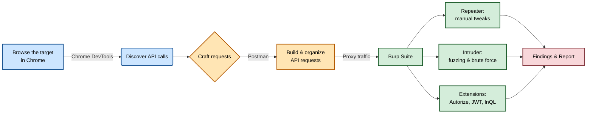
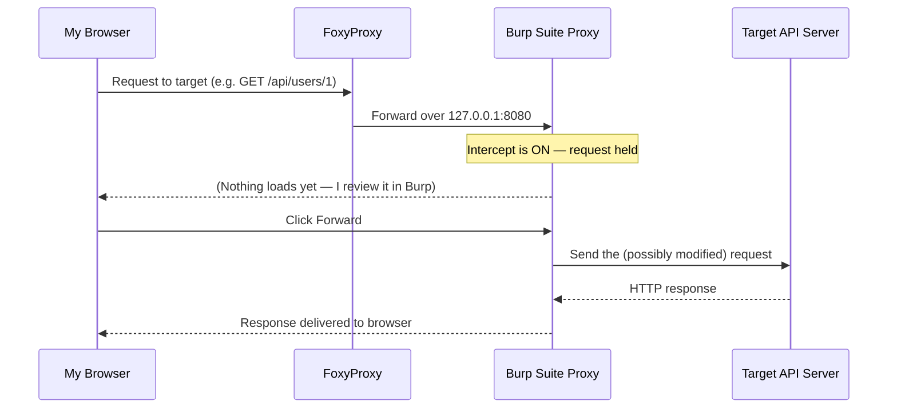
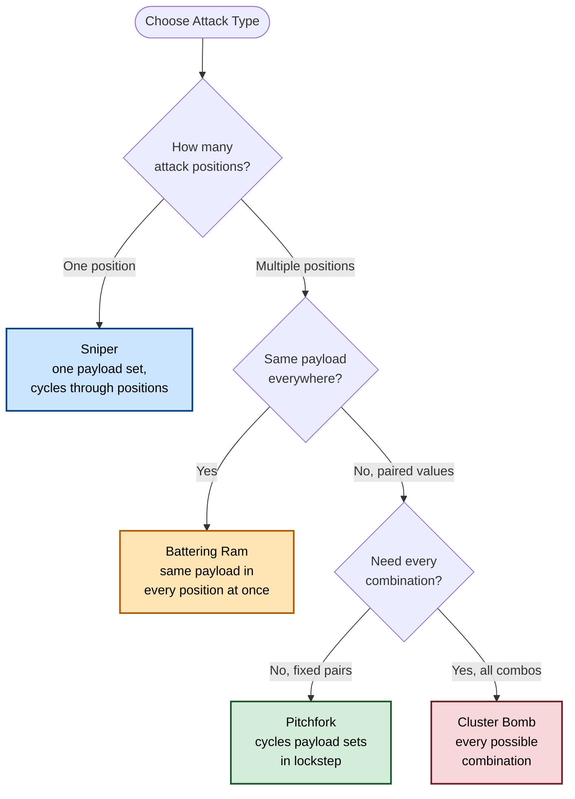
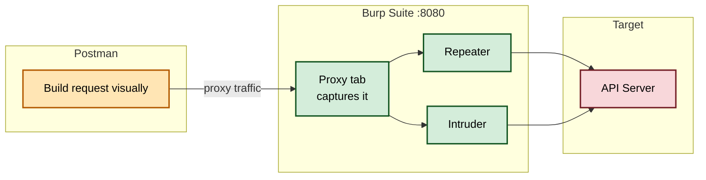
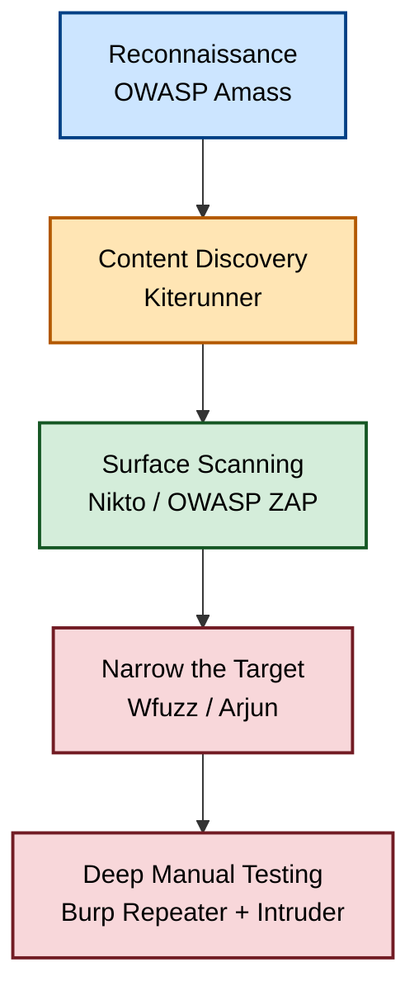
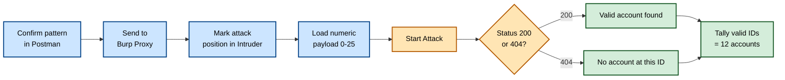

# Building My API Hacking Lab: Kali, Chrome DevTools, Burp Suite, and Postman

## Why I'm Writing This

Over the last few months I've spent a lot of time testing APIs for security weaknesses, and one of the first lessons I learned the hard way is that *the tools matter almost as much as the technique*. You can know every API vulnerability class in the OWASP API Security Top 10 by heart, but if your toolkit is clunky, poorly configured, or missing key pieces, you'll miss findings that are sitting right in front of you.

So in this post I want to walk you through exactly how I set up my own API hacking lab — the operating system I run everything from, the three core tools I use every single day (Chrome DevTools, Burp Suite, and Postman), and a handful of supplemental tools I bring in when the free edition of Burp isn't enough. I'll also walk through a small hands-on lab at the end where I actually use these tools together to enumerate user accounts on a public test API, so you can see the whole workflow rather than just reading about it in the abstract.

I'm going to be verbose and practical here. I'll show you the exact terminal commands I ran, the output I got back, and the handful of gotchas that tripped me up the first time. If you're setting up your own lab for the first time, you should be able to follow along step by step.

> **Note:** Everything described here is meant for testing systems you own or are explicitly authorized to test — your own lab environments, deliberately vulnerable practice APIs, or targets covered by a signed bug bounty or pentest scope. Don't point any of this at production systems you don't have permission to touch.

---

## 1. Picking an Operating System: Why I Use Kali Linux

I run all of my API testing tooling from Kali Linux, a Debian-based distribution built specifically for penetration testing. I like Kali for a few reasons:

- It ships with most of the tools I need already installed or easily installable from its repositories.
- It's actively maintained, so dependency hell is rare compared to trying to bolt these tools onto a generic Ubuntu install.
- Most write-ups, CTFs, and training material assume you're working from Kali, so troubleshooting is easier because the community has already hit the same walls.

I run Kali as a virtual machine rather than bare metal, which lets me snapshot it before I do anything destructive and roll back in seconds if I break something. You can grab the latest image from `kali.org/downloads` and there are plenty of guides for importing it into VMware, VirtualBox, or UTM depending on your host OS.

Once my VM was booted, the very first thing I did was update everything:

```bash
$ sudo apt update
$ sudo apt full-upgrade -y
```

**Sample output from my machine:**

```
Reading package lists... Done
Building dependency tree... Done
Reading state information... Done
Calculating upgrade... Done
The following packages will be upgraded:
  burpsuite firefox-esr kali-linux-headless libc6 openssl python3
147 upgraded, 3 newly installed, 0 to remove and 0 not upgraded.
Need to get 412 MB of archives.
After this operation, 38.4 MB of additional disk space will be used.
Fetched 412 MB in 2min 14s (3,071 kB/s)
...
Setting up kali-linux-headless (2024.3.0) ...
Processing triggers for libc-bin (2.38-1) ...
```

With the base system current, I installed the three building blocks that almost everything else depends on — Git, Python 3, and Go:

```bash
$ sudo apt-get install git python3 golang
```

```
Reading package lists... Done
Building dependency tree... Done
The following NEW packages will be installed:
  git golang python3
0 upgraded, 3 newly installed, 0 to remove and 0 not upgraded.
Need to get 1,847 kB of archives.
...
Setting up golang (2:1.21~2) ...
Setting up git (1:2.42.0-1) ...
Setting up python3 (3.11.6-1) ...
```

With those three dependencies in place, I was ready to start layering on the actual testing tools.

### A Quick Map of the Toolkit

Before diving into each tool individually, here's the mental model I use for how these pieces fit together during a typical engagement:



I usually start on the left of that diagram — browsing the target and watching what the client is doing — and work my way right into increasingly aggressive testing.

---

## 2. Chrome DevTools: My First Look at a Target

Before I ever open Burp or Postman, I like to poke around the target in Chrome itself. DevTools is free, it's already built into the browser, and it gives me a developer's-eye view of what's happening under the hood of a web application.

If Chrome isn't already on my Kali box, I install it like this:

```bash
$ sudo wget https://dl.google.com/linux/direct/google-chrome-stable_current_amd64.deb
$ sudo apt install ./google-chrome-stable_current_amd64.deb
```

```
Selecting previously unselected package google-chrome-stable.
(Reading database ... 412873 files and directories currently installed.)
Preparing to unpack google-chrome-stable_current_amd64.deb ...
Unpacking google-chrome-stable (131.0.6778.85-1) ...
Setting up google-chrome-stable (131.0.6778.85-1) ...
```

Once it's installed, I launch it from the terminal with `google-chrome`, navigate to whatever target I'm investigating, and pop open DevTools with `CTRL+SHIFT+I` (or `F12`). I almost always hit `CTRL+R` right after opening it so the Network panel actually captures the page load instead of showing a blank slate.

### What Each Panel Actually Gives Me

I used to just click around DevTools randomly until I built a mental map of what each tab is good for. Here's the breakdown I keep in my notes:

| Panel | What I use it for |
|---|---|
| **Elements** | Inspecting the live DOM and CSS, which helps me understand how the frontend is structured and where data gets rendered |
| **Console** | Running quick JavaScript snippets, reading errors/warnings, and poking at the page interactively |
| **Sources** | Reading through the actual source files the app ships — I've found hardcoded API keys here more than once in CTFs |
| **Network** | My main workhorse — every request the page makes, broken down by method, status, headers, and body |
| **Performance** | Recording a timeline of page events, which helps me pinpoint the *exact moment* a client action triggers an API call |
| **Memory** | Rarely used for API testing, but useful for spotting memory leaks in heavy single-page apps |
| **Application** | Cookies, local storage, session storage, service workers, and cache — great for understanding how auth tokens are persisted client-side |
| **Security** | TLS details, certificate info, and mixed-content warnings |

I spend about 80% of my time in **Network**, **Sources**, and **Console**. The Network tab is where I first notice an API call firing off, and clicking into any individual request lets me see the method, status code, full headers, and response body in a side panel.

The Performance tab is an underrated one for API hunting — if I record a session and then click around the app, I can see the exact timestamp where a specific user action (say, clicking "Log In") correlates to a specific XHR or fetch request firing. That correlation is gold when I'm trying to map which UI actions trigger which backend endpoints.

> **Tip:** If you want to go deeper on DevTools specifically, Google's own developer documentation is a solid reference and gets updated far more often than any book chapter could.

---

## 3. Burp Suite: Intercepting and Manipulating Traffic

Once I've got a rough map of a target's API surface from DevTools, I move into Burp Suite — the tool I probably spend the most total hours inside of. Burp, built by PortSwigger, sits as a proxy between my browser (or Postman) and the target server, letting me view, pause, and modify every request and response that passes through.

Kali ships with Burp Suite Community Edition (CE) out of the box. If for some reason it's missing, I reinstall it with:

```bash
$ sudo apt-get install burpsuite
```

Burp Suite Pro is a paid upgrade that removes most of CE's artificial limits (particularly around Intruder's request throttling and the inclusion of the full vulnerability scanner). I lean on CE for most of this walkthrough and call out Pro-only features where relevant.

### 3.1 Setting Up FoxyProxy

For Burp to see any of my traffic, I need my browser to actually route requests through it. Rather than manually editing my system's proxy settings every time I want to turn interception on or off, I use the **FoxyProxy** extension, which puts a one-click proxy toggle right in my toolbar.

Here's exactly how I set it up:

1. Open the Chrome Web Store (or Firefox Add-ons) and search for **FoxyProxy Standard**, then install it.
2. Click the fox icon that appears next to the address bar and choose **Options**.
3. Go to **Proxies ▶ Add New Proxy ▶ Manual Proxy Configuration**.
4. Set the host to `127.0.0.1`.
5. Set the port to `8080` (Burp's default listener port).
6. Under the **General** tab, I rename this proxy profile to something memorable — I personally call mine `BurpProxy`.

After that, flipping traffic through Burp is just a two-click affair: click the fox icon, select my proxy profile, and everything the browser sends gets routed to Burp first.

### 3.2 Installing Burp's CA Certificate

Modern sites almost universally enforce HTTPS, and many enforce **HSTS** (HTTP Strict Transport Security), which will actively block Burp from intercepting traffic unless my browser trusts Burp's certificate authority. So the second setup step I always do is import Burp's CA cert:

1. Start Burp Suite.
2. In the browser, switch on my FoxyProxy profile.
3. Navigate to `http://burpsuite` — this special address serves Burp's own landing page with a **CA Certificate** download link.
4. Save the certificate file somewhere I'll remember.
5. In Chrome, go to **Settings → Privacy and Security → Security → Manage Certificates → Authorities**, and import the file (switching the file-type filter to "All files" or "DER" if it doesn't show up by default).

> **Caution:** Only trust certificates you generated yourself from a tool you control, on machines you control (ideally an isolated test VM). Importing a third party's root CA certificate onto a production or personal machine is a serious security risk, since it lets whoever controls that CA silently intercept *any* HTTPS traffic from that device.

### 3.3 A Tour of Burp's Modules

Burp organizes its functionality into tabs across the top of the window. I think of them like this:

| Module | My use for it |
|---|---|
| **Dashboard** | Overview of logged events and (in Pro) active scans |
| **Proxy** | Where intercepted requests and responses land first |
| **Target** | Site map of everything Burp has seen, plus scope configuration |
| **Intruder** | Automated fuzzing / brute-force against a chosen attack position |
| **Repeater** | Manually tweak and resend a single request, over and over |
| **Sequencer** | Entropy analysis — is this token/cookie actually random? |
| **Decoder** | Quick encode/decode for Base64, hex, URL encoding, Gzip, etc. |
| **Comparer** | Diff two requests or responses to spot what changed |
| **Scanner** *(Pro)* | Automated vulnerability scanning |
| **Extender** | Install and manage community extensions (BApp Store) |

If the default white interface is too bright for late-night testing sessions, I switch to the dark **Darcula** theme under **User options ▶ Display ▶ Look and Feel** — small thing, but it matters after hour six of a testing session.

### 3.4 Capturing My First Request

With FoxyProxy and the certificate in place, the actual interception workflow looks like this:



In Burp itself, I flip **Intercept** to **on**, then browse to my target in the proxied browser. The page won't load — that's expected, because the request is sitting in Burp waiting for me to review it. From there I can right-click the captured request and choose **Send to Repeater** or **Send to Intruder** depending on what I want to do with it next.

**Repeater** is where I go first for almost everything — it lets me resend a single request with small manual edits and immediately see how the server reacts. It's my go-to for confirming a hunch before I automate anything.

### 3.5 Automating Attacks with Intruder

Once I know *roughly* what I'm looking for, Intruder is where the real automation happens. The core idea: I mark part of a captured request as a variable (an "attack position") by wrapping it in `§` symbols, then feed Burp a list of payloads to cycle through that position.

For example, if I'm testing a login endpoint and want to try a list of candidate passwords, I'd mark the password field as the attack position and load my payload list under the **Payloads** tab.

Burp gives me four different attack types, and picking the right one matters a lot for efficiency:



Here's how I decide between them in practice:

| Attack type | When I reach for it |
|---|---|
| **Sniper** | One payload set, testing one position at a time — great for brute-forcing a single numeric ID |
| **Battering Ram** | Same payload needs to land in *every* position simultaneously, like testing the same SQL injection string in multiple parameters at once |
| **Pitchfork** | I have matched pairs (like leaked username:password combos) and want them tested together, in order, not mixed-and-matched |
| **Cluster Bomb** | I want every possible combination of two or more payload lists — classic password-spraying setup |

Intruder has been my primary weapon for finding **broken object level authorization (BOLA)**, broken authentication, mass assignment, and plain old injection bugs, because at the end of the day a huge share of API vulnerabilities boil down to "send the right payload to the right field, over and over, and see what breaks."

### 3.6 Extensions I Install Right Away

Burp's BApp Store (under the **Extender** tab) is where community-built add-ons live. These are the ones I install on every new Burp instance:

| Extension | What it adds |
|---|---|
| **Autorize** | Automates BOLA testing by replaying UserA's requests using UserB's session token and flagging anything suspicious |
| **JSON Web Tokens** | Decodes, edits, and helps attack JWTs directly inside Burp |
| **InQL Scanner** | Adds GraphQL-aware scanning and introspection |
| **IP Rotate** | Rotates the source IP across cloud regions — handy against naive IP-based rate limiting |
| **Bypass WAF** | Auto-adds headers like `X-Forwarded-For` and `X-Originating-IP` that sometimes trick poorly configured WAFs into trusting the request |

> **Note:** Some of these extensions require Burp Suite Pro to function fully, but I still get value out of the free portions in CE.

---

## 4. Postman: Where I Actually Build My Requests

As useful as Burp is for intercepting and replaying traffic, it's not the tool I use to *build* requests from scratch. For that, I use **Postman** — think of it as a browser purpose-built for talking to APIs instead of rendering web pages.

### 4.1 Installing Postman on Kali

```bash
$ sudo wget https://dl.pstmn.io/download/latest/linux64 -O postman-linux-x64.tar.gz
$ sudo tar -xvzf postman-linux-x64.tar.gz -C /opt
$ sudo ln -s /opt/Postman/Postman /usr/bin/postman
```

```
postman-linux-x64.tar.gz    100%[==============================>] 198.42M  11.2MB/s
Postman/
Postman/Postman
Postman/resources/
Postman/resources/app.asar
...
```

From there, launching `postman` in a terminal boots the app. I usually skip the sign-in prompt and go straight into the app, since I don't need the team-sync features for solo lab work.

Just like with Chrome, I set Postman up to route through a proxy — but this time pointing at Postman's own default proxy port, `5555`, with a separate FoxyProxy profile I call `Postman`. That way I can quickly flip between "browse normally," "proxy through Burp," and "proxy Postman through Burp" without fiddling with settings each time.

### 4.2 The Request Builder, Piece by Piece

Every new tab in Postman opens the request builder, which is broken into a handful of functional areas:

| Tab | Purpose |
|---|---|
| **Params** | Query string and path parameters, as editable key/value pairs |
| **Authorization** | Pre-built auth schemes — Bearer tokens, Basic auth, API keys, OAuth, or "inherit from parent" to reuse a collection-level setting |
| **Headers** | Key/value header pairs, with Postman auto-suggesting common ones |
| **Body** | The payload for POST/PUT/PATCH requests, with options for raw JSON, form-data, x-www-form-urlencoded, binary, or GraphQL |
| **Pre-request Script** | JavaScript that runs *before* the request fires — I use this to chain a login call's token into the next request automatically |
| **Tests** | JavaScript assertions that run *after* the response comes back |
| **Settings** | Per-request behavior tweaks (SSL verification, redirects, etc.) |

One of my favorite Postman features is variable interpolation. If an API path looks like `http://example.com/:company/profile`, Postman recognizes the `:company` segment and lets me swap in a real value without hand-editing the URL string every time.

### 4.3 Environments: Not Retyping the Same Values Twenty Times

An **environment** in Postman is a named bucket of variables I can reuse across every request in a collection. I create one with `CTRL+N` → **Environment**, then add key/value pairs.

Each variable actually has two slots:

- **Initial value** — shared if I export or share the environment with teammates.
- **Current value** — stored only locally on my machine, never exported.

I always stash anything sensitive — API tokens, test credentials — in the **current value** field so it doesn't accidentally leak if I ever share an environment file with someone else.

```json
{
  "id": "e1a9f2b0-env",
  "name": "reqres-lab",
  "values": [
    { "key": "baseUrl", "value": "https://reqres.in/api", "type": "default" },
    { "key": "admin_creds", "value": "This_is_hidd3n", "type": "secret" }
  ]
}
```

### 4.4 Collections: Importing Instead of Re-Typing Every Request

A **collection** is just a saved, shareable group of requests. If a target API publishes an official Postman collection or an OpenAPI/Swagger spec, I always import it rather than hand-building every request myself — it saves a huge amount of time and reduces typos.

Postman natively supports importing OpenAPI 3.0, RAML (both 0.8 and 1.0), GraphQL schemas, cURL commands, WADL, Swagger 1.2/2.0, Runscope exports, and DHC files, either from a local file, a pasted link, raw text, or a linked GitHub repo.

To import by link, I just:

1. Click **Import** in the top-left corner.
2. Switch to the **Link** tab.
3. Paste the spec URL and click **Continue**.
4. Confirm on the review screen.

After importing, I almost always have to check the collection's variables before anything works — a freshly imported collection frequently ships with a placeholder like `{{baseUrl}}` that's empty until I fill it in under **Edit Collection ▶ Variables**.

### 4.5 Writing Tests (You Don't Need to Be a Programmer)

Postman's **Tests** tab lets me write small JavaScript assertions that run automatically against every response — useful for confirming an endpoint still behaves as expected, or for flagging anomalies during a fuzzing pass. Postman ships prebuilt snippets for the most common checks, so I rarely write these from scratch:

```javascript
pm.test("Status code is 200", function () {
    pm.response.to.have.status(200);
});

pm.test("Response time is under 200ms", function () {
    pm.expect(pm.response.responseTime).to.be.below(200);
});

pm.test("Body contains expected string", function () {
    pm.expect(pm.response.text()).to.include("Persians");
});
```

One habit I've picked up: I deliberately send a request I *expect* to fail a given test, just to confirm the test actually fails when it should. A test that always passes regardless of input isn't testing anything.

### 4.6 Code Snippets: Jumping Between Tools

In the top-right of the request pane there's a **Code** button that converts whatever I've built into cURL, Python, Go, Node.js, PHP, raw HTTP, and a handful of other formats. I use this constantly — I'll build a gnarly request with headers, auth, and a JSON body inside Postman's friendly UI, generate a cURL command from it, and then drop that straight into a bash script or a custom Python fuzzer.

### 4.7 The Collection Runner

When I want to replay an entire collection — say, running a smoke test across every endpoint after a target pushes an update — the **Collection Runner** lets me pick a collection, an environment to pair with it, a number of iterations, and an optional delay between requests (handy for respecting rate limits). After it finishes, a run summary shows pass/fail status for every request's attached tests.

---

## 5. Wiring Postman Into Burp Suite

Postman is great for *building* requests, and Burp is great for *manipulating* them at scale. Chaining them together means I can craft a request visually in Postman, fire it off, and have it land directly in Burp's Proxy tab ready for Repeater or Intruder.

To connect the two:

1. Open Postman's settings (`CTRL+,`) and go to the **Proxy** tab.
2. Enable the custom proxy configuration checkbox.
3. Set the proxy server to `127.0.0.1`, port `8080` (Burp's listener).
4. Under **General**, turn **SSL certificate verification** off (Postman otherwise complains about Burp's self-signed cert).
5. In Burp, make sure **Intercept** is switched **on**.



Once I send a test request from Postman and see it pop up in Burp's intercepted traffic, I know the pipeline is wired correctly, and I leave the proxy settings on permanently — I just toggle Burp's **Intercept** switch when I actually want to pause and inspect traffic.

---

## 6. Filling the Gaps in Burp Community Edition

Burp CE is excellent, but it deliberately leaves out a few things — most notably the automated vulnerability Scanner and some Intruder throttling limits. Rather than immediately paying for Pro, I lean on a set of free, open-source tools that cover most of the same ground. Here's my go-to supplemental toolkit:

| Tool | Category | What I use it for |
|---|---|---|
| **OWASP Amass** | Reconnaissance | Mapping a target's domains and subdomains before I even start poking at an API |
| **Kiterunner** | Content discovery | API-aware endpoint brute-forcing, far better than generic directory busters |
| **Nikto** | Vulnerability scanning | Quick surface-level scan for misconfigurations and interesting headers |
| **OWASP ZAP** | Vulnerability scanning | Automated crawling plus a "heads-up display" for manual, in-browser testing |
| **Wfuzz** | Fuzzing | Flexible, Python-based payload injection against any part of a request |
| **Arjun** | Parameter discovery | Finds hidden/undocumented parameters an endpoint actually accepts |



### 6.1 OWASP Amass — Mapping the Attack Surface

Amass is my starting point whenever I'm handed nothing more than a company name or root domain. It passively and actively scrapes a wide range of internet data sources to build out a picture of a target's domains, subdomains, and associated infrastructure.

```bash
$ sudo apt-get install amass
```

Amass works reasonably well with zero configuration, but it gets dramatically better once I plug in free API keys from sources like GitHub, Censys, and others. I store those keys in Amass's config file:

```bash
$ mkdir $HOME/.config/amass
$ curl https://raw.githubusercontent.com/OWASP/Amass/master/examples/config.ini \
    > $HOME/.config/amass/config.ini
```

Editing that file looks something like this (I just remove the `#` comment markers and paste in my key):

```ini
# https://urlscan.io (Free)
[data_sources.URLScan]
apikey = my-real-api-key-goes-here
```

### 6.2 Kiterunner — API-Aware Content Discovery

Generic directory brute-forcers like dirbuster or Gobuster weren't built with APIs in mind, so they tend to miss a lot. **Kiterunner** was purpose-built for finding API paths — its wordlists are derived from tens of thousands of real-world Swagger/OpenAPI files, and it can fingerprint common backend frameworks (Express, FastAPI, Flask, Spring, and so on) along the way.

```bash
$ git clone https://github.com/assetnote/kiterunner.git
$ cd kiterunner
$ make build
$ sudo ln -s $(pwd)/dist/kr /usr/local/bin/kr
```

```bash
$ kr
```

```
kite is a context based webscanner that uses common api paths
for content discovery of an applications api paths.

Usage:
  kite [command]

Available Commands:
  brute       brute one or multiple hosts with a provided wordlist
  help        help about any command
  kb          manipulate the kitebuilder schema
  scan        scan one or multiple hosts with a provided wordlist
  version     version of the binary you're running
  wordlist    look at your cached wordlists and remote wordlists
```

I grab Assetnote's monthly-refreshed wordlists for the payload side of things:

```bash
$ mkdir -p ~/api/wordlists
$ curl https://wordlists-cdn.assetnote.io/data/automated/httparchive_apiroutes_2021_06_28.txt \
    > ~/api/wordlists/latest_api_wordlist.txt
```

```
 % Total    % Received % Xferd  Average Speed   Time
100 6651k  100 6651k    0     0  16.1M      0   --:--:--
```

> **Caution:** The full Assetnote wordlist set is roughly 2.2 GB. I only grab the full set on a machine with disk space to spare, and I keep it on an external volume for my VM rather than my main disk.

### 6.3 Nikto — Fast, Noisy, Informative

Nikto is my "first five minutes" tool right after I've confirmed a web app exists. It's loud and generates a lot of traffic, but it quickly surfaces allowed HTTP methods, suspicious headers, and potential endpoints worth a closer look.

```bash
$ nikto -h https://example-lab.local
```

```
- Nikto v2.5.0
---------------------------------------------------------------------------
+ Target IP:          203.0.113.42
+ Target Hostname:    example-lab.local
+ Target Port:        443
+ SSL Info:        Subject: /CN=example-lab.local
---------------------------------------------------------------------------
+ Server: nginx/1.18.0
+ The X-Content-Type-Options header is not set.
+ /api/v1/status: Uncommon header 'x-powered-by' found, with contents: Express
+ /api/v1/debug: This might be interesting.
+ 7816 requests: 0 error(s) and 4 item(s) reported on remote host
```

I always add `-output filename` to save results to a file, and `-maxtime` if I'm time-boxing a scan against a rate-limited target.

### 6.4 OWASP ZAP — Automated Crawl Plus Manual Explore

ZAP gives me two very different modes:

- **Automated scan** — crawls the site, fuzzes parameters, and flags vulnerabilities by severity. Fast, but prone to false positives, so I always manually verify anything it reports.
- **Manual explore (ZAP HUD)** — proxies my normal browsing session through ZAP while overlaying live alerts directly on the page. I like this mode specifically for walking through authentication and account-creation flows, since ZAP will flag issues the moment I trigger them rather than after a blind automated crawl.

### 6.5 Wfuzz — Flexible, Scriptable Fuzzing

Wfuzz replaces the literal string `FUZZ` anywhere in a request with values from a wordlist, firing off roughly 900 requests per minute by default.

```bash
$ wfuzz -z file,/usr/share/wordlists/list.txt http://targetname.local/FUZZ
```

```
Target: http://targetname.local/
Total requests: 4989

ID    Response   Lines    Words    Chars       Payload
==================================================================
000012   200      42       180      3271        "users"
000045   200      12        45       892        "health"
000103   403       9        20       412        "admin"
```

A couple of variations I use constantly:

```bash
# Fuzz an HTTP verb against a single path
$ wfuzz -X POST -z list,admin-dashboard-docs-api-test http://targetname.local/FUZZ

# Fuzz a numeric ID range — great for BOLA hunting
$ wfuzz -z range,500-1000 "http://targetname.local/account?user_id=FUZZ"

# Multiple simultaneous attack positions
$ wfuzz -z list,A-B-C -z range,1-3 "http://targetname.local/FUZZ/user_id=FUZZ2"
```

And because raw Wfuzz output can be a firehose, I lean heavily on its filters:

| Flag | Behavior |
|---|---|
| `--sc` | Only show responses with a specific status code |
| `--sl` | Only show responses with a specific line count |
| `--sw` | Only show responses with a specific word count |
| `--sh` | Only show responses with a specific character count |
| `--hc` | Hide responses with a specific status code |
| `--hl` / `--hw` / `--hh` | Hide by line / word / character count |

```bash
$ wfuzz -z file,/usr/share/wordlists/list.txt --hc 404 --hh 950 http://targetname.local/FUZZ
```

### 6.6 Arjun — Finding Parameters Nobody Documented

Arjun specializes in one job: discovering parameters an endpoint actually accepts, even if they're completely undocumented. It's my go-to first scan against a brand-new endpoint.

```bash
$ cd /opt/
$ sudo git clone https://github.com/s0md3v/Arjun.git
$ python3 /opt/Arjun/arjun.py -u http://target-address.local -o arjun_results.json
```

```
    _
   /_| _ '
  (  |/ /(//) v2.2.1
      _/
    
[*] Analysing endpoint for errors
[*] Measuring response time
[+] Analysed in 2.11 seconds
[*] Probing with a total of 25600 parameter names
[*] Parameter names in current bucket: 1000
[+] Found parameter: user_id
[+] Found parameter: debug
[+] Scan completed in 00:02:14
```

If a target rate-limits aggressively, Arjun will tell me plainly: `Target is unable to process requests, try --stable switch`. Adding `--stable` throttles the probing and usually resolves it:

```bash
$ python3 /opt/Arjun/arjun.py -u http://target-address.local -o arjun_results.json --stable
```

Arjun can also batch multiple targets at once — handy after a Burp session where I've already collected a sitemap:

```bash
$ python3 /opt/Arjun/arjun.py -i burp_targets.txt
```

---

## 7. Putting It All Together: A Hands-On Lab

Theory is nice, but nothing cements a tool for me like actually using it. So here's a small, self-contained lab I ran against **reqres.in**, a public API built specifically for testing and practice. The goal: figure out exactly how many user accounts exist, using Postman and Burp together instead of guessing.

### Step 1 — Confirm the Base Behavior

The API's own documentation shows a sample request to `/api/users/2`. I started by testing `/api/users/1` directly in Postman:

- Method: `GET`
- URL: `https://reqres.in/api/users/1`

```json
{
  "data": {
    "id": 1,
    "email": "george.bluth@reqres.in",
    "first_name": "George",
    "last_name": "Bluth",
    "avatar": "https://reqres.in/img/faces/1-image.jpg"
  },
  "support": {
    "url": "https://contentcaddy.io?utm_source=reqres&utm_medium=json&utm_campaign=referral",
    "text": "Tired of writing endless social media content? Let Content Caddy generate it for you."
  }
}
```

That confirms my assumption: accounts are addressed sequentially by a numeric ID in the URL path. That's the exact pattern I want to hand off to Burp's Intruder rather than test by hand, one request at a time.

### Step 2 — Hand the Request to Burp

With my Postman-to-Burp proxy chain already configured (Section 5), I fired the same request again from Postman and watched it land in Burp's **Proxy** tab. From there:

1. `CTRL+I` (or right-click → **Send to Intruder**) on the intercepted request.
2. In **Intruder ▶ Positions**, I clicked **Clear §** to wipe Burp's automatic guesses.
3. I highlighted just the `1` at the end of `/api/users/1` and clicked **Add §**, so the request looked like `/api/users/§1§`.

### Step 3 — Configure the Payload

Under **Intruder ▶ Payloads**, I set:

- **Payload type:** Numbers
- **Range:** `0` to `25`
- **Step:** `1`

That configuration tells Burp to generate 26 requests total, one for each integer between 0 and 25 inclusive, substituting each one into the attack position in turn.

### Step 4 — Start the Attack

Clicking **Start Attack** fired all 26 requests in sequence. Here's a trimmed view of what came back:

| User ID | Status | Notes |
|---|---|---|
| 0 | 404 | No such user |
| 1 | 200 | George Bluth |
| 2 | 200 | Janet Weaver |
| ... | 200 | ... |
| 12 | 200 | Last valid account |
| 13 | 404 | Doesn't exist |
| ... | 404 | All remaining IDs 404 |
| 25 | 404 | Confirmed range exhausted |

```
=== Intruder Attack Summary ===
Total requests sent: 26
200 OK responses:     12   (IDs 1–12)
404 Not Found:        14   (IDs 0, 13–25)
Average response time: 143ms
```

From those results, the conclusion is simple: **reqres.in has exactly 12 user accounts**, numbered 1 through 12. No guessing required — Burp did the heavy lifting of sending every request, and I just had to read the status column.

This exact pattern — substituting a sequential ID into a URL and watching which ones return valid data versus a 404 — is the foundational technique behind **BOLA (Broken Object Level Authorization)** testing. In a real engagement, that "user ID" could just as easily be a bank account number, an invoice ID, a phone number, or an email address tied to someone else's data. The mechanics are identical; only the sensitivity of what you find at the end changes.

> **Note:** As a follow-up exercise, I re-ran this exact same scan using Wfuzz instead of Burp Intruder, just to compare workflows:
> ```bash
> $ wfuzz -z range,0-25 --hc 404 https://reqres.in/api/users/FUZZ
> ```
> Both tools land on the identical answer — which is reassuring, because it means the result isn't an artifact of one tool's quirks.



---

## 8. Lessons I Took Away From This Setup

A few practical takeaways I keep coming back to after rebuilding this lab a couple of times on fresh VMs:

1. **Chrome DevTools is underrated.** I almost skip it out of habit, but every time I slow down and actually read the Network and Sources tabs before touching Burp, I find something I would have otherwise missed.
2. **Proxy chaining is worth the ten minutes of setup.** Getting Postman → Burp working smoothly turns two separate tools into one cohesive workflow, instead of me manually copy-pasting requests between them.
3. **Burp CE's gaps are very coverable.** Between Nikto, ZAP, Wfuzz, and Arjun, I rarely feel like I'm missing critical functionality just because I haven't paid for Pro — though I do plan to upgrade once this pays for itself through bounty income.
4. **Numeric sequential IDs are still everywhere.** The reqres.in lab is intentionally simple, but I'm consistently surprised by how often real-world APIs — even ones built in 2024 and later — still use sequential, guessable IDs for sensitive resources.
5. **Filter aggressively.** Whether it's Wfuzz's `--hc`/`--sc` flags or Burp's response-sorting columns, the single biggest productivity unlock in fuzzing is cutting noise down to the handful of responses that actually matter.

> **Caution:** None of this toolkit is useful — or legal to use — without proper authorization. Always confirm you're operating within a written scope (a bug bounty program's policy, a signed pentest agreement, or your own lab/practice environment) before pointing any of these tools at a target.

---

## 9. What's Next

With Kali set up, Chrome DevTools in my back pocket, Burp Suite wired into Postman, and a handful of supplemental tools filling in the Community Edition gaps, I've got a complete, repeatable environment I can spin up on any machine in under an hour. From here, the natural next step is digging into specific vulnerability classes — starting with wordlist strategy and fuzzing technique, then moving into the authentication and authorization bugs (BOLA, BFLA, mass assignment) that this toolkit is really built to uncover.

If you're building your own lab alongside this post, I'd genuinely recommend doing the reqres.in exercise yourself before moving on — there's a real difference between reading about Intruder's attack positions and actually watching 26 requests fly out and sorting the 200s from the 404s with your own eyes.
