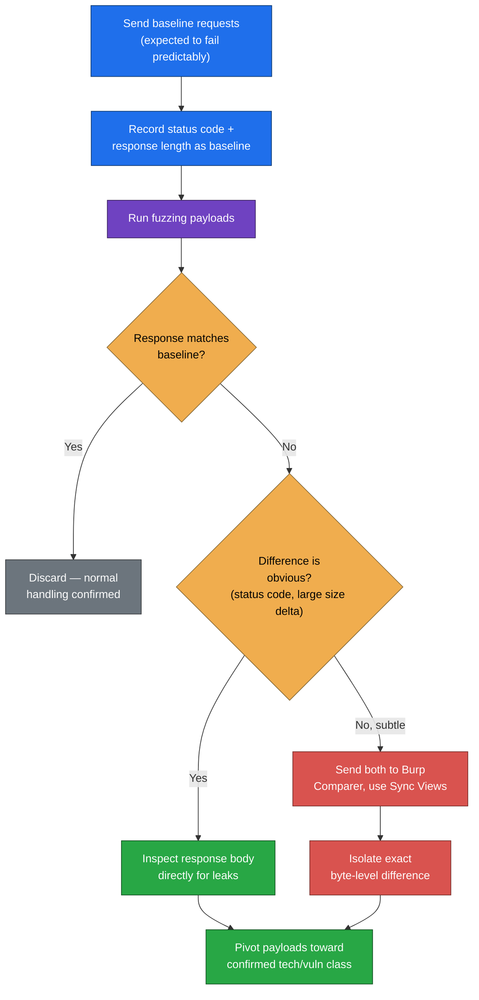
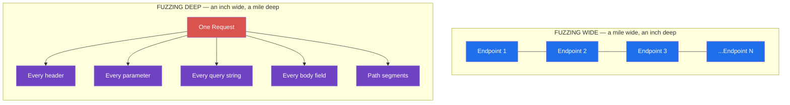
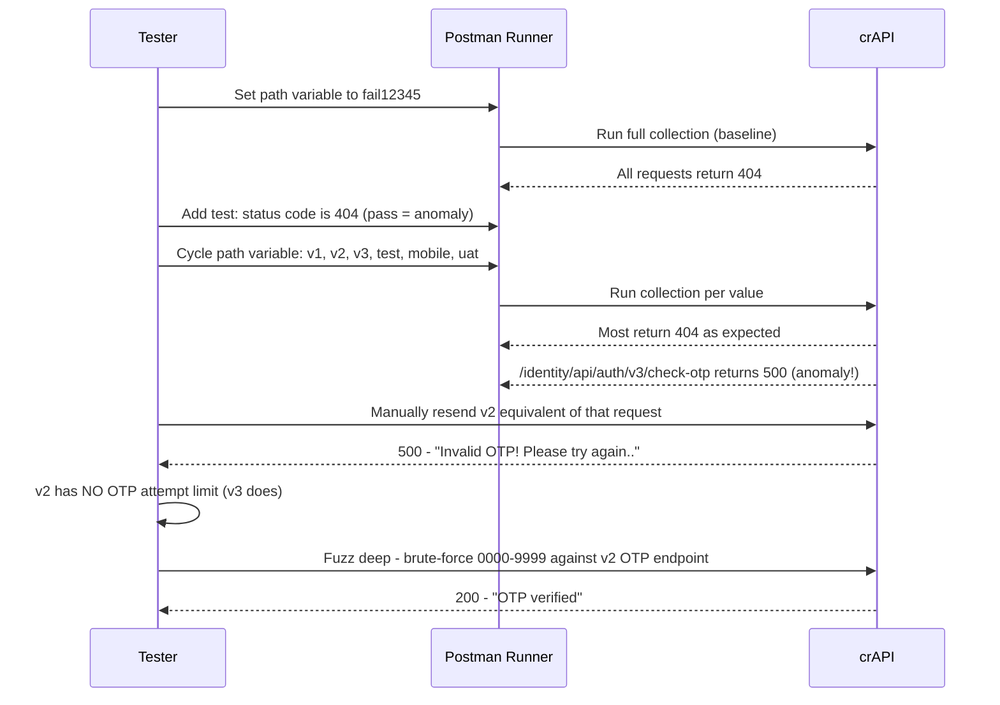

# Fuzzing APIs: How I Find Vulnerabilities by Throwing Garbage at Endpoints

## Why Fuzzing Is My First Real Attack, Not Just Recon

I think of fuzzing as the moment an API assessment stops being passive and starts being active. Up to that point I've been reading documentation, mapping endpoints, collecting tokens — all useful, but none of it actually pokes the application. Fuzzing is where I start sending input the developers never expected, and watching what comes back.

The honest truth about fuzzing is that it's simple in concept and endlessly deep in practice. The concept: send weird input, watch for weird output. The depth: knowing *where* to send that input, *what* to send, and *how to tell* when a response actually matters versus when it's just noise. In this post I want to walk through how I actually do this — the tools I reach for (Wfuzz, Burp Suite Intruder, Postman's Collection Runner), the two complementary strategies I lean on (fuzzing wide and fuzzing deep), and a handful of specific vulnerability classes I hunt for with fuzzing, including improper assets management, hidden HTTP methods, and input-sanitization bypasses.

As always: everything here assumes you have explicit authorization to test the target. Fuzzing sends a large volume of abnormal traffic, and doing that against a system you don't have permission to test is both reckless and illegal.

> **Caution**
> Aggressive fuzzing can trip rate limiters, lock out accounts, or in the worst case crash a poorly hardened service entirely. I always start cautious — smaller payload lists, slower request rates — especially on my first pass against a new target, and I scale up once I understand how resilient the application actually is.

---

## Table of Contents

1. What "Effective" Fuzzing Actually Means
2. Choosing the Right Fuzzing Payloads
3. Detecting Anomalies in a Sea of Responses
4. Fuzzing Wide vs. Fuzzing Deep
5. Fuzzing Wide with Postman's Collection Runner
6. Fuzzing Deep with Burp Suite Intruder
7. Fuzzing Deep with Wfuzz
8. Fuzzing Wide for Improper Assets Management
9. Discovering Hidden HTTP Methods
10. Fuzzing Deeper to Bypass Input Sanitization
11. Fuzzing for Directory Traversal
12. A Worked Lab Walkthrough
13. Final Thoughts

---

## 1. What "Effective" Fuzzing Actually Means

I define fuzzing the same way most of the industry does: sending requests with various kinds of input to an endpoint in order to provoke an unintended result. The vague part — "various kinds of input" and "unintended result" — is vague on purpose, because the possibilities are genuinely huge. I might send symbols, oversized numbers, decimals, hexadecimal strings, emoji, system commands, SQL fragments, or NoSQL operators. If the API hasn't implemented proper validation, any one of these can trigger a verbose error, an unusual response, or — worst case — an internal server error that takes the whole service down.

Here's the mental model I use before I fuzz anything: think about what the *developer* expected this field to contain, then deliberately violate that expectation in a controlled, targeted way.

Take a simple funds-transfer request as an example:

```http
POST /account/balance/transfer HTTP/1.1
Host: bank.example.com
x-access-token: hapi_token

{
  "userid": 12345,
  "account": 224466,
  "transfer-amount": 1337.25
}
```

I could absolutely blast huge payloads into every one of those three fields at once. But that's a good way to trip a WAF, get my token blocked, or burn through my allotted request budget before I've learned anything useful. If the API has no apparent defenses, sure — "release the krakens" and fuzz everything simultaneously. But my default is more surgical: target one field at a time, and think specifically about what that field is supposed to contain.

For `transfer-amount`, I know the application almost certainly expects a modest decimal number — nobody is wiring more than the GDP of a mid-sized country in a single transfer. So I test:

- A value in the quadrillions
- A string of letters where a number is expected
- A large or negative decimal
- Null-ish values: `null`, `(null)`, `%00`, `0x00`
- Symbols: `!@#$%^&*();':''|,./?>`

Any of these can produce a verbose error. A value in the quadrillions, for instance, might overflow a database column and trigger an unhandled SQL error — which, in turn, tells me exactly where to focus a SQL injection attack later.

So the success of fuzzing comes down to two variables: **where** I fuzz and **what** I fuzz with. I look for every input a consumer uses to interact with the app — authentication forms, registration, file uploads, profile edits, account management, search — because those are the places insufficient input handling tends to live.

> **Note**
> Generically, I send symbols, strings, and numbers designed to cause errors, then pivot based on what comes back. A SQL error tells me to go deeper on SQL injection. A stack trace tells me the language/framework. A timeout tells me I might have found something expensive to compute — worth a denial-of-service note even if I don't push further.

---

## 2. Choosing the Right Fuzzing Payloads

I split my payloads into two broad categories.

**Generic payloads** are my opening move against any new field — symbols, null bytes, directory traversal strings, encoded characters, oversized numbers, long strings, and characters from unexpected character sets (I always like to throw in some non-Latin scripts and emoji, since plenty of input-validation code only accounts for ASCII).

**Targeted payloads** come later, once I know more about the stack. These are tuned toward a specific technology or vulnerability class: XSS payloads, SQL/NoSQL operators, directory and file-extension lists, HTTP method lists, or OS-specific command strings. There's no point throwing SQL injection payloads at an API that's clearly backed entirely by MongoDB — that's wasted effort. I only reach for targeted payloads once generic fuzzing has told me something about what's running underneath.

Here's a short, hand-built generic fuzzing list I keep around and reuse constantly:

```text
AAAAAAAAAAAAAAAAAAAAAAAAAAAAAAAAAAAAAAAA
9999999999999999999999999999999999999999
~'!@#$%^&*()-_+
{}[]|\:''; '<>?,./
%00
0x00
$ne
%24ne
$gt
%24gt
|whoami
-- -
' ''
' OR 1=1-- -
'' ''''''
漢さЖѪѬѦѨѮ
😀😃😄😁😆
```

That list alone tends to shake out a surprising amount — null-byte handling bugs, NoSQL operator injection (`$ne`, `$gt`), classic SQL injection markers, command injection via `|whoami`, buffer/length issues from the long strings, and encoding bugs from the non-ASCII characters.

For anything larger or more structured, I lean on community-maintained wordlists rather than reinventing them myself:

| Source | What it's good for |
|---|---|
| [SecLists](https://github.com/danielmiessler/SecLists) — `big-list-of-naughty-strings.txt` | Broad, battle-tested generic fuzzing strings that reliably trigger edge cases |
| [fuzzdb](https://github.com/fuzzdb-project/fuzzdb) | Categorized payloads by vulnerability class (injection, traversal, XSS, etc.) |
| [Wfuzz's own wordlists](https://github.com/xmendez/wfuzz) — `injections/All_attack.txt` | A combined list mixing several targeted attack types in one file |

> **Note**
> I rarely start with hundreds of `A` characters — I usually bump that up to a few thousand when I'm specifically hunting for buffer-related issues or length-validation bugs, since a 40-character string is often too short to trigger anything interesting.

---

## 3. Detecting Anomalies in a Sea of Responses

Once I start fuzzing, I'm not looking at two or three responses — I'm looking at hundreds or thousands. The skill that actually matters here isn't crafting payloads, it's filtering noise fast enough to spot the signal.

When input is handled properly, I expect a clean, consistent rejection:

```http
HTTP/1.1 400 Bad Request
Content-Type: application/json

{
  "error": "number required"
}
```

That tells me the field is validated and tailored. Boring, but useful — it's my baseline.

When input is *not* handled properly, the server often leaks something it shouldn't:

```http
HTTP/1.1 200 OK

SQL Error: There is an error in your SQL syntax near '~'!@#$%^&*()-_+' at line 1
```

That single response just told me two things: the backend is SQL-based, and this field passes raw input straight into a query without sanitization. That's worth flagging immediately and pivoting toward SQL-specific payloads.

My general process for establishing a baseline:

1. Send a batch of requests I expect to behave normally (or fail in a predictable, boring way).
2. Confirm the majority come back identical in status code and response size.
3. Treat that majority as the baseline.
4. Review anything that deviates — different status code, different response length, different timing, different body content.

When the difference is subtle — a response that's only a handful of bytes larger than the baseline — I reach for **Burp Suite's Comparer**. I right-click the interesting result, choose **Send to Comparer (Response)**, repeat for the baseline response, then use **Compare Words** to get a side-by-side diff. The **Sync Views** toggle is genuinely useful here — it highlights exactly what was added, removed, or modified between the two responses, which saves me from eyeballing a 2KB JSON blob looking for one changed character.



---

## 4. Fuzzing Wide vs. Fuzzing Deep

This is the distinction I keep coming back to throughout every engagement, because it keeps my testing organized and prevents me from either wasting time or missing coverage.

**Fuzzing wide** means sending one input (or a small set of inputs) across *every unique request* in the API. Think of it as testing a mile wide and an inch deep. It's the right tool when I want to check for something that could affect any endpoint — improper assets management, which HTTP methods are accepted, token-handling inconsistencies, or general information-disclosure issues.

**Fuzzing deep** means thoroughly testing *one specific request* with a large variety of payloads across every header, parameter, query string, path segment, and body field. Think of it as testing an inch wide and a mile deep. Most vulnerability classes I care about — injection, mass assignment, broken object-level authorization (BOLA), broken function-level authorization (BFLA) — get found through fuzzing deep, not wide.



My rule of thumb: start wide to triage the whole API quickly and spot structural weaknesses, then pivot deep on anything interesting (or on every request, if the API is small enough that deep fuzzing everything is actually feasible).

---

## 5. Fuzzing Wide with Postman's Collection Runner

Postman's **Collection Runner** is my preferred tool for fuzzing wide, because it lets me run the same fuzzing variable across every request in an imported or hand-built collection in one pass. If an API has 150 unique requests, I don't want to hand-craft 150 individual fuzz tests — I want to set one variable and let the Runner iterate.

My workflow:

1. **Create a Postman environment** dedicated to fuzzing, with variables like `fuzz1`, `fuzz2`, etc., each holding a different payload from my generic list.
2. **Swap literal values for variables** across the collection using the `{{variable}}` syntax — a header value, a query parameter, a path segment, or a body field.
3. Use **Find and Replace** (bottom-left of Postman) to bulk-swap placeholder values. Many APIs use documentation placeholders like `<email>`, `<number>`, `<string>`, or `<boolean>` — I search for those and replace them with `{{fuzz1}}` across the whole collection in one shot.
4. **Write a collection-level test** so pass/fail is obvious at a glance:

```javascript
pm.test("Status code is 200", function () {
    pm.response.to.have.status(200);
});
```

5. **Establish a baseline first.** I uncheck **Keep Variable Values** for the first run so the collection runs with its original, unmodified values — that gives me a clean baseline pass/fail count before I introduce any fuzzing.
6. **Run the collection with fuzzing enabled** — check **Keep Variable Values**, make sure response saving is on, and disable any request that issues a brand-new token (I test those separately with deep fuzzing, since regenerating tokens mid-run would throw off my baseline).

Here's the kind of shift I look for: say my baseline run passes 13 of 18 requests and fails 5 (nothing alarming — probably requests with deliberately missing fields). Then I run the same collection with `fuzz1` set to `'OR 1=1-- -` substituted into a shared variable, and the Runner passes only 3 tests before it stops processing additional requests entirely. That's not an interesting *response* — it's interesting *behavior*. Something about that payload broke the request pipeline downstream, and that's worth investigating manually in Burp Repeater.

> **Note**
> I cycle through my fuzz variables one at a time and compare each Collection Runner pass against the baseline. It's tedious, but it's also how I catch injection points, improper assets management, and information disclosure across an entire API without writing 150 individual test cases by hand.

---

## 6. Fuzzing Deep with Burp Suite Intruder

Once fuzzing wide points me at something worth drilling into — or once I just want to be thorough against a specific, important request — I switch to fuzzing deep, and Burp Suite Intruder is usually my first stop.

Say I've captured this PUT request in Postman and proxied it to Burp:

```http
PUT /api/user/edit_info HTTP/1.1
Host: 192.168.195.132:8090
Content-Type: application/json
x-access-token: eyJhbGciOiJIUzI1NiIsInR5cCI...

{
  "user": "§<email>§",
  "pass": "§<string>§",
  "id": "§<number>§",
  "name": "§<string>§",
  "is_admin": "§<boolean>§",
  "account_balance": "§<number>§"
}
```

I use the `§…§` markers to set attack positions on every field, then choose **sniper** mode to cycle one wordlist through each position individually (sniper tests one position at a time; I'll come back to cluster bomb later when I want to test multiple positions in combination).

The core principle I apply here: **always request the unexpected**. If a field expects an email, send a number. If it expects a number, send a long string. If it expects a small string, send a huge one. If it expects a boolean, send literally anything else.

A trick I use constantly against well-validated fields: send a *valid-looking* value followed by a fuzzing payload, rather than a completely invalid one. Developers often lock down format validation tightly (a proper email regex, for instance), so a raw garbage string just gets rejected immediately with the same boring error every time. But appending a payload after a technically-valid value sometimes slips past that first validation layer:

```json
"user": "hapi@hacker.com§test§"
```

If I keep getting the identical `"not a valid email"` response regardless of what follows the `@hacker.com`, that tells me the validation is solid and it's time to move to a different field rather than keep hammering this one.

When reviewing Intruder results, I sort by **status code**, **response length**, and **request number** — in that order, usually. Burp Suite Pro also lets me filter by search terms directly in the results grid, which is a huge time-saver on large payload runs. When I spot something interesting, I open the **Response** tab for that specific request. For example, a payload like `{}[]|\:";'<>?,./` might come back with:

```http
HTTP/1.1 400 Bad Request

SyntaxError: Unexpected token in JSON at position 32
```

That tells me exactly what broke, and it tells me where to go next — in this case, narrowing down which specific symbol or combination caused the JSON parser to choke, then building follow-up payloads around that specific weakness.

> **Caution**
> Burp Suite Community Edition throttles Intruder's request rate, which is fine for a sniper attack against a handful of payloads but painfully slow for a large wordlist (hundreds or thousands of entries) or a cluster bomb attack with multiple positions. That's exactly when I switch over to Wfuzz.

---

## 7. Fuzzing Deep with Wfuzz

Wfuzz is considerably faster than Intruder in CE, which means I can comfortably scale up to larger payload lists — something like SecLists' `big-list-of-naughty-strings.txt`, which has 500+ entries.

I build the command up incrementally rather than writing the whole thing at once, since a single typo in a long Wfuzz invocation can waste a lot of time troubleshooting.

**Step 1 — start with the payload file:**

```bash
wfuzz -z file,/home/hapihacker/big-list-of-naughty-strings.txt
```

**Step 2 — add the headers I need for an authenticated request:**

```bash
wfuzz -z file,/home/hapihacker/big-list-of-naughty-strings.txt \
  -H "Content-Type: application/json" \
  -H "x-access-token: eyJhbGciOiJIUzI1NiIsInR5cCI..."
```

**Step 3 — set the HTTP method and filter out the expected failure code:**

```bash
wfuzz -z file,/home/hapihacker/big-list-of-naughty-strings.txt \
  -H "Content-Type: application/json" \
  -H "x-access-token: eyJhbGciOiJIUzI1NiIsInR5cCI..." \
  --hc 400 \
  -X PUT \
  http://192.168.195.132:8090/api/user/edit_info
```

**Step 4 — add the request body with FUZZ markers.** Wfuzz strips quotes by default, so I escape them with backslashes to keep the JSON structure intact:

```bash
wfuzz -z file,/home/hapihacker/big-list-of-naughty-strings.txt \
  -H "Content-Type: application/json" \
  -H "x-access-token: eyJhbGciOiJIUzI1NiIsInR5cCI..." \
  --hc 400 \
  -X PUT \
  -d "{ \
    \"user\": \"FUZZ\", \
    \"pass\": \"FUZZ\", \
    \"id\": \"FUZZ\", \
    \"name\": \"FUZZ\", \
    \"is_admin\": \"FUZZ\", \
    \"account_balance\": \"FUZZ\" \
  }" \
  -u http://192.168.195.132:8090/api/user/edit_info
```

This is a dense command with plenty of surface area for mistakes. When I need to troubleshoot it, I proxy the traffic back through Burp Suite using `-p`, so I can visually confirm the request actually looks the way I intend:

```bash
wfuzz -z file,/home/hapihacker/big-list-of-naughty-strings.txt \
  -H "Content-Type: application/json" \
  -H "x-access-token: eyJhbGciOiJIUzI1NiIsInR5cCI..." \
  -p 127.0.0.1:8080 \
  --hc 400 \
  -X PUT \
  -d "{\"user\":\"FUZZ\",\"pass\":\"FUZZ\",\"id\":\"FUZZ\",\"name\":\"FUZZ\",\"is_admin\":\"FUZZ\",\"account_balance\":\"FUZZ\"}" \
  -u http://192.168.195.132:8090/api/user/edit_info
```

Once I confirm in Burp Repeater that the request is well-formed, I run it for real and get results like this:

```text
********************************************************
* Wfuzz 3.1.0 - The Web Fuzzer                         *
********************************************************
Target: http://192.168.195.132:8090/api/user/edit_info
Total requests: 502

=====================================================================
ID           Response   Lines    Word     Chars       Payload
=====================================================================
000000001:   200        0 L      3 W      39 Ch       "undefined - undefined - undefined..."
000000012:   200        0 L      3 W      39 Ch       "TRUE - TRUE - TRUE - TRUE - TRUE..."
000000017:   200        0 L      3 W      39 Ch       "\\ - \\ - \\ - \\ - \\ - \\"
000000010:   302        10 L     63 W     1014 Ch     "<a href='\xE2\x80...'>"
```

That last line — a `302` with a drastically different line count and character count from the rest — is exactly the kind of anomaly I'd chase down next, sending that specific payload into Burp Repeater or Postman to inspect the full response body.

---

## 8. Fuzzing Wide for Improper Assets Management

Improper assets management shows up when an organization exposes an API that's retired, still in a test/dev environment, or otherwise meant to be internal — and that forgotten surface almost always has weaker protections than its production counterpart. Because this vulnerability class can live on any single endpoint, fuzzing wide across the whole API is the efficient way to hunt for it.

I start with documentation and version control, since they often hand me the answer directly — an outdated API spec referencing a `v1` path, or a changelog entry that casually mentions "resolved broken object level authorization vulnerability in v3." That sentence alone tells me `v1` or `v2` is worth testing for the exact same bug that was supposedly fixed.

When documentation doesn't hand me anything, I fuzz for it directly. In Postman, I isolate the versioning segment of the base URL as a variable (`{{path}}`) and cycle through likely values:

```text
v1
v2
v3
test
mobile
uat
dev
old
internal
```

I also test combinations, since some providers tuck administrative functionality behind an `/internal/` segment positioned either before or after the version number:

```text
/api/v2/internal/users
/api/internal/v2/users
```

As with any fuzz-wide approach, I establish a baseline first — I run the Collection Runner with a path value I'm confident doesn't exist (`fail12345` or similar) and confirm the whole collection returns a consistent `404`. Then I add a collection-level test that flags anything *other* than `404` as a pass (meaning: as an anomaly):

```javascript
pm.test("Status code is 404", function () {
    pm.response.to.have.status(404);
});
```

Any request that returns something other than `404` for a path I expected to fail — especially a `200` where I expected a `404`, or even an unexpected `500` — deserves a closer look. In practice, I've had the most luck specifically on password-reset and OTP-verification endpoints, because teams tend to patch rate-limiting and validation on the *current* version and completely forget the old one is still reachable.

| Path Tested | Expected Response | Actual Response | Verdict |
|---|---|---|---|
| `/api/v2/users` | 404 | 404 | Consistent with baseline |
| `/api/v3/users` | 404 | 404 | Consistent with baseline |
| `/api/v1/users` | 404 | **200** | 🚩 Improper assets management |
| `/api/internal/v2/users` | 404 | **200** | 🚩 Improper assets management |

---

## 9. Discovering Hidden HTTP Methods

A quick, high-value fuzzing technique: discovering every HTTP method an endpoint actually accepts, not just the one shown in documentation. I usually reach for Wfuzz for this, fuzzing the method itself rather than any field value:

```bash
wfuzz -z list,GET-HEAD-POST-PUT-PATCH-TRACE-OPTIONS-CONNECT \
  -X FUZZ \
  http://testsite.com/api/v2/account
```

```text
********************************************************
* Wfuzz 3.1.0 - The Web Fuzzer                         *
********************************************************
Target: http://testsite.com/api/v2/account
Total requests: 8

=====================================================================
ID           Response   Lines    Word     Chars       Payload
=====================================================================
000000001:   200        0 L      107 W    2610 Ch     "GET"
000000002:   200        0 L      0 W      0 Ch        "HEAD"
000000003:   405        0 L      84 W     1503 Ch      "POST"
000000004:   405        7 L      11 W     163 Ch       "PUT"
000000005:   405        7 L      11 W     163 Ch       "PATCH"
000000006:   405        7 L      11 W     163 Ch       "TRACE"
000000007:   405        7 L      11 W     163 Ch       "OPTIONS"
000000008:   405        7 L      11 W     163 Ch       "CONNECT"
```

The baseline here is a `405 Method Not Allowed` with a 163-character body — six of the eight methods match that pattern exactly. `GET` and `HEAD` returning `200` isn't surprising since the endpoint is documented as a GET request. But `POST` returning `405` with a *different* length than the other rejected methods (`1503` characters instead of `163`) stands out immediately — that's not a generic "method not allowed" response, it's a distinct response, which usually means the server is actually processing the POST request differently before rejecting it, or that POST is partially supported.

If an endpoint accepts a method that's absent from the documentation, I treat that as undocumented functionality worth testing independently — it may have weaker authorization checks than the officially supported methods, since nobody expected consumers (or attackers) to use it.

---

## 10. Fuzzing Deeper to Bypass Input Sanitization

Some fields are genuinely well-validated. An email field, for instance, might reject every malformed value with the exact same `400 Bad Request` regardless of what I throw at it. When that happens, I don't necessarily abandon the field — I try to escape the validation logic instead.

My go-to trick: send something that satisfies the expected format, then append an escape character, then append my actual payload:

```json
"user": "a@b.com%00§test§"
```

If a null byte doesn't do it, I rotate through other escape characters — pipes, quotes, spaces, backslashes. Rather than guessing one at a time, I set up a **cluster bomb** attack in Burp Intruder with two payload positions: one cycling through escape characters, the other cycling through my actual fuzzing payloads. Cluster bomb tests every combination of the two lists against each other:

```text
Escape1 + Payload1
Escape1 + Payload2
Escape1 + Payload3
Escape2 + Payload1
Escape2 + Payload2
Escape2 + Payload3
```

> **Caution**
> Cluster bomb attacks grow combinatorially — two positions with 20 payloads each is 400 requests; three positions with 20 payloads each is 8,000. I always do the multiplication before I hit **Start attack**, and I scale my payload lists down accordingly when testing a rate-limited or fragile target.

---

## 11. Fuzzing for Directory Traversal

Directory (path) traversal is an old vulnerability class, but I still find it in APIs more often than I'd expect — usually in file-upload, file-download, or document-retrieval endpoints that build a file path directly from user input. The core payload family uses `../` sequences to climb out of the intended directory:

```text
..
..\
../
\..\
\..\.\
```

I treat these the same way I treat escape characters in the sanitization-bypass section above — they slot neatly into the same fuzzing position I'd otherwise use for symbols or null bytes. If an endpoint doesn't properly sanitize these sequences, I might be able to walk out of the intended directory entirely and read arbitrary files: configuration files, application logs, credential stores, or anything else sitting on the filesystem that the web server process can read.

I typically combine this with both wide and deep fuzzing: fuzz wide first across every endpoint that touches a filename or file path parameter, then fuzz deep on anything that returns differently from the baseline. I also fold in anything specific I've picked up during reconnaissance — a known internal file naming convention, a config filename mentioned in a changelog, or an error message that already leaked a directory structure.

> **Note**
> Directory traversal payloads pair extremely well with information gathered elsewhere in the assessment. If an earlier verbose error already told me the application is running on `/var/www/app/`, I don't fuzz blind — I craft traversal payloads specifically aimed at files I already suspect exist, like `../../../etc/passwd` or application-specific config paths.

---

## 12. A Worked Lab Walkthrough

To make all of this concrete, here's roughly how I'd walk through a hands-on exercise against a deliberately vulnerable API like crAPI, hunting specifically for improper assets management.



Step by step, that's:

1. **Build the baseline.** Set a Postman path variable to a value guaranteed not to exist (`fail12345`), run the full collection, and confirm every request returns `404`.
2. **Add an anomaly-detecting test.** A `pm.test` checking for status `404` — anything that *passes* this test as something other than 404 is immediately visible in the Runner's summary.
3. **Cycle through likely version/path values** (`v1`, `v2`, `v3`, `test`, `mobile`, `uat`, `dev`) using **Find and Replace** to swap the hardcoded version segments for the variable first.
4. **Spot the anomaly.** Here, the password-reset endpoint (`/identity/api/auth/v3/check-otp`) behaves differently from everything else: it returns `500` instead of `404` — a sign something's actually being processed rather than simply not found.
5. **Compare `v2` against `v3` manually.** The `v3` version returns a generic `{"message":"ERROR..","status":500}`, while `v2` returns a more specific `{"message":"Invalid OTP! Please try again..","status":500}` — and critically, `v2` doesn't appear to rate-limit OTP attempts the way `v3` does.
6. **Exploit the finding.** With a 4-digit OTP and no attempt limiting on `v2`, I can fuzz deep across all 10,000 possible codes and expect to land on the correct one well within that budget:

```bash
wfuzz -d '{"email":"victim@example.com","otp":"FUZZ","password":"NewPassword1!"}' \
  --hc 500 \
  -H 'Content-Type: application/json' \
  -z range,0000-9999 \
  http://crapi.local/identity/api/v2/auth/check-otp
```

```text
000000731: 200   1 L   8 W   56 Ch   "0730"

{"message":"OTP verified","status":200}
```

That's improper assets management in action: the "retired" `v2` endpoint silently lost a security control (OTP attempt limiting) that its `v3` replacement enforces, and because nobody actually decommissioned `v2`, it's still sitting there, fully reachable, fully functional, and fully vulnerable.

---

## 13. Final Thoughts

What I keep relearning on every engagement is that fuzzing rewards patience and structure far more than it rewards raw payload volume. A thousand random strings thrown at an endpoint blind will occasionally get lucky, but a disciplined baseline-then-deviate approach, combined with knowing when to go wide versus when to go deep, finds real vulnerabilities reliably and repeatably — and produces findings I can actually explain and reproduce in a report, rather than a lucky hit I can't fully account for.

My honest advice if you're getting started: don't try to memorize every payload type up front. Start with a short generic list, learn to read the baseline-versus-anomaly pattern, and let each interesting response tell you what to fuzz with next. The targeted payloads come naturally once the API starts telling you what it's built on.

And on the defensive side: the single highest-leverage fix I see missing over and over isn't exotic input validation logic — it's simply making sure that *every* version of an API, including the ones nobody's actively developing anymore, gets the same security controls as the current one. Retiring an endpoint on paper means nothing if the server still answers when you ask it a question.

> **Caution**
> As always, every technique in this post assumes explicit written authorization to test the target. Fuzzing generates substantial traffic and can affect real users and production systems — confirm scope, confirm environment, and get sign-off before you start.
