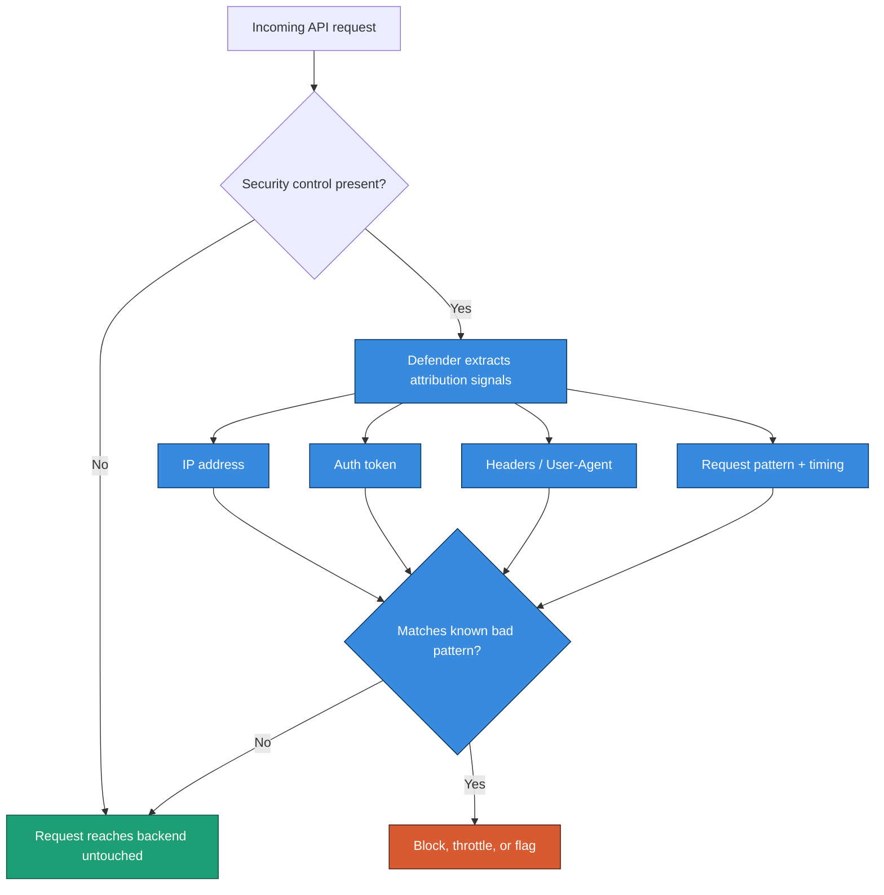
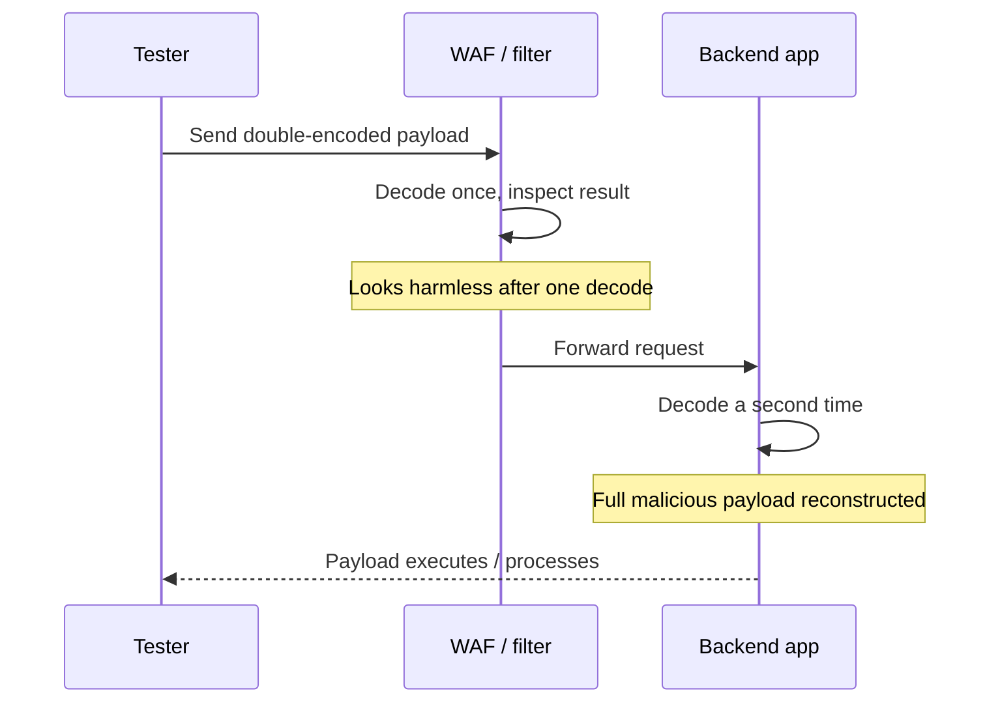
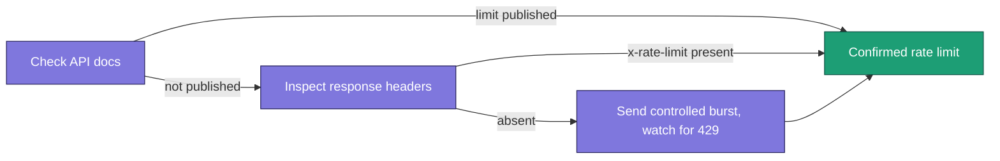
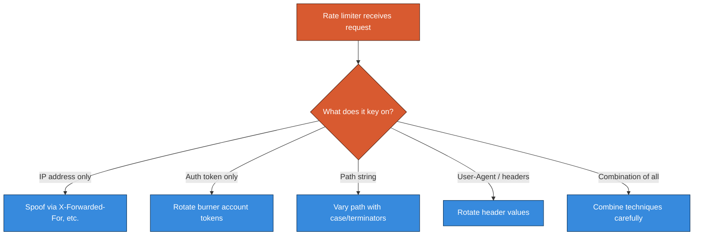
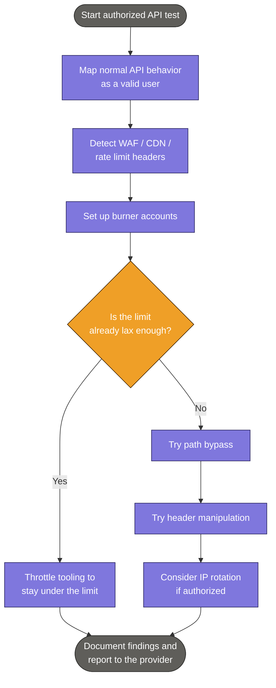

# How I Approach Evasive Testing and Rate Limit Bypasses When Pentesting APIs

> **Scope note:** Everything below assumes you're testing an API you are explicitly authorized to test — a bug bounty program's in-scope assets, a client engagement with signed rules of engagement, or your own lab environment. I'm writing this the way I'd explain it to a junior tester on my team, not as a how-to for attacking systems you don't have permission to touch. If you don't have written authorization, none of this applies to you yet — go get it first.

I've spent a lot of time testing REST APIs, and one pattern keeps showing up: the moment I start sending anything slightly abnormal, something in front of the API starts pushing back. A web application firewall throws a generic error. A rate limiter starts returning `429` responses. An IP gets temporarily blacklisted. None of that means the test is over — it usually means I've found the edge of the API's defenses, and now I get to map out exactly where that edge is.

In this post I want to walk through how I think about two closely related problems: getting past security controls like WAFs that are actively filtering my requests, and testing whether an API's rate limiting actually holds up under pressure. I'll include the commands I actually run, the headers I look for, and some tables I keep bookmarked for quick reference.

## Why APIs Push Back in the First Place

REST APIs are stateless by design — each request is supposed to stand on its own, with no memory of the one before it. That's great for scalability, but it creates a real headache for API providers trying to defend themselves. If a request doesn't carry any history with it, how does a defender recognize that the same attacker sent the last fifty requests?

The answer is **attribution**. API defenders have to reconstruct identity from whatever details each request happens to carry: your IP address, your authorization token, your `User-Agent` string, the exact path you're hitting, and more subtle signals like how quickly you're sending requests or which headers you tend to include. Once a defensive system decides it can attribute a batch of requests to "you," it has something to act on — a warning, a slowdown, a temporary ban, or an outright block.

That single idea — that every defense depends on correctly attributing a request to an attacker — is the thread that runs through this entire post. Every evasion technique I'm going to describe is really just a way of breaking that attribution chain. If the WAF can't cleanly tell that two requests came from the same source, or can't recognize a familiar attack pattern in a slightly mutated payload, its threshold never gets crossed.



## Getting a Feel for What's in Front of Me

Before I try to bypass anything, I want to know exactly what I'm bypassing. Throwing malicious payloads at an API on day one tells me almost nothing except "I got blocked" — I learn more by using the API the way it was designed to be used first, mapping out its normal behavior, and only then poking at the edges.

### Reading the Headers

A surprising amount of information leaks out in response headers, especially when a provider is routing traffic through a content delivery network. CDNs are popular partly because they bundle in WAF functionality, so spotting CDN fingerprints is often the fastest way to confirm a security layer exists. Here's a shortlist I check every single engagement:

| Header | What it usually tells me |
|---|---|
| `X-CDN` | Which CDN is proxying traffic (Akamai, Fastly, Imperva, Incapsula, etc.) |
| `Server` | Sometimes reveals the edge software (`Zenedge`, `Kestrel`) rather than the real origin server |
| `X-Kong-Proxy-Latency` | Confirms an API gateway (Kong) sits in front of the origin |
| `X-Zen-Fury` / `X-Original-URI` | Vendor-specific headers that leak proxy/WAF presence |
| `x-rate-limit` / `x-rate-limit-remaining` | Tells me the rate limit ceiling and how much budget I have left |
| `Retry-After` | Tells me exactly how long I'm locked out after a `429` |

A quick manual check with `curl -I` against an in-scope target is usually my first move:

```bash
$ curl -I https://api.example-lab.local/v1/status
```

```text
HTTP/2 200
server: cloudflare
x-cdn: cloudflare
x-ratelimit-limit: 100
x-ratelimit-remaining: 97
cf-ray: 8a1f2e3b9c7d4e21-DFW
content-type: application/json
```

That one response already tells me three useful things: there's a CDN-based WAF in front of this API, the rate limit ceiling is 100 requests (in whatever window the provider defines), and I've already burned three of my available requests just saying hello.

> **Note:** Don't skip the "use it normally first" step. Building a clean map of valid requests, valid parameters, and expected responses gives you a baseline. Without a baseline, you can't tell the difference between "the WAF blocked me" and "I just sent a malformed request."

### Automated Detection Tools

When I want a faster first pass than manual header-reading, a few community tools help confirm whether a WAF is present:

```bash
$ nmap -p 80 --script http-waf-detect api.example-lab.local
```

```text
Starting Nmap 7.94 ( https://nmap.org )
Nmap scan report for api.example-lab.local
PORT   STATE SERVICE
80/tcp open  http
| http-waf-detect: IDS/IPS/WAF detected:
|_api.example-lab.local:80/?p4yl0ad=<script>alert(1)</script>
Nmap done: 1 IP address (1 host up) scanned in 4.21 seconds
```

Tools like `wafw00f` do something similar by sending a handful of probe requests and comparing response fingerprints against a known-WAF database. I treat the output from any of these tools as a lead to confirm manually, not as gospel — false positives and false negatives both happen.

## Working Safely: Burner Accounts

Here's something I learned the hard way early in my testing career: once a defensive system decides your token or account is hostile, it can be genuinely painful to get back in good standing, especially mid-engagement. So before I do anything that might trip a defense, I set up a batch of disposable accounts — what most testers call **burner accounts**.

A few rules I follow when creating them:

- Use unique email addresses and display names for each burner — never anything that ties back to an account I actually care about.
- If the registration flow allows it, register burners from a different network context (a VPN exit node, a different ASN) than my primary testing account, so an IP-based correlation doesn't link them together.
- Keep a short list of valid auth tokens for each burner handy before I start any aggressive testing, so I can rotate the moment one gets throttled or banned.

The entire point is that if I burn through an account's goodwill while establishing where the defensive thresholds sit, that's fine — that account was never going to be used for anything else.

## Evasive Techniques for Getting Past Input Filters

Once I understand what's watching me, I start probing with techniques designed to slip malicious-looking input past pattern-matching filters while still having that input processed correctly by the backend. None of these are exotic — they're mostly about exploiting the gap between how a filter parses a string and how the backend eventually parses the same string.

### String Terminators

Certain characters act as **string terminators** in many parsing contexts — symbols that tell a program "stop reading here." A classic example is the null byte. If a WAF's filtering logic reads a string up to a null byte but the backend's own parser ignores the null byte and keeps reading, you've found a mismatch you can exploit: the filter sees a truncated, harmless-looking string, while the backend processes the full, malicious payload.

Here's a short list of characters worth trying as separators or terminators when you're testing filter boundaries:

| Terminator | Encoded form |
|---|---|
| Null byte | `%00` or `0x00` |
| Double slash | `//` |
| Semicolon | `;` |
| Percent sign | `%` |
| Exclamation mark | `!` |
| Question mark | `?` |
| Empty brackets | `[]` or `%5B%5D` |
| Tab | `%09` |
| Line feed | `%0a` |
| Vertical tab | `%0b` |
| Form feed | `%0c` |

As an example, if a filter is specifically blocking the literal string `<script>`, inserting a null byte in the middle of the tag sometimes slips past the filter while the backend's HTML parser still renders it correctly:

```json
{
  "uname": "<s%00cript>alert(1)</s%00cript>",
  "email": "tester@example-lab.local"
}
```

> **Caution:** Test metacharacters one at a time, on burner accounts, in an environment you're authorized to test. Throwing an entire wordlist of metacharacters at a production target in one burst is a great way to get permanently banned before you've learned anything useful — and in a live environment that's also closer to a denial-of-service pattern than a security test.

### Case Switching

Some filters are built on simple, case-sensitive string matching, which means something as trivial as mixing upper and lowercase letters in your payload can be enough to dodge detection:

```text
<sCriPt>alert('test')</scrIpT>
SeLeCT * FrOM all_tables
sELecT @@vErSion
```

I always try this early because it costs nothing and immediately tells me something about the sophistication of the filter I'm up against. If case-mixing alone gets a payload through, I know I'm dealing with naive regex-based filtering rather than anything that actually parses the request semantically.

### Encoding Payloads

The next tier up is encoding — transforming your payload so the filter doesn't recognize the dangerous characters, while the backend still decodes and processes them normally. URL encoding is usually my first choice because it's the encoding every HTTP stack understands natively, but HTML entity encoding and base64 are worth trying too, depending on where the payload lands in the request flow.

Here's the same XSS payload at increasing levels of encoding:

```text
Raw:          <script>alert('test')</script>
URL-encoded:  %3Cscript%3Ealert(%27test%27)%3C%2Fscript%3E
Double-encoded: %253Cscript%253Ealert%2528%2527test%2527%2529%253C%252Fscript%253E
```

Double-encoding is a particularly useful trick when there are two decoding stages between the filter and the final processing — for example, a WAF that decodes once and checks the result, followed by an application framework that decodes the request body a second time. If that's the architecture, a double-encoded payload passes the filter's single decode-and-check step looking harmless, then gets decoded a second time by the backend into its fully malicious form.



### Automating Payload Mutation

Testing every combination of case-switching, encoding, and string terminators by hand doesn't scale, so I lean on tooling to generate and send mutated payload sets automatically.

**In Burp Suite**, Intruder's "Payload Processing" rules let you chain transformations that get applied to every payload before it's sent. A typical chain I set up looks like this:

1. **Encode** — URL-encode all characters in the payload.
2. **Add Prefix** — prepend `%00`.
3. **Add Suffix** — append `%00`.

Burp applies these top-to-bottom, so ordering matters — I encode first, then wrap with null bytes, so the null bytes themselves don't get swept up into the encoding step.

**With Wfuzz**, the same idea works through its built-in encoders:

```bash
$ wfuzz -e encoders
```

```text
Available encoders:
base64        - Encode the given string using base64
urlencode     - URL-encode using %xx escapes
random_upper  - Randomly capitalize characters
md5           - MD5 hash the string
hexlify       - Convert each byte to its two-digit hex form
none          - No transformation
```

To fuzz an endpoint with a wordlist where every payload is base64-encoded first:

```bash
$ wfuzz -z file,wordlist/api/common.txt,base64 \
    -u https://api.example-lab.local/FUZZ
```

Chaining multiple encoders with a hyphen sends a separate, differently-encoded request for each encoder listed; chaining them with an `@` applies all of them, in order, to a single payload before it's sent:

```bash
# Three separate requests: base64, md5, and unmodified
$ wfuzz -z list,admin,base64-md5-none -u https://api.example-lab.local/FUZZ

# One request per payload, random-uppercased THEN base64-encoded
$ wfuzz -z list,admin,base64@random_upper -u https://api.example-lab.local/FUZZ
```

> **Note:** When you're automating payload mutation against a real target (even an authorized one), throttle your request rate. A burst of thousands of malformed requests in a few seconds looks a lot like a denial-of-service attempt even when your intent is pure security testing — see the rate-limiting section below for throttling options in both tools.

## Testing Rate Limits

Rate limiting deserves its own section because it's doing a different job than a WAF. A WAF is trying to recognize malicious *content*. A rate limiter is trying to recognize malicious *volume* — too many requests, too fast, from what it believes is a single source. For a hacker, that distinction matters: rate limiting is often the only thing standing between you and brute-forcing a password, enumerating every user ID in a system, or scraping an entire dataset through an API.

### Finding the Limit

Before trying to break anything, I want to know what the limit actually is. A few sources, roughly in order of how much I trust them:

1. **Official API documentation.** Providers frequently publish rate limit tiers directly — free tier vs. paid tier, requests per minute vs. per day.
2. **Response headers.** `x-rate-limit` and `x-rate-limit-remaining` (or vendor variants like `X-RateLimit-Limit`) tell you the ceiling and how much you have left on every response, no guessing required.
3. **Trial and error.** If neither of the above is available, I send a steadily increasing burst of requests and watch for the first `429 Too Many Requests` response, ideally paired with a `Retry-After` header that tells me exactly how long the cooldown lasts.



### When the Limit Is Just... Lax

Sometimes I don't need to bypass anything at all — the limit is generous enough that a legitimate-looking attack fits comfortably underneath it. If a rate limit allows 15,000 requests per minute and I only need 150,000 total requests to brute-force a short numeric ID, that's 10 minutes of patient, well-behaved traffic. No evasion required — just throttling my own tooling to stay under the ceiling.

Both of my go-to fuzzers make this easy. Wfuzz's `-s` flag adds a delay (in seconds) between requests:

| `-s` delay | Approximate request rate |
|---|---|
| `0.01` | ~10 requests/second |
| `1` | 1 request/second |
| `6` | 10 requests/minute |
| `60` | 1 request/minute |

```bash
$ wfuzz -z range,1-150000 -s 0.01 \
    -u "https://api.example-lab.local/v1/users?id=FUZZ"
```

Burp Suite Intruder's Resource Pool works the same way but in milliseconds:

| Delay (ms) | Approximate request rate |
|---|---|
| `100` | ~10 requests/second |
| `1000` | 1 request/second |
| `6000` | 10 requests/minute |
| `60000` | 1 request/minute |

> **Note:** Before spending hours bypassing a rate limit, check whether exceeding it has any real consequence at all. I've found APIs where the `x-rate-limit-remaining` header hit zero and... nothing happened. No `429`, no block, no slowdown — the limit was advertised but never enforced. If that's the case, you've already found your finding; there's no need to go further.

### Path Bypass

If the rate limit genuinely is enforced and genuinely is too tight for what I need to test, the first thing I try is altering the request path slightly — on the theory that some rate limiters key their counters off the exact literal path string, so a cosmetically different path resets or dodges the counter entirely.

```text
POST /api/myprofile
POST /api/myprofile%00
POST /api/myprofile%20
POST /api/myProfile
POST /api/MyProfile
POST /api/my-profile
POST /api/myprofile?test=1
```

If appending a throwaway query parameter turns out to reset the counter, the next step is cycling the *value* of that parameter on every request, so each one looks like a fresh, distinct path to the rate limiter:

```text
POST /api/myprofile?test=1   {"uid": "0001"}
POST /api/myprofile?test=2   {"uid": "0002"}
POST /api/myprofile?test=3   {"uid": "0003"}
```

In Burp Suite, this maps neatly onto an Intruder **pitchfork** attack — two synchronized payload positions, one driving the throwaway parameter and one driving the actual value you're brute-forcing, stepping through both lists in lockstep.

### Origin Header Manipulation

Some providers try to attribute requests to a real-world origin using headers that are, notably, entirely client-supplied — which means they're trivial to forge if the backend trusts them at face value. The usual suspects:

```text
X-Forwarded-For
X-Forwarded-Host
X-Host
X-Originating-IP
X-Remote-IP
X-Client-IP
X-Remote-Addr
```

```bash
$ curl -X POST https://api.example-lab.local/v1/login \
    -H "X-Forwarded-For: 127.0.0.1" \
    -H "X-Originating-IP: 10.0.0.1" \
    -d '{"user":"test"}'
```

If a rate limiter is naively trusting one of these headers to decide "who" is making a request, rotating the header value on every request can make a flood of traffic look like it's coming from a different source each time. Sending every possible header at once risks a `431 Request Header Fields Too Large` response from some servers, so I usually test them individually first, then combine only the ones that seem to matter.

`User-Agent` rotation is worth testing alongside origin headers — some defenders fold it into the same attribution logic, and cycling through a wordlist of realistic browser user-agent strings (SecLists has a solid one) can be enough to reset a counter keyed on that header.



### IP Rotation

The most thorough — and most infrastructure-heavy — bypass is to make requests genuinely originate from different IP addresses rather than just spoofing a header and hoping the backend trusts it. Burp Suite's **IP Rotate** extension does this by proxying traffic through a cloud API gateway (commonly AWS API Gateway), cycling the exit IP on each request so every single one arrives at the target from a different address in the provider's IP range.

Setting it up, at a high level:

```bash
$ pip3 install boto3
```

Then, inside Burp Suite's Extender settings, point the Python environment at a Jython standalone jar, install the IP Rotate extension from the BApp Store, and supply AWS access keys for an IAM user scoped to just the API Gateway admin and invoke permissions it needs — nothing broader. Once it's configured, enabling it against a target host causes every outbound request from that tool to arrive from a different IP within the cloud provider's address space.

> **Caution:** This technique uses real cloud infrastructure and incurs real, if small, cost. It's also the most powerful of the techniques in this post — it defeats pure IP-based blocking entirely, with no spoofing involved, because the requests genuinely do originate from different addresses. That power is exactly why it should only ever be pointed at infrastructure you're explicitly authorized to test. Running it against anything else isn't a gray area.

## Pulling It Together: A Testing Workflow

When I put all of this together into one methodical pass, it looks roughly like the flow below — recon and baseline first, detection second, and only then do I start layering in evasive techniques, always starting with the least invasive option.



## A Quick Reference Table

I keep something like this pinned next to my testing notes — it's the fastest way to remember which tool handles which job.

| Goal | Tool | Key command / setting |
|---|---|---|
| Detect a WAF | nmap | `nmap -p 80 --script http-waf-detect <host>` |
| Detect a WAF | wafw00f | `wafw00f https://api.example-lab.local` |
| Mutate payload case | manual | Mix upper/lowercase in payload |
| Encode payloads | Burp Decoder | URL / HTML / base64 encode |
| Chain payload mutations | Burp Intruder | Payload Processing rules |
| Mutate payloads at scale | Wfuzz | `-z file,<wordlist>,<encoder>` |
| Throttle request rate | Wfuzz | `-s <seconds>` |
| Throttle request rate | Burp Intruder | Resource Pool (ms delay) |
| Rotate exit IP | Burp IP Rotate | AWS API Gateway proxy |

## Wrapping Up

The through-line across every technique in this post is the same: security controls can only act on what they can attribute, and attribution depends entirely on signals carried inside an otherwise stateless request. Null bytes break attribution by confusing a filter's parsing. Case-switching breaks it by dodging naive pattern matching. Encoding breaks it by hiding a payload's true form until it's past the filter. Path variations, header spoofing, and IP rotation all break the rate limiter's ability to tell that the last thousand requests came from the same source.

None of that is a reason to treat these techniques casually. Used against a system you're authorized to test, they're exactly what a thorough API security assessment looks like — this is standard methodology taught in API-focused penetration testing courses and documented in resources like the OWASP API Security Project. Used against anything you don't have permission to touch, the exact same requests are a crime in most jurisdictions, full stop. Always get scope and authorization in writing before you run a single one of these commands against a real target, and keep your burner accounts, your throttling, and your documentation disciplined enough that your findings hold up when you write the report.

If you're building toward a broader API testing methodology, the natural next step from here is usually GraphQL-specific testing — introspection abuse, batching attacks, and the different shape that rate limiting and WAF evasion take when the API isn't REST at all.
