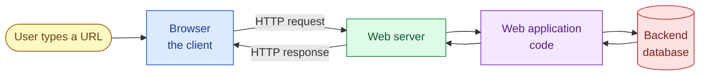
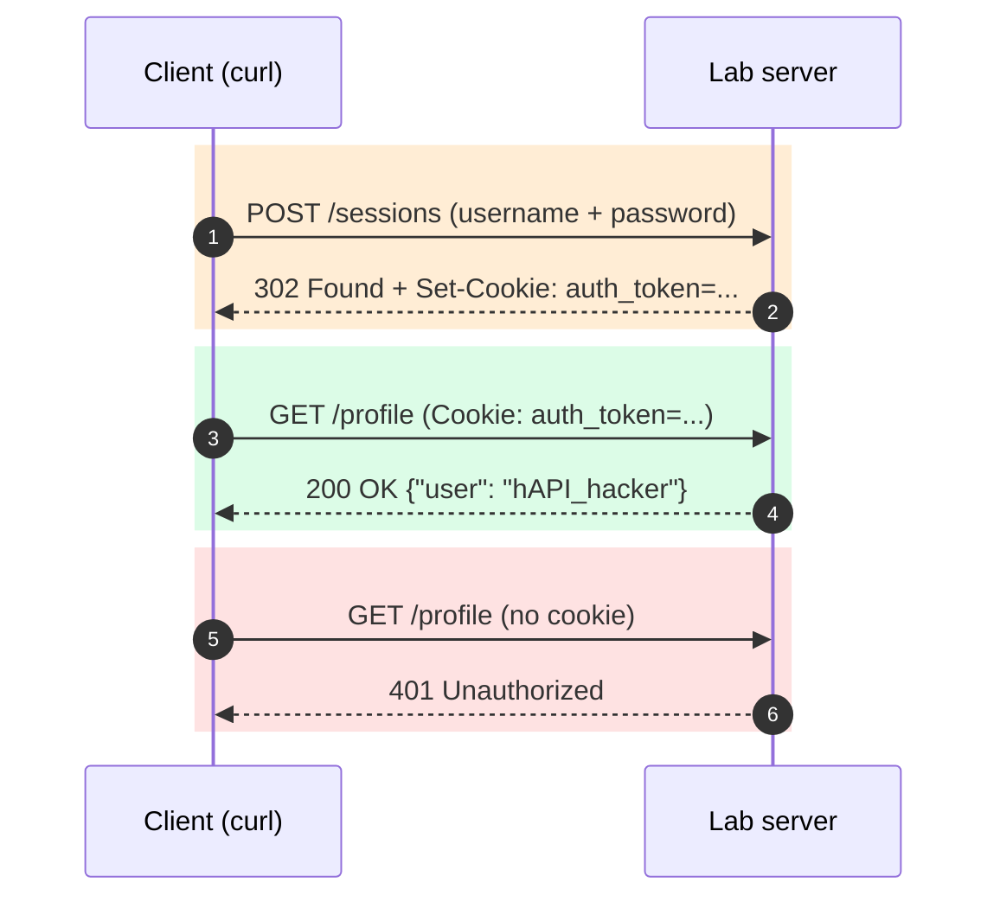
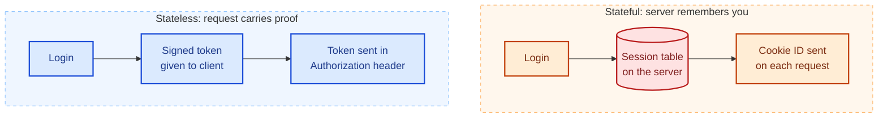
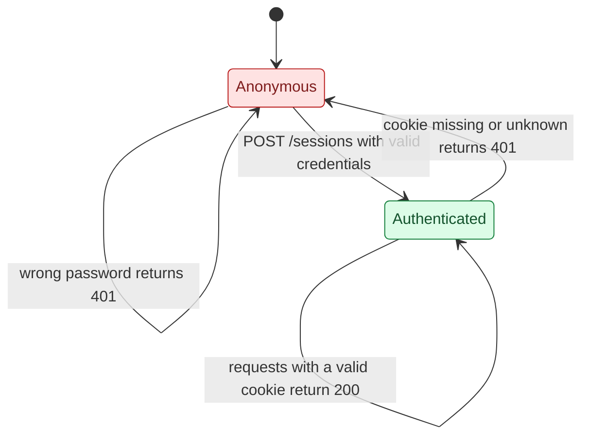
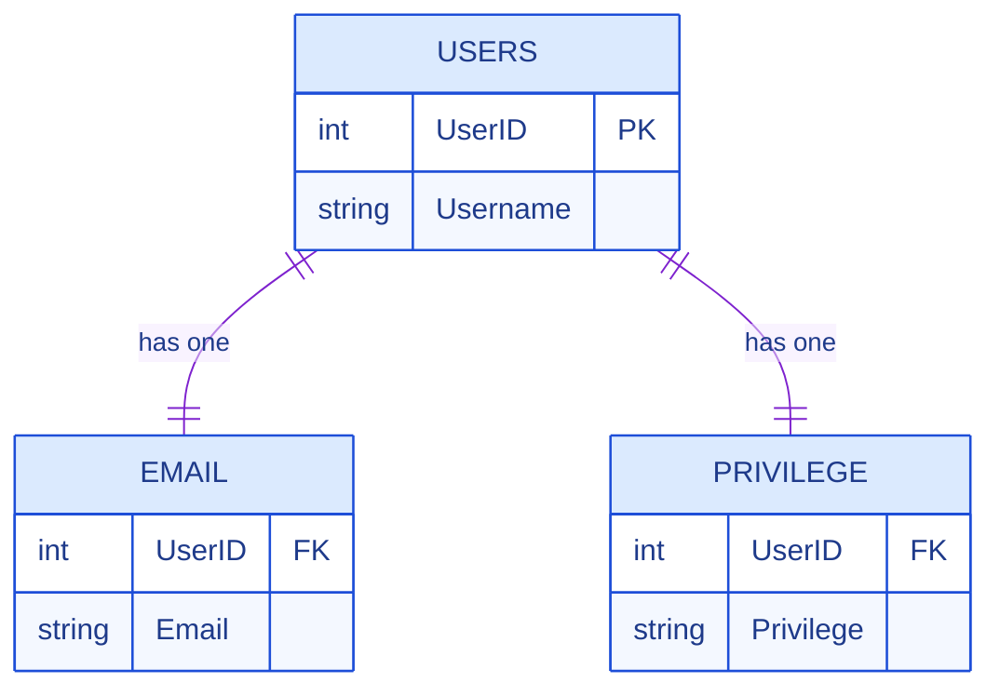
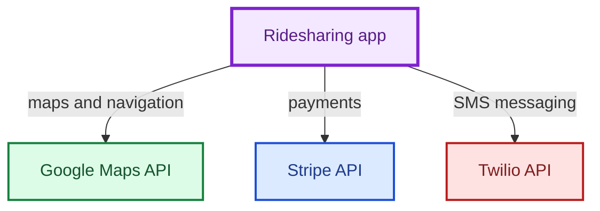

# How Web Applications Work: The Foundation Every API Hacker Needs

## Why I started here

Before I try to break an API, I want to understand the machinery underneath it. Web APIs are not a new kind of technology. They are web applications talking to other applications, using the same HTTP, the same authentication ideas, and the same databases. If I understand those three things, API testing stops feeling like magic and starts feeling like careful reading.

So in this post I walk through the whole chapter in my own words. Instead of only repeating definitions, I built a tiny web server on my own machine and ran every command and script in this post against it. Every terminal output you see below is real output from that lab, not something I typed in by hand.

> **Note:** The lab server binds to `127.0.0.1` only, and the "password" in it is a throwaway lab value. Everything in this post is done against software I wrote and run myself. Only test systems you own or have written permission to test.

Here is the map of what I cover:

```mermaid
flowchart LR
    A["Web app basics<br/>client and server"]:::blue --> B["The URL"]:::green
    B --> C["HTTP requests<br/>and responses"]:::orange
    C --> D["Status codes<br/>and methods"]:::orange
    D --> E["Stateful vs<br/>stateless"]:::purple
    E --> F["Databases<br/>SQL and NoSQL"]:::red
    F --> G["Where APIs<br/>fit in"]:::teal

    classDef blue fill:#dbeafe,stroke:#1d4ed8,color:#1e3a8a,stroke-width:2px
    classDef green fill:#dcfce7,stroke:#15803d,color:#14532d,stroke-width:2px
    classDef orange fill:#ffedd5,stroke:#c2410c,color:#7c2d12,stroke-width:2px
    classDef purple fill:#f3e8ff,stroke:#7e22ce,color:#581c87,stroke-width:2px
    classDef red fill:#fee2e2,stroke:#b91c1c,color:#7f1d1d,stroke-width:2px
    classDef teal fill:#ccfbf1,stroke:#0f766e,color:#134e4a,stroke-width:2px
```



---

## 1. Web app basics: the client/server model

Everything on the web starts with a conversation. My browser (the **client**) asks for something, and a computer called a **web server** answers. The software running on that server, such as Reddit, Gmail, or GitHub, is called a **web application**.

I found one distinction in the chapter especially useful: a *website* versus a *web application*.

| | Website | Web application |
|---|---|---|
| Direction of communication | Mostly one way, server to client | Both ways |
| What the user does | Reads | Posts, votes, comments, edits, configures |
| Example | A static brochure page | Reddit, where I can upvote, comment and customize my feed |
| Why it matters for hacking | Little input to attack | Lots of input, so more places for bugs |

That last row is the one I keep in mind. Every place where a user can send data is a place a tester can poke at. The chapter calls the total amount of exposed functionality the **attack surface**.



---

## 2. Anatomy of a URL

A URL has up to five parts: **protocol**, **hostname**, optional **port**, **path**, and optional **query** with parameters:

```text
protocol://hostname[:port]/path?query=value&another=value
```

| Part | What it does | Example |
|---|---|---|
| Protocol | The rules used to talk (`http`, `https`, `ftp`) | `https` |
| Hostname | Which server to contact | `twitter.com` |
| Port | Which channel on that server | `443` (implied for HTTPS) |
| Path | Which resource | `/search` |
| Query | Extra instructions, a `?` followed by `name=value` pairs | `q=hacking&src=typed_query` |

The default ports worth memorizing are 80 for HTTP, 443 for HTTPS and 21 for FTP. Alternatives such as 8080 and 8443 are common for web apps running on non-standard ports, and those show up often when I scan a target.

I wanted to see the chapter's Twitter example split apart, so I tested it with Python's standard library:

```python
from urllib.parse import urlparse, parse_qs

url = "https://twitter.com/search?q=hacking&src=typed_query"
u = urlparse(url)
print("protocol :", u.scheme)
print("hostname :", u.hostname)
print("port     :", u.port or "(default: 443 for https)")
print("path     :", u.path)
print("query    :", u.query)
print("params   :", parse_qs(u.query))
```

Output:

```text
protocol : https
hostname : twitter.com
port     : (default: 443 for https)
path     : /search
query    : q=hacking&src=typed_query
params   : {'q': ['hacking'], 'src': ['typed_query']}
```

> **Note on terminology:** The book describes `?q` as the "query" and `hacking` as the "query parameter". Many other references call everything after the `?` the query string and each `name=value` pair a parameter. Both views describe the same thing. I'll use whichever reads clearer in context.

Notice `src=typed_query`. I never typed that. The browser added it as a tracking hint, which is a reminder that **a client can send values the user never sees**, and that I can edit any of them.

---

## 3. HTTP requests

When I press Enter, my browser builds an HTTP request. The chapter's login example (Listing 1-1) has three layers:

1. **Request line**: method, path, protocol version, for example `POST /sessions HTTP/1.1`
2. **Headers**: `Name: value` pairs such as `Host`, `User-Agent`, `Content-Type` and `Cookie`
3. **Body**: the data being submitted, such as the username and password

Characters that could cause trouble get encoded. An exclamation mark becomes `%21`. I tested that against my lab server by sending `NotMyPassword%21`, which the server decoded to `NotMyPassword!`, and since my lab password has no exclamation mark, the login failed:

```console
$ curl -si -X POST http://127.0.0.1:8080/sessions \
    -d 'username_or_email=hAPI_hacker&password=NotMyPassword%21'
HTTP/1.1 401 Unauthorized
Server: labsrv/1.0 Python/3.13.16
Date: Tue, 13 Oct 2026 15:00:43 GMT
Content-Type: text/plain
Content-Length: 15

bad credentials
```

That small failure taught me something real: the server decodes the body before checking it, so encoding is part of how input is interpreted, which matters a lot when I later craft payloads.

> **Caution:** HTTP traffic is cleartext. Anyone who can see the network path can read a login sent over plain HTTP. HTTPS wraps the same request in TLS. Also, the book describes HTTP/1.1 as the standard version. That was the focus when it was written, but HTTP/2 and HTTP/3 are widely deployed today. They change how messages travel on the wire, but the ideas of methods, headers, bodies and status codes stay the same.

---

## 4. HTTP responses and status codes

The server answers with a status line, headers and sometimes a body. A successful login request and response look like this in my lab:

```console
$ curl -si -X POST http://127.0.0.1:8080/sessions \
    --data-urlencode 'username_or_email=hAPI_hacker' \
    --data-urlencode 'password=NotMyPassword' -c cookies.txt
HTTP/1.1 302 Found
Server: labsrv/1.0 Python/3.13.16
Date: Tue, 13 Oct 2026 15:00:43 GMT
Content-Type: text/html
Content-Length: 67
Location: /
Set-Cookie: auth_token=08c74700a04bde4615dd2f4ebfbb6c4366fbed96; Path=/; HttpOnly; SameSite=Lax

<html><body>You are being <a href="/">redirected</a>.</body></html>
```

Two headers matter here. `Location` says where to go next. `Set-Cookie` hands me my credential. Notice the cookie flags: `HttpOnly` stops JavaScript from reading it, and `SameSite` limits cross-site sending. A production app would add `Secure` so it is only sent over HTTPS.

> **Note:** The chapter treats the `302` as the sign that authentication worked. More precisely, a `302` only means "go look somewhere else". The real evidence of success is the `Set-Cookie` header carrying a session credential. Apps differ, and some return `200` or `401` for the same events, so I always read the whole response.

Status codes come in families. I keep this table handy:

| Range | Meaning | What I think when I see it |
|---|---|---|
| 1xx | Informational | Rarely seen in testing |
| 2xx | Success | The request was accepted |
| 3xx | Redirect | Follow `Location`, and note where it goes |
| 4xx | Client error | I asked wrongly or I'm not allowed (401, 403, 404) |
| 5xx | Server error | The server broke, so I should look closer at what I sent |

Here are real examples from my lab:

```console
$ curl -si http://127.0.0.1:8080/missing
HTTP/1.1 404 Not Found
Content-Type: text/plain
Content-Length: 0

$ curl -si http://127.0.0.1:8080/boom
HTTP/1.1 500 Internal Server Error
Content-Type: text/plain
Content-Length: 21

Internal Server Error
```

*(I trimmed the `Server` and `Date` headers from the two outputs above to keep them short.)*

The whole request/response cycle for logging in, then using the session, looks like this:



I ran the second and third steps myself:

```console
$ curl -si http://127.0.0.1:8080/profile
HTTP/1.1 401 Unauthorized
Content-Length: 14

login required

$ curl -si -b cookies.txt http://127.0.0.1:8080/profile
HTTP/1.1 200 OK
Content-Type: application/json
Content-Length: 52

{"user": "hAPI_hacker", "mode": "stateful (cookie)"}
```

---

## 5. HTTP methods and idempotency

Methods tell the server what I want to do with a resource.

| Method | Purpose | Idempotent? |
|---|---|---|
| GET | Fetch a resource | Yes |
| POST | Submit data, usually creating something | **No** |
| PUT | Store or fully replace a resource at a URL | Yes |
| PATCH | Partially update a resource | No (per the book) |
| DELETE | Remove a resource | Yes |
| HEAD | Like GET, but headers only | Yes |
| OPTIONS | Ask which methods are allowed | Yes |
| TRACE | Echo the request back, for debugging | Yes |
| CONNECT | Open a tunnel, such as through a proxy | No |

**Idempotent** means that sending the same request many times leaves the server in the same state as sending it once. The book's analogy is a light switch: flipping "on" twice still leaves the light on.

I proved the difference with my `/items` endpoint. Three identical POSTs created three records:

```console
$ for i in 1 2 3; do curl -s -X POST http://127.0.0.1:8080/items \
    -H 'Content-Type: application/json' -d '{"name":"book"}'; echo; done
{"id": 1, "name": "book"}
{"id": 2, "name": "book"}
{"id": 3, "name": "book"}
```

Three identical PUTs to the same URL left exactly one record, overwritten each time:

```console
$ for i in 1 2 3; do curl -s -X PUT http://127.0.0.1:8080/items/10 \
    -H 'Content-Type: application/json' -d '{"name":"lamp"}'; echo; done
{"id": 10, "name": "lamp"}
{"id": 10, "name": "lamp"}
{"id": 10, "name": "lamp"}

$ curl -s http://127.0.0.1:8080/items
{"1": {"name": "book"}, "2": {"name": "book"}, "3": {"name": "book"}, "10": {"name": "lamp"}}
```

DELETE is where I learned a subtle point. The final *state* is the same (the item is gone), but the *status code* can differ between calls:

```console
$ for i in 1 2; do curl -s -o /dev/null -w "DELETE #$i -> %{http_code}\n" \
    -X DELETE http://127.0.0.1:8080/items/10; done
DELETE #1 -> 204
DELETE #2 -> 404
```

> **Note:** Idempotency is about server state, not about identical responses. That is why DELETE counts as idempotent even though the second call returns 404.

The other methods are just as easy to try. HEAD returns headers with no body, OPTIONS advertises what is allowed, and TRACE echoes my request back:

```console
$ curl -sI http://127.0.0.1:8080/items/1
HTTP/1.1 200 OK
Content-Type: application/json
Content-Length: 16

$ curl -si -X OPTIONS http://127.0.0.1:8080/items/1 | grep -iE 'HTTP/|allow'
HTTP/1.1 204 No Content
Allow: GET, HEAD, PUT, PATCH, DELETE, OPTIONS

$ curl -s -X PATCH http://127.0.0.1:8080/items/10 \
    -H 'Content-Type: application/json' -d '{"color":"red"}'
{"id": 10, "name": "lamp", "color": "red"}

$ curl -s -X TRACE http://127.0.0.1:8080/ -H 'X-Demo: hello'
TRACE / HTTP/1.1
Host: 127.0.0.1:8080
User-Agent: curl/8.5.0
Accept: */*
X-Demo: hello
```

*(The PATCH call was made while item 10 still existed, before the DELETE demo above removed it. I'm showing it here so the methods are grouped together.)*

> **Caution:** Real servers often leave TRACE enabled by mistake, and an `Allow` header can reveal methods the developers never meant to expose. As a tester I read `OPTIONS` results carefully, but I never assume that an allowed method is *safe* to send on a system that isn't mine. A DELETE sent to a real resource really deletes it.

---

## 6. Stateful versus stateless

HTTP itself is **stateless**: each request stands alone, and the server does not automatically remember the last one. But a shopping cart or a logged-in session needs memory, so apps add it back in one of two ways.



| | Stateful (cookie session) | Stateless (token) |
|---|---|---|
| Where is the session kept? | Server memory or database | Inside the token the client holds |
| Scaling | Harder: the server must track every session | Easier: any server can verify the token |
| Switching devices | You log in again and get a new state | Request a token for the new device |
| What an attacker steals | The cookie | The token |

My lab has both, so I could test each one. The stateless flow gives me a signed token:

```console
$ curl -s -X POST http://127.0.0.1:8080/api/login \
    -H 'Content-Type: application/json' \
    -d '{"username":"hAPI_hacker","password":"NotMyPassword"}'
```

The token that came back is two parts joined by a dot: an encoded payload and a signature. Anyone can decode the payload, because it is only encoded and not encrypted:

```console
$ echo "$PAYLOAD_PART" | python3 -c 'import sys,base64;s=sys.stdin.read().strip();print(base64.urlsafe_b64decode(s+"="*(-len(s)%4)).decode())'
{"sub": "hAPI_hacker", "iat": 1791903653}
```

Then I used it, withheld it, and tampered with it:

```console
--- valid token:
{"user": "hAPI_hacker", "mode": "stateless (bearer token)"}

--- no token:
{"error": "invalid token"} [401]

--- tampered payload (sub changed to "admin", original signature kept):
{"error": "invalid token"} [401]
```

The tampered token failed because the signature no longer matched the payload. That is the entire point of signing. A token that is signed but poorly implemented, for example one that accepts any signature or skips the check, is a classic API weakness, and that is what I will be hunting for in later chapters.

Next I tried the attacker's view of the stateful design. I copied the cookie value and replayed it in a separate request, as if it came from another machine:

```console
$ curl -s -H "Cookie: auth_token=08c74700a04bde4615dd2f4ebfbb6c4366fbed96" http://127.0.0.1:8080/profile
{"user": "hAPI_hacker", "mode": "stateful (cookie)"}
```

The server cannot tell a stolen cookie from the real one. It only checks whether the value exists in its session table.

> **Caution:** This is the same reason the book says an attacker can impersonate a user by stealing or forging cookies or tokens. Treat any cookie, bearer token or API key like a password. Never paste real ones into chats, tickets or screenshots, and never replay credentials you were not given.

The state diagram below shows the life of a session in my lab:



---

## 7. Web server databases

The frontend (HTML, CSS, JavaScript and frameworks like React) is what I see. The backend (server, application code and database) is where data actually lives. In a well-built app, I should never reach the database directly. Every query should go through application code, which keeps the attack surface smaller.

Two database families dominate.

### SQL: tables and relationships

The chapter uses three small tables linked by `UserID`. I rebuilt them in SQLite, which ships with Python:

```python
import sqlite3

db = sqlite3.connect(":memory:")
c = db.cursor()
c.executescript("""
CREATE TABLE Users     (UserID INTEGER PRIMARY KEY, Username TEXT);
CREATE TABLE Email     (UserID INTEGER, Email TEXT);
CREATE TABLE Privilege (UserID INTEGER, Privilege TEXT);
INSERT INTO Users     VALUES (111,'hAPI_hacker'),(112,'Scuttleph1sh'),(113,'mysterioushadow');
INSERT INTO Email     VALUES (111,'hapi_hacker@email.com'),(112,'scuttleph1sh@email.com'),(113,'mysterioushadow@email.com');
INSERT INTO Privilege VALUES (111,'admin'),(112,'partner'),(113,'user');
""")

print("Query 1: SELECT * FROM Email WHERE UserID = 111;")
print(c.execute("SELECT * FROM Email WHERE UserID = 111;").fetchall())

print("\nQuery 2: join all three tables")
rows = c.execute("""
SELECT u.UserID, u.Username, e.Email, p.Privilege
FROM Users u JOIN Email e USING(UserID) JOIN Privilege p USING(UserID)
ORDER BY u.UserID;
""").fetchall()
for r in rows:
    print(r)

print("\nQuery 3: safe, parameterized version of Query 1")
user_input = "111"
print(c.execute("SELECT * FROM Email WHERE UserID = ?", (user_input,)).fetchall())
```

Output:

```text
Query 1: SELECT * FROM Email WHERE UserID = 111;
[(111, 'hapi_hacker@email.com')]

Query 2: join all three tables
(111, 'hAPI_hacker', 'hapi_hacker@email.com', 'admin')
(112, 'Scuttleph1sh', 'scuttleph1sh@email.com', 'partner')
(113, 'mysterioushadow', 'mysterioushadow@email.com', 'user')

Query 3: safe, parameterized version of Query 1
[(111, 'hapi_hacker@email.com')]
```

The query anatomy is worth memorizing: `SELECT` chooses what to return, `*` means all columns, `FROM` names the table, and `WHERE` filters rows.



> **Caution:** Query 1 builds its `WHERE` clause from a literal value. If an app builds that string by gluing user input into SQL, an attacker can change the meaning of the query. That is **SQL injection**, and it is still found in APIs after more than two decades. Query 3 shows the defense: a parameterized query keeps data and code separate. I will cover testing for injection in later chapters, and only against labs and authorized targets.

### NoSQL: documents and operators

NoSQL databases drop the table-and-relationship model. MongoDB, the example in the chapter, stores documents and filters them with operators. I did not want to install a full database server for a few queries, so I used `mongomock`, a Python library that implements the same query language in memory (`pip install mongomock`):

```python
import mongomock

col = mongomock.MongoClient().lab.collection
col.insert_many([
    {"UserID": 111, "Username": "hAPI_hacker", "Privilege": "admin"},
    {"UserID": 112, "Username": "Scuttleph1sh", "Privilege": "partner"},
    {"UserID": 113, "Username": "mysterioushadow", "Privilege": "user"},
])

def show(label, query):
    ids = [d["UserID"] for d in col.find(query)]
    print(f"{label:<48} -> {ids}")

show('find({"UserID": 111})', {"UserID": 111})
show('find({"UserID": {"$eq": 111}})', {"UserID": {"$eq": 111}})
show('find({"UserID": {"$gt": 110}})', {"UserID": {"$gt": 110}})
show('find({"UserID": {"$lt": 113}})', {"UserID": {"$lt": 113}})
show('find({"UserID": {"$ne": 111}})', {"UserID": {"$ne": 111}})
```

Output:

```text
find({"UserID": 111})                            -> [111]
find({"UserID": {"$eq": 111}})                   -> [111]
find({"UserID": {"$gt": 110}})                   -> [111, 112, 113]
find({"UserID": {"$lt": 113}})                   -> [111, 112]
find({"UserID": {"$ne": 111}})                   -> [112, 113]
```

The third line is the one to remember. I did not need to know the exact `UserID` to match records, because `$gt` matched every user above 110. That flexibility is the reason operators matter so much when testing for NoSQL injection.

| Operator | Matches | My test result |
|---|---|---|
| `$eq` | Values equal to the given value | `[111]` |
| `$gt` | Values greater than the given value | `[111, 112, 113]` |
| `$lt` | Values less than the given value | `[111, 112]` |
| `$ne` | Values not equal to the given value | `[112, 113]` |

> **Note:** SQL and NoSQL are not interchangeable in testing. The chapter points out that each NoSQL product has its own structure, query style and weaknesses. Knowing which database sits behind an API shapes what I try next.

---

## 8. Where APIs fit in

An **API** lets one application use another. A **web API** does this over HTTP, so it inherits the methods, headers, status codes and client/server model I just walked through. The chapter's example is a ridesharing app that does not build everything itself:



This helps developers move fast, and it is also why the attack surface grows. Each integration is another entrance, and API calls are stateless, so credentials travel with every request.

---

## 9. Reproduce the lab yourself

If you want to run everything above, here are the steps I used. I tested them on Linux with Python 3.13, curl 8.5 and SQLite 3.45.

1. Create a folder and save the server code from the appendix as `server.py`.
2. Install the one extra library: `pip install mongomock`
3. Start the server in the background and confirm it responds:

```console
$ python3 server.py &
$ curl -si http://127.0.0.1:8080/ | head -1
HTTP/1.1 200 OK
```

4. Save the URL, SQL and NoSQL scripts from the sections above as `url_demo.py`, `sql_demo.py` and `nosql_demo.py`, then run them with `python3`.
5. Run the curl commands from each section in order. Tokens and cookie values will differ on your machine because they are generated fresh each time, and the `Date` header will show your own time.
6. When you are done, stop the server with `kill %1` (or `pkill -f server.py`).

> **Caution:** The server code is intentionally minimal. It has no rate limiting, no HTTPS and a hard-coded secret. Use it only on localhost.

---

## Key takeaways

- A **web application** is interactive in both directions, so it accepts lots of input. That input is the attack surface.
- A **URL** is protocol, host, port, path and query. Browsers add values you never typed, and you can change them.
- An **HTTP request** is a method, path, headers and body. A **response** is a status code, headers and body.
- **Status codes** group into 1xx to 5xx. Read the full response, not just the number, because a `302` alone does not prove a login worked.
- **Idempotent** methods (GET, PUT, DELETE and others) leave the same server state when repeated. POST does not.
- **Stateful** apps remember you with cookies and a server-side session. **Stateless** apps make every request carry proof, usually a token. Stealing or forging either one means impersonating the user.
- **SQL** stores related tables and is queried with `SELECT ... FROM ... WHERE`. **NoSQL** stores documents and filters with operators such as `$eq`, `$gt`, `$lt` and `$ne`.
- **APIs** connect applications using the same HTTP foundations. Understanding the basics makes the rest of API hacking much easier to follow.

---

## Appendix: the lab server (`server.py`)

<details>
<summary>Click to expand the full tested server code</summary>

```python
#!/usr/bin/env python3
"""Tiny teaching web app for the 'How Web Applications Work' lab.

Stateful login  : POST /sessions  -> session stored in server memory, cookie issued
Stateless token : POST /api/login -> signed token, nothing stored on the server
Methods demo    : /items collection (POST, GET, PUT, PATCH, DELETE, HEAD, OPTIONS, TRACE)
Binds to 127.0.0.1 only. Never expose this on a real network.
"""
import base64, hashlib, hmac, json, secrets, time
from http.server import BaseHTTPRequestHandler, ThreadingHTTPServer
from urllib.parse import urlparse, parse_qs

SECRET = b"lab-only-secret"
USERS = {"hAPI_hacker": "NotMyPassword"}
SESSIONS = {}          # cookie value -> username (server-side state)
ITEMS = {}             # id -> dict
NEXT_ID = [1]


def make_token(user):
    payload = base64.urlsafe_b64encode(json.dumps({"sub": user, "iat": int(time.time())}).encode()).decode()
    sig = hmac.new(SECRET, payload.encode(), hashlib.sha256).hexdigest()
    return f"{payload}.{sig}"


def check_token(token):
    try:
        payload, sig = token.split(".")
        good = hmac.new(SECRET, payload.encode(), hashlib.sha256).hexdigest()
        if not hmac.compare_digest(sig, good):
            return None
        return json.loads(base64.urlsafe_b64decode(payload))["sub"]
    except Exception:
        return None


class H(BaseHTTPRequestHandler):
    server_version = "labsrv/1.0"
    protocol_version = "HTTP/1.1"

    def log_message(self, *a):
        pass

    # ---- helpers
    def body(self):
        n = int(self.headers.get("Content-Length") or 0)
        return self.rfile.read(n) if n else b""

    def send(self, code, data=b"", ctype="text/plain", headers=None, head=False):
        if isinstance(data, (dict, list)):
            data, ctype = json.dumps(data).encode(), "application/json"
        elif isinstance(data, str):
            data = data.encode()
        self.send_response(code)
        self.send_header("Content-Type", ctype)
        self.send_header("Content-Length", str(len(data)))
        for k, v in (headers or {}).items():
            self.send_header(k, v)
        self.end_headers()
        if not head:
            self.wfile.write(data)

    def cookie_user(self):
        for part in (self.headers.get("Cookie") or "").split(";"):
            k, _, v = part.strip().partition("=")
            if k == "auth_token":
                return SESSIONS.get(v)

    def bearer_user(self):
        h = self.headers.get("Authorization") or ""
        return check_token(h[7:]) if h.startswith("Bearer ") else None

    # ---- routing
    def route(self, method):
        u = urlparse(self.path)
        p, head = u.path, method == "HEAD"
        m = "GET" if head else method

        if p == "/" and m == "GET":
            return self.send(200, "<html><body>Hello from the lab</body></html>", "text/html", head=head)
        if p == "/search" and m == "GET":
            return self.send(200, {"path": p, "query": u.query, "params": parse_qs(u.query)}, head=head)
        if p == "/boom":
            return self.send(500, "Internal Server Error")
        if p == "/sessions" and m == "POST":
            form = parse_qs(self.body().decode())
            user = (form.get("username_or_email") or [""])[0]
            pw = (form.get("password") or [""])[0]
            if USERS.get(user) == pw:
                tok = secrets.token_hex(20)
                SESSIONS[tok] = user
                return self.send(302, '<html><body>You are being <a href="/">redirected</a>.</body></html>', "text/html",
                                 {"Location": "/", "Set-Cookie": f"auth_token={tok}; Path=/; HttpOnly; SameSite=Lax"})
            return self.send(401, "bad credentials")
        if p == "/profile" and m == "GET":
            u_ = self.cookie_user()
            return self.send(200, {"user": u_, "mode": "stateful (cookie)"}) if u_ else self.send(401, "login required")
        if p == "/api/login" and m == "POST":
            d = json.loads(self.body() or b"{}")
            if USERS.get(d.get("username")) == d.get("password"):
                return self.send(200, {"token": make_token(d["username"])})
            return self.send(401, {"error": "bad credentials"})
        if p == "/api/profile" and m == "GET":
            u_ = self.bearer_user()
            return self.send(200, {"user": u_, "mode": "stateless (bearer token)"}) if u_ else self.send(401, {"error": "invalid token"})

        # ---- /items collection for the methods demo
        if p == "/items":
            if m == "GET":
                return self.send(200, ITEMS, head=head)
            if m == "POST":
                i = NEXT_ID[0]; NEXT_ID[0] += 1
                ITEMS[i] = json.loads(self.body() or b"{}")
                return self.send(201, {"id": i, **ITEMS[i]}, headers={"Location": f"/items/{i}"})
            if m == "OPTIONS":
                return self.send(204, headers={"Allow": "GET, POST, HEAD, OPTIONS"})
        if p.startswith("/items/"):
            try:
                i = int(p.rsplit("/", 1)[1])
            except ValueError:
                return self.send(400, "bad id")
            if m == "GET":
                return self.send(200, ITEMS[i], head=head) if i in ITEMS else self.send(404, "", head=head)
            if m == "PUT":
                ITEMS[i] = json.loads(self.body() or b"{}")
                return self.send(200, {"id": i, **ITEMS[i]})
            if m == "PATCH":
                if i not in ITEMS:
                    return self.send(404, "")
                ITEMS[i].update(json.loads(self.body() or b"{}"))
                return self.send(200, {"id": i, **ITEMS[i]})
            if m == "DELETE":
                return (ITEMS.pop(i) and self.send(204)) if i in ITEMS else self.send(404, "")
            if m == "OPTIONS":
                return self.send(204, headers={"Allow": "GET, HEAD, PUT, PATCH, DELETE, OPTIONS"})
        return self.send(404, "", head=head)

    def do_GET(self): self.route("GET")
    def do_POST(self): self.route("POST")
    def do_PUT(self): self.route("PUT")
    def do_PATCH(self): self.route("PATCH")
    def do_DELETE(self): self.route("DELETE")
    def do_OPTIONS(self): self.route("OPTIONS")
    def do_HEAD(self): self.route("HEAD")

    def do_TRACE(self):
        echo = f"{self.command} {self.path} {self.request_version}\r\n" + "".join(f"{k}: {v}\r\n" for k, v in self.headers.items())
        self.send(200, echo, "message/http")


if __name__ == "__main__":
    ThreadingHTTPServer(("127.0.0.1", 8080), H).serve_forever()
```

</details>
