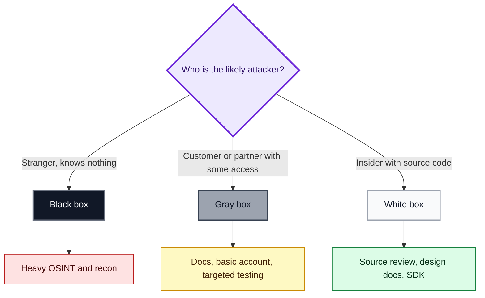
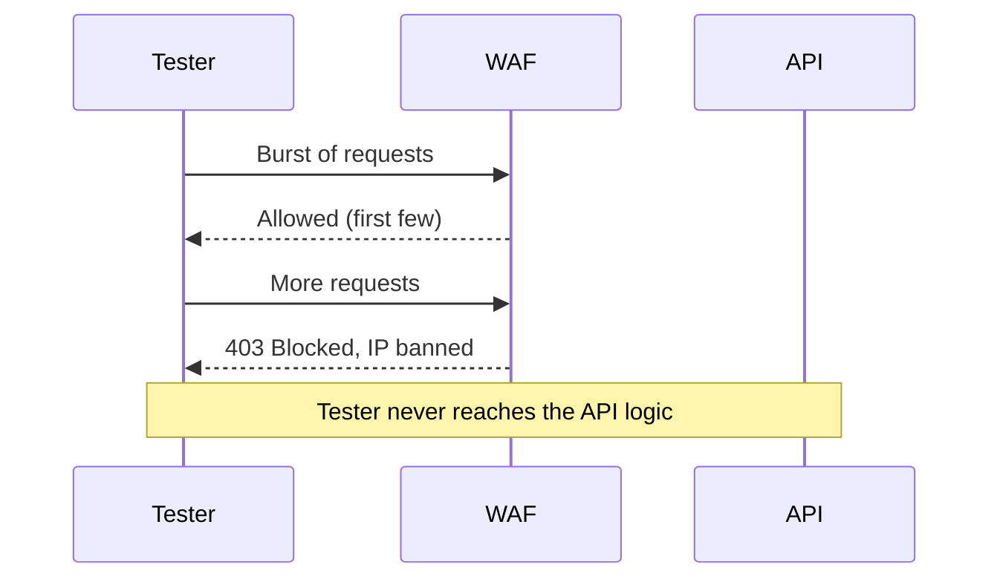
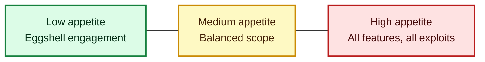
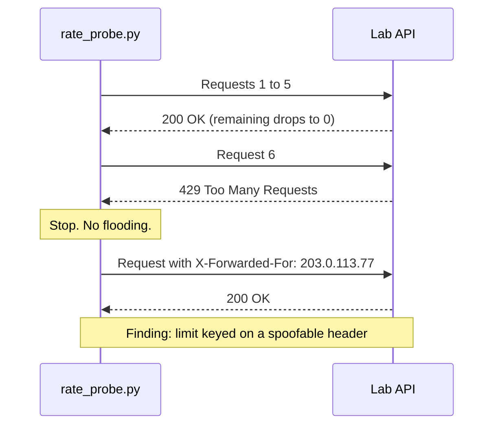
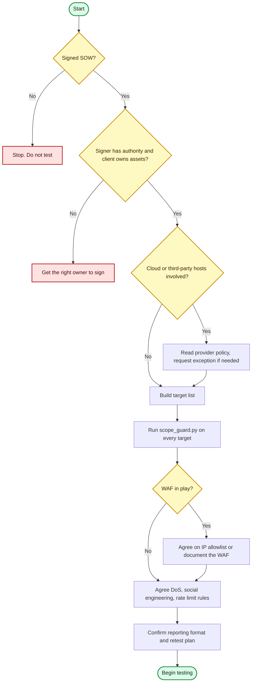

# Preparing for Your API Security Tests: Scoping, Authorization, and Threat Modeling

*A practical, hands-on guide to everything that happens before the first request is sent*

---

I have learned something the hard way: the quality of an API penetration test is decided **before** I open Burp Suite or fire a single `curl`. Scoping, authorization, and threat modeling are the boring part of the job, and they are also the part that keeps me legal, keeps the client's production systems alive, and makes the final report actually valuable.

In this post I walk through how I prepare for an API security engagement. I cover authorization, threat modeling (black, gray, and white box), what API features belong in scope, WAFs, mobile apps, documentation audits, rate limit testing, exclusions, cloud provider rules, DoS testing, reporting, and bug bounty scope. I also include two small Python tools I wrote and **actually ran** in a local lab, so the terminal output you see below is real.

> **Note:** Everything here assumes you only test systems you are explicitly authorized to test. I never run any of this against a target without a signed agreement.

---

## Table of Contents

1. [Why API testing needs its own scope](#1-why-api-testing-needs-its-own-scope)
2. [Receiving authorization](#2-receiving-authorization)
3. [Threat modeling an API test](#3-threat-modeling-an-api-test)
4. [Black, gray, and white box compared](#4-black-gray-and-white-box-compared)
5. [Which API features I include in scope](#5-which-api-features-i-include-in-scope)
6. [Restrictions and exclusions](#6-restrictions-and-exclusions)
7. [Cloud API testing rules](#7-cloud-api-testing-rules)
8. [DoS testing and risk appetite](#8-dos-testing-and-risk-appetite)
9. [Reporting and remediation testing](#9-reporting-and-remediation-testing)
10. [Bug bounty scope](#10-bug-bounty-scope)
11. [Hands-on lab: scope guard and rate limit probe](#11-hands-on-lab)
12. [My pre-engagement checklist](#12-my-pre-engagement-checklist)

---

## 1. Why API testing needs its own scope

An API penetration test does not fit neatly into a general network pentest, and it is not the same as a web application pentest either. Organizations often expose dozens or hundreds of endpoints, multiple versions, several authentication schemes, and different privilege levels. That attack surface is large enough that API testing is its own service.

A good API scope comes down to six factors:

| Factor | The question I ask the client |
|---|---|
| Methodology | Black, gray, or white box? |
| Magnitude | How many endpoints, methods, versions, roles? |
| Target features | Auth, rate limits, docs, mobile, third-party calls? |
| Restrictions | What is off limits (DoS, social engineering, shared hosts)? |
| Reporting | What format, what severity model, what deadline? |
| Remediation testing | Do they want a retest after fixes? |

Here is the overall flow I follow:

```mermaid
flowchart LR
    A[Client request] --> B[Scoping call]
    B --> C[Threat model]
    C --> D[Choose box color]
    D --> E[Sign SOW]
    E --> F[Test]
    F --> G[Report]
    G --> H[Retest]

    classDef plan fill:#dbeafe,stroke:#1d4ed8,stroke-width:2px,color:#0f172a
    classDef legal fill:#fef9c3,stroke:#ca8a04,stroke-width:2px,color:#422006
    classDef act fill:#fee2e2,stroke:#b91c1c,stroke-width:2px,color:#450a0a
    classDef out fill:#dcfce7,stroke:#15803d,stroke-width:2px,color:#052e16

    class A,B,C,D plan
    class E legal
    class F act
    class G,H out
```



---

## 2. Receiving authorization

Before I attack anything, I need a **signed contract** that states the scope and grants me permission to attack the client's resources within a specific time window. For API work this is usually a signed **statement of work (SOW)** listing approved targets. It should cover:

- Which parts of the API will be tested
- Explicit exclusions
- The agreed testing window
- Who to call if something breaks

### Things I double-check

1. **The signer has authority.** A friendly developer is not necessarily someone who can authorize testing. I make sure the signer represents the client and can approve it.
2. **The client owns the assets.** If an API is run by a vendor, I need *that* owner's permission too.
3. **Hosting location matters.** If the API lives with a cloud or hosting provider, the client may not be able to authorize testing against the underlying hardware.

> **Caution:** If it is not written down, it is not authorized. Verbal approval, a casual chat message, or "the CTO said it's fine" will not protect you if an outage happens. I put everything in the contract, reminder emails, or meeting notes, and I still recommend talking to a lawyer or your legal department to reduce risk.

### Convincing clients to loosen restrictions

Some organizations write very restrictive scopes. When I get the chance to help write the scope, I calmly explain that real criminals have no scope. They do not avoid the subnet with sensitive production servers, and they do not wait for a convenient time of day. I try to convince clients that a less restrictive engagement produces a more honest result, then document the particulars precisely.

---

## 3. Threat modeling an API test

**Threat modeling** maps the threats facing an API provider. If I model the test around a *relevant* threat, I can choose tools and techniques that match the real attack. A **threat actor** can be:

- A member of the public who stumbles on the API
- A paying customer
- A rogue business partner
- An insider who knows the application well

The actor's perspective decides how much information I receive, and that decides the testing approach.



### Match the threat to the target

Imagine a small, politically inconsequential business that is not part of any supply chain. Assuming its adversary is a nation-state advanced persistent threat (APT) would be absurd. It would be like using a drone strike on a petty thief. The likelier attacker is an opportunistic, medium-skilled person running published exploits against known vulnerabilities. That fits a **limited black box** test.

### The survey I use

The best way I have found to model a threat is a short client survey. I ask about:

- Scope of exposure to attacks
- Economic significance
- Political involvement
- Supply chain involvement
- Whether they offer essential services
- Any other motive a criminal might have

I build my own survey or borrow from professional resources such as [MITRE ATT&CK](https://attack.mitre.org) and the [OWASP Threat Modeling Cheat Sheet](https://cheatsheetseries.owasp.org/cheatsheets/Threat_Modeling_Cheat_Sheet.html).

---

## 4. Black, gray, and white box compared

| Aspect | Black box | Gray box | White box |
|---|---|---|---|
| Models | Opportunistic outsider | Better-informed attacker | Insider |
| Info given | Often only the company name | Scope, docs, maybe a basic account | Source code, design info, SDK, everything above |
| Recon effort | Very high (OSINT) | Reduced | Minimal |
| Active testing time | Lowest | Higher | Highest |
| WAF handling | Must work around it | Often disclosed | Disclosed, often bypassed for testing |
| Typical use | Realism check | Most commercial engagements | Maximum thoroughness |

### Black box in practice

In a true black box engagement I might start with nothing but the company name. I use OSINT: search engines, social media, public financial records, and DNS data. At the end I present a list of discovered IP addresses, URLs, and API endpoints, and the client reviews and authorizes testing.

> **Illustrative example only.** The commands below use `example.com`, a domain reserved for documentation, and the output is representative rather than captured from a real target.

```bash
$ dig +short example.com A
93.184.216.34
$ dig +short example.com NS
a.iana-servers.net.
b.iana-servers.net.
```

### Gray box and bug bounties

A gray box test trades recon time for active testing. I usually receive in-scope and out-of-scope lists, API documentation, and sometimes a basic user account. I might also be allowed to bypass some perimeter controls.

**Bug bounty programs** sit between black and gray. The company provides approved targets, exclusions, rewarded vulnerability types, and allowed attacks, but hunters decide how much time to spend on recon.

### White box in practice

Here the client shares as much as possible: source code, design information, and the SDK. It models an insider, and the more information I receive, the more thoroughly the target gets tested.

---

## 5. Which API features I include in scope

One of the main goals of scoping is sizing the work. I need to know how many **unique endpoints, methods, versions, features, authentication and authorization mechanisms, and privilege levels** I must cover. I find this out through client interviews, API documentation, and API collections (such as Postman collections). From that I estimate testing hours.

### 5.1 Authenticated testing

I ask how the client wants unauthenticated and authenticated users handled. They may want me to test several roles to look for flaws at each privilege level, plus the authentication and authorization process itself. Many of the most damaging API weaknesses live in authentication and authorization.

### 5.2 Web application firewalls (WAFs)

A WAF controls the traffic that reaches the API. A properly configured WAF can detect request frequency or repeated failures and ban my testing device, stopping a test cold.



Ideally the client lets my IP bypass the WAF, or lowers boundary security, so I test the **API's** controls and not the WAF's effectiveness. This is not about weakening security. A persistent attacker given enough time may learn the WAF's limits, bypass it, or use a zero-day, so layered defense matters and the API must stand on its own.

> **Note:** If the WAF is on in the test environment, I document that in the report so the client knows which findings were validated *behind* the WAF and which *with* it bypassed.

### 5.3 Mobile applications

Mobile apps expand the attack surface and rely heavily on APIs. I can test those APIs through:

- **Manual code review** of the app source
- **Automated source code analysis** with tooling
- **Dynamic analysis**, which means intercepting the app's requests and the server's responses while it runs

### 5.4 Auditing API documentation

Documentation describes authentication, roles, examples, and endpoints. It is also frequently outdated, inaccurate, and leaky. In gray and white box tests I include a **documentation audit** in scope, because it exposes weaknesses including business logic flaws.

### 5.5 Rate limit testing

Rate limiting restricts how many requests a consumer can make in a time frame. It protects resources and enables **API monetization**. For example, a free tier might get one request per hour while a paid tier gets hundreds.

**Rate limit testing is not DoS testing.** DoS testing tries to make a system unavailable. Rate limit testing tries to bypass the restriction on request volume, which does not necessarily disrupt anything.

Documentation usually states the limit like this:

```text
You may make X requests within a Y time frame.
If you exceed this limit, you will get a Z response.
```

The Twitter example from the source material: the first tier allowed 15 requests per 15 minutes, the next tier 180 per 15 minutes, and exceeding the limit returned an error status code.

| Status code | Meaning | What I do |
|---|---|---|
| `200` | Request accepted | Count it |
| `429` | Too many requests (the standard code) | Record the threshold and stop |
| `403` | Possibly a WAF ban | Pause and check with the client |
| `5xx` | Server struggling | **Stop immediately** and notify the client |

> **Caution:** Even though rate limit testing is not DoS testing, I keep my request volume low and stop at the first sign of service degradation. Check the `max_rps` value in your scope.

---

## 6. Restrictions and exclusions

Unless the authorization documents say otherwise, I assume **no DoS or DDoS**. Being authorized for it is rare, and when it is, it is spelled out formally. Penetration testing and social engineering (phishing, vishing, smishing) are normally separate exercises, but I always ask.

Bug bounty programs by default reject social engineering, DoS and DDoS, attacks against customers, and access to customer data. When an attack would affect a user, the usual advice is to create **multiple accounts and attack your own test accounts**.

Clients may also list **known issues** or accepted risks. A forgot-password function that reveals whether an email exists could allow username enumeration, yet the organization may have accepted that as a convenience.

### Path-level exclusions

Exclusions can be very specific. A banking API might allow `/api/accounts` but forbid `/api/shared/accounts` because it is shared with a third party that has not authorized testing. Authentication may also run through a third party I am not allowed to touch.

Because mistakes here are easy to make, I wrote a small script that checks every candidate target against the signed scope.

---

## 7. Cloud API testing rules

Modern APIs often run in the cloud, so I am effectively attacking the provider's physical servers. Each provider has its own rules, and as of 2021, providers have become friendlier toward testers. Some SaaS targets, such as an organization's Salesforce APIs, still require authorization.

| Provider | Pre-approval needed? | Key restrictions |
|---|---|---|
| **AWS** | Not for most testing | No DNS zone walking, DoS/DDoS, simulated DoS/DDoS, port flooding, protocol flooding, or request flooding without written exception |
| **Google Cloud** | No notification needed | Must follow the AUP and TOS; no illegal actions, phishing, spam, malicious files, or service interruption |
| **Microsoft Azure** | No notification needed | Follow the published Penetration Testing Rules of Engagement |

If I need an AWS exception, I email AWS with my testing dates, accounts and assets involved, my phone number, and a description of the proposed attack.

> **Caution:** Provider policies change. These summarize the policies at the time of the source material, so always re-read the current terms before testing.

---

## 8. DoS testing and risk appetite

I treat DoS testing as **opt-in**, only for clients who want to measure the resilience of their infrastructure. An unplanned interruption is a classic trigger for legal action, so I only perform what I am authorized to perform.

Whether a client accepts DoS testing depends on their **risk appetite**:



- **High appetite:** confident, cutting-edge organizations may let me connect to every feature and run every exploit.
- **Low appetite:** risk-averse organizations spell out every machine, and I may need permission before running specific exploits.

---

## 9. Reporting and remediation testing

The report is the most valuable thing the client receives. It must list vulnerabilities and explain how to fix them. The last scoping question I ask is whether they want **remediation testing**. A retest can focus only on the previous weak spots, or it can be a full retest to check that the fixes did not introduce new weaknesses.

| Retest type | Coverage | Best for |
|---|---|---|
| Targeted | Only previously reported findings | Quick validation, tight budgets |
| Full | Everything again | Major code changes after the first report |

---

## 10. Bug bounty scope

Bug bounty platforms such as Bugcrowd and HackerOne are a great way to start hacking professionally. Many companies also run their own programs. With bounties I pay attention to **two contracts**: the platform's terms of service and the program's scope. Violating either can lead to a ban and legal trouble.

| Item | What I look for |
|---|---|
| Targets | Approved URLs; some subdomains may be out of scope |
| Disclosure terms | Whether and how I can publish findings |
| Exclusions | URLs excluded from testing and rewards |
| Testing restrictions | Which vulnerability types are rewarded; real-world exploitation proof is often required |
| Legal | Regulations tied to the organization, customers, and data center locations |

I also read past disclosures to see whether a program pays fairly, and which evidence got successful reports accepted. One example from the source: a valid rate limiting exploit that the host treated as spam and refused to reward. Know the rewards before you invest time.

---

## 11. Hands-on lab

The tools below are in Python 3 using only the standard library. I ran all of them on Python 3.12 against a **local mock API**, never against a real target.

### 11.1 The signed scope as machine-readable JSON

```json
{
  "engagement": "ACME-API-2026-01",
  "approach": "gray_box",
  "window": {"start": "2026-10-01T00:00:00+00:00", "end": "2026-10-31T23:59:59+00:00"},
  "in_scope": ["api.acme.test/v1/*", "api.acme.test/v2/accounts/*", "staging.acme.test/*"],
  "out_of_scope": ["api.acme.test/v2/shared/*", "auth.thirdparty.test/*"],
  "restrictions": {"dos": false, "social_engineering": false, "max_rps": 5}
}
```

### 11.2 `scope_guard.py`

Exclusions always beat inclusions, and anything unmatched is treated as **out** of scope.

```python
#!/usr/bin/env python3
"""scope_guard.py - check candidate targets against a signed-scope JSON file.
Exclusions always beat inclusions. Anything unmatched is OUT of scope."""
import json, sys
from datetime import datetime, timezone
from fnmatch import fnmatch
from urllib.parse import urlparse

def normalize(target: str) -> str:
    p = urlparse(target if "://" in target else "//" + target)
    return (p.netloc + p.path).rstrip("/") or p.netloc

def classify(target, scope):
    t = normalize(target)
    for pat in scope["out_of_scope"]:
        if fnmatch(t, pat) or fnmatch(t + "/", pat):
            return "OUT", f"excluded by '{pat}'"
    for pat in scope["in_scope"]:
        if fnmatch(t, pat) or fnmatch(t + "/", pat):
            return "IN", f"matched '{pat}'"
    return "OUT", "no matching in-scope rule"

def in_window(scope, now=None):
    now = now or datetime.now(timezone.utc)
    w = scope["window"]
    return datetime.fromisoformat(w["start"]) <= now <= datetime.fromisoformat(w["end"])

if __name__ == "__main__":
    scope = json.load(open(sys.argv[1]))
    now = datetime.fromisoformat(sys.argv[3]) if len(sys.argv) > 3 else None
    print(f"Engagement : {scope['engagement']} ({scope['approach']})")
    print(f"Window open: {in_window(scope, now)}")
    print("-" * 62)
    bad = 0
    for line in open(sys.argv[2]):
        line = line.strip()
        if not line or line.startswith("#"):
            continue
        verdict, why = classify(line, scope)
        bad += verdict == "OUT"
        print(f"[{verdict:>3}] {line:<38} {why}")
    sys.exit(1 if bad else 0)
```

My candidate target list, `targets.txt`:

```text
https://api.acme.test/v1/users/42
https://api.acme.test/v2/accounts/9001
https://api.acme.test/v2/shared/accounts
https://auth.thirdparty.test/oauth/token
https://staging.acme.test/health
https://prod-db.acme.test:5432
```

Real output:

```console
$ python3 scope_guard.py scope.json targets.txt 2026-10-13T12:00:00+00:00
Engagement : ACME-API-2026-01 (gray_box)
Window open: True
--------------------------------------------------------------
[ IN] https://api.acme.test/v1/users/42      matched 'api.acme.test/v1/*'
[ IN] https://api.acme.test/v2/accounts/9001 matched 'api.acme.test/v2/accounts/*'
[OUT] https://api.acme.test/v2/shared/accounts excluded by 'api.acme.test/v2/shared/*'
[OUT] https://auth.thirdparty.test/oauth/token excluded by 'auth.thirdparty.test/*'
[ IN] https://staging.acme.test/health       matched 'staging.acme.test/*'
[OUT] https://prod-db.acme.test:5432         no matching in-scope rule
```

The script exits with code `1` when any target is out of scope, so I can wire it into a shell pipeline and stop automatically. I also passed a date after the window closed:

```console
$ python3 scope_guard.py scope.json targets.txt 2026-11-05T12:00:00+00:00
Engagement : ACME-API-2026-01 (gray_box)
Window open: False
```

> **Note:** The mock domains use the reserved `.test` TLD, which can never resolve on the public internet. This keeps the lab safe.

### 11.3 A deliberately weak lab API

This local server allows 5 requests per 10 seconds per client and has a classic flaw: it trusts the `X-Forwarded-For` header to identify the client.

```python
#!/usr/bin/env python3
"""Local lab API: 5 requests / 10 s per client. Deliberately trusts X-Forwarded-For."""
import json, time
from http.server import BaseHTTPRequestHandler, HTTPServer
LIMIT, WINDOW, hits = 5, 10, {}
class H(BaseHTTPRequestHandler):
    def do_GET(self):
        key = self.headers.get("X-Forwarded-For", self.client_address[0])
        now = time.time()
        hits[key] = [t for t in hits.get(key, []) if now - t < WINDOW]
        if len(hits[key]) >= LIMIT:
            self.send_response(429); self.send_header("Retry-After", str(WINDOW))
            body = {"error": "rate limit exceeded"}
        else:
            hits[key].append(now); self.send_response(200)
            body = {"status": "ok", "path": self.path}
        self.send_header("X-RateLimit-Limit", str(LIMIT))
        self.send_header("X-RateLimit-Remaining", str(max(0, LIMIT - len(hits[key]))))
        self.send_header("Content-Type", "application/json"); self.end_headers()
        self.wfile.write(json.dumps(body).encode())
    def log_message(self, *a): pass
HTTPServer(("127.0.0.1", 8099), H).serve_forever()
```

Start it, then inspect one response:

```console
$ python3 mock_api.py &
$ curl -i http://127.0.0.1:8099/v1/ping
HTTP/1.0 200 OK
Server: BaseHTTP/0.6 Python/3.12.3
Date: Tue, 13 Oct 2026 15:04:41 GMT
X-RateLimit-Limit: 5
X-RateLimit-Remaining: 4
Content-Type: application/json

{"status": "ok", "path": "/v1/ping"}
```

### 11.4 `rate_probe.py`: a polite rate limit finder

This tool **stops at the first 429**. It never floods the target, which keeps it on the rate limit testing side of the line and away from DoS.

```python
#!/usr/bin/env python3
"""rate_probe.py - find a rate limit politely. Stops at the first 429 (no flooding),
then checks whether the limit is keyed on a spoofable header."""
import sys, urllib.request, urllib.error

def get(url, headers=None):
    req = urllib.request.Request(url, headers=headers or {})
    try:
        with urllib.request.urlopen(req, timeout=5) as r:
            return r.status, dict(r.headers)
    except urllib.error.HTTPError as e:
        return e.code, dict(e.headers)

def probe(url, max_requests=20):
    for i in range(1, max_requests + 1):
        status, h = get(url)
        print(f"request {i:>2} -> {status}  remaining={h.get('X-RateLimit-Remaining')}")
        if status == 429:
            return i
    return None

if __name__ == "__main__":
    url = sys.argv[1]
    hit = probe(url)
    print(f"\nLimit enforced after {hit - 1} successful requests." if hit else "\nNo limit seen.")
    if hit:
        status, _ = get(url, {"X-Forwarded-For": "203.0.113.77"})
        print(f"Spoofed X-Forwarded-For -> {status}  "
              + ("FINDING: limit bypassable via header" if status == 200 else "limit held"))
```

Real output (after waiting for the window to reset):

```console
$ python3 rate_probe.py http://127.0.0.1:8099/v1/ping
request  1 -> 200  remaining=4
request  2 -> 200  remaining=3
request  3 -> 200  remaining=2
request  4 -> 200  remaining=1
request  5 -> 200  remaining=0
request  6 -> 429  remaining=0

Limit enforced after 5 successful requests.
Spoofed X-Forwarded-For -> 200  FINDING: limit bypassable via header
```

The probe found the documented limit of 5 requests and then showed the limit could be sidestepped by changing a header value. That is exactly the kind of monetization-breaking weakness that rate limit testing is meant to surface: a free-tier user could cheat the system.



> **Caution:** Only try header-spoofing checks on systems where the scope explicitly allows rate limit bypass testing. On a real client, I confirm this in writing first, and I never run the probe against production without agreeing on request volume.

### 11.5 Tested versus illustrative

| Item | Status |
|---|---|
| `scope_guard.py` and its output | Run and captured |
| `mock_api.py`, `curl -i` output | Run and captured |
| `rate_probe.py` and its output | Run and captured |
| `dig` example | Illustrative, not from a live test |

---

## 12. My pre-engagement checklist



Here is the written version I keep on hand:

- [ ] Signed SOW with targets, exclusions, and dates
- [ ] Signer verified as authorized, and asset ownership confirmed
- [ ] Hosting and cloud provider policies reviewed
- [ ] Threat actor and testing approach (black, gray, white) agreed
- [ ] Endpoint, method, version, and role counts gathered, hours estimated
- [ ] Authentication test accounts and privilege levels documented
- [ ] WAF status and IP allowlisting decision recorded
- [ ] Mobile app, documentation audit, and rate limit testing decisions recorded
- [ ] DoS and social engineering explicitly **in** or **out**
- [ ] Known issues and accepted risks listed
- [ ] Emergency contact and stop-test procedure agreed
- [ ] Report format and remediation testing decided
- [ ] Every target run through a scope checker

---

## Final thoughts

When I look back at engagements that went badly, the cause was almost never a missing exploit. It was a vague scope, an unverified signer, an unexpected WAF, or a forgotten exclusion. The attack is the fun part, but preparation is what makes a test legal, safe, and useful. If I test only inside documented boundaries, I am set up for a successful engagement.

In the next post I will cover how web applications work, so that the technical anatomy of APIs makes sense.

*If you found this useful, try the lab scripts on your own machine, change the scope file, and see how the output changes.*

---

> **Disclaimer:** This article is for educational purposes. Only test systems you own or have explicit written authorization to test. The scripts here were run against a local lab only. Provider policies and laws change, so verify current terms and consult legal counsel for real engagements.
