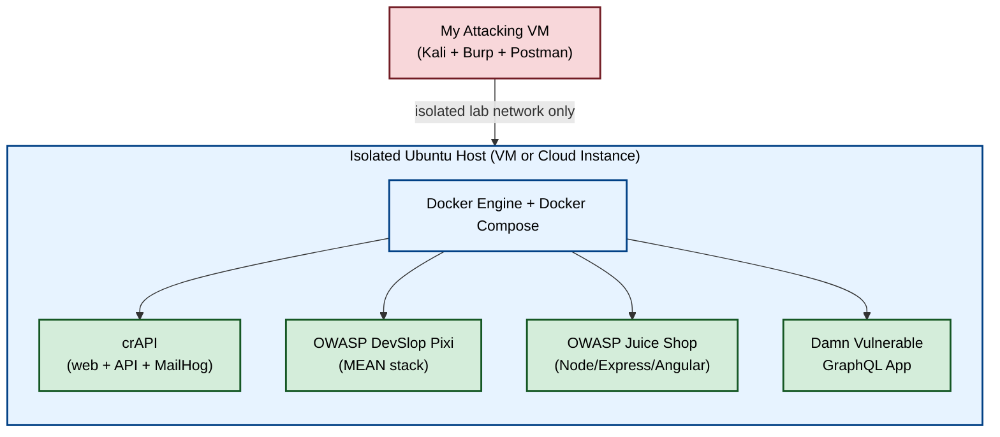
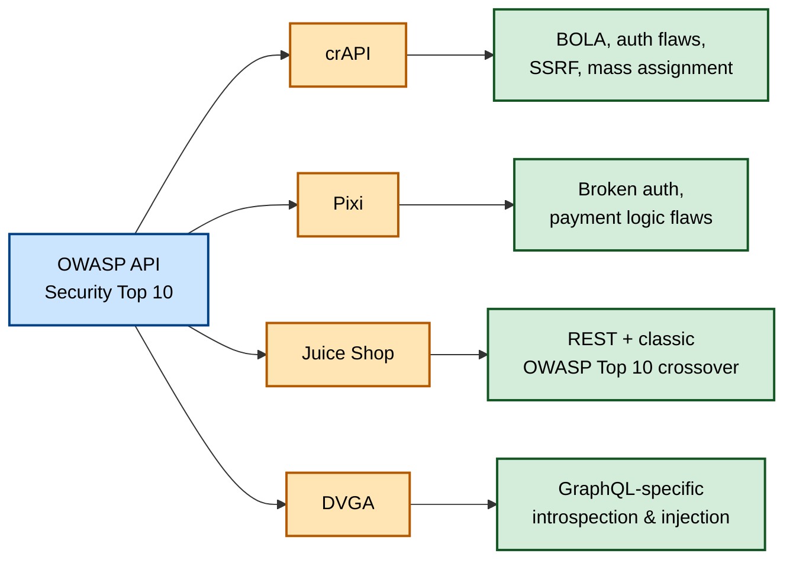
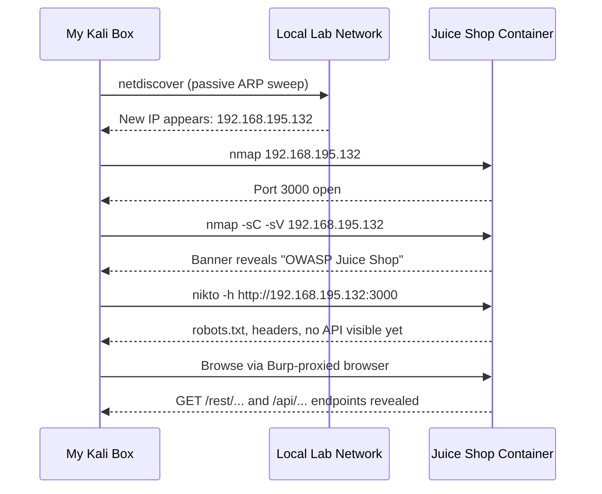

# Setting Up My Vulnerable API Targets: A Home Lab I Can Actually Break

## Why I Needed Targets, Not Just Tools

In my last post I walked through the toolkit I built for API testing — Kali, Chrome DevTools, Burp Suite, and Postman. But a toolkit without something to point it at is just a collection of shiny apps sitting idle on my desktop. So the next thing I did was build a set of **deliberately vulnerable API targets** I could legally and safely attack, break, fix my understanding of, and break again.

The appeal of practicing against intentionally broken systems is that I get to be reckless. I can fire off destructive payloads, brute-force endpoints into oblivion, and chain together half-baked exploit ideas without worrying I'm going to end up on the wrong end of a computer crime statute or knock over someone's production service. I also get to flip perspectives — after I exploit something, I can go look at the vulnerable app's source code and see exactly *why* it was exploitable, which teaches me the defensive side just as much as the offensive one.

This post covers exactly how I built that lab: the host setup, Docker and Docker Compose, four specific vulnerable applications I'm running, a table of extra vulnerable projects I plan to add later, a couple of training platforms I use to supplement my own lab, and a full hands-on walkthrough where I go hunting for one of my own lab machines on the network and uncover its hidden API endpoints using Netdiscover, Nmap, Nikto, and Burp Suite.

> **Caution:** Every application in this lab is *deliberately* vulnerable. That's the whole point — but it also means these machines are genuinely dangerous if they're reachable from anywhere outside your isolated lab network. Don't expose them to your home Wi-Fi, your office network, or the open internet. Treat this lab the way you'd treat a chemistry set with live reagents: useful, educational, and not something you leave unattended near people who might wander into it.

---

## 1. The Mental Model: How the Pieces Fit Together

Before I get into individual commands, here's the overall shape of what I built:



I deliberately keep each vulnerable application on its own container (and ideally its own host, if I have the resources) rather than smashing them all onto one box. I learned this lesson after Juice Shop and DVGA both tried to claim port 3000 at the same time and I spent twenty minutes confused about why DVGA wouldn't load. Isolating each app means an exploit against one — say, a resource-exhaustion bug in Pixi — can't accidentally crash or interfere with the others.

---

## 2. Building the Host

### 2.1 Choosing and Setting Up Ubuntu

I run a plain, recent Ubuntu image as the host for all of my vulnerable apps, hosted on a hypervisor on my own hardware (I use VirtualBox, though VMware and Hyper-V work identically well). You could just as easily spin this up as a cloud instance on AWS, Azure, or GCP if you'd rather not tie up local hardware — the setup from here is identical either way.

I'm not going to re-explain general VM networking and hypervisor setup here since it's genuinely a rabbit hole on its own, but a few resources got me unstuck quickly when I was setting this up for the first time:

| Resource | What it's good for |
|---|---|
| Cybrary's virtual pentesting lab tutorial | General walkthrough of building a home lab from scratch |
| Black Hills Information Security's home lab webcast | Practical advice on hardware and network segmentation |
| Null Byte's virtual hacking lab guide | A beginner-friendly intro to the whole process |
| Hacking Articles' AWS pentest lab write-up | If you'd rather build in the cloud than on local hardware |

> **Note:** Whichever path you pick, the one non-negotiable requirement is **network isolation**. I run my lab on a host-only or NAT network inside my hypervisor that has no bridge back to my home LAN, specifically so a vulnerable app can't be stumbled onto by anything else on my network.

### 2.2 Installing Docker and Docker Compose

Once Ubuntu was up and patched, I installed Docker following the official instructions rather than any shortcut I found via a random blog — Docker's install steps change often enough that following the canonical docs at `docs.docker.com/engine/install/ubuntu` saved me from installing a stale version.

I confirmed the install worked with the classic test container:

```bash
$ sudo docker run hello-world
```

```
Unable to find image 'hello-world:latest' locally
latest: Pulling from library/hello-world
c1ec31eb5944: Pull complete
Digest: sha256:d211f485f2854febd57b2dcc4e8fdf226bd4e71b49cc0ff3e5b6c7ef13e8a2d
Status: Downloaded newer image for hello-world:latest

Hello from Docker!
This message shows that your installation appears to be working correctly.

To generate this message, Docker took the following steps:
 1. The Docker client contacted the Docker daemon.
 2. The Docker daemon pulled the "hello-world" image from Docker Hub.
 3. The Docker daemon created a new container from that image which runs
    the executable that produces the output you are currently reading.
 4. The Docker daemon streamed that output to the Docker client, which sent
    it to your terminal.
```

Seeing that `Hello from Docker!` banner is my green light that the engine is healthy. If that command fails, I always go straight back to Docker's own troubleshooting docs rather than guessing — Docker install issues are usually permissions-related (forgetting to add my user to the `docker` group) or leftover state from a previous failed install.

Docker Compose came next, since several of my vulnerable apps ship a `docker-compose.yml` file that spins up multiple linked containers (an app server, a database, sometimes a mail server) with one command:

```bash
$ docker compose version
```

```
Docker Compose version v2.29.1
```

With both installed, I was ready to actually pull down vulnerable applications.

---

## 3. The Four Applications I Run

I settled on four vulnerable applications that, between them, cover an enormous share of the OWASP API Security Top 10: **crAPI**, **OWASP DevSlop's Pixi**, **OWASP Juice Shop**, and the **Damn Vulnerable GraphQL Application (DVGA)**.



### 3.1 crAPI — "The Completely Ridiculous API"

crAPI is the OWASP API Security Project's own flagship vulnerable target, and it's the one I spend the most time in. It bundles a realistic-feeling web app, a backing API, and even its own MailHog mail server for catching outbound email — so I can test flows like password resets end-to-end without needing a real mailbox.

The app's theme is a shop for vehicle parts, complete with a community chat feature and a "link your vehicle" workflow that connects to local repair shops. Underneath that friendly shell, it's intentionally riddled with realistic implementations of the OWASP API Security Top 10 — BOLA, broken authentication, excessive data exposure, SSRF, mass assignment, and more, all wired together the way a real engineering team might accidentally introduce them rather than as isolated toy examples.

### 3.2 OWASP DevSlop's Pixi

Pixi is a MEAN-stack application (MongoDB, Express, Angular, Node) built specifically to showcase DevOps-related security mistakes. I think of it as a small social platform with an attached virtual payment system, which makes it a great target for practicing attacks against user data exposure, admin functionality, and payment/business-logic flaws.

Getting it running was genuinely the easiest setup of the four:

```bash
$ git clone https://github.com/DevSlop/Pixi.git
$ cd Pixi
$ sudo docker-compose up
```

```
Creating network "pixi_default" with the default driver
Creating pixi_mongo_1 ... done
Creating pixi_api_1   ... done
Creating pixi_web_1   ... done
Attaching to pixi_mongo_1, pixi_api_1, pixi_web_1
pixi_api_1    | Server started on port 8090
pixi_web_1    | Angular Live Development Server is listening on 0.0.0.0:8000
```

Once that settled, I pointed my browser at `http://localhost:8000` and the Pixi landing page loaded right up.

### 3.3 OWASP Juice Shop

Juice Shop is probably the most actively maintained vulnerable app I run — it currently has more than 70 contributors — and it covers both the classic OWASP Top 10 and the API-specific Top 10, since the whole frontend is really just a thin Angular shell talking to a set of REST endpoints.

One detail I really appreciate: Juice Shop tracks my own hacking progress with a hidden scoreboard, which turns "find all the bugs" into something closer to a built-in CTF rather than an open-ended scavenger hunt.

```bash
$ docker pull bkimminich/juice-shop
$ docker run --rm -p 80:3000 bkimminich/juice-shop
```

```
Unable to find image 'bkimminich/juice-shop:latest' locally
latest: Pulling from bkimminich/juice-shop
Digest: sha256:9b1e7df...
Status: Downloaded newer image for bkimminich/juice-shop:latest
info: Server listening on port 3000
```

I mapped Juice Shop's internal port 3000 to host port 80 using `-p 80:3000` specifically because DVGA (below) also defaults to port 3000, and I didn't want the two fighting over the same port on the same host. With that mapping, I reach Juice Shop at `http://localhost` instead of needing to remember a non-standard port.

> **Note:** If you're running Docker Machine on macOS or Windows instead of native Docker, your target address will be the Docker Machine IP — typically something like `http://192.168.99.100` — rather than `localhost`.

### 3.4 Damn Vulnerable GraphQL Application (DVGA)

I added DVGA specifically because GraphQL adoption has exploded — companies like Facebook, Netflix, AWS, and IBM all use it in production — and REST-focused testing habits don't automatically transfer. GraphQL introduces its own attack surface: introspection abuse, batching attacks, and query complexity/denial-of-service issues that simply don't exist in a REST world.

```bash
$ sudo docker pull dolevf/dvga
$ sudo docker run -t -p 5000:5000 -e WEB_HOST=0.0.0.0 dolevf/dvga
```

```
Unable to find image 'dolevf/dvga:latest' locally
latest: Pulling from dolevf/dvga
Status: Downloaded newer image for dolevf/dvga:latest
 * Serving Flask app "dvga" (lazy loading)
 * Running on http://0.0.0.0:5000/ (Press CTRL+C to quit)
```

Browsing to `http://localhost:5000` drops me straight into the GraphiQL IDE — one of the more common GraphQL development interfaces I run into in the wild, which makes DVGA a genuinely good stand-in for real targets rather than a purely academic exercise.

### Quick Reference Table

| App | Stack | Default Port(s) | Best for practicing |
|---|---|---|---|
| **crAPI** | Node/Go microservices + web + MailHog | Multiple (via compose) | Realistic, chained API Top 10 vulnerabilities |
| **Pixi** | MEAN (Mongo/Express/Angular/Node) | 8000 (web), 8090 (API) | Social-platform + payment logic flaws |
| **Juice Shop** | Node/Express/Angular | 3000 (remapped to 80) | Classic + API OWASP Top 10, gamified scoring |
| **DVGA** | Flask + GraphQL | 5000 | GraphQL-specific attacks via GraphiQL |

---

## 4. Expanding the Lab with More Vulnerable Apps

Once I got comfortable with those four, I started bookmarking additional deliberately-vulnerable API projects from GitHub to add as new challenges whenever I want something fresh. I haven't stood all of these up yet, but they're on my list:

| Name | Maintainer | Repository |
|---|---|---|
| VAmPI | erev0s | `github.com/erev0s/VAmPI` |
| DVWS-node | snoopysecurity | `github.com/snoopysecurity/dvws-node` |
| DamnVulnerableMicroServices | ne0z | `github.com/ne0z/DamnVulnerableMicroServices` |
| Node-API-goat | layro01 | `github.com/layro01/node-api-goat` |
| Vulnerable GraphQL API | AidanNoll / CarveSystems | `github.com/CarveSystems/vulnerable-graphql-api` |
| Generic-University | InsiderPhD | `github.com/InsiderPhD/GenericUniversity` |
| vulnapi | tkisason | `github.com/tkisason/vulnapi` |

Most of these follow the exact same pattern I used for Pixi — clone, then `docker-compose up` — so expanding the lab is mostly just a matter of free disk space and curiosity.

---

## 5. Supplementing My Home Lab with TryHackMe and HackTheBox

My own lab is great for deep, unhurried practice, but I also keep a couple of hosted platforms in rotation for variety and structured challenges.

**TryHackMe** is the one I reach for most often when I want a guided, lower-friction session — it has a mix of free and subscription content, and it'll spin up a browser-based attack box for me with a single click, pre-loaded with most of the tools I've already installed locally. A few rooms I've specifically found valuable for API-focused practice:

- **Bookstore** (free)
- **Carpe Diem 1** (free)
- **ZTH: Obscure Web Vulns** (paid)
- **ZTH: Web2** (paid)
- **GraphQL** (paid)

**HackTheBox** assumes more baseline skill going in — there's no provided attack box, so I bring my own Kali VM, and getting an account at all means working through their invite-code challenge first. The free tier only gives me access to the 20 most recently retired machines, and if I want the full historical library (including some genuinely great API-focused boxes), that requires a VIP subscription.

A few retired HTB machines I've specifically queued up for API practice:

| Machine | Focus |
|---|---|
| Craft | API authentication & build pipeline abuse |
| Postman | Redis + API misconfig chaining |
| Smasher2 | Advanced binary + web chaining |
| JSON | Deserialization-driven API attacks |
| Node | Node.js-specific API weaknesses |
| Help | API + privilege escalation chaining |
| PlayerTwo | Multi-stage web/API exploitation |
| Luke | API auth bypass |
| Playing with Dirty Socks | Unix socket + API abuse |

> **Note:** Outside of named machines, HTB's rotating "challenges" category (things like *Fuzzy*) are also worth doing specifically to sharpen fuzzing instincts in a lower-stakes, single-flag format.

---

## 6. Hands-On Lab: Hunting Down Juice Shop on My Own Network

Reading about tools only gets me so far, so here's the actual walkthrough I ran to rediscover my own Juice Shop container on the lab network — pretending, for the sake of practice, that I didn't already know its IP address.



### Step 1 — Find the Host with Netdiscover

Before I even power on the vulnerable app, I run Netdiscover to get a baseline of what's already on the network, then again afterward to spot what's new:

```bash
$ sudo netdiscover
```

```
Currently scanning: 172.16.129.0/16   |   Screen View: Unique Hosts

13 Captured ARP Req/Rep packets, from 4 hosts. Total size: 780
_____________________________________________________________________________
  IP            At MAC Address       Count   Len   MAC Vendor / Hostname
_____________________________________________________________________________
192.168.195.2     00:50:56:f0:23:20     6     360   VMware, Inc.
192.168.195.130   00:0c:29:74:7c:5d     4     240   VMware, Inc.
192.168.195.132   00:0c:29:85:40:c0     2     120   VMware, Inc.
192.168.195.254   00:50:56:ed:c0:7c     1      60   VMware, Inc.
```

The new address I'm after here is `192.168.195.132` — it appeared right after I launched the Juice Shop container, which is my first clue it's the target. I hit `CTRL+C` once I've got the IP I need.

### Step 2 — Enumerate Ports and Services with Nmap

A plain scan first, just to see what's actually listening:

```bash
$ nmap 192.168.195.132
```

```
Nmap scan report for 192.168.195.132
Host is up (0.00046s latency).
Not shown: 999 closed ports
PORT     STATE SERVICE
3000/tcp open  ppp

Nmap done: 1 IP address (1 host up) scanned in 0.14 seconds
```

Just one open port, matching exactly what I'd expect from how I launched the container earlier. To squeeze more detail out of it, I add `-sC` (default script scan) and `-sV` (service/version detection):

```bash
$ nmap -sC -sV 192.168.195.132
```

```
Nmap scan report for 192.168.195.132
Host is up (0.00047s latency).
Not shown: 999 closed ports
PORT     STATE SERVICE VERSION
3000/tcp open  ppp?
| fingerprint-strings:
|   GetRequest:
|     HTTP/1.1 200 OK
|     Connection: close
|     <!doctype html>
|     <html lang="en">
|     <head>
|       <meta charset="utf-8">
|       <title>OWASP Juice Shop</title>
```

That's enough confirmation — I've got an HTTP service on port 3000 that's self-identifying as OWASP Juice Shop. From here, I open it in my browser at `http://192.168.195.132:3000` and start clicking around.

### Step 3 — A Quick Surface Scan with Nikto

```bash
$ nikto -h http://192.168.195.132:3000
```

```
+ Target IP:          192.168.195.132
+ Target Hostname:    192.168.195.132
+ Target Port:        3000
---------------------------------------------------------------------------
+ Server: No banner retrieved
+ Retrieved access-control-allow-origin header: *
+ The X-XSS-Protection header is not defined. This header can hint to the
  user agent to protect against some forms of XSS
+ Uncommon header 'feature-policy' found, with contents: payment 'self'
+ No CGI Directories found (use '-C all' to force check all possible dirs)
+ Entry '/ftp/' in robots.txt returned a non-forbidden or redirect HTTP
  code (200)
+ "robots.txt" contains 1 entry which should be manually viewed.
```

Nikto turns up a couple of interesting breadcrumbs — a permissive CORS header, a missing XSS protection header, and a `robots.txt` entry pointing at `/ftp/` — but notably **nothing here reveals an API directly**. Nikto is great at surface-level web misconfiguration, but APIs tend to live beneath the GUI, invisible to a scanner that isn't actually driving the application the way a real user would.

### Step 4 — Proxy Through Burp and Actually Drive the App

Since Nikto alone didn't surface the API, I switch my browser over to the Burp-configured FoxyProxy profile, confirm **Intercept** is switched on in Burp, and refresh the Juice Shop page.

The very first intercepted request doesn't show anything API-related yet — just the initial page load. But as I click **Forward** repeatedly, letting each queued request through one at a time, the browser's GUI slowly renders piece by piece, and a stream of genuinely interesting requests starts showing up in Burp's Proxy history:

```
GET /rest/admin/application-configuration
GET /api/Challenges/?name=Score%20Board
GET /api/Quantitys/
```

And there it is — the actual API surface, completely invisible from a static scan, only revealed by watching real requests fire as the single-page app bootstraps itself. That `/rest/admin/application-configuration` endpoint in particular immediately jumps out as worth a much closer look in a later session — admin-prefixed paths are almost always worth investigating for broken function-level authorization.

### What I Took Away From This Lab

| Tool | What it told me | What it missed |
|---|---|---|
| Netdiscover | A new host appeared on the network | No service or app detail |
| Nmap (basic) | Exactly one open port | No idea what app was running |
| Nmap (`-sC -sV`) | Confirmed it was Juice Shop via banner grab | Still no API visibility |
| Nikto | Header and robots.txt findings | Zero API endpoints surfaced |
| Burp Suite (live browsing) | Full set of REST API calls | Requires manually driving the app |

That progression is exactly why I never rely on just one tool. Each one peeled back a different layer, and it took the combination — not any single scan — to get from "there's a device on my network" all the way to "here are three API endpoints worth attacking."

---

## 7. What I'm Doing Next

With four vulnerable applications running, a shortlist of more to add, a couple of hosted platforms in my back pocket for variety, and a working discovery workflow using Netdiscover, Nmap, Nikto, and Burp, I've got everything I need to start digging into specific vulnerability classes without worrying about breaking anything that matters.

My plan from here is to spend dedicated sessions against crAPI specifically chasing BOLA and mass assignment bugs, then pivot to DVGA to build up my GraphQL-specific instincts, since that's the area where my REST habits least naturally transfer. I'll keep documenting each session as I go.

> **Caution, one more time for emphasis:** keep this lab air-gapped from anything that matters to you. A vulnerable app sitting on the same network as your personal devices isn't a risk you want to discover the hard way.
