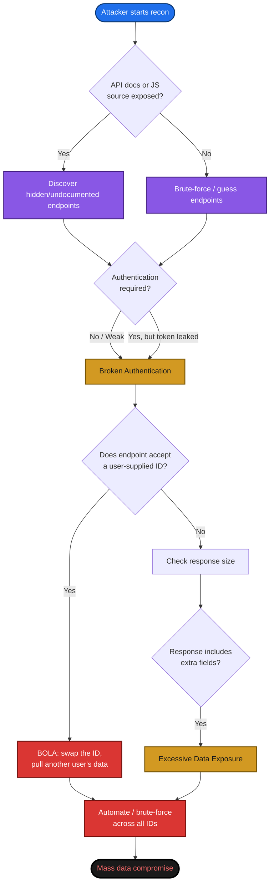
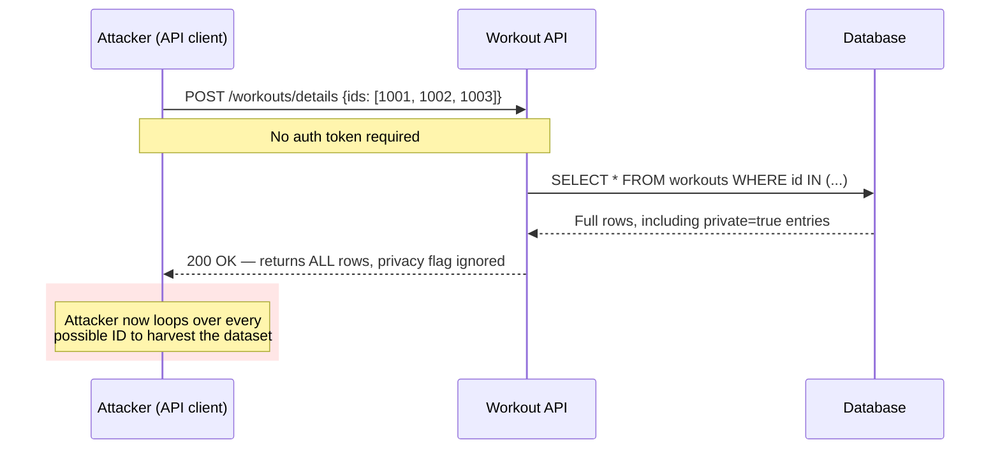
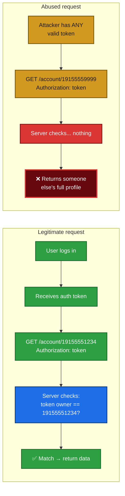

# What Real API Breaches Taught Me About Hacking (and Defending) APIs

I've spent a lot of time reading post-mortems of API breaches, and the more I read, the more I notice the same handful of mistakes showing up again and again. Different companies, different industries, same root causes. In this post I want to walk through what I've learned from studying some of the most talked-about API incidents — a fitness platform, a postal service, a telecom carrier — plus a few bug bounty write-ups that show how ethical hackers find these issues *before* criminals do. Along the way I'll show you the commands I actually ran, some diagrams I built to make the concepts click, and the lessons I've taken away as both a builder and a breaker of APIs.

> **Note:** Everything described here is drawn from information that is already public (breach disclosures, bug bounty write-ups, security advisories). I'm not reproducing anyone's exact proof-of-concept payloads — I've rebuilt simplified, generic examples so the *concepts* are clear without handing anyone a working exploit against a real system.

---

## Table of Contents

1. [Breach vs. Leak vs. Exposure — Getting the Vocabulary Right](#vocab)
2. [The Vulnerability Classes Behind Almost Every API Breach](#classes)
3. [Case Study 1 — The Fitness App That Leaked Everyone's Workouts](#case1)
4. [Case Study 2 — The Postal Service and the Wildcard Query](#case2)
5. [Case Study 3 — The Telecom Carrier and the Predictable ID](#case3)
6. [Trying It Myself: Commands and Output](#commands)
7. [What Bug Bounty Hunters Taught Me](#bounties)
8. [My Defensive Checklist](#defense)
9. [Closing Thoughts](#closing)

---

<a id="vocab"></a>
## 1. Breach vs. Leak vs. Exposure — Getting the Vocabulary Right

Before I get into the case studies, I want to be precise about terminology, because I think sloppy language leads to sloppy thinking.

| Term | What it actually means | Do we know data was taken? |
|---|---|---|
| **Data breach** | A confirmed case where someone exploited a system to steal or compromise data | Yes — confirmed |
| **Data leak / exposure** | A weakness is discovered that *could have* let someone compromise data | Not necessarily |
| **Vulnerability disclosure** | A researcher reports a flaw through a formal or informal channel | N/A — proactive |

I like this distinction because it keeps me honest. A lot of the incidents I'll cover below are technically "exposures" — researchers found the hole and reported it before (as far as anyone can prove) a criminal walked through it. That's the best-case outcome, and it's exactly why bug bounty programs exist.

One thing I've also internalized: companies rarely explain *how* a breach happened. Sometimes it's embarrassment, sometimes it's ongoing litigation, and sometimes — this is the one that unsettles me most — they genuinely don't know. So when I talk about root cause below, I'm reconstructing the most plausible technical path from public reporting, not quoting an official confession.

---

<a id="classes"></a>
## 2. The Vulnerability Classes Behind Almost Every API Breach

If you map these incidents against the OWASP API Security Top 10, the same few categories keep showing up:

| Vulnerability Class | Short Definition | Shows Up In |
|---|---|---|
| **BOLA** (Broken Object Level Authorization) | The API lets you ask for *someone else's* object just by changing an ID | Fitness app, telecom carrier |
| **Broken Authentication** | Tokens, keys, or sessions that are missing, guessable, or leaked | Telecom carrier, bounty #1 |
| **Excessive Data Exposure** | The API returns more fields than the client actually needs, relying on the frontend to hide the rest | Postal service, fitness app |
| **BFLA** (Broken Function Level Authorization) | A low-privilege or unauthenticated user can call admin-only functions | Bounty #2 |
| **Security Misconfiguration** | Debug endpoints, exposed docs, verbose errors, wildcard queries left enabled | Postal service, bounty #3 |

Here's a diagram I put together to show how these classes typically chain together into a full breach. I find that breaches are rarely "one vulnerability" — they're usually two or three small issues stacked on top of each other.



I like this diagram because it reflects how I actually think while testing an API: recon, then "can I touch someone else's data," then "is the response telling me more than it should," then automate.

---

<a id="case1"></a>
## 3. Case Study 1 — The Fitness App That Leaked Everyone's Workouts

The first incident I studied closely involved a connected-fitness platform (the one with the famous stationary bikes). A researcher found that the platform's API would hand back profile and workout data for *any* user, even ones who had explicitly marked their account as private, and even to requests that weren't authenticated at all.

What made this interesting to me wasn't just one bug — it was that the researcher found the *same underlying flaw* in three different places:

1. **A workout-details endpoint** that accepted a list of user IDs and returned age, gender, username, and workout data regardless of the account's privacy setting.
2. **A user-search endpoint** that exposed profile pictures, location, follower counts, and account IDs to anyone, logged in or not.
3. **A GraphQL endpoint** that accepted unauthenticated queries and returned user IDs, usernames, and locations — a classic sign that GraphQL permissions were set at the schema level but never actually enforced per-field.

> **Note:** The notable detail that made this story travel widely was that a very high-profile public figure owned one of these devices at the time, which is a good reminder that "nobody important uses our API" is never a safe assumption.

The common thread is **BOLA**: the privacy flag existed in the data model, but nothing on the server side actually checked it before returning a response. The frontend app probably respected the flag and hid private profiles in the UI — but an API client that skips the UI entirely doesn't care what the UI would have shown.



**Lesson I took from this:** a "private" checkbox in the UI is not a security control. It's a UX preference. Authorization has to be enforced at the point where data leaves the database, every single time, not optionally when the client happens to ask nicely.

---

<a id="case2"></a>
## 4. Case Study 2 — The Postal Service and the Wildcard Query

The second case that stuck with me involved a national postal service's package-tracking API. This one is a textbook **excessive data exposure** combined with a **security misconfiguration** — and it's the one that annoys me the most, because the fix would have been so simple.

Here's what happened, as best as public reporting reconstructs it:

- An API meant to give authenticated business users near-real-time mail tracking data was reachable by **any** authenticated account, not just the ones it was built for.
- The query parameter accepted **wildcards**. So a request for `email=*@somemailprovider.com` would return every account matching that pattern.
- When you queried by a physical address, the API didn't just return the current resident — it returned **every account historically associated with that address**, including people who had moved away years earlier.

I think the wildcard issue is the most instructive part. Wildcard support is a totally reasonable feature for an internal admin tool. It is not a reasonable feature for a public-facing (or even "authenticated but broadly accessible") API. The team almost certainly built this for convenience during internal testing or admin workflows, and it just... never got locked down for production.

What also struck me: an official vulnerability assessment had been performed a month before the public disclosure, and it concluded the web application's authentication and encryption were secure. The assessment reportedly didn't test the API at all — it tested the website. That's a pattern I now watch for constantly: **a "secure" web app with a wide-open API behind it is not a secure system.** Scanning the login page and never touching `/api/v1/...` gives you a false sense of safety.

### A simplified version of the exposure, with Python

To make the "excessive data exposure" idea concrete, here's a toy example I actually ran. Imagine an API returns this when you ask for the account at a single address:

```bash
$ cat /tmp/sample_response.json
{
  "street": "100 Example Ave",
  "city": "Testville",
  "customers": [
    {"name": "Alex Doe", "username": "adoe", "email": "alex@example.com", "phone": "555-0101"},
    {"name": "Jamie Ray", "username": "jray", "email": "jamie@example.com", "phone": "555-0102"}
  ]
}
```

A well-designed API for a "who lives here" lookup should return the *current* resident only, and probably not their email or phone at all. Here's what happens when I pull out just the fields the response is over-sharing:

```bash
$ python3 - << 'EOF'
import json
data = json.load(open('/tmp/sample_response.json'))
emails = [c['email'] for c in data['customers']]
print(json.dumps(emails, indent=2))
EOF
```

**Output:**
```
[
  "alex@example.com",
  "jamie@example.com"
]
```

That's the whole bug in miniature: the server did the filtering work of "who's at this address" correctly, but then handed back far more per-record detail than the use case justified — including a second person who doesn't even live there anymore in the real-world version of this story. Multiply that one query by a wildcard that matches millions of addresses, and you understand how tens of millions of records end up exposed from what looks, on paper, like a single "info disclosure" finding.

> **Caution:** If you're testing an API like this yourself (with proper authorization, on a system you're allowed to test), be very careful with wildcard and range queries. They can return far more data than you expect, and depending on your jurisdiction and the program's rules, pulling large volumes of real personal data — even "just to prove the point" — can cross from responsible disclosure into something you don't want to be doing. Grab the smallest proof-of-concept you can and stop.

---

<a id="case3"></a>
## 5. Case Study 3 — The Telecom Carrier and the Predictable ID

The third one is my favorite because it shows how a years-old, low-effort proof-of-concept video can foreshadow a much bigger breach.

A telecom carrier disclosed that an attacker had accessed data for a couple million customer accounts — names, phone numbers, emails, dates of birth, account numbers, and billing ZIP codes — through one of its APIs. The company didn't publish technical details, but roughly a year earlier, an independent researcher had posted a public video demonstrating a strikingly similar flaw in the carrier's API gateway:

- A single valid authorization token was enough to query the endpoint.
- The *actual authorization check* was supposed to come from matching the phone number in the URL to the logged-in account — except it didn't. Any valid token could query **any** phone number.
- Phone numbers are short, structured, and often guessable or scrapable from other breaches, which makes them a terrible choice as the sole "secret" protecting an account.

This is BOLA again, but the part I find most useful to internalize is *why* it's so dangerous here specifically: the "ID" being abused isn't a random UUID, it's a 10-digit number with a predictable format tied to area codes. An attacker doesn't even need to brute-force the full keyspace — they can narrow it down geographically and get a meaningful hit rate almost immediately.



**Lesson I took from this:** having *an* authorization token present is not the same as *authorizing that specific request*. The server has to ask "does the token in this request actually own the resource this request is asking for?" every single time — not just "is this a token that was issued by us at some point."

---

<a id="commands"></a>
## 6. Trying It Myself: Commands and Output

I like to actually run things rather than just read about them, so here are two small, self-contained demos I ran locally (no real systems touched) to make a couple of these concepts tangible.

### Demo A — Why leaked API keys are often base64, not encrypted

One of the bug bounty write-ups I read involved a hardcoded API key sitting in a public JavaScript file, encoded with base64. A lot of people (including, apparently, some engineers) treat base64 as if it were encryption. It isn't — it's just a reversible text encoding, and decoding it takes one command:

```bash
$ echo 'VXNlcm5hbWU6UGFzc3dvcmQ=' | base64 -d
```

**Output:**
```
Username:Password
```

And the reverse direction, encoding a demo credential the same way a developer might have (accidentally) done before shipping it to production:

```bash
$ echo -n 'demo_api_key:demo_secret' | base64
```

**Output:**
```
ZGVtb19hcGlfa2V5OmRlbW9fc2VjcmV0
```

| Command | Purpose | Time to run |
|---|---|---|
| `base64 -d` | Decode a suspicious string found in JS/config files | < 1 second |
| `base64` | Understand what an encoded secret would look like, for pattern-matching | < 1 second |

> **Note:** If you ever find a base64 blob sitting next to words like `key`, `secret`, `auth`, or `token` in a public JS bundle, decoding it takes less time than it took you to read this sentence. That's exactly why it should never be there in the first place — "obfuscated" is not "protected."

### Demo B — Spotting excessive data exposure programmatically

This is the same filtering demo from the postal service section, but worth repeating as a general technique: when you're testing an API response for over-sharing, don't eyeball a huge JSON blob — script the extraction of the fields that shouldn't be there, so you have a clean, reproducible proof of concept:

```bash
$ python3 - << 'EOF'
import json
data = json.load(open('/tmp/sample_response.json'))
emails = [c['email'] for c in data['customers']]
print(json.dumps(emails, indent=2))
EOF
```

**Output:**
```
[
  "alex@example.com",
  "jamie@example.com"
]
```

A one-liner like that turns "the API returns a lot of stuff" into "here are the exact three PII fields a normal address lookup has no business returning," which is the kind of concrete evidence that gets a bug bounty report taken seriously.

---

<a id="bounties"></a>
## 7. What Bug Bounty Hunters Taught Me

Reading breach post-mortems teaches you what went wrong. Reading **bug bounty write-ups** teaches you the actual hunting process, because researchers usually document their thinking step by step. A few of my favorites:

| Researcher's finding (paraphrased) | Vulnerability Class | Core technique | Reported payout |
|---|---|---|---|
| A base64-encoded API key sitting in a public JS file, usable against an HR platform | Broken Authentication | Searching JS bundles for `api`, `key`, `secret` | $2,000 |
| Exposed API docs at a predictable path, plus a leaked bearer token, allowed account edits and admin actions | Broken Authentication + BFLA | Directory enumeration → reading public docs → reusing a leaked token | $440 |
| A "backend for frontend" proxy leaked an internal directory structure through subtle status-code differences, eventually exposing a huge internal user directory | Security Misconfiguration + BFLA | Careful diffing of 404 vs. 400 responses while fuzzing paths | $4,000 |
| A GraphQL endpoint on a major social platform allowed pulling private post/story data by swapping a media ID with a null access token | BOLA | Supplying a null auth value and brute-forcing/guessing object IDs | $30,000 |

A few patterns jump out at me across all four of these:

1. **Documentation is a gift to attackers if it's public and the API isn't locked down.** One researcher's entire path to a BFLA started because the API docs were reachable without login.
2. **Small inconsistencies matter.** The difference between a `404 Not Found` and a `400 Bad Request` was the breadcrumb that led to a nine-figure-record exposure. If you're testing APIs, log *every* status code you see, not just the ones that look obviously interesting.
3. **"null" is a legitimate test value.** More than one of these bugs came from simply trying an empty or null value where a token was expected, instead of assuming the server would reject it.
4. **Payout roughly tracks blast radius, not cleverness.** The $30,000 bug wasn't necessarily the hardest one technically — it was the one where the impact (private data belonging to potentially millions of users) was easiest to prove and most severe.

```mermaid
flowchart TB
    S([Start: pick a target]):::start --> R[Recon: JS files, API docs,<br/>subdomains, mobile app traffic]:::step
    R --> F{Find something<br/>interesting?}
    F -- "Leaked key / token" --> A1[Test the key against<br/>its own API]:::finding
    F -- "Hidden endpoint" --> A2[Test with no auth,<br/>then with another user's token]:::finding
    F -- "Weird status code" --> A3[Diff requests, fuzz paths,<br/>look for a pattern]:::finding
    A1 --> V[Validate impact:<br/>what data/action did I just get?]:::validate
    A2 --> V
    A3 --> V
    V --> D{Severe and<br/>reproducible?}
    D -- Yes --> W[Write it up with minimal,<br/>non-destructive PoC]:::report
    D -- No --> R
    W --> E([Submit through the<br/>program's disclosure process]):::end

    classDef start fill:#1f6feb,stroke:#0d3b76,color:#ffffff,stroke-width:2px
    classDef step fill:#8957e5,stroke:#4c2889,color:#ffffff,stroke-width:2px
    classDef finding fill:#d29922,stroke:#7a5705,color:#1a1a1a,stroke-width:2px
    classDef validate fill:#1f6feb,stroke:#0d3b76,color:#ffffff,stroke-width:2px
    classDef report fill:#2ea043,stroke:#1a6b2b,color:#ffffff,stroke-width:2px
    classDef end fill:#1a1a1a,stroke:#000000,color:#ffffff,stroke-width:3px
```

> **Caution:** Every one of these researchers worked within a defined bug bounty scope and disclosure process. Testing an API you don't have explicit permission to test — even "just looking" — can be illegal depending on where you are and what systems are involved. If you want to practice these techniques, use intentionally vulnerable practice APIs (there are several built specifically for this) or your own test environments, and only test real third-party systems through an authorized bug bounty or pentest engagement.

---

<a id="defense"></a>
## 8. My Defensive Checklist

After going through all of this, here's the checklist I now keep in mind, whether I'm testing an API or building one:

| # | Check | Why it matters |
|---|---|---|
| 1 | Does every object-returning endpoint verify the **requesting user owns or is permitted to access** that specific object ID? | Prevents BOLA — the single most common root cause above |
| 2 | Are "privacy" flags enforced **server-side**, not just hidden in the UI? | A hidden field is not an access control |
| 3 | Does the API return **only the fields the use case needs**, not the full database row? | Shrinks the blast radius of any other bug |
| 4 | Are wildcard / range queries disabled or tightly scoped on any customer-facing or broadly-authenticated endpoint? | Wildcards turn a single-record bug into a mass-exposure bug |
| 5 | Is API documentation that describes internal/admin functionality kept **off the public internet**? | Removes a free recon map for attackers |
| 6 | Do security assessments explicitly include **API endpoints**, not just the web frontend? | A scanned login page tells you nothing about the API behind it |
| 7 | Are secrets scanned out of client-side JS/mobile binaries before release? | Base64 is not encryption, and bundlers don't strip comments or stray keys automatically |
| 8 | Is every status code and response difference logged during testing, even ones that look "boring"? | The 400-vs-404 difference above led to one of the largest exposures in this post |

---

<a id="closing"></a>
## 9. Closing Thoughts

What I keep coming back to is this: almost none of these breaches required nation-state-level sophistication. A wildcard that should have been disabled. A privacy flag that was never checked server-side. A token that proved you were *someone*, but the API never checked whether you were *this specific* someone. These are small, boring, extremely common mistakes — and that's exactly why they keep happening at companies with plenty of security budget and plenty of smart engineers.

If there's one habit I've taken from studying all of this, it's to treat every object ID in every API request as a question: *"Is the server actually checking that I'm allowed to ask for this, or is it just checking that I'm logged in as someone?"* Those are very different questions, and the gap between them is where almost every story in this post lives.

I'll keep digging into more of these write-ups as I come across them — there's always another lesson hiding in a 400 status code somewhere.
