# Advanced Web API Automation: Guiding Delivery, Isolating Dependencies, and Surviving the Pipeline

> **TL;DR:** Basic API checks tell me *that something changed*. Advanced automation lets me do three more things: **guide delivery** so the team builds the right thing (acceptance test-driven development), **stabilise my checks** by replacing flaky dependencies with mocks, and **run reliably in a pipeline** by starting the API and waiting until it's ready. I walk through all three using the `restful-booker-platform` sandbox, and I back them up with a working Python framework and **21 passing tests**, plus a bonus property-based example that finds a seeded bug and shrinks it to the smallest failing input.

---

## Table of Contents

1. [Why go beyond basic checks](#why-go-beyond-basic-checks)
2. [Acceptance test-driven development](#acceptance-test-driven-development)
3. [Hands-on: ATDD in Python, red then green](#hands-on-atdd-in-python-red-then-green)
4. [Beware of traps](#beware-of-traps)
5. [Web API mocking](#web-api-mocking)
6. [Hands-on: a mock server and what it unlocks](#hands-on-a-mock-server-and-what-it-unlocks)
7. [Running as part of a pipeline](#running-as-part-of-a-pipeline)
8. [Hands-on: waiting for an API to be ready](#hands-on-waiting-for-an-api-to-be-ready)
9. [Bonus: property-based testing](#bonus-property-based-testing)
10. [Where this sits in my strategy](#where-this-sits-in-my-strategy)
11. [Pitfalls, cheat sheet and summary](#pitfalls-cheat-sheet-and-summary)

---

## Why go beyond basic checks

In the automation post I built checks that act as **change detectors**: send a request, assert on the response, and let a person interpret any failure. That's a solid foundation, but as API tooling has matured there's much more I can get out of automation. This post covers the three directions the book takes:

| Direction | The problem it addresses | The tool or idea |
|---|---|---|
| **Guiding delivery** | The team builds the *wrong thing* | Acceptance test-driven development with Gherkin and Cucumber |
| **Stabilising checks** | Checks fail for reasons unrelated to what they test | Mocking dependencies, for example with WireMock |
| **Running in a pipeline** | Checks run on a build box, where the API isn't already running | Programmatic start-up and readiness checks |

(The book's chapter introduction also lists **property-based testing**, but the text I worked from doesn't include that section. I've added a short, clearly labelled example at the end of this post.)

> **⚠️ Caution: what I ran and what I didn't.** The book builds everything in **Java**: Maven, JUnit, REST Assured, Cucumber, WireMock and Spring Boot. I couldn't resolve Maven dependencies where I wrote this, so I **did not run any Java**. Instead I **ported each idea to Python** (`pytest`, `pytest-bdd`, `requests`, `hypothesis`, and a mock server I wrote) and ran *that*. The Java snippets I describe are the book's design, unverified by me. The principles carry across languages.

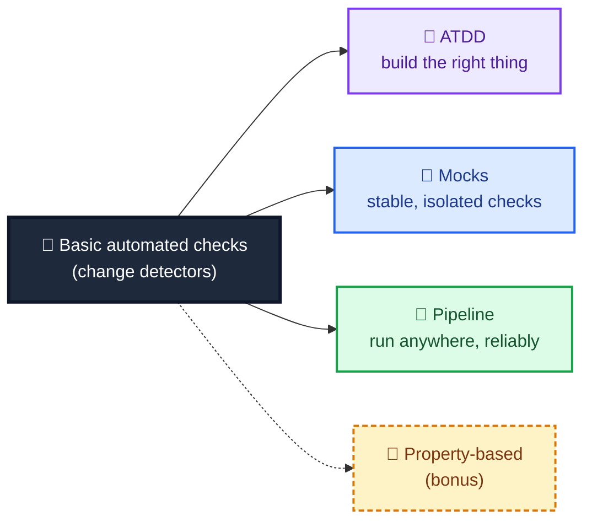

---

## Acceptance test-driven development

### Two kinds of risk

Different testing activities mitigate different risks, and automation is no exception. The checks I built before target **regression risks**: what if the system changes in an undesirable way as we add features and modify code? For example, what if the wrong status code comes back?

But there's another kind of risk that's easy to overlook: **delivering the wrong thing.** That isn't about how the *system* can go wrong. It's about how *we, as a team,* can misunderstand what needs to be delivered. Acceptance test-driven development (ATDD) is aimed squarely at that.

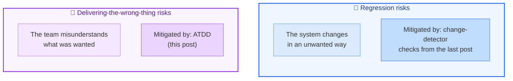

### From TDD to ATDD

ATDD borrows the rhythm of **test-driven development (TDD)**:

1. Create a **failing** automated check.
2. Write some production code to make it pass.
3. **Refactor** with confidence.

The difference is where the expectations come from. In TDD they're small pieces of logic a developer is working on. In ATDD they come from **a conversation with the business** about what they want the API to do, so the checks sit at a higher level, describing business behaviour.

The conversation produces an example captured in **Gherkin**, a Given-When-Then language:

```gherkin
Feature: Booking reports
  Scenario: User requests total earnings of all bookings
    Given I have multiple bookings
    When I ask for a report on my total earnings
    Then I will receive a total amount based on all my bookings
```

Tools such as Cucumber can turn that scenario into an automated check. It fails at first, because the production code doesn't exist yet. When we write just enough code to make it pass, we have feedback that **we built what the business asked for**, and no more. That's a built-in defence against scope creep.

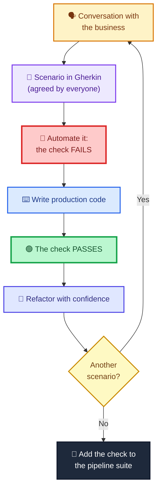

### How the book wires it up (Java)

For the book's Java version, the setup has these pieces:

| Piece | What it does |
|---|---|
| **Dependencies** | The same JUnit, REST Assured and Jackson as before, plus two Cucumber libraries (`cucumber-java` and `cucumber-junit`) |
| **Packages** | `requests`, `payloads`, and a new `stepdefinitions` |
| **`RunCukesTest`** | A class that connects JUnit and Cucumber and points at the folder of `.feature` files |
| **A `.feature` file** | The scenario, in plain English |
| **Step definitions** | Methods annotated `@Given`, `@When` and `@Then`, each with the exact phrase from the scenario |

When you first run it (`mvn clean test`), Cucumber finds the scenario, can't find matching code, and helpfully reports an `UndefinedStepException`, even suggesting the method to write. Each step then gets real code:

- **Given** *I have multiple bookings*: build two `Booking` payloads and POST them.
- **When** *I ask for a report on my total earnings*: send a GET to the booking `report` endpoint and keep the response.
- **Then** *I will receive a total amount based on all my bookings*: parse the response into a `Total` object and assert on the total (400, for two bookings of 200).

At this point the check **fails** (in the book, with a connection error, because there's no production code to talk to). Whoever owns the production code then builds it. When the check goes green, the team has delivered what the business wanted, can refactor safely, and can add the check to the pipeline suite so future changes can't silently break the behaviour.

> **📝 A few small things I noticed in the source text:**
> - The callouts for `@BeforeAll` and `@AfterAll` say "runs before/after *every test*". In JUnit 5, `@BeforeAll` runs **once before all the tests in the class**; `@BeforeEach` is the per-test hook. For a mock server that you start once, `@BeforeAll` is the right choice, so the code is fine and only the comment is loose.
> - The assertion is written `assertEquals(total, 400)`. JUnit's convention is `assertEquals(expected, actual)`, so the arguments are swapped. It passes or fails identically, but a failure message would call the wrong number "expected". It's a tiny thing that makes debugging a little more confusing.
> - This chapter's `Booking` class has a `totalprice` and no `roomid`, while the previous chapter's had `roomid`. The two are different payload shapes, so I'd keep them in separate projects, as the book does.
>
> None of these change the lesson. They're a reminder that even carefully written examples contain slips, and that running the code is the only way to know.

---

## Hands-on: ATDD in Python, red then green

I ported the scenario using **`pytest-bdd`**, which plays the role Cucumber plays in Java: it reads the `.feature` file and ties each step to a function.

| Role | Book (Java) | My port (Python) |
|---|---|---|
| Runner | JUnit 5 + `RunCukesTest` | pytest |
| Gherkin to code | Cucumber (`@Given` / `@When` / `@Then`) | `pytest-bdd` (`@given` / `@when` / `@then`) |
| HTTP | REST Assured | `requests` |
| API under test | the real sandbox | a mock booking API I wrote |

> **⚠️ Caution: the system under test is mine.** My `booking_app.py` stands in for the sandbox. It has the endpoints the chapter uses (`POST /booking/`, `GET /booking/report`, `DELETE /booking/{id}`, a health endpoint) but its rules are my own simplifications.

Install what's needed with:

```bash
pip install pytest pytest-bdd requests hypothesis
```

### The scenario and its step definitions

The feature file is exactly the book's scenario:

```gherkin
Feature: Booking reports
  Scenario: User requests total earnings of all bookings
    Given I have multiple bookings
    When I ask for a report on my total earnings
    Then I will receive a total amount based on all my bookings
```

And the step definitions tie each phrase to code:

```python
"""The Gherkin scenario from features/booking_reports.feature, tied to code (the 'step definitions')."""
import pytest
import requests
from pytest_bdd import given, scenarios, then, when

from conftest import a_booking, post_booking

scenarios("booking_reports.feature")


@pytest.fixture
def context():
    return {}


@given("I have multiple bookings")
def i_have_multiple_bookings(booking):
    post_booking(booking, a_booking(price=200))
    post_booking(booking, a_booking(price=200))


@when("I ask for a report on my total earnings")
def i_ask_for_a_report(booking, context):
    context["response"] = requests.get(booking.base + "/booking/report")


@then("I will receive a total amount based on all my bookings")
def i_receive_a_total(context):
    response = context["response"]
    assert response.status_code == 200, f"report endpoint answered {response.status_code}"
    assert response.json()["total"] == 400
```

The shared fixtures (real auth API, mock auth API, booking API wired to each, and state reset between checks) live in `conftest.py`. One switch matters for the red/green demonstration: setting `REPORT_ENABLED=0` makes the booking API behave as if **the production code hasn't been written yet**.

```python
import os

import pytest
import requests

from auth_app import AuthApp
from booking_app import BookingApp
from mock_server import MockServer


@pytest.fixture(scope="session")
def auth():
    """The REAL auth API."""
    a = AuthApp().start()
    yield a
    a.stop()


@pytest.fixture(scope="session")
def mock_auth():
    """A stand-in for the auth API (the WireMock role)."""
    m = MockServer().start()
    yield m
    m.stop()


@pytest.fixture(scope="session")
def booking(auth):
    """Booking API wired to the REAL auth API. REPORT_ENABLED=0 simulates 'production code not written yet'."""
    app = BookingApp(auth_url=auth.base, report_enabled=os.environ.get("REPORT_ENABLED", "1") == "1").start()
    yield app
    app.stop()


@pytest.fixture(scope="session")
def booking_mocked(mock_auth):
    """Booking API wired to the MOCK auth API."""
    app = BookingApp(auth_url=mock_auth.base).start()
    yield app
    app.stop()


@pytest.fixture(autouse=True)
def clean_slate(booking, booking_mocked, mock_auth):
    booking.reset()
    booking_mocked.reset()
    mock_auth.reset()


def a_booking(price=200, first="Mark", checkin="2021-01-01", checkout="2021-03-01"):
    return {"firstname": first, "lastname": "Winteringham", "totalprice": price, "depositpaid": True,
            "bookingdates": {"checkin": checkin, "checkout": checkout}, "additionalneeds": "Breakfast"}


def post_booking(app, payload):
    return requests.post(app.base + "/booking/", json=payload)
```

### Red

First, the report endpoint doesn't exist:

```bash
REPORT_ENABLED=0 pytest tests/test_booking_reports_atdd.py
```

```text
E   AssertionError: report endpoint answered 404
E   assert 404 == 200
1 failed
```

That's the **failing automated check**, and notice that the failure message is useful: *"report endpoint answered 404"*. I included the actual status in my assertion message deliberately. A failing check should tell the reader what it saw, not just that it was surprised.

### Green

Now the production code exists:

```bash
pytest tests/test_booking_reports_atdd.py
```

```text
1 passed
```

That's the whole cycle in two commands. And notice what it *didn't* do: it didn't check that negative prices are rejected, or that dates are validated, or that every error message is friendly. Those are real risks, but they're **not what this check is for**. This check answers one question: *did we build the thing the business asked for?*

> **💡 Tip:** I like to write the failing check **before** I tell anyone the feature is "in progress". It turns a vague feeling ("I think I understand it") into something that's either red or green.

---

## Beware of traps

ATDD only works if the *conversation* works. The book names two antipatterns that I've seen as well, and I wrote a small tool to help me spot one of them.

### Trap 1: going alone

The value of ATDD isn't the automation. It's the **conversation before the scenario is written**. The team meets regularly, talks through new features, and captures scenarios *together*, dispelling misunderstandings before work begins. If everyone agrees with the scenario, I can automate it with confidence.

The trap is one person (maybe me) writing the scenarios alone. Then I risk **codifying my own misunderstanding**: the check passes, the work doesn't match what the business wanted, and everyone suffers the rework we all hate.

### Trap 2: trying to automate everything

Getting people in the room is a good start, but I need to stay focused on the **core business features**. Sometimes a negative scenario about business validation belongs, but I don't want to capture every way a feature can fail. The focus is on delivering the right thing first time, not on writing checks for every eventuality. Otherwise I end up with scenarios that no longer describe business expectations, plus a mountain of low-value code to maintain.

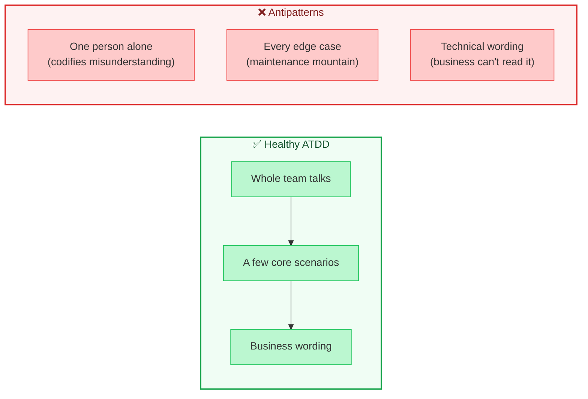

### A scenario reviewer

I can't automate "had a good conversation", but I *can* spot the symptoms. This little linter flags: too many scenarios in one feature (probably automating everything), very long scenarios (probably several ideas jammed together), scenarios missing a Given, When or Then, and **technical wording** such as "POST", "JSON", "status code" or a bare number like `201`. If the business wouldn't say it, it doesn't belong in a scenario.

> **⚠️ Caution:** The linter's limits (six scenarios, seven steps) and its word list are **my own choices**. It produces *prompts for a conversation*, not verdicts. A technical-sounding step might be exactly right in your context, and a perfectly clean scenario can still be the wrong scenario.

```python
"""A small reviewer for Gherkin files: a prompt for conversation, never a verdict."""
import re

TECHNICAL = re.compile(r"\b(status code|http|json|endpoint|payload|header|post|get|put|delete|\d{3})\b", re.I)
MAX_SCENARIOS = 6      # my limit: a feature is not a test suite
MAX_STEPS = 7          # my limit: long scenarios usually hide several ideas
KEYWORDS = ("Given", "When", "Then", "And", "But")


def lint(text: str) -> list[str]:
    findings, scenarios, current = [], [], None
    for raw in text.splitlines():
        line = raw.strip()
        if line.startswith("Scenario"):
            current = {"name": line.split(":", 1)[1].strip(), "steps": []}
            scenarios.append(current)
        elif current is not None and line.startswith(KEYWORDS):
            current["steps"].append(line)
    if len(scenarios) > MAX_SCENARIOS:
        findings.append(f"{len(scenarios)} scenarios in one feature: are these core business behaviours, "
                        f"or is this trying to automate everything?")
    for s in scenarios:
        kinds = {step.split()[0] for step in s["steps"]}
        for needed in ("Given", "When", "Then"):
            if needed not in kinds:
                findings.append(f"'{s['name']}': no {needed} step")
        if len(s["steps"]) > MAX_STEPS:
            findings.append(f"'{s['name']}': {len(s['steps'])} steps, which is a lot for one idea")
        for step in s["steps"]:
            if TECHNICAL.search(step):
                findings.append(f"'{s['name']}': technical wording in '{step}': would the business say this?")
    return findings
```

```python
from pathlib import Path

from lint_feature import lint

GOOD = Path("features/booking_reports.feature").read_text()

TECHNICAL = """Feature: Bookings
  Scenario: Create a booking
    Given I have a JSON payload for a booking
    When I send a POST to the booking endpoint
    Then the response status code is 201
"""

NO_THEN = """Feature: Bookings
  Scenario: Half a scenario
    Given I have a booking
    When I look at it
"""


def test_the_chapters_scenario_is_clean():
    assert lint(GOOD) == []


def test_technical_wording_is_flagged_step_by_step():
    findings = lint(TECHNICAL)
    assert len(findings) == 3
    assert all("technical wording" in f for f in findings)


def test_a_scenario_missing_a_then_is_flagged():
    assert lint(NO_THEN) == ["'Half a scenario': no Then step"]


def test_too_many_scenarios_suggest_automating_everything():
    many = "Feature: Everything\n" + "".join(
        f"  Scenario: Case {i}\n    Given a thing\n    When it happens\n    Then it works\n" for i in range(8))
    findings = lint(many)
    assert any("8 scenarios" in f for f in findings)


def test_a_very_long_scenario_is_flagged():
    steps = "".join(f"    And step number {i}\n" for i in range(8))
    text = f"Feature: Long\n  Scenario: Rambling\n    Given a start\n    When something\n    Then an end\n{steps}"
    assert any("steps, which is a lot" in f for f in lint(text))
```

The chapter's own scenario comes back clean. A scenario written the way a developer might ("Given I have a JSON payload... When I send a POST to the booking endpoint... Then the response status code is 201") gets three findings, one per step.

---

## Web API mocking

### The problem: flaky checks

One of the biggest headaches in automation is **false positives**, often called "flaky tests". Two common causes are **state management** and **complex dependencies between the API I'm testing and other APIs on the platform.** The book illustrates this with the delete check from the last chapter, which creates a booking, logs in as an administrator, and then deletes the booking.

The check is *about* the booking API, but it quietly relies on the **auth API** to authorise the delete. So if the auth API misbehaves (a misconfigured account, a bug, a connectivity blip between services), the booking check fails for reasons that have nothing to do with bookings. The result can be a persistently red check that demands debugging and wears away trust in the check itself.

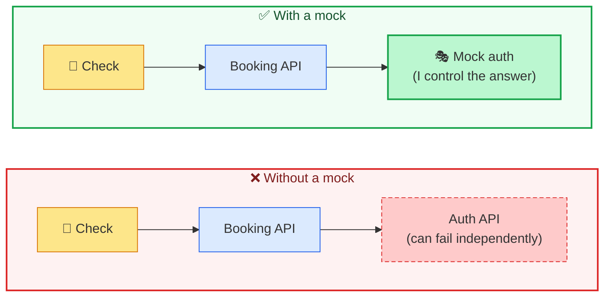

The remedy is a **web API mocking** library. It lets me isolate the API under test *and* control the flow of information going into it. I can state which requests the mock should receive, in what format, and exactly what it should send back.

### How the book does it with WireMock

The book rewires the delete check like this:

1. **Set up the booking API** locally, and make sure nothing else is listening on port 3004, because the fake auth API will take that port.
2. **Remove the auth calls** from the check and hard-code a token (`abc123`) in the delete request. On its own that would fail, because `abc123` isn't a real token.
3. **Add WireMock** as a test dependency.
4. **Start a `WireMockServer`** on port 3004 before the tests, and stop it afterwards.
5. **Create a stub** for `POST /auth/validate` that only matches a request body of `{"token": "abc123"}` and answers with a `200`.

In the book's terms, the stub is built from five parts: call the mock; `stubFor(...)` with the endpoint's configuration; `post(...)` to choose the method and path; `withRequestBody(...)` to say what the body must contain; and `willReturn(...)` to say what comes back. When the booking API receives the delete, it forwards the token from the cookie to the mock. If the token matches `abc123`, the mock says yes. Otherwise the stub doesn't match, and the check fails.

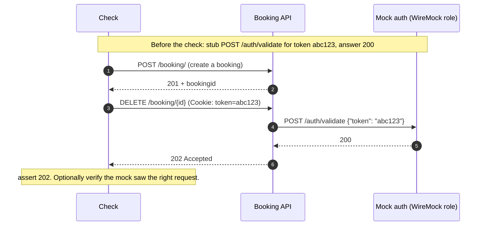

The payoff: I have far more control over how the booking API's dependencies behave, and if something fails, I can be much more confident the problem lies with the booking API.

---

## Hands-on: a mock server and what it unlocks

I wrote a small **WireMock-style mock server** in Python. It supports exactly the ideas above: `stub_for` (match on method, path and, optionally, an exact JSON body, then say what status and body to return), and `verify` (count the requests that actually arrived). It also records **every** request, matched or not, which turns out to be useful.

> **📝 Note:** I used the stub-and-verify shape on purpose, so that if you know WireMock, this reads familiarly. It's a teaching tool, not a WireMock replacement. It has no delays, no faults, no templating, and no persistence.

```python
"""A small WireMock-style stub server: stub_for(...) a request, say what comes back,
then verify afterwards what the system under test actually sent."""
from json_server import JsonServer


class MockServer(JsonServer):
    def __init__(self):
        self.stubs = []       # (method, path, expected_body_or_None, status, response)
        self.received = []    # (method, path, body): every request that arrived, matched or not
        super().__init__(self._handle)

    def stub_for(self, method, path, *, body=None, status=200, response=None):
        """Like WireMock's stubFor(post(path).withRequestBody(equalToJson(body)).willReturn(status))."""
        self.stubs.append((method, path, body, status, response or {}))

    def reset(self):
        self.stubs.clear()
        self.received.clear()

    def verify(self, method, path, body=None) -> int:
        """How many received requests match? (body=None means 'any body')"""
        return sum(1 for m, p, b in self.received
                   if m == method and p == path and (body is None or b == body))

    def _handle(self, method, path, headers, body):
        self.received.append((method, path, body))
        for m, p, expected, status, response in self.stubs:
            if m == method and p == path and (expected is None or expected == body):
                return status, response
        return 404, {"error": "no stub matches this request"}
```

The booking API forwards the cookie's token to whatever `auth_url` it's configured with. The real auth API and the mock sit behind the same URL contract, which is what makes swapping them possible:

```python
"""The booking API under test (MY mock, not restful-booker-platform).
Run in-process for fast checks, or as a separate process: python booking_app.py --port 3000"""
import argparse
import re
import threading
import time
from datetime import date

import requests

from json_server import JsonServer

ISO = re.compile(r"^\d{4}-\d{2}-\d{2}$")


class BookingApp(JsonServer):
    def __init__(self, auth_url: str = "http://localhost:3004", report_enabled: bool = True):
        self.auth_url = auth_url
        self.report_enabled = report_enabled
        self.faults = set()          # e.g. {"accept_negative_price"}
        self.bookings = {}
        self._next_id = 1
        self._lock = threading.Lock()
        super().__init__(self._route)

    def reset(self):
        self.bookings.clear()
        self._next_id = 1
        self.faults.clear()

    # ---------- routing ----------
    def _route(self, method, path, headers, body):
        if method == "GET" and path == "/booking/actuator/health":
            return 200, {"status": "UP"}
        if method == "POST" and path == "/booking/":
            return self._create(body)
        if method == "GET" and path == "/booking/report":
            if not self.report_enabled:
                return 404, {"error": "not found"}
            return 200, {"total": sum(b["totalprice"] for b in self.bookings.values())}
        m = re.fullmatch(r"/booking/(\d+)", path)
        if method == "DELETE" and m:
            return self._delete(int(m.group(1)), headers.get("Cookie", ""))
        return 404, {"error": "not found"}

    # ---------- behaviour ----------
    def _create(self, b):
        errors = []
        if not isinstance(b, dict):
            return 400, {"errors": ["body must be a JSON object"]}
        for f in ("firstname", "lastname"):
            if not isinstance(b.get(f), str) or not b[f].strip():
                errors.append(f"{f} must not be blank")
        price = b.get("totalprice")
        if not isinstance(price, int) or isinstance(price, bool):
            errors.append("totalprice must be an integer")
        elif price < 0 and "accept_negative_price" not in self.faults:
            errors.append("totalprice must not be negative")
        if not isinstance(b.get("depositpaid"), bool):
            errors.append("depositpaid must be a boolean")
        try:
            d = b["bookingdates"]
            if not (ISO.match(d["checkin"]) and ISO.match(d["checkout"])):
                raise ValueError
            if date.fromisoformat(d["checkout"]) <= date.fromisoformat(d["checkin"]):
                errors.append("checkout must be after checkin")
        except (KeyError, TypeError, ValueError):
            errors.append("bookingdates must contain ISO checkin and checkout")
        if errors:
            return 400, {"errors": errors}
        with self._lock:
            booking_id = self._next_id
            self._next_id += 1
            self.bookings[booking_id] = b
        return 201, {"bookingid": booking_id, "booking": b}

    def _delete(self, booking_id, cookie):
        token = cookie.split("token=")[1].split(";")[0] if "token=" in cookie else ""
        try:
            verdict = requests.post(self.auth_url + "/auth/validate", json={"token": token}, timeout=2)
        except requests.RequestException:
            return 502, {"error": "auth service unreachable"}
        if verdict.status_code in (401, 403):
            return 403, {"error": "forbidden"}
        if verdict.status_code != 200:
            return 502, {"error": f"auth service answered {verdict.status_code}"}
        if booking_id not in self.bookings:
            return 404, {"error": "no such booking"}
        del self.bookings[booking_id]
        return 202, {}


if __name__ == "__main__":
    parser = argparse.ArgumentParser()
    parser.add_argument("--port", type=int, default=3000)
    parser.add_argument("--auth-url", default="http://localhost:3004")
    parser.add_argument("--startup-delay", type=float, default=0.0)
    args = parser.parse_args()
    app = BookingApp(args.auth_url).start(port=args.port, startup_delay=args.startup_delay)
    print(f"booking API listening on {app.base}", flush=True)
    while True:
        time.sleep(1)
```

<details>
<summary>Supporting code: the tiny HTTP server base and the real auth API (click to expand)</summary>

```python
"""A tiny JSON-over-HTTP server that runs a handler function on a free local port."""
import json
import threading
import time
from http.server import BaseHTTPRequestHandler, ThreadingHTTPServer


class JsonServer:
    def __init__(self, handler):
        """handler(method, path, headers, body) -> (status, payload_dict)"""
        self._handler = handler
        self.httpd = None
        self.port = None

    def start(self, port=0, startup_delay=0.0):
        if startup_delay:
            time.sleep(startup_delay)           # lets me simulate an API that is slow to boot
        outer = self

        class H(BaseHTTPRequestHandler):
            def log_message(self, *args):
                pass

            def _go(self):
                n = int(self.headers.get("Content-Length", 0))
                raw = self.rfile.read(n) if n else b""
                try:
                    body = json.loads(raw) if raw else None
                except json.JSONDecodeError:
                    body = "__invalid__"
                status, payload = outer._handler(self.command, self.path, self.headers, body)
                data = json.dumps(payload).encode()
                self.send_response(status)
                self.send_header("Content-Type", "application/json")
                self.send_header("Content-Length", str(len(data)))
                self.end_headers()
                self.wfile.write(data)

            do_GET = do_POST = do_DELETE = _go

        self.httpd = ThreadingHTTPServer(("127.0.0.1", port), H)
        self.port = self.httpd.server_address[1]
        threading.Thread(target=self.httpd.serve_forever, daemon=True).start()
        return self

    @property
    def base(self) -> str:
        return f"http://127.0.0.1:{self.port}"

    def stop(self):
        if self.httpd:
            self.httpd.shutdown()
            self.httpd.server_close()
            self.httpd = None
```

```python
"""The real auth API: login gives a token, validate checks one."""
import secrets

from json_server import JsonServer


class AuthApp(JsonServer):
    def __init__(self):
        self.tokens = set()
        super().__init__(self._route)

    def _route(self, method, path, headers, body):
        if method == "POST" and path == "/auth/login":
            if isinstance(body, dict) and body.get("username") == "admin" and body.get("password") == "password":
                token = secrets.token_hex(8)
                self.tokens.add(token)
                return 200, {"token": token}
            return 403, {"error": "bad credentials"}
        if method == "POST" and path == "/auth/validate":
            ok = isinstance(body, dict) and body.get("token") in self.tokens
            return (200, {}) if ok else (403, {})
        return 404, {"error": "not found"}
```

</details>

### The experiments

Now the checks. Each one answers a question about mocking:

```python
"""Isolating the booking API from its auth dependency."""
import requests

from conftest import a_booking, post_booking

TOKEN = {"Cookie": "token=abc123"}


def booking_id(app):
    return post_booking(app, a_booking()).json()["bookingid"]


def delete(app, bid, headers=TOKEN):
    return requests.delete(f"{app.base}/booking/{bid}", headers=headers)


def test_real_auth_flow_passes_when_everything_is_healthy(booking, auth):
    bid = booking_id(booking)
    token = requests.post(auth.base + "/auth/login", json={"username": "admin", "password": "password"}).json()["token"]
    assert delete(booking, bid, {"Cookie": f"token={token}"}).status_code == 202


def test_real_auth_down_breaks_a_check_that_is_about_booking(booking, auth):
    """The dependency problem: the BOOKING check fails because AUTH is unhealthy."""
    bid = booking_id(booking)
    auth.stop()
    try:
        assert delete(booking, bid, {"Cookie": "token=anything"}).status_code == 502   # not the booking API's fault
    finally:
        auth.start(port=auth.port or 0)
    # the lesson: nothing was wrong with the booking API, yet a delete check would have gone red


def test_mocked_delete_returns_202_and_the_mock_saw_the_right_token(booking_mocked, mock_auth):
    mock_auth.stub_for("POST", "/auth/validate", body={"token": "abc123"}, status=200)
    bid = booking_id(booking_mocked)
    assert delete(booking_mocked, bid).status_code == 202
    assert mock_auth.verify("POST", "/auth/validate", {"token": "abc123"}) == 1


def test_a_token_the_mock_does_not_expect_fails_the_check(booking_mocked, mock_auth):
    mock_auth.stub_for("POST", "/auth/validate", body={"token": "abc123"}, status=200)
    bid = booking_id(booking_mocked)
    response = delete(booking_mocked, bid, {"Cookie": "token=wrong"})
    assert response.status_code == 502                      # the unmatched stub answered 404
    assert mock_auth.verify("POST", "/auth/validate", {"token": "wrong"}) == 1


def test_auth_saying_forbidden_leaves_the_booking_in_place(booking_mocked, mock_auth):
    mock_auth.stub_for("POST", "/auth/validate", status=403)
    bid = booking_id(booking_mocked)
    assert delete(booking_mocked, bid).status_code == 403
    assert bid in booking_mocked.bookings


def test_auth_falling_over_is_reported_and_the_booking_survives(booking_mocked, mock_auth):
    mock_auth.stub_for("POST", "/auth/validate", status=500)
    bid = booking_id(booking_mocked)
    assert delete(booking_mocked, bid).status_code == 502
    assert bid in booking_mocked.bookings


def test_with_no_stub_at_all_I_learn_exactly_what_the_api_asks_of_its_dependency(booking_mocked, mock_auth):
    bid = booking_id(booking_mocked)
    delete(booking_mocked, bid)
    assert mock_auth.received == [("POST", "/auth/validate", {"token": "abc123"})]
```

| Check | What it shows |
|---|---|
| Real auth, everything healthy | The original end-to-end delete flow works |
| **Real auth down** | The booking delete fails with a `502`: nothing wrong with booking, yet the check would go red. This is the flakiness. |
| Mocked delete returns 202 | With a stub, the check is **independent** of the real auth API, and `verify` confirms the mock received exactly the expected token |
| A token the mock doesn't expect | The unmatched stub answers 404, the booking API reports a `502`, and the check fails, as the book describes |
| Auth says **403** | The booking API returns `403` and **the booking is still there** |
| Auth says **500** | The booking API reports a `502`, and the booking is **still there** |
| **No stub at all** | The mock's request log shows exactly what the booking API asks of its dependency |

Look at the 403 and 500 rows. Those are scenarios I'd struggle to trigger against a real auth API: I'd have to break it on purpose. With a mock, they're two lines. It's the same trick I used in the exploratory testing post, where I swapped in a stub to see how a booking API behaved when its message API misbehaved, now captured as permanent automated checks.

And the last row is an underrated benefit. By registering no stub at all and reading `mock_auth.received`, I learned the *precise* request my API sends: `POST /auth/validate` with `{"token": "abc123"}`. That's documentation of a hidden dependency, produced for free.

> **⚠️ Caution: mocks can lie.** A mock only knows what *I told it*. If the real auth API changes its request format or its responses, my mock will keep cheerfully answering the old way, and my checks will stay green while the integration is broken. Mocking trades one kind of risk (flakiness) for another (**drift** between mock and reality). The book's next chapter takes this on directly with contract testing, and I'd keep at least one *unmocked* end-to-end check, like my "real auth" one, as a sanity net.

> **💡 Tip:** When a check goes red, I ask which dependencies it touches. If a failure could have come from something *other* than the thing I named in the check, I'm paying a flakiness tax, and a mock may be worth the cost.

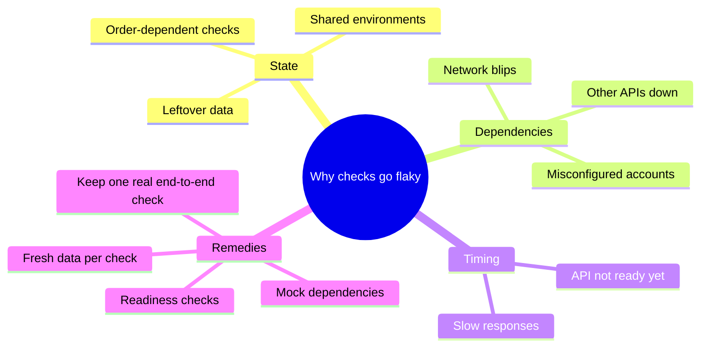

---

## Running as part of a pipeline

Sooner or later I want to run my automation as part of a pipeline that builds, checks and deploys. So far I've worked in an IDE against a deployed API or one running on my laptop. But a pipeline runs somewhere else, typically a continuous integration build box, and **unlike unit checking, API automation needs the API to be running.** So I need some tool, library or script to get the API up, and what I choose depends on how my code is organised and what pipeline tools I use. The book looks at two situations.

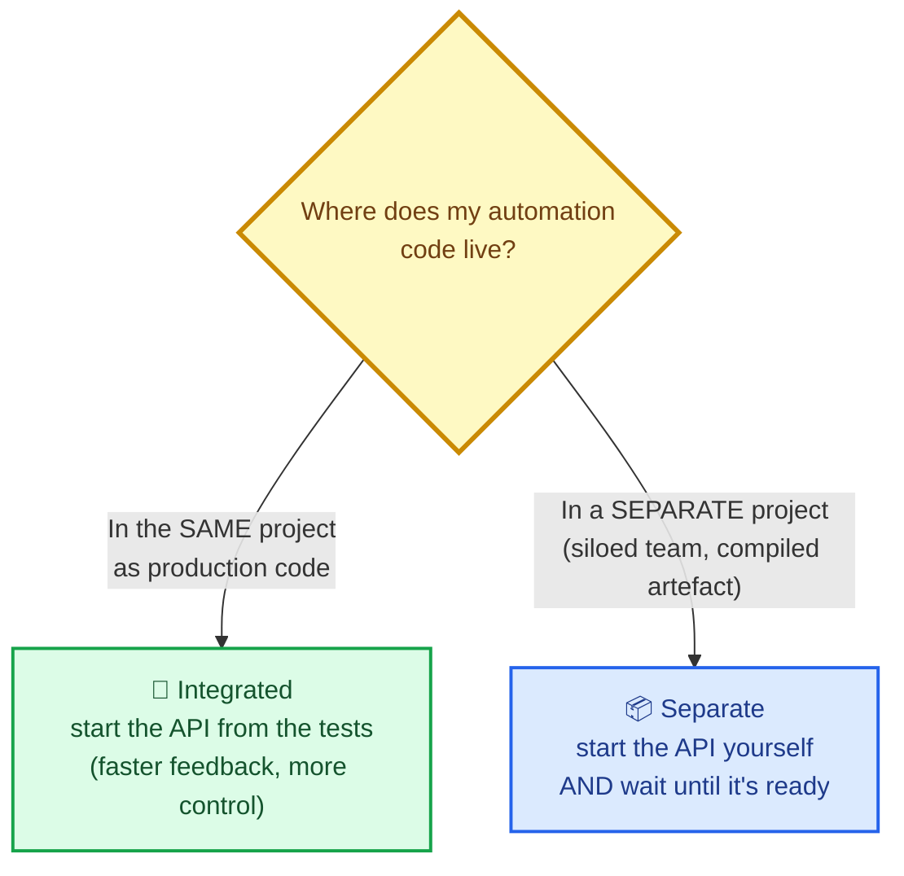

### Integrated with the codebase

Keeping automation in the same project as the production code is recommended, though not always possible. You get **faster feedback**, because the checks run in the build (think of Maven's test and integration-test phases), and **more access and control** over how the API starts.

The book shows this with Spring Boot's `spring-boot-starter-test`, which can switch the API on from inside the test class. Three annotations do the work:

| Annotation | What it does |
|---|---|
| `@ExtendWith(SpringExtension.class)` | Connects JUnit 5 with Spring so the test class can drive the web API |
| `@SpringBootTest(webEnvironment = DEFINED_PORT, classes = BookingApplication.class)` | Says *how* to start the API: use the port from the properties file, and use this class's `SpringApplication.run()` to launch it |
| `@ActiveProfiles("dev")` | Chooses which properties file to load (here `application-dev.properties`), useful for "production" versus "test" modes such as different logging |

With that in place, running the check starts the API (you can see it in the log), and, given the failsafe plugin from the last chapter, `mvn clean install` runs the whole thing, ready for any CI tool.

My Python equivalent of this is the `conftest.py` you saw earlier: session fixtures that start the booking API **inside the test process** and stop it afterwards. Nothing needs to be running beforehand.

### Separate to the codebase

It's not always possible to keep both together: siloed teams may pass finished work "over the fence", or the software may already be compiled. That shouldn't stop me trying. If I imagine a compiled JAR, two things are needed:

1. **Turn the API on**, easily done with whatever deployment script exists (`java -jar example.jar`, or Docker, which the book leaves out of scope).
2. **Wait until it can receive requests.** This is the hard part. If the automation starts first, I get false positives that look like real failures.

The book's solution is a pre-flight method, `waitForApi`, which sends a request to a health URL every second. A connection error or a non-200 response means "not ready yet", so it counts down a limit and tries again. It ends one of two ways: the limit hits zero and the check fails with a clear message, or a `200` arrives and testing begins.

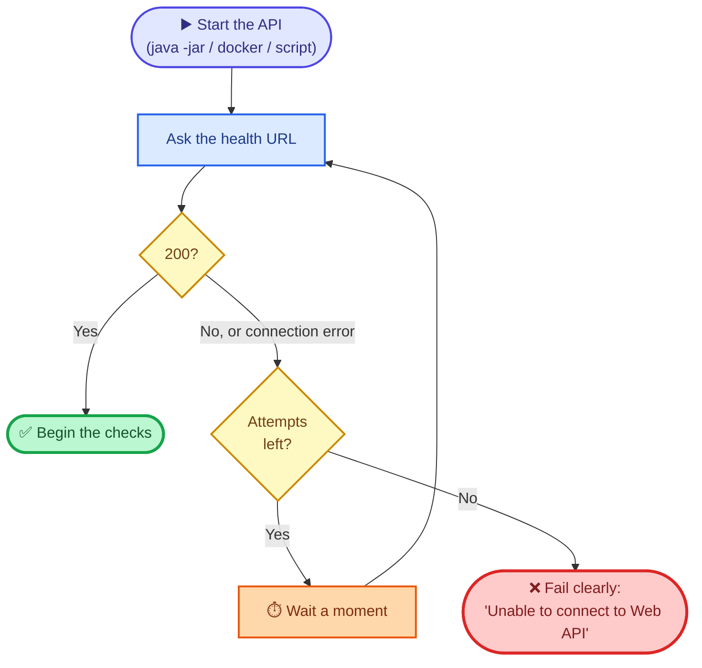

The book is honest about the downside: this means more code to maintain and more places to fail, which can feel uncomfortable. That's why it's worth stepping back to ask whether I can change my *context* so production and automation code live together, which may save everyone time later.

---

## Hands-on: waiting for an API to be ready

I ported `waitForApi` to Python with two small improvements for testing: the HTTP call and the sleep are **injectable**, so I can test the retry logic instantly and deterministically rather than waiting real seconds.

```python
"""A pre-flight check: don't start checking until the API can answer."""
import time

import requests


class ApiNotReady(Exception):
    pass


def wait_for_api(url: str, timeout_limit: int, interval: float = 1.0,
                 get=requests.get, sleep=time.sleep) -> int:
    """Try up to `timeout_limit` times, `interval` seconds apart. Anything other than a 200
    (including a connection error) counts as 'not ready yet'. Returns the attempts used."""
    attempts = 0
    while attempts < timeout_limit:
        attempts += 1
        try:
            if get(url, timeout=2).status_code == 200:
                return attempts
        except Exception:
            pass
        if attempts < timeout_limit:
            sleep(interval)
    raise ApiNotReady(f"Unable to connect to Web API at {url} after {timeout_limit} attempts")
```

The tests cover the behaviour I care about:

```python
import socket
import subprocess
import sys

import pytest
import requests

from readiness import ApiNotReady, wait_for_api


class FakeResponse:
    def __init__(self, status):
        self.status_code = status


def scripted(*outcomes):
    """A fake HTTP getter that returns/raises the given outcomes in order."""
    queue = list(outcomes)

    def get(url, timeout=None):
        outcome = queue.pop(0)
        if isinstance(outcome, Exception):
            raise outcome
        return FakeResponse(outcome)
    return get


def test_ready_at_once_uses_one_attempt_and_never_sleeps():
    sleeps = []
    assert wait_for_api("http://x", 5, get=scripted(200), sleep=sleeps.append) == 1
    assert sleeps == []


def test_connection_errors_and_non_200s_both_mean_not_ready_yet():
    sleeps = []
    get = scripted(ConnectionError("refused"), 503, 404, 200)
    assert wait_for_api("http://x", 10, interval=0.5, get=get, sleep=sleeps.append) == 4
    assert sleeps == [0.5, 0.5, 0.5]


def test_gives_up_with_a_clear_message_after_the_limit():
    sleeps = []
    with pytest.raises(ApiNotReady) as caught:
        wait_for_api("http://x", 3, get=scripted(503, 503, 503), sleep=sleeps.append)
    assert "after 3 attempts" in str(caught.value)
    assert len(sleeps) == 2          # no pointless sleep after the final attempt


def free_port():
    with socket.socket() as s:
        s.bind(("127.0.0.1", 0))
        return s.getsockname()[1]


def test_a_port_nobody_listens_on_times_out_for_real():
    with pytest.raises(ApiNotReady):
        wait_for_api(f"http://127.0.0.1:{free_port()}/booking/actuator/health", 3, interval=0.05)


def test_a_separate_process_that_is_slow_to_start_is_waited_for():
    """'Separate to codebase': start the API as its own process, then wait until it is ready."""
    port = free_port()
    proc = subprocess.Popen([sys.executable, "booking_app.py", "--port", str(port), "--startup-delay", "1.0"],
                            stdout=subprocess.DEVNULL, stderr=subprocess.DEVNULL)
    try:
        url = f"http://127.0.0.1:{port}/booking/actuator/health"
        attempts = wait_for_api(url, 40, interval=0.1)
        assert attempts > 1                       # it genuinely was not ready on the first try
        assert requests.get(url).json() == {"status": "UP"}
    finally:
        proc.terminate()
        proc.wait(timeout=5)
    assert proc.returncode is not None
```

| Check | What it proves |
|---|---|
| Ready at once | One attempt and **no sleeping**. A healthy API shouldn't slow the build |
| Connection errors and non-200s | Both count as "not ready yet", and it sleeps between attempts |
| Gives up after the limit | A clear message, and **no pointless sleep after the final attempt** |
| A port nobody listens on | The real timeout path works against a genuinely closed port |
| **A real separate process, slow to start** | The API is launched as its own process (`python booking_app.py --startup-delay 1`), the wait loop needs more than one attempt, then the health endpoint answers `UP`, and the process is cleaned up |

That last one is the closest I can get to the book's "separate to codebase" scenario: a program that really is slow to start, and a check that really does wait for it.

> **⚠️ Caution:** Retry-until-ready loops can hide real problems. If I set the limit too high, a genuinely broken deployment looks like a slow one and the pipeline just hangs. Pick a limit that's generous for a healthy start-up and short enough that a broken one fails fast, and make the failure message say *which* URL didn't respond.

> **💡 Tip:** Prefer a purpose-built **health endpoint** (like the book's `/booking/actuator/health`) over a business endpoint. A health check answers "is it up?", whereas a business endpoint might fail for reasons unrelated to start-up, such as missing data.

---

## Bonus: property-based testing

The book's chapter introduction promises property-based testing, but the section isn't in the text I worked from, so treat this as **my addition**.

Example-based checks (everything so far) say: *"for this input, I expect that output."* **Property-based** checks say: *"for ANY input of this shape, this rule always holds"*, and a library generates hundreds of inputs and hunts for a counterexample. When it finds one, it **shrinks** it to the simplest failing case, which is a gift for debugging.

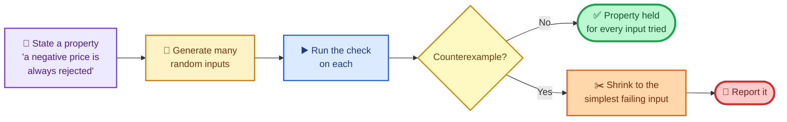

I wrote three properties with the `hypothesis` library:

```python
"""Property-based checks: describe a rule, let the tool hunt for counterexamples."""
import pytest
import requests
from hypothesis import HealthCheck, given, settings
from hypothesis import strategies as st

from conftest import post_booking

names = st.text(alphabet=st.characters(blacklist_categories=("Cs",)), min_size=1, max_size=20).filter(lambda s: s.strip())
prices = st.integers(min_value=0, max_value=10_000)
dates = st.dates(min_value=__import__("datetime").date(2020, 1, 1), max_value=__import__("datetime").date(2030, 1, 1))

SETTINGS = settings(max_examples=40, deadline=None, suppress_health_check=[HealthCheck.function_scoped_fixture])


def booking_payload(first, price, d_in, nights):
    from datetime import timedelta
    return {"firstname": first, "lastname": "Tester", "totalprice": price, "depositpaid": True,
            "bookingdates": {"checkin": d_in.isoformat(), "checkout": (d_in + timedelta(days=nights)).isoformat()}}


@SETTINGS
@given(st.lists(st.tuples(names, prices, dates, st.integers(1, 30)), min_size=0, max_size=6))
def test_report_total_equals_the_sum_of_all_accepted_prices(booking, rows):
    booking.reset()
    for first, price, d_in, nights in rows:
        assert post_booking(booking, booking_payload(first, price, d_in, nights)).status_code == 201
    assert requests.get(booking.base + "/booking/report").json()["total"] == sum(r[1] for r in rows)


@SETTINGS
@given(st.text(max_size=30), st.text(max_size=30))
def test_whatever_garbage_is_sent_as_dates_the_answer_is_a_400_never_a_500(booking, checkin, checkout):
    payload = {"firstname": "A", "lastname": "B", "totalprice": 1, "depositpaid": True,
               "bookingdates": {"checkin": checkin, "checkout": checkout}}
    status = post_booking(booking, payload).status_code
    assert status in (201, 400)          # 201 only if the random text happened to be two sane dates


@SETTINGS
@given(st.integers(min_value=-10_000, max_value=-1))
def test_a_negative_price_is_always_rejected(booking, price):
    booking.reset()
    payload = booking_payload("A", 1, __import__("datetime").date(2021, 1, 1), 2) | {"totalprice": price}
    assert post_booking(booking, payload).status_code == 400
    assert booking.bookings == {}
```

| Property | Rule |
|---|---|
| Report total | The report's total **always equals the sum of the prices** of all accepted bookings, for any list of valid bookings |
| Garbage dates | Whatever text is sent as dates, the answer is a `400`, **never a `500`** |
| Negative prices | A negative price is **always** rejected |

All three hold on my healthy mock. The interesting question is: *would the third one notice a bug?* So I seeded one: a fault that lets negative prices through. Then I ran the same property against it:

```python
"""Part 1: the property-based hunt. Part 2 (red/green) is run from the shell, see the post."""
from datetime import date

import requests
from hypothesis import given, settings
from hypothesis import strategies as st

from booking_app import BookingApp

app = BookingApp().start()
app.faults.add("accept_negative_price")          # seed the bug: negative prices slip through


def payload(price):
    return {"firstname": "A", "lastname": "B", "totalprice": price, "depositpaid": True,
            "bookingdates": {"checkin": date(2021, 1, 1).isoformat(), "checkout": date(2021, 1, 3).isoformat()}}


@settings(max_examples=200, deadline=None, database=None, derandomize=True)
@given(st.integers(min_value=-10_000, max_value=10_000))
def a_booking_with_a_negative_price_is_rejected(price):
    app.reset(); app.faults.add("accept_negative_price")
    status = requests.post(app.base + "/booking/", json=payload(price)).status_code
    assert not (price < 0 and status == 201), f"price {price} was accepted"


try:
    a_booking_with_a_negative_price_is_rejected()
    print("property held (no counterexample found)")
except AssertionError as e:
    notes = getattr(e, "__notes__", [])
    print("property FAILED:", e)
    for n in notes:
        print("  ", n)
    print("   (hypothesis shrank the failure to the smallest example it could find)")
app.stop()
```

```text
property FAILED: price -1 was accepted
   Failing test case: a_booking_with_a_negative_price_is_rejected(
    price=-1,
)
   (hypothesis shrank the failure to the smallest example it could find)
```

The library didn't just say "failed". It found the **smallest** counterexample, a price of `-1`, which is precisely the boundary I'd want to see. I didn't have to think of negative one. That's the strength of the technique: it searches the space of inputs *I didn't think of*, which makes it a close cousin of exploratory testing, automated.

> **⚠️ Caution:** A property is only as good as my statement of it. If I write a vague property ("the API doesn't crash") it will pass for the wrong reasons; if I write a wrong one it will fail forever. The hard part isn't the library. It's articulating the *rule*, which is itself a design-testing skill.

---

## Where this sits in my strategy

Recall my model: *imagination* (what we want), *implementation* (what we have), and the overlap where automated checks live. This post adds nuance:

- **ATDD** reaches back toward the **imagination** side. Its power comes from the *conversation* that creates a shared understanding of what's wanted, and the automated check then becomes proof that the team delivered it. (That's my reading of how it fits the model, not something the book states in those words.)
- **Mocked, pipeline-ready checks** remain in the **overlap**: they confirm what I already know is still true, but with far fewer false alarms.
- **Property-based testing** leans toward **implementation**, hunting for unexpected behaviour, much as exploration does.

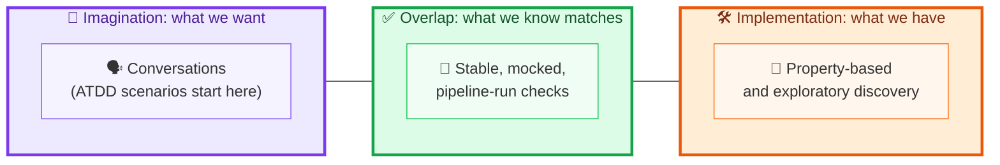

### The whole suite at a glance

All of the code in this post is covered by **21 tests**. Here's the complete run, and what the tests are for:

```bash
pytest -v
```

```text
test_booking_reports_atdd.py::test_user_requests_total_earnings_of_all_bookings PASSED
test_feature_lint.py::test_the_chapters_scenario_is_clean PASSED
test_feature_lint.py::test_technical_wording_is_flagged_step_by_step PASSED
test_feature_lint.py::test_a_scenario_missing_a_then_is_flagged PASSED
test_feature_lint.py::test_too_many_scenarios_suggest_automating_everything PASSED
test_feature_lint.py::test_a_very_long_scenario_is_flagged PASSED
test_mocking.py::test_real_auth_flow_passes_when_everything_is_healthy PASSED
test_mocking.py::test_real_auth_down_breaks_a_check_that_is_about_booking PASSED
test_mocking.py::test_mocked_delete_returns_202_and_the_mock_saw_the_right_token PASSED
test_mocking.py::test_a_token_the_mock_does_not_expect_fails_the_check PASSED
test_mocking.py::test_auth_saying_forbidden_leaves_the_booking_in_place PASSED
test_mocking.py::test_auth_falling_over_is_reported_and_the_booking_survives PASSED
test_mocking.py::test_with_no_stub_at_all_I_learn_exactly_what_the_api_asks_of_its_dependency PASSED
test_properties.py::test_report_total_equals_the_sum_of_all_accepted_prices PASSED
test_properties.py::test_whatever_garbage_is_sent_as_dates_the_answer_is_a_400_never_a_500 PASSED
test_properties.py::test_a_negative_price_is_always_rejected PASSED
test_readiness.py::test_ready_at_once_uses_one_attempt_and_never_sleeps PASSED
test_readiness.py::test_connection_errors_and_non_200s_both_mean_not_ready_yet PASSED
test_readiness.py::test_gives_up_with_a_clear_message_after_the_limit PASSED
test_readiness.py::test_a_port_nobody_listens_on_times_out_for_real PASSED
test_readiness.py::test_a_separate_process_that_is_slow_to_start_is_waited_for PASSED
============================== 21 passed ==============================
```

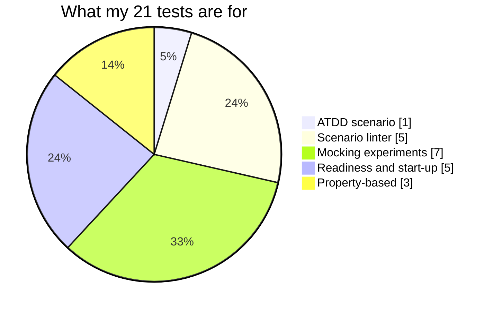

---

## Pitfalls, cheat sheet and summary

### Pitfalls I try to avoid

| Pitfall | Why it hurts | What I do instead |
|---|---|---|
| Writing scenarios alone | I codify my own misunderstanding | Hold the conversation first, with the whole team |
| Scenarios for every edge case | Maintenance mountain, lost business meaning | A few core business behaviours |
| Technical wording in scenarios | The business can't read or challenge them | Write in the business's words |
| Using ATDD to replace TDD or other checks | Different risks, different tools | Let them work side by side |
| Checks that fail because *another* API is down | Flakiness erodes trust | Mock the dependency |
| Mocks that drift from reality | Green checks over a broken integration | Keep a real end-to-end check; use contracts |
| No stub means silent surprises | I don't know what my API asks of its dependency | Record and inspect what the mock received |
| Starting checks before the API is up | False positives that look like bugs | Wait for a health check |
| Waiting forever | A broken deploy looks like a slow one | A sensible limit and a clear failure message |
| Business endpoints as health checks | Unrelated failures masquerade as "not ready" | Use a dedicated health endpoint |
| Vague properties | They pass for the wrong reasons | State a precise rule |
| Treating Java snippets as verified | I didn't run them | Run your own, and trust the principle more than my port |

### Cheat sheet

| I want to... | Reach for... | Watch out for... |
|---|---|---|
| Make sure we build the *right* thing | ATDD with Gherkin scenarios | Going alone; automating everything |
| Tie plain English to code | Cucumber (Java) / `pytest-bdd` (Python) | Technical wording in steps |
| Stop another API making my checks flaky | A mock with stubs | Drift from reality |
| Prove my API sent the right request | `verify` on the mock | Over-specifying incidental details |
| Test failure responses I can't trigger for real | Stub a 403, a 500, a timeout | Forgetting to restore the real service |
| Run checks on a build box | Start the API from the tests, or as a process | Environment differences |
| Not start checking too early | A wait-for-ready loop on a health URL | Limits that are too high or too low |
| Hunt for inputs I didn't think of | Property-based testing | Weak or wrong properties |

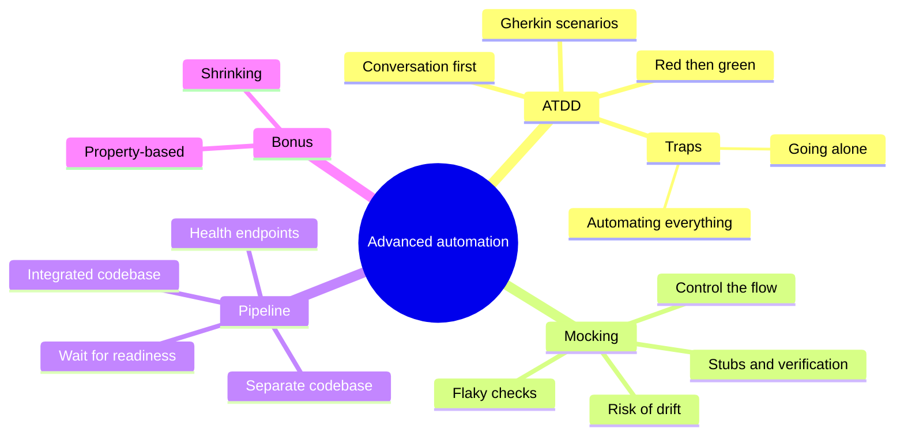

### Key takeaways

- **ATDD mitigates the risk of delivering the wrong thing**, which is different from the regression risk that ordinary checks cover.
- **The conversation is the point.** Scenarios written alone codify misunderstanding.
- **Start red.** A failing check before the code exists gives clear feedback when the work is done.
- **Don't automate everything with ATDD.** Capture core business behaviour, and let TDD and other checks handle the rest.
- **Flaky checks usually come from state and dependencies.** A failure unrelated to what the check names is a flakiness tax.
- **A mock gives me control over a dependency**, letting me test responses I'd struggle to trigger, and verify what my API sent.
- **Mocks can drift.** Keep a real check and look to contract testing.
- **API automation needs a running API.** Start it from the tests if I can, as a process if I must, and always wait until it's ready.
- **Aligning production and automation code** removes whole classes of pipeline pain.
- **Properties find the unexpected.** Describe a rule, let the library hunt, and enjoy the shrunken counterexample.

### Quick glossary

| Term | Meaning |
|---|---|
| **ATDD** | Acceptance test-driven development: automated acceptance checks that guide delivery |
| **TDD** | Test-driven development: failing check, production code, refactor |
| **Gherkin** | A plain-language Given-When-Then format for scenarios |
| **Cucumber / pytest-bdd** | Tools that connect Gherkin steps to automation code |
| **Step definition** | The code that runs for one step of a scenario |
| **Flaky test** | A check that fails intermittently for reasons unrelated to what it tests |
| **Mock / stub** | A stand-in for a dependency that returns responses I choose |
| **WireMock** | A Java library for stubbing and verifying HTTP interactions |
| **Verification** | Checking afterwards what requests the mock actually received |
| **Health endpoint** | A purpose-built endpoint that says whether a service is up |
| **Property-based testing** | Stating a rule that must hold for all inputs and letting a tool search for counterexamples |
| **Shrinking** | Reducing a failing input to the simplest example that still fails |
| **Drift** | A mock's behaviour falling out of step with the real dependency |

### Where I go next

I've just spent a whole section warning that mocks can drift away from the thing they imitate. That's the opening for the next topic: **contract testing**, a way of keeping the *agreements* between APIs honest so that both the real service and its stand-ins keep saying the same thing, and a way to help teams collaborate around API design.

If I could leave you with one habit, it would be this: **for every dependency I mock, I write down what I'm assuming it does, and I know where that assumption is checked against the real thing.** A mock without that second half isn't isolation. It's wishful thinking with a green tick.

---

*Source and credits:* this post is based on the chapter "Advanced web API automation". The ATDD, WireMock and pipeline approaches are the chapter's; the Java snippets I describe are the book's design and were **not run by me**. The Python framework (booking, auth and mock servers, the `pytest-bdd` scenario, the scenario linter, the readiness wait, the property-based examples) and all 21 tests are my own, written and run for this post. Property-based testing is my own addition, as the section wasn't in the source text I worked from.
