# Automating Web API Checks: What It Can Do, What It Can't, and How I Build It Cleanly

> **TL;DR:** Automation is brilliant at one thing: telling me, quickly and repeatably, *that something has changed*. It is hopeless at telling me whether that change matters, and it will never notice anything I didn't ask it to look at. So I treat automated tests as **change detectors**, I let **risk** decide which ones to build first, and I keep the code clean by splitting it into three layers: **checks, requests and payloads**. In this post I walk through the whole idea using the `restful-booker-platform` sandbox, and I back it up with a working framework (ported to Python) and **23 passing tests**, including experiments that show a check being fooled.

---

## Table of Contents

1. [The automation gold rush](#the-automation-gold-rush)
2. [The illusion of automation](#the-illusion-of-automation)
3. [Automation as change detection](#automation-as-change-detection)
4. [Letting risk be my guide](#letting-risk-be-my-guide)
5. [Setting up the framework](#setting-up-the-framework)
6. [Hands-on: the framework, ported to Python](#hands-on-the-framework-ported-to-python)
7. [Building the three checks](#building-the-three-checks)
8. [Experiments: what my checks notice, and what they miss](#experiments-what-my-checks-notice-and-what-they-miss)
9. [Running checks in a pipeline](#running-checks-in-a-pipeline)
10. [Where automation sits in a strategy](#where-automation-sits-in-a-strategy)
11. [Pitfalls, cheat sheet and summary](#pitfalls-cheat-sheet-and-summary)

---

## The automation gold rush

The book opens with a statistic: according to Global Market Insights, the "automation testing market" was worth around **$19 billion in 2019**, with projections of roughly **$36 billion by 2026**. I haven't verified those figures myself, but the direction of travel matches what I see everywhere. Teams are asked to ship faster and build more complex products, so the appetite for automated testing keeps growing.

The unfortunate side effect is a gold rush mentality, with plenty of misconceptions about what automation can achieve. Those misconceptions can give a team a **false sense of security** about the product and its quality. The problem isn't the tools. It's the *perception of how they can be used*. Used well, automation is a major asset. Used carelessly, it's an expensive way to feel safe.

To get the most from it, I need to solve two challenges, in this order:

1. **Pick the right things to automate.**
2. **Implement the automation so it's reliable and easy to maintain.**

The order matters. It doesn't matter how elegant my automation code is if I'm automating the wrong things.

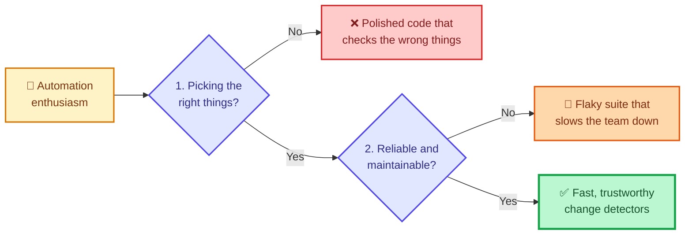

When people say "test automation", they normally mean **automated regression testing**: a collection of tests run by a machine, each reported as pass or fail, to detect changes that might reduce the quality of the product. That's the meaning I'll use throughout.

---

## The illusion of automation

The allure is strong. Machines doing the testing promises faster delivery, higher productivity, and less costly "manual" testing. (The book mentions seeing a webinar titled "QA Retirement Party", and hopes it was tongue-in-cheek. I hope so too.) The reality is different:

| The promise | The reality |
|---|---|
| Faster delivery | Automation needs a large **upfront investment** |
| More productivity | Unreliable automation can **slow teams down** while they fix it |
| Less costly testing | A passing suite can **mislead** the team about quality |

Discussions about automation often assume a **one-to-one relationship** between what a person tests and what a tool tests. It isn't one-to-one, and the book's example shows why. Imagine an automated test for a website's home page, which has a call to action showing the next training event. The test opens a browser, loads the page, and looks for an element with the class `next-training-label`. If it exists and is displayed, the test passes.

Now suppose the CSS breaks. The page still shows the event details, but it's ugly and half-styled. A person looking at it knows instantly that something is wrong. Who'd buy training from a site that looks like that? **The automated test still passes.**

(There are visual testing tools for that exact problem, but the point is about *assumptions*: what we assume a tool will notice.)

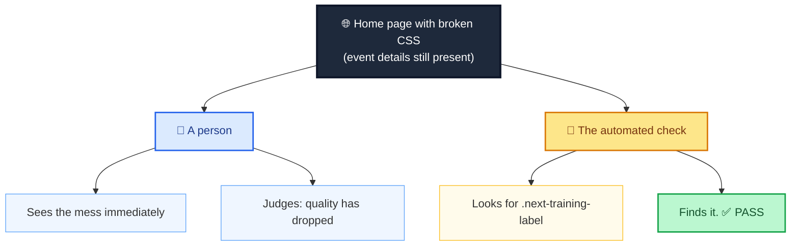

Does that make the human better than the machine? Not really. Machines are superb at **rapid, consistent feedback based on explicit instructions**. But we get out what we put in, and nothing more. People are slower and harder to repeat, but we're remarkably good at spotting patterns and at noticing many things at once, consciously and unconsciously.

> **Automation will tell us only what we asked it to tell us, and nothing more.**

### Checking versus testing

To keep this difference visible, many people (the author included) use two words. When a machine gives feedback based on explicit steps I set, that's a **check**. When a person uses heuristics, biases, oracles and judgement, that's **testing**. I'll use "check" for automation from here on. What we call it matters less than appreciating what each brings.

### The monoculture trap

The danger is a **monoculture** strategy: automate as much as possible and rely on it. You gain speed, but lose the richness of observation. Automation sacrifices *quality of information* for *speed and efficiency*. That's a fine trade when it's deliberate, and a poor one when it's invisible. The fix isn't less automation. It's using automation **alongside** other activities, such as the exploratory testing from my last post.

> **📝 Note:** I'm not arguing against automation. A good suite is one of the most valuable things a team can own. I'm arguing against *believing* it does more than it does.

---

## Automation as change detection

Michael Bolton, in a 2012 webinar on regression testing, raised a lovely puzzle. We usually say regression testing looks for places where quality has *regressed*. But if quality is fluid and decided by users, can a pass or fail really tell me quality has regressed? Isn't that for the user to decide?

His answer, as the book relays it: the check doesn't determine whether quality regressed. **My interpretation of the result does.** The checks are **change detectors**. They tell me something changed, and *I* decide whether that change reduces quality.

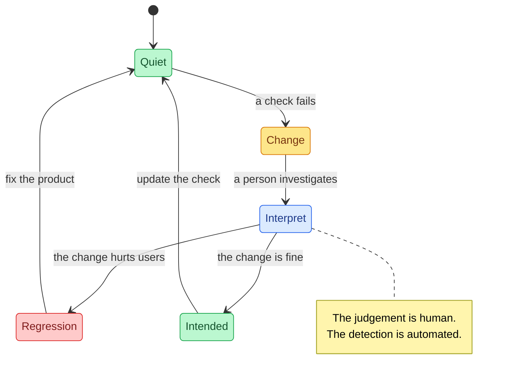

This reframing changes what I automate. I'm **not** trying to automate every path and permutation of an endpoint. I'm trying to place *indicators* in and around the areas that matter most. So the real question becomes: how do I find the areas that matter most?

---

## Letting risk be my guide

If checks are change detectors, I can build a **coverage model** around what I care about, instead of code coverage, requirements coverage, or a pile of legacy test cases. And I already have the raw material: **risks**, from the quality and risk post. The book gives three risks for the booking API, each paired with a check:

| Risk | The check I'd build |
|---|---|
| Unable to retrieve bookings | Send a request and check for a positive response |
| Booking payload isn't parsed correctly | Send a booking with expected-valid values and assert a positive response or an error |
| Incorrect status code for deleting a booking | Create a booking, delete it with correct credentials, confirm the right type of status code |

Then I prioritise by worry. If I'm less concerned about inconsistent feedback than about being unable to create a room, the order of risks becomes **my to-do list of checks to automate**. That way the first change detectors I build are the ones that matter most.

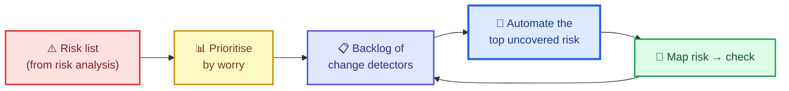

### TaTTa: am I testing the API, or testing *through* it?

One more idea, and it's a helpful one. If I *can* push a check lower, to a unit check, I should. To decide, I ask: **am I testing the API, or testing through the API (TaTTa)?**

- If my risk is "the right status code comes back for bad data", I'm **testing the API**. An API check fits.
- If my risk is "the tax calculation is wrong", I'm **testing through the API**: using it as a gateway to logic that a unit check would cover faster and more precisely.

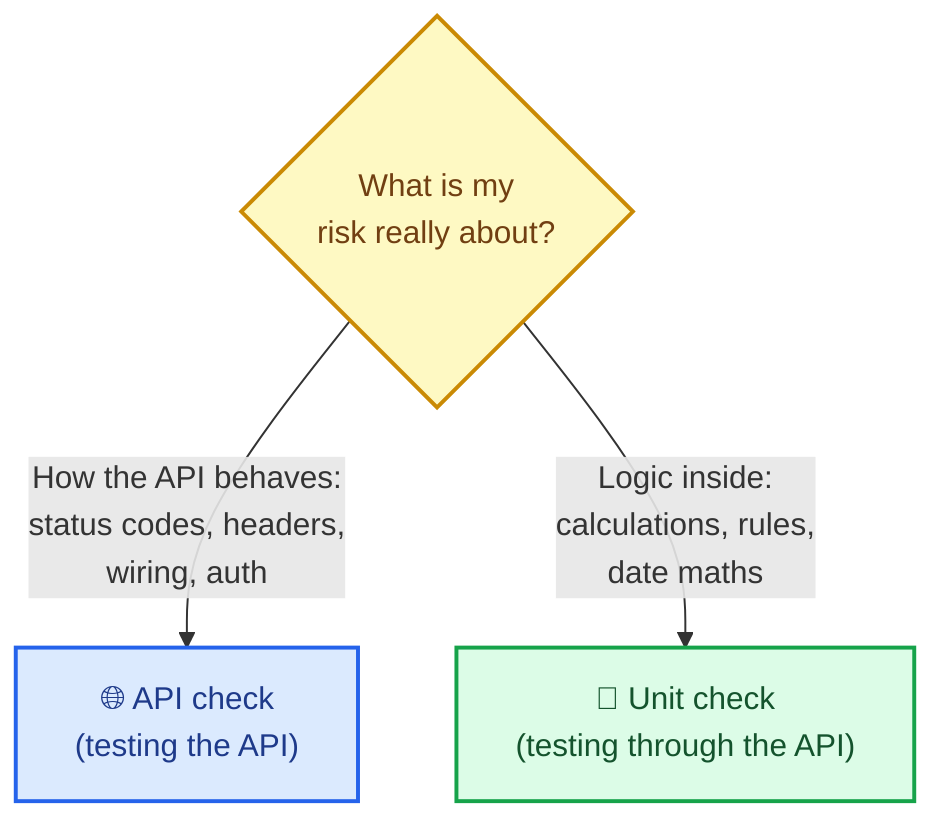

I'll demonstrate this with real code shortly: a booking-overlap rule that I check directly, plus a single API check that the rule is wired up to a `409`.

> **🧪 Activity:** Choose one booking endpoint and list the risks that could affect it. Put them in priority order and write down how you'd check each. We'll use that list when we build.

---

## Setting up the framework

The chapter automates three risks:

1. `GET /booking/` always returns the correct status code.
2. `POST /booking/` always successfully creates a booking.
3. `DELETE /booking/{id}` always deletes a booking.

The book builds this in **Java**: **JUnit** to organise and run the checks, **REST Assured** to send requests and read responses (the "engine"), and **Jackson** to convert Java objects to JSON and back. I'll explain that design, but I want to be upfront about something.

> **⚠️ Caution: what I ran and what I didn't.** I couldn't resolve Maven dependencies in the environment where I wrote this, so I **did not run the Java code**. Instead I **ported the same architecture to Python** (pytest and the `requests` library) and ran *that*. The Java snippets in this post are the book's design, shown for comparison, and are unverified by me. The principles carry across languages, which is exactly what the book says.

| Role in the framework | Book (Java) | My port (Python) |
|---|---|---|
| Organise and run checks, assertions | JUnit 5 (`@Test`) | pytest (`def test_...`, `assert`) |
| Build and send HTTP, read responses | REST Assured | `requests` |
| Convert objects to and from JSON | Jackson | `dataclasses` with `to_dict` / `from_dict` |
| Run `*IT` classes in the build | `maven-failsafe-plugin` | `pytest.ini` collecting `*_it.py` |

### Three layers, one purpose each

A surefire way to fail at automation is to build a framework that's hard to read or maintain. Automation code is *code*, so it deserves the same care as production code. The structure the author has found most effective has three areas:

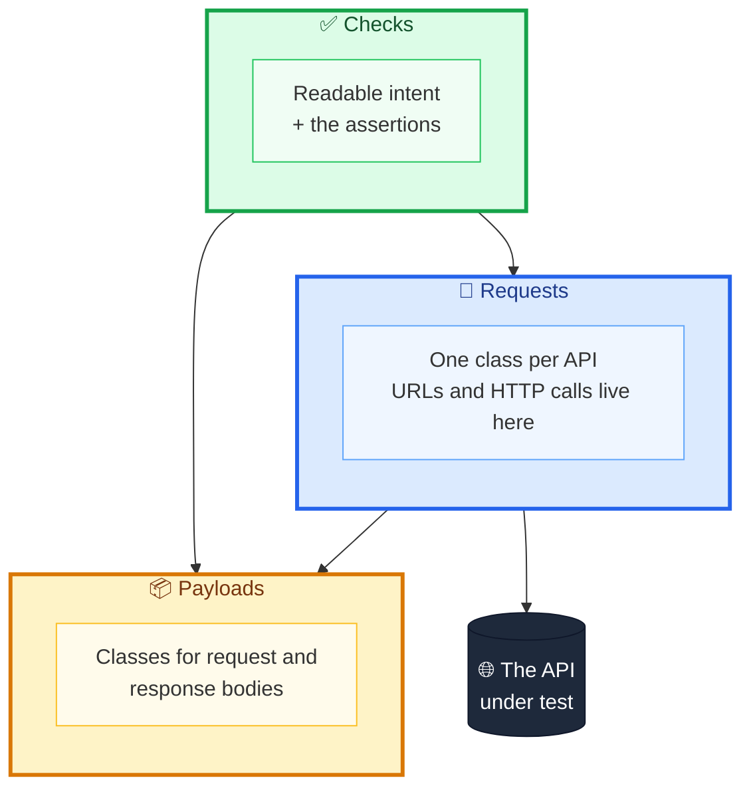

| Layer | Its job | Why it exists |
|---|---|---|
| **Checks** | Create and organise checks; make *intent* easy to read; hold every assertion | If I can't tell what a check does, I can't tell whether it truly passed or failed |
| **Requests** | One class per API (or per resource, if there's only one API); owns URLs and HTTP details | Updating a URL in 1,000 checks is a miserable afternoon. Here it's one change. |
| **Payloads** | Classes for request and response bodies, organised by API | Complex models stay tidy and reusable |

The naming rule for request classes: **one API under test** means name classes after *resources* (posts, pages, tags); **many APIs** means name classes after *each API* (booking, auth, room), which suits `restful-booker-platform`.

> **💡 Tip:** The principle behind all three layers is **DRY**: don't repeat yourself. Anything that appears in many checks (a URL, a payload shape) belongs in exactly one place.

---

## Hands-on: the framework, ported to Python

Here's my project. Everything runs locally against a **mock platform** I built (standard library only), so you can try it in seconds.

> **⚠️ Caution: the mock is mine.** It's a stand-in for `restful-booker-platform`, with similar endpoints (`/booking/summary`, `/booking/`, `/auth/login`, `DELETE /booking/{id}`) and a set of switchable **faults** so I can see how checks react when behaviour changes. Don't read it as a description of the real sandbox's internals.

```text
apiframework/
├── pytest.ini
├── conftest.py
├── mock_platform.py        <- the system under test (mine)
├── booking_rules.py        <- a pure business rule
├── demo.py                 <- the scenario matrix
├── payloads/               <- layer 3
│   ├── booking.py
│   └── auth.py
├── api_requests/           <- layer 2
│   ├── base_api.py
│   ├── booking_api.py
│   └── auth_api.py
├── checks/                 <- layer 1
│   ├── booking_api_it.py
│   └── test_change_detection.py
├── tests_for_the_framework/
│   ├── test_rules_unit.py
│   ├── test_framework_health.py
│   └── test_risk_backlog.py
└── risk_backlog.py
```

> **📝 Note on naming:** My package is `api_requests`, not `requests`, so it never collides with the library of the same name. A small thing, but it's exactly the kind of thing that wastes an hour.

Install what you need with:

```bash
pip install pytest requests
```

### The system under test

First, `booking_rules.py`, a pure function I'll check directly (more on why in a moment):

```python
"""A pure business rule. Checking it here is cheaper than checking it 'through' the API."""
from datetime import date


def dates_overlap(in_a: date, out_a: date, in_b: date, out_b: date) -> bool:
    """Two stays overlap when each starts before the other ends.
    Back-to-back stays (checkout day == next checkin day) do NOT overlap."""
    return in_a < out_b and in_b < out_a
```

And the mock platform. Skim it: what matters is its **faults**. By adding a name like `"delete_returns_200"` to `platform.faults`, I can change its behaviour on demand.

```python
"""A mock booking + auth API for practising API checks (standard library only).
It is MY stand-in, not restful-booker-platform. A set of 'faults' lets me change
its behaviour on demand, to see how checks react."""
import json
import re
import secrets
import threading
from datetime import date
from http.server import BaseHTTPRequestHandler, ThreadingHTTPServer
from urllib.parse import parse_qs, urlparse

from booking_rules import dates_overlap

ISO = re.compile(r"^\d{4}-\d{2}-\d{2}$")


class MockPlatform:
    def __init__(self):
        self.bookings = {}          # id -> booking dict
        self.tokens = set()
        self.faults = set()         # e.g. {"delete_returns_200"}
        self._next_id = 1
        self._lock = threading.Lock()
        self.httpd = None
        self.port = None

    # ---------- lifecycle ----------
    def start(self):
        platform = self

        class Handler(BaseHTTPRequestHandler):
            def log_message(self, *args):
                pass

            def _send(self, status, payload=None, headers=None):
                data = json.dumps(payload if payload is not None else {}).encode()
                self.send_response(status)
                self.send_header("Content-Type", "application/json")
                self.send_header("Content-Length", str(len(data)))
                for k, v in (headers or {}).items():
                    self.send_header(k, v)
                self.end_headers()
                self.wfile.write(data)

            def _body(self):
                n = int(self.headers.get("Content-Length", 0))
                try:
                    return json.loads(self.rfile.read(n)) if n else None
                except json.JSONDecodeError:
                    return "__invalid__"

            def do_GET(self):
                self._send(*platform.get(self.path))

            def do_POST(self):
                self._send(*platform.post(self.path, self._body()))

            def do_DELETE(self):
                self._send(*platform.delete(self.path, self.headers.get("Cookie", "")))

        self.httpd = ThreadingHTTPServer(("127.0.0.1", 0), Handler)
        self.port = self.httpd.server_address[1]
        threading.Thread(target=self.httpd.serve_forever, daemon=True).start()
        return self

    def stop(self):
        self.httpd.shutdown()
        self.httpd.server_close()

    @property
    def base_url(self):
        return f"http://127.0.0.1:{self.port}/"

    # ---------- behaviour ----------
    def get(self, raw_path):
        url = urlparse(raw_path)
        if url.path == "/booking/summary":
            if "summary_error_but_200" in self.faults:
                return 200, {"error": "database unavailable"}      # looks fine to a status check
            room = int(parse_qs(url.query).get("roomid", ["0"])[0])
            rows = [{"bookingDates": b["bookingdates"]} for b in self.bookings.values() if b["roomid"] == room]
            return 200, {"bookings": rows}
        return 404, {"error": "not found"}

    def post(self, path, body):
        if path == "/auth/login":
            if isinstance(body, dict) and body.get("username") == "admin" and body.get("password") == "password":
                token = secrets.token_hex(8)
                self.tokens.add(token)
                return 200, {}, {"Set-Cookie": f"token={token}; Path=/"}
            return 403, {"error": "bad credentials"}
        if path == "/booking/":
            return self._create_booking(body)
        return 404, {"error": "not found"}

    def _create_booking(self, b):
        errors = []
        if not isinstance(b, dict):
            return 400, {"errors": ["body must be a JSON object"]}
        if not isinstance(b.get("roomid"), int) or isinstance(b.get("roomid"), bool):
            errors.append("roomid must be an integer")
        for f in ("firstname", "lastname"):
            if not isinstance(b.get(f), str) or not b[f].strip():
                errors.append(f"{f} must not be blank")
        if not isinstance(b.get("depositpaid"), bool):
            errors.append("depositpaid must be a boolean")
        dates = b.get("bookingdates") or {}
        try:
            if not (ISO.match(dates["checkin"]) and ISO.match(dates["checkout"])):
                raise ValueError
            d_in, d_out = date.fromisoformat(dates["checkin"]), date.fromisoformat(dates["checkout"])
            if d_out <= d_in:
                errors.append("checkout must be after checkin")
        except (KeyError, TypeError, ValueError):
            errors.append("bookingdates must contain ISO checkin and checkout")
        if errors:
            return 400, {"errors": errors}
        with self._lock:
            for other in self.bookings.values():
                o = other["bookingdates"]
                if other["roomid"] == b["roomid"] and dates_overlap(
                        d_in, d_out, date.fromisoformat(o["checkin"]), date.fromisoformat(o["checkout"])):
                    return 409, {"error": "room already booked for those dates"}
            booking_id = self._next_id
            self._next_id += 1
            self.bookings[booking_id] = b
        status = 200 if "post_returns_200" in self.faults else 201
        return status, {"bookingid": booking_id, "booking": b}

    def delete(self, path, cookie):
        m = re.fullmatch(r"/booking/(\d+)", path)
        if not m:
            return 404, {"error": "not found"}
        token = cookie.split("token=")[1].split(";")[0] if "token=" in cookie else ""
        if token not in self.tokens:
            return 403, {"error": "forbidden"}
        if int(m.group(1)) not in self.bookings:
            return 404, {"error": "no such booking"}
        del self.bookings[int(m.group(1))]
        return (200 if "delete_returns_200" in self.faults else 202), {}
```

### Layer 3: payloads

The Python equivalent of the book's POJOs are small frozen dataclasses with explicit `to_dict` and `from_dict` methods. They sit between my tidy objects and the raw JSON.

```python
"""Payloads: plain data classes for request and response bodies (the Python 'POJOs')."""
from dataclasses import dataclass
from datetime import date


@dataclass(frozen=True)
class BookingDates:
    checkin: date
    checkout: date

    def to_dict(self) -> dict:
        return {"checkin": self.checkin.isoformat(), "checkout": self.checkout.isoformat()}

    @classmethod
    def from_dict(cls, d: dict) -> "BookingDates":
        return cls(date.fromisoformat(d["checkin"]), date.fromisoformat(d["checkout"]))


@dataclass(frozen=True)
class Booking:
    roomid: int
    firstname: str
    lastname: str
    depositpaid: bool
    bookingdates: BookingDates
    additionalneeds: str = ""

    def to_dict(self) -> dict:
        return {"roomid": self.roomid, "firstname": self.firstname, "lastname": self.lastname,
                "depositpaid": self.depositpaid, "bookingdates": self.bookingdates.to_dict(),
                "additionalneeds": self.additionalneeds}

    @classmethod
    def from_dict(cls, d: dict) -> "Booking":
        return cls(d["roomid"], d["firstname"], d["lastname"], d["depositpaid"],
                   BookingDates.from_dict(d["bookingdates"]), d.get("additionalneeds", ""))


@dataclass(frozen=True)
class BookingResponse:
    bookingid: int
    booking: Booking

    @classmethod
    def from_dict(cls, d: dict) -> "BookingResponse":
        return cls(d["bookingid"], Booking.from_dict(d["booking"]))
```

```python
from dataclasses import dataclass


@dataclass(frozen=True)
class Auth:
    username: str
    password: str

    def to_dict(self) -> dict:
        return {"username": self.username, "password": self.password}
```

### Layer 2: requests

`BaseApi` is the *only* place that knows where the API lives, and it reads the address from an environment variable, so the identical checks can run against a laptop, a test environment, or anywhere else.

```python
"""Requests: the ONE place that knows URLs. Change it here, not in 1000 checks."""
import os


class BaseApi:
    @staticmethod
    def base_url() -> str:
        # controlled from the environment, so the same checks can run anywhere
        return os.environ.get("API_BASE_URL", "https://automationintesting.online/")
```

```python
import requests

from api_requests.base_api import BaseApi
from payloads.booking import Booking


class BookingApi(BaseApi):
    @classmethod
    def _url(cls) -> str:
        return cls.base_url() + "booking/"

    @classmethod
    def get_booking_summary(cls, room_id: int = 1) -> requests.Response:
        return requests.get(cls._url() + "summary", params={"roomid": room_id})

    @classmethod
    def post_booking(cls, payload: Booking) -> requests.Response:
        return requests.post(cls._url(), json=payload.to_dict())

    @classmethod
    def delete_booking(cls, booking_id: int, token: str) -> requests.Response:
        return requests.delete(cls._url() + str(booking_id), headers={"Cookie": f"token={token}"})
```

```python
import requests

from api_requests.base_api import BaseApi
from payloads.auth import Auth


class AuthApi(BaseApi):
    @classmethod
    def post_auth(cls, payload: Auth) -> requests.Response:
        return requests.post(cls.base_url() + "auth/login", json=payload.to_dict())
```

### Wiring: `pytest.ini` and `conftest.py`

The configuration is the Python counterpart of the Maven plumbing. `pytest.ini` also collects files ending `_it.py`, and `conftest.py` starts the mock once, points `API_BASE_URL` at it, and **resets state before every check** so checks never depend on each other.

```ini
[pytest]
# The Python twist on Maven Failsafe's "**/*IT": also collect files ending in _it.py
python_files = *_it.py test_*.py
testpaths = checks tests_for_the_framework
```

```python
import os

import pytest

from mock_platform import MockPlatform


@pytest.fixture(scope="session")
def platform():
    """Start the mock platform once, and point the framework at it via the environment."""
    p = MockPlatform().start()
    os.environ["API_BASE_URL"] = p.base_url
    yield p
    p.stop()


@pytest.fixture(autouse=True)
def clean_slate(platform):
    """Each check starts from a known state, so checks don't depend on each other."""
    platform.bookings.clear()
    platform.tokens.clear()
    platform.faults.clear()
```

---

## Building the three checks

### Check 1: a GET request

The first check sends a GET and asserts the status code is 200. In the book's Java:

```java
@Test
public void getBookingSummaryShouldReturn200(){
    Response response = BookingApi.getBookingSummary();
    assertEquals(200, response.getStatusCode());
}
```

The request class does the heavy lifting. With REST Assured, even the `given()` method does nothing except make the code read like English (Given-When-Then). The base URL is declared once, in `BookingApi`, so if the URL changes, or if we run against multiple environments, **it's controlled from one location**.

In my port, the same check reads:

```python
def test_get_booking_summary_should_return_200(platform):
    response = BookingApi.get_booking_summary()
    assert response.status_code == 200
```

Run it, watch it pass, then change `200` to another number and watch it fail. That small ritual proves the check can *fail*, which is half of what makes it trustworthy.

> **💡 Tip:** I never trust a check I've only seen pass. Breaking it on purpose, even for ten seconds, is the cheapest quality control I know.

### Check 2: a POST request

The next check posts a valid booking and expects a `201`. First I need a **payload**: a Java object shaped like the JSON, with a field for each key (`roomid`, `firstname`, `lastname`, `depositpaid`, `bookingdates`, `additionalneeds`). In the book's Java that takes `@JsonProperty` annotations, constructors and getters (and, as the book explains, a deliberately empty constructor so Jackson can build an empty object and fill it in when parsing responses). In Python, a dataclass does the same job in a dozen lines, which is the whole reason for my port.

Then the request method adds a content-type header and the body, and the check asserts the status:

```python
def test_post_booking_returns_201(platform):
    response = BookingApi.post_booking(a_booking())
    assert response.status_code == 201
```

> **📝 Why the Java "blank constructor" confuses people:** when a JSON response arrives, it's a plain string. The library creates an **empty object** of the target class, then walks the JSON keys and stores each value in the matching field. If the class only has a constructor with parameters, creation fails with an error like "no Creators, like default constructor, exist". The fix is to add an explicit empty constructor. My Python port avoids the whole issue because `from_dict` builds the object itself, a nice example of how the *language* changes the plumbing but not the *design*.

#### Should I reuse the production payload classes?

The book raises a good question: why not reuse the production POJOs instead of duplicating them? There's a real trade-off:

| | Reuse production payloads | Keep separate test payloads |
|---|---|---|
| Maintenance | Less duplication | More code to keep in step |
| Risk | **False positives**: if the production class has a mistake (a missing or misnamed field), a test built from the same class will *always* be accepted | An independent model can disagree with production, and that's what lets it catch mistakes |

The risk is uncommon but real. If I accidentally misname a field in the production model, and my test builds its payload from that *same* model, the test and the product are wrong **together**, and the check cheerfully passes.

I put that into a test. It compares my payload against a contract I wrote out **by hand**, independently of the payload class:

```python
CONTRACT_KEYS = {"roomid", "firstname", "lastname", "depositpaid", "bookingdates", "additionalneeds"}

def test_payload_matches_an_independently_written_contract():
    assert set(a_booking().to_dict()) == CONTRACT_KEYS
    assert set(a_booking().to_dict()["bookingdates"]) == {"checkin", "checkout"}
```

### Check 3: combining requests

The last check deletes a booking, which needs three steps:

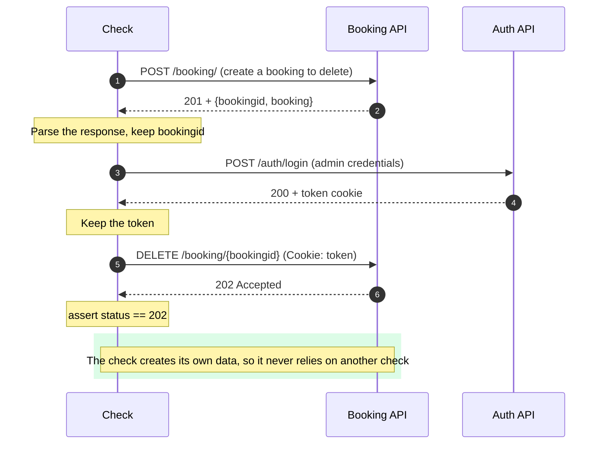

This check introduces three new ideas:

1. **Parse the response body** into an object, by mapping the JSON of the booking response onto `BookingResponse` (reusing the `Booking` class for the nested object).
2. **Create an Auth payload and request class**, which means a new `AuthApi` class, and the shared `BaseApi` I mentioned earlier, so every request class gets its base URL from one place.
3. **Pass a value from one response into the next request**: the token from the login response goes into the delete request's `Cookie` header, and the booking id goes into the URL.

Here's my version:

```python
"""The three automated checks. Note how little HTTP detail is visible here: intent only."""
from datetime import date

from api_requests.auth_api import AuthApi
from api_requests.booking_api import BookingApi
from payloads.auth import Auth
from payloads.booking import Booking, BookingDates, BookingResponse


def a_booking(room=1, checkin=date(2021, 1, 1), checkout=date(2021, 1, 3)):
    return Booking(room, "Mark", "Winteringham", True, BookingDates(checkin, checkout), "Breakfast")


def test_get_booking_summary_should_return_200(platform):
    response = BookingApi.get_booking_summary()
    assert response.status_code == 200


def test_post_booking_returns_201(platform):
    response = BookingApi.post_booking(a_booking())
    assert response.status_code == 201


def test_delete_booking_returns_202(platform):
    created = BookingApi.post_booking(a_booking(checkin=date(2021, 2, 1), checkout=date(2021, 2, 3)))
    booking_id = BookingResponse.from_dict(created.json()).bookingid

    auth = AuthApi.post_auth(Auth("admin", "password"))
    token = auth.cookies["token"]

    response = BookingApi.delete_booking(booking_id, token)
    assert response.status_code == 202
```

Look at how readable that is. Almost no HTTP is visible. The *intent* (create, authenticate, delete, expect 202) is right there, and everything fiddly lives in the other two layers. That's the entire point of the structure.

> **📝 A small thing I noticed in the source text:** the chapter's intermediate listing builds the login payload as `new Auth("admin", "password123")`, while the final listing uses `"password"`. One of them is presumably a typo (probably a copy-paste drift between listings). It's a nice reminder that even carefully written examples can contradict themselves, and that *running* the code is the only way to know. Similarly, the text calls the first check `getBookingShouldReturn200` in one place and `getBookingSummaryShouldReturn200` in another. Meticulous naming discipline matters in test code too.

> **📝 GraphQL:** GraphQL is normally served over HTTP, so the same tools work. The only difference is how I build the request: a payload class (or string) that represents the query, sent the same way as any other body.

> **🧪 Activity:** Go back to your prioritised risk list. Automate the top one, then keep going down the list.

---

## Experiments: what my checks notice, and what they miss

This is the part I wanted most. The chapter makes two claims: *checks only tell you what you asked*, and *checks are change detectors*. I can test both claims with my mock's switchable faults.

I run every check under four scenarios and record which ones notice a change:

```python
"""Run each check under each scenario and show which ones notice the change."""
import os

from api_requests.booking_api import BookingApi
from checks import booking_api_it as it
from mock_platform import MockPlatform

platform = MockPlatform().start()
os.environ["API_BASE_URL"] = platform.base_url


def body_aware_summary_check(platform):
    assert "bookings" in BookingApi.get_booking_summary().json(), "summary has no 'bookings' list"


CHECKS = [("get summary -> 200", it.test_get_booking_summary_should_return_200),
          ("post booking -> 201", it.test_post_booking_returns_201),
          ("delete booking -> 202", it.test_delete_booking_returns_202),
          ("summary body has bookings", body_aware_summary_check)]
SCENARIOS = [("healthy", None), ("delete returns 200", "delete_returns_200"),
             ("post returns 200", "post_returns_200"), ("200 carrying an error", "summary_error_but_200")]

print(f"{'check':<28}" + "".join(f"{name:<24}" for name, _ in SCENARIOS))
for check_name, check in CHECKS:
    row = f"{check_name:<28}"
    for _, fault in SCENARIOS:
        platform.bookings.clear(); platform.tokens.clear(); platform.faults.clear()
        if fault:
            platform.faults.add(fault)
        try:
            check(platform)
            row += f"{'pass':<24}"
        except AssertionError:
            row += f"{'FAIL (change detected)':<24}"
    print(row)
platform.stop()
```

```text
check                       healthy                 delete returns 200      post returns 200        200 carrying an error
get summary -> 200          pass                    pass                    pass                    pass
post booking -> 201         pass                    pass                    FAIL (change detected)  pass
delete booking -> 202       pass                    FAIL (change detected)  pass                    pass
summary body has bookings   pass                    pass                    pass                    FAIL (change detected)
```

Read the table by columns:

| Scenario | What changed | Which checks noticed |
|---|---|---|
| **delete returns 200** | The API now answers `200` instead of `202` | Only the delete check, as designed |
| **post returns 200** | The API now answers `200` instead of `201` | Only the post check, as designed |
| **200 carrying an error** | The summary endpoint returns `200` with `{"error": "database unavailable"}` | **The original GET check does not notice.** Only the check that looks at the *body* does. |

That third column is the whole chapter in one cell. The check named "get summary → 200" **passes** while the endpoint is effectively broken. It did *exactly* what I asked, and nothing more, just like the page with broken CSS.

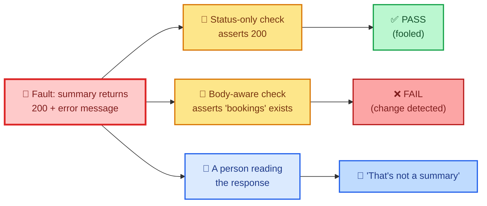

I wrote these experiments as proper tests too, so the lessons are pinned down and re-checkable:

```python
"""Checks are change detectors. These tests show what they do, and do NOT, notice."""
import pytest

from api_requests.booking_api import BookingApi
from checks import booking_api_it as it


def test_a_status_only_check_is_fooled_by_a_200_that_carries_an_error(platform):
    platform.faults.add("summary_error_but_200")
    # the automated check from the framework still passes...
    it.test_get_booking_summary_should_return_200(platform)
    # ...while a person reading the body can see the quality has dropped
    assert BookingApi.get_booking_summary().json() == {"error": "database unavailable"}


def test_a_body_aware_check_catches_what_the_status_check_missed(platform):
    platform.faults.add("summary_error_but_200")
    body = BookingApi.get_booking_summary().json()
    with pytest.raises(AssertionError):
        assert "bookings" in body, "summary response has no 'bookings' list"


def test_a_changed_status_code_trips_the_delete_check(platform):
    platform.faults.add("delete_returns_200")           # someone 'improved' the API
    with pytest.raises(AssertionError) as caught:
        it.test_delete_booking_returns_202(platform)
    assert "200 == 202" in str(caught.value)


def test_a_changed_status_code_trips_the_post_check(platform):
    platform.faults.add("post_returns_200")
    with pytest.raises(AssertionError):
        it.test_post_booking_returns_201(platform)


def test_the_checks_are_independent_of_one_another(platform):
    # run the delete check twice: it creates its own data, so it must pass both times
    it.test_delete_booking_returns_202(platform)
    it.test_delete_booking_returns_202(platform)
```

> **⚠️ Caution:** The lesson isn't "always assert on bodies". It's that **every assertion is a decision about what I care about**, and anything I don't assert on is invisible to that check. A body-aware check would be fooled by something else (a body that's *well-formed but wrong*). There's no check that notices everything, which is exactly why people and exploration stay in the strategy.

> **💡 Tip:** When a check fails, my first question shouldn't be "who broke it?" but "**did the change reduce quality, or is the check out of date?**" That's the interpretation step from the change-detector model, and it's a human one.

### Pushing a check lower: TaTTa in action

Here's the TaTTa idea made concrete. Whether two stays overlap is a *rule*, so I test it directly, with a table of cases, fast and precise. The API then needs only **one** check that the rule is wired up to a `409`:

```python
"""Testing the rule itself (TaTTa: not through the API) is faster and more precise."""
from datetime import date

import pytest

from booking_rules import dates_overlap

D = date


@pytest.mark.parametrize("a, b, expected", [
    ((D(2021, 1, 1), D(2021, 1, 3)), (D(2021, 1, 2), D(2021, 1, 5)), True),    # partial overlap
    ((D(2021, 1, 1), D(2021, 1, 10)), (D(2021, 1, 3), D(2021, 1, 4)), True),   # one inside the other
    ((D(2021, 1, 1), D(2021, 1, 3)), (D(2021, 1, 3), D(2021, 1, 5)), False),   # back to back
    ((D(2021, 1, 1), D(2021, 1, 3)), (D(2021, 2, 1), D(2021, 2, 3)), False),   # far apart
    ((D(2021, 1, 1), D(2021, 1, 3)), (D(2021, 1, 1), D(2021, 1, 3)), True),    # identical
])
def test_dates_overlap(a, b, expected):
    assert dates_overlap(*a, *b) is expected
    assert dates_overlap(*b, *a) is expected          # order must not matter


def test_the_api_only_needs_one_check_that_the_rule_is_wired_to_409(platform):
    from api_requests.booking_api import BookingApi
    from checks.booking_api_it import a_booking
    assert BookingApi.post_booking(a_booking(room=5)).status_code == 201
    clash = a_booking(room=5, checkin=D(2021, 1, 2), checkout=D(2021, 1, 4))
    assert BookingApi.post_booking(clash).status_code == 409
```

Five tiny parametrised cases cover the rule's boundaries (including the easily-botched "back to back" case, where checkout day equals the next check-in day), and a single API check proves the wiring. Doing all of that *through* HTTP would be slower, and the failures less informative.

### Testing the automation itself

Automation code is code, so mine has tests too. They check that payloads round-trip through dictionaries, that response parsing handles the nested objects, and that the base URL really comes from the environment:

```python
"""Automation code is code: it deserves tests of its own."""
import os

from api_requests.booking_api import BookingApi
from api_requests.base_api import BaseApi
from payloads.booking import Booking, BookingDates, BookingResponse
from checks.booking_api_it import a_booking

CONTRACT_KEYS = {"roomid", "firstname", "lastname", "depositpaid", "bookingdates", "additionalneeds"}


def test_payload_matches_an_independently_written_contract():
    """Guards against the false positive of a payload class that is wrong in the same way
    as the thing it is testing: the expected keys are written out by hand, here."""
    assert set(a_booking().to_dict()) == CONTRACT_KEYS
    assert set(a_booking().to_dict()["bookingdates"]) == {"checkin", "checkout"}


def test_payload_round_trips_through_json_dicts():
    original = a_booking()
    assert Booking.from_dict(original.to_dict()) == original


def test_response_payload_parses_nested_objects(platform):
    resp = BookingApi.post_booking(a_booking())
    parsed = BookingResponse.from_dict(resp.json())
    assert parsed.bookingid >= 1
    assert parsed.booking.bookingdates.checkin.year == 2021


def test_base_url_comes_from_the_environment(platform, monkeypatch):
    assert BaseApi.base_url() == platform.base_url
    monkeypatch.setenv("API_BASE_URL", "https://staging.example.com/")
    assert BookingApi._url() == "https://staging.example.com/booking/"
    monkeypatch.delenv("API_BASE_URL")
    assert BaseApi.base_url() == "https://automationintesting.online/"
```

### Risk as a backlog, in code

Finally, the "let risk be your guide" idea. This tiny module holds a prioritised backlog, picks what to automate next, and, my favourite part, detects **stale mappings**: a backlog that claims a risk is covered by a check that has since been renamed or deleted. That's a quiet way for coverage to rot.

```python
"""Let risk be the guide: a prioritised backlog of change detectors to automate."""
from dataclasses import dataclass


@dataclass(frozen=True)
class RiskItem:
    risk: str
    worry: int                 # 1 (barely) .. 5 (very worried): the team's judgement
    check: str | None = None   # name of the automated check that covers it, if any


def next_to_automate(backlog):
    """Highest worry first among risks with no check yet; ties keep list order."""
    todo = [r for r in backlog if r.check is None]
    return max(todo, key=lambda r: r.worry, default=None)


def automation_order(backlog):
    return [r.risk for r in sorted((r for r in backlog if r.check is None), key=lambda r: -r.worry)]


def stale_mappings(backlog, available_checks):
    """Checks named in the backlog that no longer exist: a quiet way for coverage to rot."""
    return [r.check for r in backlog if r.check and r.check not in available_checks]


BACKLOG = [
    RiskItem("GET /booking/summary always returns the correct status code", 4, "test_get_booking_summary_should_return_200"),
    RiskItem("POST /booking/ always successfully creates a booking", 5, "test_post_booking_returns_201"),
    RiskItem("DELETE /booking/{id} always deletes a booking", 3, "test_delete_booking_returns_202"),
    RiskItem("Overlapping bookings are rejected", 5, None),
    RiskItem("Invalid booking payloads return a clear 400", 3, None),
    RiskItem("Inconsistent feedback between endpoints", 1, None),
]
```

```python
import inspect

from checks import booking_api_it
from risk_backlog import BACKLOG, RiskItem, automation_order, next_to_automate, stale_mappings


def available_checks():
    return {n for n, f in inspect.getmembers(booking_api_it, inspect.isfunction) if n.startswith("test_")}


def test_highest_worry_uncovered_risk_is_automated_next():
    assert next_to_automate(BACKLOG).risk == "Overlapping bookings are rejected"


def test_order_is_by_worry_and_skips_covered_risks():
    assert automation_order(BACKLOG) == ["Overlapping bookings are rejected",
                                         "Invalid booking payloads return a clear 400",
                                         "Inconsistent feedback between endpoints"]


def test_nothing_left_to_automate_gives_none():
    assert next_to_automate([RiskItem("x", 5, "some_check")]) is None


def test_every_check_named_in_the_backlog_really_exists():
    assert stale_mappings(BACKLOG, available_checks()) == []


def test_a_renamed_check_is_reported_as_stale():
    renamed = [RiskItem("r", 3, "test_old_name")]
    assert stale_mappings(renamed, available_checks()) == ["test_old_name"]
```

> **⚠️ Caution:** The "worry" numbers in the backlog are my own illustration, with the three risks from the book plus three I invented. Your numbers should come from your team's judgement, using the techniques in the quality and risk post.

### The full run

```bash
pytest -v
```

```text
checks/booking_api_it.py::test_get_booking_summary_should_return_200 PASSED [  4%]
checks/booking_api_it.py::test_post_booking_returns_201 PASSED           [  8%]
checks/booking_api_it.py::test_delete_booking_returns_202 PASSED         [ 13%]
checks/test_change_detection.py::test_a_status_only_check_is_fooled_by_a_200_that_carries_an_error PASSED [ 17%]
checks/test_change_detection.py::test_a_body_aware_check_catches_what_the_status_check_missed PASSED [ 21%]
checks/test_change_detection.py::test_a_changed_status_code_trips_the_delete_check PASSED [ 26%]
checks/test_change_detection.py::test_a_changed_status_code_trips_the_post_check PASSED [ 30%]
checks/test_change_detection.py::test_the_checks_are_independent_of_one_another PASSED [ 34%]
tests_for_the_framework/test_framework_health.py::test_payload_matches_an_independently_written_contract PASSED [ 39%]
tests_for_the_framework/test_framework_health.py::test_payload_round_trips_through_json_dicts PASSED [ 43%]
tests_for_the_framework/test_framework_health.py::test_response_payload_parses_nested_objects PASSED [ 47%]
tests_for_the_framework/test_framework_health.py::test_base_url_comes_from_the_environment PASSED [ 52%]
tests_for_the_framework/test_risk_backlog.py::test_highest_worry_uncovered_risk_is_automated_next PASSED [ 56%]
tests_for_the_framework/test_risk_backlog.py::test_order_is_by_worry_and_skips_covered_risks PASSED [ 60%]
tests_for_the_framework/test_risk_backlog.py::test_nothing_left_to_automate_gives_none PASSED [ 65%]
tests_for_the_framework/test_risk_backlog.py::test_every_check_named_in_the_backlog_really_exists PASSED [ 69%]
tests_for_the_framework/test_risk_backlog.py::test_a_renamed_check_is_reported_as_stale PASSED [ 73%]
tests_for_the_framework/test_rules_unit.py::test_dates_overlap[a0-b0-True] PASSED [ 78%]
tests_for_the_framework/test_rules_unit.py::test_dates_overlap[a1-b1-True] PASSED [ 82%]
tests_for_the_framework/test_rules_unit.py::test_dates_overlap[a2-b2-False] PASSED [ 86%]
tests_for_the_framework/test_rules_unit.py::test_dates_overlap[a3-b3-False] PASSED [ 91%]
tests_for_the_framework/test_rules_unit.py::test_dates_overlap[a4-b4-True] PASSED [ 95%]
tests_for_the_framework/test_rules_unit.py::test_the_api_only_needs_one_check_that_the_rule_is_wired_to_409 PASSED [100%]
============================== 23 passed ==============================
```

All 23 pass. Here's what they're *for*:

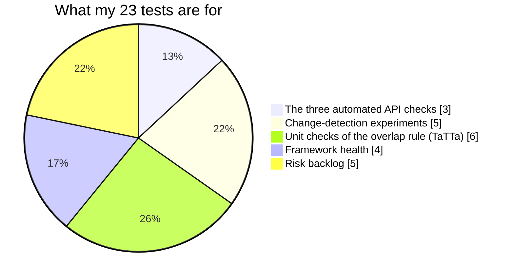

Only three of the 23 are "the checks" in the book's sense. The rest exist to *prove those three can be trusted*: that they fail when they should, that they're independent, that the framework behaves, and that the risk mapping hasn't rotted.

---

## Running checks in a pipeline

Having checks isn't enough. They have to **run regularly**, ideally on every change. In the book's Java project, the class is called `BookingApiIT` (the `IT` suffix means "integration test"), which cleanly separates these API checks from unit checks on individual components. But Maven's default test phase only picks up classes ending in `Test`, so my `IT` files would be ignored by `mvn clean install`.

The fix is the **`maven-failsafe-plugin`**, which hooks a different set of files into the `integration-test` and `verify` goals:

```xml
<build>
  <plugins>
    <plugin>
      <groupId>org.apache.maven.plugins</groupId>
      <artifactId>maven-failsafe-plugin</artifactId>
      <version>2.22.2</version>
      <executions>
        <execution>
          <goals>
            <goal>integration-test</goal>
            <goal>verify</goal>
          </goals>
          <configuration>
            <includes>
              <include>**/*IT</include>
            </includes>
          </configuration>
        </execution>
      </executions>
    </plugin>
  </plugins>
</build>
```

*(The book's configuration, shown for comparison. I haven't run it.)*

With that in place, `mvn clean verify` runs the checks, so they can run on a laptop **or** in a continuous integration pipeline against whatever environment I point them at. My Python equivalent is the `python_files` line in `pytest.ini` plus the `API_BASE_URL` environment variable, which I tested in `test_base_url_comes_from_the_environment`.

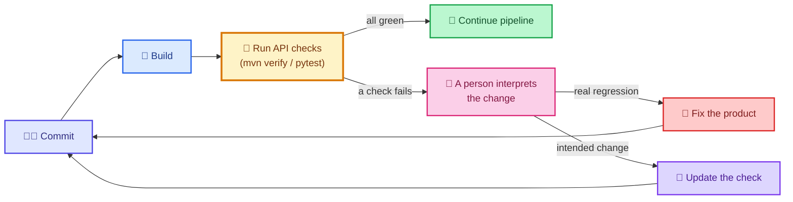

> **⚠️ Caution: pipelines punish flakiness.** A check that fails randomly teaches the team to ignore red. In my framework I reset state before every check and make each check create its own data (my `test_the_checks_are_independent_of_one_another` runs the delete check twice to prove it). The real sandbox is a shared public environment, so checks run against it can collide with other people's data. Prefer your own environment.

> **💡 Tip:** Keep the pipeline's checks **fast and few**. A suite that takes an hour will be skipped. The change detectors that matter most (the top of my risk backlog) should be the quickest to run.

---

## Where automation sits in a strategy

Remember the testing model from the first post: two circles, *imagination* (what we want) and *implementation* (what we have). Writing these checks demanded some **existing knowledge** of the system: I had to know what a valid booking looks like, which status code is right, how auth works. Unlike activities that discover new information, automation **confirms what we already know is still true** as the product changes. So it lives in the **overlap** of the two circles.

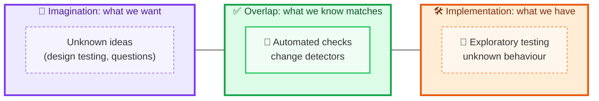

That's an important job. As a product grows I must test the *new* features and fixes, **and** confirm that what used to work still does. But there's a gap between what a tool tells me and what a person observes (my 200-with-an-error experiment proves it). A successful strategy uses automation to **support and warn** me, freeing my attention for other activities, such as exploratory testing, to learn more.

| Activity | Circle it focuses on | Brings |
|---|---|---|
| Testing API designs | Imagination | Shared understanding before code |
| Exploratory testing | Implementation | Discovery of the unexpected |
| **Automated checks** | **Overlap** | **Fast, repeatable change detection** |

---

## Pitfalls, cheat sheet and summary

### Pitfalls I try to avoid

| Pitfall | Why it hurts | What I do instead |
|---|---|---|
| Automating before choosing | Polished checks of unimportant things | Start from the risk backlog |
| Believing green means good | Checks only report what I asked | Remember they're change detectors; keep exploring |
| A "monoculture" strategy | Rich feedback is lost for speed | Balance automation with other activities |
| Asserting only on status codes | A `200` can carry an error | Decide deliberately what each check should notice |
| Never watching a check fail | A check that can't fail is decoration | Break it on purpose once |
| URLs and payloads scattered through checks | One change means a thousand edits | Requests and payloads layers (DRY) |
| Checks that depend on each other | Order-dependent failures and flakiness | Each check creates its own data |
| Reusing production payloads blindly | The test and product can be wrong together | Keep an independent contract |
| Automating logic through the API | Slow, imprecise failures | Ask: testing the API, or *through* it? Push checks lower |
| Letting the risk-to-check mapping rot | Coverage silently disappears | Check for stale mappings |
| Ignoring flaky checks | The team learns to ignore red | Fix or remove them |
| Treating a failure as "someone broke it" | Skips the interpretation step | Ask whether quality dropped or the check is stale |

### Cheat sheet

| Question | Answer |
|---|---|
| What is an automated check? | A machine's pass/fail feedback based on explicit steps I set |
| What does it really tell me? | That something **changed**, not that quality dropped |
| What should I automate first? | The change detectors for my top risks |
| Where should a check live? | As low as it can: unit if I'm testing *through* the API |
| How do I keep checks clean? | Three layers: checks, requests, payloads |
| Where does the base URL live? | One place (`BaseApi`), driven by the environment |
| How do I run them regularly? | In the build pipeline (`mvn verify`, `pytest`) |
| Where do they sit in my strategy? | The overlap of imagination and implementation |
| What do I pair them with? | Exploratory testing and design testing |

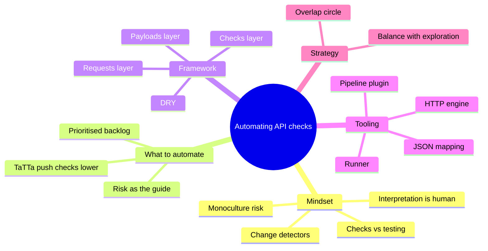

### Key takeaways

- **Automation trades richness for speed.** It gives quick, consistent feedback on what I explicitly ask, and nothing else.
- **Treat checks as change detectors.** A failure says "something changed". A person decides whether quality dropped.
- **Let risk choose what to automate.** My prioritised risks become my backlog of checks.
- **Ask whether I'm testing the API or testing through it.** Push logic checks down to unit level.
- **Structure the framework in three layers**, checks, requests and payloads, to stay DRY and readable.
- **Keep intent visible in the checks** and push URLs and HTTP detail into the requests layer.
- **Beware false positives from shared payload classes.** An independent contract catches mistakes the product shares.
- **Run checks in the pipeline** and keep them fast, independent, and trustworthy.
- **Pair automation with other activities.** It lives in the overlap of what I want and what I have.

### Quick glossary

| Term | Meaning |
|---|---|
| **Automated check** | A machine-run test giving pass/fail feedback on an explicit instruction |
| **Change detector** | A check viewed as an indicator that something in the system has changed |
| **Regression testing** | Re-running checks to detect changes that might reduce quality |
| **Monoculture strategy** | Relying purely on automation, losing other kinds of feedback |
| **TaTTa** | "Testing the API, or testing through the API?": a prompt for deciding where a check belongs |
| **DRY** | Don't repeat yourself: keep each piece of knowledge in one place |
| **POJO / payload class** | A plain object representing a request or response body |
| **Requests layer** | The framework area that owns URLs and HTTP calls |
| **False positive** | A passing check that should have failed |
| **Flaky check** | A check that passes and fails inconsistently without any change in the product |
| **IT suffix** | A naming convention for integration-style checks, run by Maven Failsafe |
| **Fault injection (my mock)** | Switching on a deliberate misbehaviour to see which checks notice |

### Where I go next

Automation completes the three activities in this part of the book: **designs**, **exploration** and **checks**. Each works in a different region of my testing model and reveals different information. The next step is to bring them together into a strategy, matching each to the risks it handles best.

If I could leave you with one habit, it would be this: **for every check I write, I ask what it *wouldn't* notice.** Writing down that answer is the quickest way to remember that a green build is a statement about my questions, not about my product.

---

*Source and credits:* this post is based on the chapter "Automating web API tests". The ideas of checking versus testing and of checks as change detectors are credited there to Michael Bolton and to the wider testing community; TaTTa and the three-layer framework structure are the chapter author's. The Java snippets are the book's design, shown for comparison and **not run by me**. The Python framework, the mock platform with its fault switches, the experiments, the risk backlog and all 23 tests are my own work, written and run for this post.
