# Exploratory Testing APIs: Structure, Freedom, and a Session I Can Actually Run

> **TL;DR:** Exploratory testing is not "poking around". It's a disciplined loop of *design, execute, analyse, learn*, steered by short written **charters**, judged by **oracles**, fuelled by **heuristics**, supported by **tools**, recorded in **notes**, and shared in a **debrief**. In this post I walk through all of it using the `restful-booker-platform` sandbox, and I back it up with a small, tested toolkit: a charter parser and session planner, a mock booking API seeded with realistic quirks, and three "oracle assistants" that flag suspicious behaviour for me to judge.

---

## Table of Contents

1. [Two walks from A to B](#two-walks-from-a-to-b)
2. [The value of exploratory testing](#the-value-of-exploratory-testing)
3. [Planning to explore: charters](#planning-to-explore-charters)
4. [Hands-on: charters and session planning in code](#hands-on-charters-and-session-planning-in-code)
5. [A case study: exploring "booking a room"](#a-case-study-exploring-booking-a-room)
6. [Hands-on: running the session against a mock API](#hands-on-running-the-session-against-a-mock-api)
7. [Note-taking](#note-taking)
8. [Knowing when to stop](#knowing-when-to-stop)
9. [Sharing what I learned](#sharing-what-i-learned)
10. [Where exploratory testing sits in a strategy](#where-exploratory-testing-sits-in-a-strategy)
11. [Pitfalls, cheat sheet and summary](#pitfalls-cheat-sheet-and-summary)

---

## Two walks from A to B

Before any theory, here's a ten-minute experiment I'd like you to try. You need a pen, paper, and ideally a friend.

1. **Write a script** that guides a reader from point A to point B, say from the front door of your building to your desk, or from your front door to your kitchen. Don't agonise over the route.
2. Give the script to your friend. Ask them to follow it exactly, then ask: *"What did you notice on the way?"* Write down what they say.
3. Now ask them to do it again, **without a script**. Give them ten minutes to get from A to B, and tell them to write down everything they notice as they go.
4. Compare the two lists.

I'd bet the second list is longer and richer. Someone had a strange object on their desk. There was a poster on the wall nobody had noticed. The reason is that on the second walk your friend was doing an informal piece of **exploratory testing**: exploring a *constrained area* with *purpose* in order to learn about it. On the first walk, the script told them where to look, so they didn't look anywhere else.

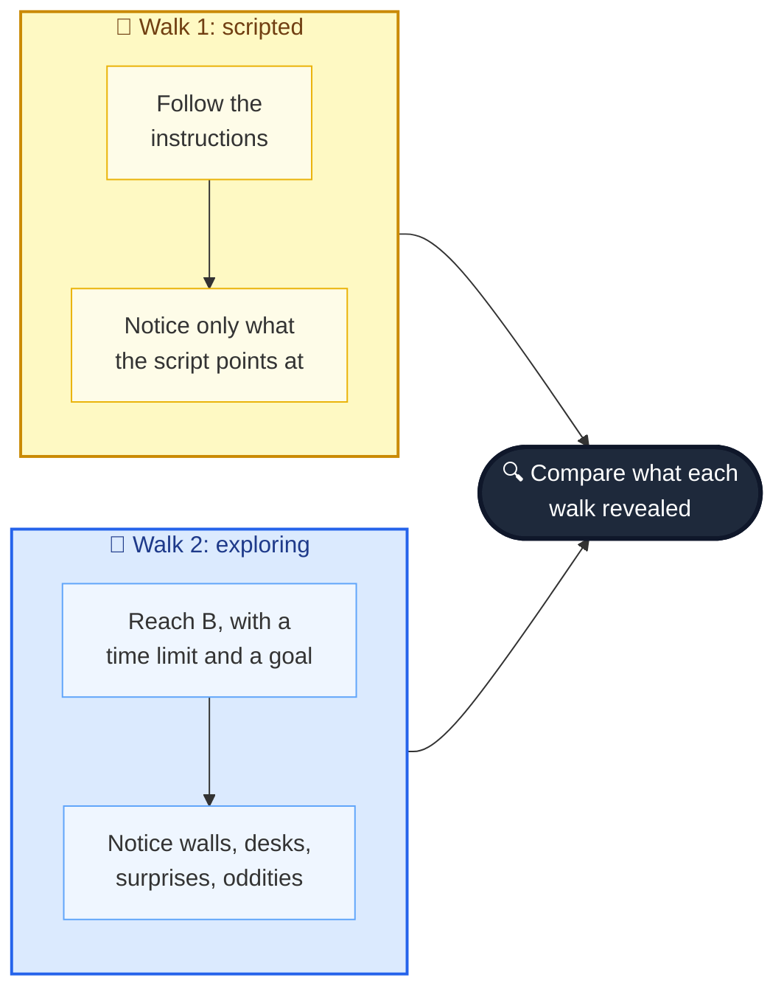

That little experiment contains the whole idea. The rest of this post is about doing it deliberately, with APIs.

---

## The value of exploratory testing

Plenty of people have *heard* of exploratory testing, but far fewer know how it works. Some assume it's ad hoc, made up as you go, structureless, and impossible to manage. There's a grain of truth in the freedom part. But in practice it's a **highly disciplined approach that balances structure and freedom** so the explorer learns as much useful information as possible.

### The testing loop

Elisabeth Hendrickson, in her book *Explore It!*, describes exploratory testing as learning about a system while designing and running tests, using feedback from the last test to shape the next one. In other words, I repeat a small loop, many times, in a single session:

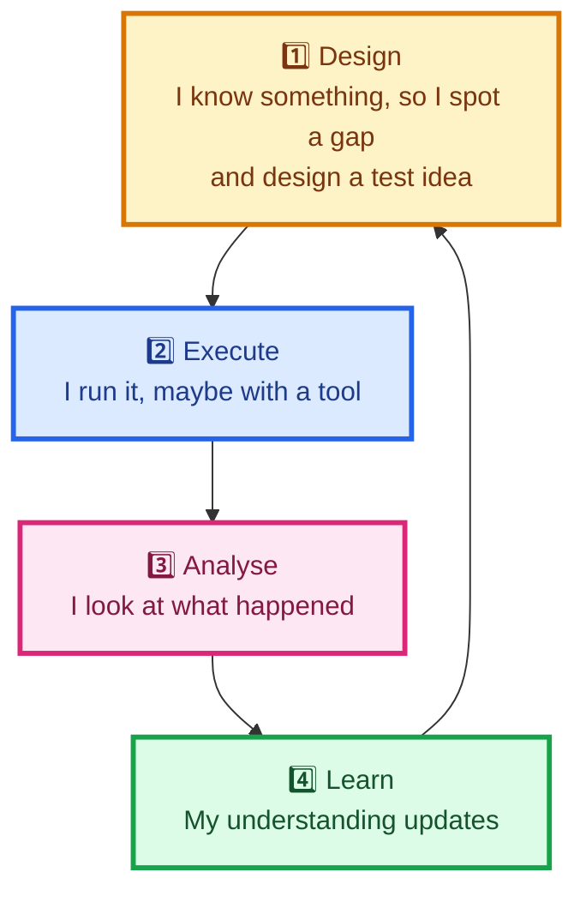

It happens quickly, mostly in my head, with notes to keep track. Here's the book's example, a form field that should accept "valid" phone numbers:

| Step | What I do |
|---|---|
| **Design** | The field should accept valid phone numbers, so I plan to try two valid formats: one UK, one US |
| **Execute** | I make one valid number for each country and submit both |
| **Analyse** | The UK number is accepted; the US number is not |
| **Learn** | "Valid" apparently means "UK" right now. Maybe other countries are rejected too. |

And so the loop starts again with a better idea: *try other countries.* One session might spin through this loop dozens of times.

### A double-edged sword

The loop gives me structure (a repeatable pattern) and freedom (I choose what to test next). But it's also a double-edged sword. I can't test everything, because my time is finite, so I need guidance about **what to focus on and what to leave for another day**. That guidance is the subject of the next section.

> **📝 Note:** The loop looks a lot like the question-driven testing from the previous post. The difference is the target. There I questioned *ideas*. Here I question a *running system* and let its behaviour feed my next question.

---

## Planning to explore: charters

If exploratory testing is structured, where does the structure come from? From **charters**: brief, specific, measurable goals for an exploratory testing **session**. Here's one:

> Explore the branding API
> With different B&B details
> To discover whether the branding API saves B&B details correctly

A charter says clearly what I hope to achieve *without being overly prescriptive*. With that charter, I can come up with test ideas about B&B names, locations and addresses and feel confident they fit. If I notice myself examining response codes on the *booking* API, I've gone **off charter**, and I might not be finding information my team needs.

### Where charters come from: risks

Just as an explorer sets off to discover an unknown region, I use charters to discover a different kind of unknown: **risks**. I find risks the way the earlier post described (a skeptical mindset, plus techniques like RiskStorming), and then I capture them as charters.

Take a risk from that earlier work, "the admin is unable to use the branding API", and make it concrete: *the `PUT /branding` endpoint fails to update details.* That's brief and specific, but it isn't measurable and it lacks focus. A charter template fixes that.

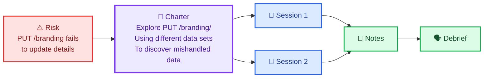

### Three charter templates

There are several templates. I use whichever feels natural:

| Template | Shape | Example for `PUT /branding/` |
|---|---|---|
| **Explore It!** (Hendrickson) | Explore *target* / Using *tools* / To discover *risk or information* | Explore the PUT /branding/ API endpoint, using different data sets, to discover issues in which data is incorrectly handled |
| **Dan Ashby** | Look at *target* / To test for *test idea* | Look at PUT /branding/, to test for issues in which data is incorrectly saved |
| **Michael D. Kelly** | My mission is to test *risk* for *coverage* | My mission is to test for issues with data not saving for the PUT /branding/ API endpoint |

Which format I use matters far less than the result: **a set of charters that each capture a different risk**, so I can plan what exploring to do and when.

> **🧪 Activity:** Pick a risk from your own RiskStorming session, or invent one for the sandbox. Write it as a charter in at least two of the templates and see which reads best.

### When to write charters

Charters are flexible about timing. They can come out of sprint planning or story discussions, which is a good time because the team is already together. They can also be added *during* a session or while sharing discoveries. The best approach is a mix of both.

### One charter, one session, or many?

An exploratory **session** is a single, time-boxed run guided by one charter. Sometimes one session per charter is enough. Sometimes **several sessions on the same charter** pay off, because no two sessions are the same: who runs it, what they know, their skill and mood all change what gets noticed. Running a charter more than once tends to produce different discoveries.

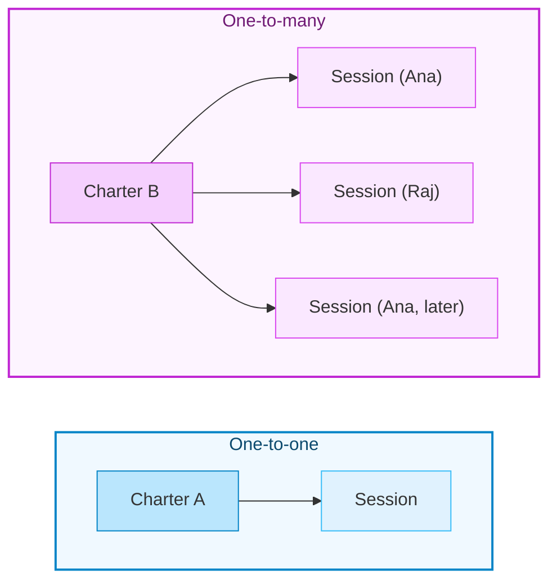

### Charters as a planning tool

How many sessions each charter gets, and which charters come first, depends on the time available. So charters aren't just a steering wheel. They're also a **to-do list with priorities**. Here's the book's example, three charters in priority order:

1. Explore the **Create Room** API to discover risks around rooms not being **stored** correctly.
2. Explore the **Delete Room** API to discover risks around rooms not being **deleted** correctly.
3. Explore the **Create Room** API to discover risks around incorrect **responses**.

Suppose I'd ideally run charter 2 at least three times, but I only have time for **four sessions in total**. I have two sensible options:

| Option | Plan | Upside | Downside |
|---|---|---|---|
| **A: depth first** | Charter 1 once, charter 2 three times | Deep coverage of the risks I rank highest | Charter 3 stays *unknown*, which should start a conversation: find more time, or accept that risk? |
| **B: breadth first** | One session each, in priority order (1, 2, 3), then charter 2 again | Everything gets *some* attention | Charter 2 gets less depth than I wanted |

Neither is "right". What matters is that charters make the trade-off **visible** and let me communicate what I will *not* explore. I'll show both options in code in a moment.

> **📝 Charters and regression testing:** If I track which charters were run and when, I can use that record to decide what to re-explore: charters that haven't run for a while, or ones covering areas that recent changes might have disturbed.

---

## Hands-on: charters and session planning in code

Charters are just text, but text with a *shape*, and shapes can be checked. I wrote a small module (standard library only) that:

- parses the three templates into target, risk and tools,
- **rejects** text that isn't really a charter (no target or no risk),
- plans sessions for a limited budget in either **sequential** (depth-first) or **breadth** (round-robin) mode,
- reports which charters would be left **unexplored**,
- lists charters that are overdue for a re-run,
- computes a session-based time-box window ("an hour, give or take fifteen minutes").

### `charters.py`

```python
"""Charters: parse the three templates, and plan which sessions to run."""
import re
from dataclasses import dataclass
from datetime import date

# Template 1 (Explore It!):  Explore <target> / Using <tools> / To discover <risk>
# Template 2 (Dan Ashby):    Look at <target> / To test for <idea>
# Template 3 (Michael Kelly): My mission is to test <risk> for <coverage>
_T1 = re.compile(r"^\s*Explore (?P<target>.+?)\s*\n\s*Using (?P<tools>.+?)\s*\n\s*To discover (?P<risk>.+?)\s*$", re.I | re.S)
_T2 = re.compile(r"^\s*Look at (?P<target>.+?)\s*\n\s*To test for (?P<risk>.+?)\s*$", re.I | re.S)
_T3 = re.compile(r"^\s*My mission is to test (?P<risk>.+?) for (?P<target>.+?)\s*$", re.I | re.S)


def parse_charter(text: str) -> dict:
    """Return {'template', 'target', 'risk', 'tools'?}. Raises ValueError if the
    text is not a charter: a charter must name a target AND a risk."""
    for name, pattern in (("explore-using-discover", _T1), ("look-at-test-for", _T2), ("mission", _T3)):
        m = pattern.match(text)
        if m:
            return {"template": name, **{k: v.strip() for k, v in m.groupdict().items()}}
    raise ValueError("Not a recognised charter: it needs a target and a risk to explore")


def plan_sessions(wanted: dict, budget: int, mode: str):
    """wanted: {charter: sessions wanted}, in PRIORITY ORDER.
    mode 'sequential': fill each charter's wish in priority order (depth first).
    mode 'breadth':    one session per charter per round (round robin).
    Returns (schedule, unexplored): the ordered sessions, and charters that got none."""
    if mode not in ("sequential", "breadth"):
        raise ValueError(f"unknown mode {mode!r}")
    remaining = dict(wanted)
    schedule = []
    if mode == "sequential":
        for name, n in remaining.items():
            for _ in range(n):
                if len(schedule) < budget:
                    schedule.append(name)
    else:
        while len(schedule) < budget and any(remaining.values()):
            for name in remaining:
                if remaining[name] > 0 and len(schedule) < budget:
                    schedule.append(name)
                    remaining[name] -= 1
    return schedule, [c for c in wanted if c not in schedule]


@dataclass(frozen=True)
class TrackedCharter:
    name: str
    last_run: date | None   # None = never run


def stale_charters(charters, today: date, max_age_days: int):
    """Regression idea: which charters are due a re-run?"""
    due = [c.name for c in charters
           if c.last_run is None or (today - c.last_run).days > max_age_days]
    return sorted(due)


def session_window(base_minutes: int, variance_minutes: int) -> tuple[int, int]:
    """Session-based test management time-box: 'an hour, give or take 15'."""
    return base_minutes - variance_minutes, base_minutes + variance_minutes
```

> **⚠️ Caution:** A parser can check a charter's *shape*, not its *quality*. "Explore the system / using anything / to discover bugs" parses fine and is useless. Treat a successful parse as a minimum, not a pass.

The tests for this module encode the book's own scenarios, and they appear in the combined test file further down. Here's the planner's output for the book's four-session example (taken from the real run of `demo.py`):

| Mode | Sessions scheduled | Unexplored |
|---|---|---|
| **Sequential** (option A) | storage, delete, delete, delete | create room: responses |
| **Breadth** (option B) | storage, delete, responses, delete | none |

> **💡 Tip:** I like seeing the "unexplored" column. It turns a vague worry ("did we cover enough?") into a named gap I can take to the product owner.

---

## A case study: exploring "booking a room"

Exploratory testing is hard to *teach* because every session differs. I can't hand you a script to copy. But the *patterns* and *techniques* inside a session transfer to any session. So I'll walk through a session guided by this charter:

> Explore booking a room
> Using different data sets
> To discover issues that might cause bookings to fail or be in an error state

### Beginning the session

Knowing where to start is the trickiest part. I usually begin in one of two states: I know **too little** (so decisions are hard) or **too much** (so the options overwhelm me). My advice either way is to spend a little time *learning* before diving into test ideas.

I start my notes as a **mind map**: session information (start time, version, environment) and the details of the request that successfully makes a booking (URL, headers, body). I learn that from the research activities of the second post: capture `POST /booking` in dev tools, copy it into Postman. I could equally have read documentation, read source code, or asked the person who built the endpoint.

Then I pick a node and add test ideas as **questions**. For the check-in and checkout dates:

- What if the dates fall on a leap year?
- What if the date format is different?
- What if I send other incorrect data?

Each question becomes an experiment: set a date to `29-02-2020`; try `01/01/2000` or `2000-30-12`; try `null`, integers or strings. Critical thinking digs deeper into an idea, and lateral thinking goes broader, and I use both to generate the questions.

> **📝 Exploring GraphQL:** The structure differs from REST, but the approach is the same. For a query like `character(id: 1) { name created }`, I'd ask what other fields and filters exist, what happens for a character that doesn't exist, what if I remove the id, and what if I send something other than an integer.

> **🧪 Activity:** Write down as many test ideas as you can for the check-in and checkout dates. Keep the list. We'll expand it in a moment.

### Knowing when something isn't right: oracles

A common worry for newcomers is *when to raise an issue*. A scripted test has an explicit expectation. Exploration doesn't. The answer is **oracles**: sources of information, explicit (a requirement) or tacit (the rules of language), that help me judge whether what I'm seeing is fine or a potential problem.

```mermaid
flowchart TD
    OBS["👀 I observe<br/>something"] --> Q{"Does it conform<br/>to an oracle?"}
    Q -->|Yes| FINE["✅ Probably fine"]
    Q -->|No| ISSUE["🚩 Potential issue"]
    ISSUE --> TRIAGE["🗣️ Triage with the team"]
    TRIAGE -->|Real| BUG["🐞 Raise and fix"]
    TRIAGE -->|Oracle was wrong| DROP["♻️ Drop it,<br/>improve my oracle"]

    style OBS fill:#e0e7ff,stroke:#4f46e5,stroke-width:2px,color:#312e81
    style Q fill:#fef9c3,stroke:#ca8a04,stroke-width:2px,color:#713f12
    style FINE fill:#bbf7d0,stroke:#16a34a,stroke-width:2px,color:#14532d
    style ISSUE fill:#fecaca,stroke:#dc2626,stroke-width:2px,color:#7f1d1d
    style TRIAGE fill:#fde68a,stroke:#d97706,stroke-width:2px,color:#78350f
    style BUG fill:#fca5a5,stroke:#b91c1c,stroke-width:3px,color:#7f1d1d
    style DROP fill:#e5e7eb,stroke:#6b7280,stroke-width:2px,color:#374151
```

The book gives three examples from the session:

| Oracle | Where the expectation comes from | Example issue found |
|---|---|---|
| **Product** | The system should behave consistently with itself | Sometimes a `400` carries an actionable message ("field cannot be blank"), sometimes it's a generic `400` with nothing. Which is intended? |
| **Statutes and standards** | Rules, regulations, architectural standards | Setting checkin and checkout to the same day returned `409`. RFC 7231 defines 409 as a conflict with the *current state* of the resource, but there was no existing booking to conflict with. |
| **Familiarity** | Experience with software in general | A `500` came back when the message API was unavailable. The surprise wasn't the 500, it was that the booking was **saved anyway**. In my experience a 500 means "it didn't complete". |

There are many more oracles. Michael Bolton's *FEW HICCUPPS* mnemonic collects them, and reading it and inventing an example bug for each is a worthwhile exercise.

> **⚠️ Caution: oracles are fallible.** They only work in certain situations, and sometimes they make me raise things that aren't issues. That's why I always **triage bugs with the team**: a short conversation with a developer or product owner confirms which are real, and shows them the value of the work.

### Coming up with ideas: heuristics

Eventually my own ideas run dry. That's where **heuristics** come in. As Richard Bradshaw and Sarah Deery put it, they're cognitive shortcuts we use under uncertainty.

The book illustrates this with a small story about a shed padlock. Two similar keys on a red keychain, one warped and one not. The phrase **"Red is right"** reminds the owner which key to use. It's useful, but fallible (it fails if you pick up the green keychain), and after enough practice it became unconscious. Test ideas work the same way. My first ideas about dates, formats and data types come from internal heuristics built up from testing *other* date fields. When those run dry, I switch to **explicit** heuristics:

| Heuristic source | What it offers | Ideas it triggered in the session |
|---|---|---|
| **Test Heuristic Cheat Sheet** (Hendrickson, Lyndsay, Emery) | Heuristics and data type attacks | Whitespace-only names, accented characters and emojis (which exposed an issue), impossible dates like February 30 |
| **BINMEN** (Gwen Diagram and Ash Winter) | **B**oundary, **I**nvalid entries, **N**ulls, **M**ethod, **E**mpty, **N**egatives | *Method* stood out: which HTTP methods does `/booking/` support? |
| **POISED** (Amber Race) | **P**arameters, **O**utput, **I**nteroperability, **S**ecurity, **E**xceptions, **D**ata | *Exceptions* prompted questions about error handling and message usefulness |

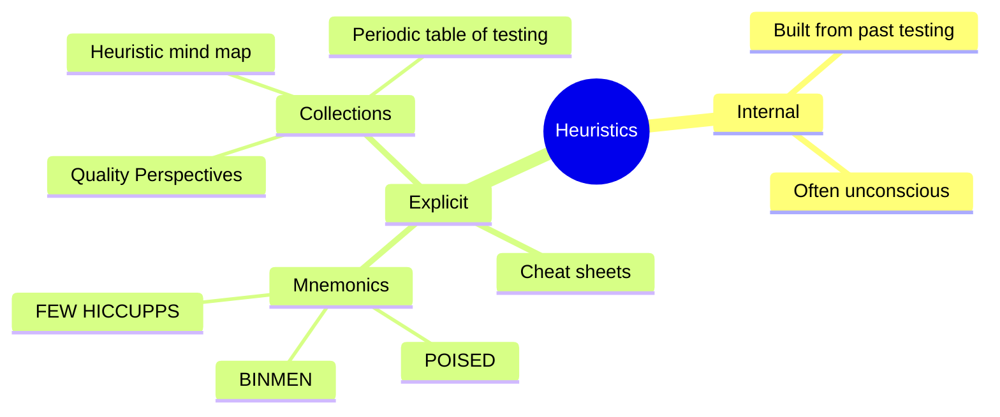

> **💡 Tip:** Heuristics aren't checklists to tick off. There's no correct way to use them. **If one triggers an idea, use it; if it doesn't, move on.** What matters is my relationship with them.

> **🧪 Activity:** Go back to your date test ideas and expand them using a cheat sheet or a mnemonic. Which prompts produced ideas you hadn't thought of?

### Using tools

Software can help me test further, deeper and faster. The book's session notes list a range of tools. Two examples show the principle.

**Example 1: data-driven testing with Excel and an HTTP client.** I had a test idea: would the `phone` validation accept international formats? Two problems: I needed a list of international numbers, and there are a lot of them. I solved the first with a table of country codes and lengths (from a reference page), and used spreadsheet formulas to produce a random number in each format. I solved the second by capturing `POST /booking/` in **Postman**, replacing the `roomid` and `phone` values with variables, and using the **collection runner** with the CSV file. Each iteration pulls a row, injects it, sends the request, and saves the response.

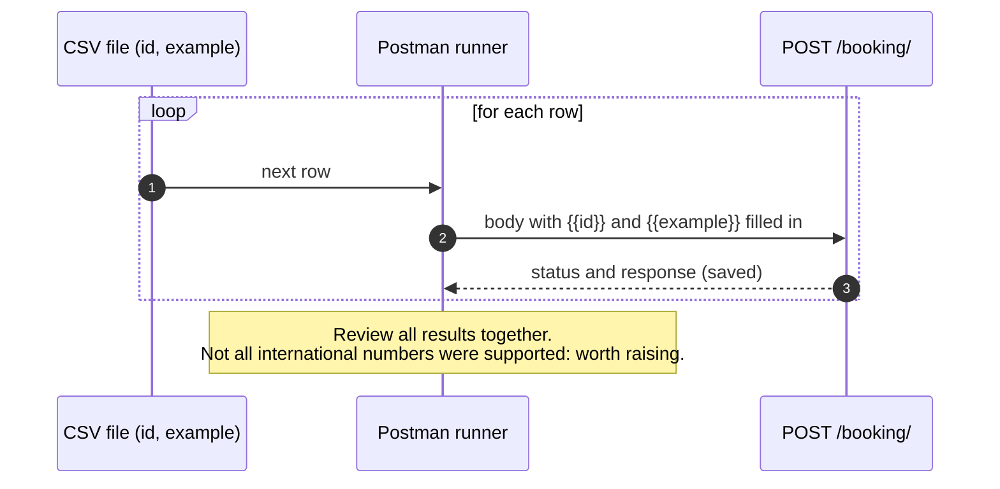

**Example 2: proxies and mocks.** A packet sniffer such as Wireshark (from the second post) revealed that the **booking** API calls the **message** API. That led to a new idea: *what happens if the message API sends an unexpected error or wrong status code?* The obstacle: how do I make the message API misbehave on demand? The answer was an API mocking tool, **WireMock**: stop the real message API, start WireMock on the same port, and give it a mapping file that returns whatever status I want. Then I can change the mapping (different status codes, connection errors) and watch the booking API react. That's how the session found a `500` response for a booking that **had been saved**.

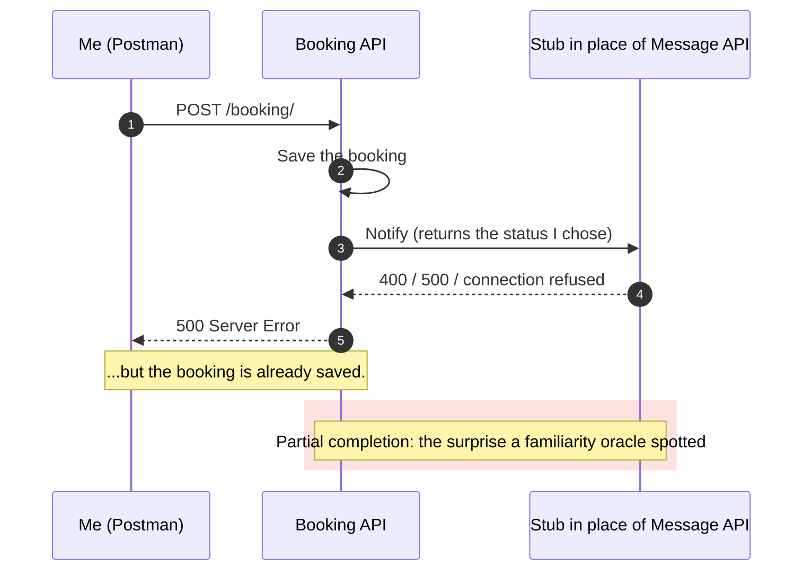

> **⚠️ Caution:** Swapping a real service for a mock means stopping processes and re-pointing ports on your own machine. Do this only in a test environment you control. Never do it against shared or production systems. And remember to restore the real service afterwards, or you'll chase "bugs" caused by your own stub.

> **🧪 Activities:** (1) Run a data-driven experiment over a range of valid and invalid *email* formats with Postman's runner and a CSV file. (2) Mock the auth API with WireMock and have it send different status codes back to the room API.

---

## Hands-on: running the session against a mock API

I can't ship the Java sandbox in a blog post, and I wanted something runnable in seconds. So I built a **mock booking API** and **mock message API** in Python's standard library.

> **⚠️ Caution: the quirks are mine.** I *seeded* the mock with the **kinds** of behaviour the chapter's session describes: a `409` for same-day dates, generic empty `400`s next to descriptive ones, a `500` with the booking saved, and a UK-only phone check. The exact rules, and extras like an emoji crash, are my own inventions. **Nothing here is a finding about the real sandbox.** The point is to practise the techniques on something that behaves like the real thing in the *ways that matter for learning*.

### `mock_booking.py`

```python
"""A mock booking API + message API, seeded with the KINDS of behaviour an
explorer might meet. It is MY stand-in, not restful-booker-platform."""
import json
import re
import threading
import urllib.error
import urllib.request
from datetime import date
from http.server import BaseHTTPRequestHandler, ThreadingHTTPServer

ISO = re.compile(r"^\d{4}-\d{2}-\d{2}$")


class Server:
    """Small base: run a handler function on a free local port."""
    def __init__(self, handle):
        self._handle = handle
        self.httpd = None
        self.port = None

    def start(self, port=0):
        outer = self

        class H(BaseHTTPRequestHandler):
            def log_message(self, *a):
                pass

            def _go(self):
                n = int(self.headers.get("Content-Length", 0))
                raw = self.rfile.read(n) if n else b""
                try:
                    body = json.loads(raw) if raw else None
                except json.JSONDecodeError:
                    body = "__invalid__"
                status, payload = outer._handle(self.command, self.path, body)
                data = json.dumps(payload).encode()
                self.send_response(status)
                self.send_header("Content-Type", "application/json")
                self.send_header("Content-Length", str(len(data)))
                self.end_headers()
                self.wfile.write(data)

            do_GET = do_POST = _go

        self.httpd = ThreadingHTTPServer(("127.0.0.1", port), H)
        self.port = self.httpd.server_address[1]
        threading.Thread(target=self.httpd.serve_forever, daemon=True).start()
        return self

    @property
    def base(self):
        return f"http://127.0.0.1:{self.port}"

    def stop(self):
        if self.httpd:
            self.httpd.shutdown()
            self.httpd.server_close()
            self.httpd = None


class MessageStub(Server):
    """Plays the message API, like a WireMock stub: you choose the status."""
    def __init__(self, status=201):
        self.status = status
        super().__init__(lambda method, path, body: (self.status, {}))


class BookingApp(Server):
    def __init__(self, message_base: str):
        self.message_base = message_base
        self.bookings = []
        super().__init__(self._route)

    def _route(self, method, path, body):
        if path.rstrip("/") != "/booking":
            return 404, {"error": "not found"}
        if method == "GET":
            return 200, {"bookings": self.bookings}
        if method == "POST":
            try:
                return self.create(body)
            except Exception:                      # unexpected crash -> 500
                return 500, {"error": "internal error"}
        return 405, {}

    def _notify(self, booking):
        req = urllib.request.Request(self.message_base + "/message/", method="POST",
                                     data=json.dumps(booking).encode(),
                                     headers={"Content-Type": "application/json"})
        with urllib.request.urlopen(req, timeout=2):
            pass

    def create(self, b):
        if not isinstance(b, dict):
            return 400, {"errors": ["body must be a JSON object"]}
        for field in ("firstname", "lastname"):
            if not b.get(field):
                return 400, {"errors": [f"{field} must not be blank"]}
            if any(ord(ch) > 0xFFFF for ch in b[field]):
                raise RuntimeError("encoding problem")          # seeded: emoji crashes
        if "@" not in str(b.get("email", "")):
            return 400, {"errors": ["email is not valid"]}
        phone = str(b.get("phone", ""))
        if not (phone.isdigit() and phone.startswith("44") and len(phone) == 12):
            return 400, {"errors": ["phone is not a valid number"]}   # seeded: UK only
        dates = b.get("bookingdates")
        try:
            checkin, checkout = dates["checkin"], dates["checkout"]
            if not (ISO.match(checkin) and ISO.match(checkout)):
                raise ValueError
            d_in, d_out = date.fromisoformat(checkin), date.fromisoformat(checkout)
        except (TypeError, KeyError, ValueError):
            return 400, {}                                           # seeded: generic 400
        if d_in == d_out:
            return 409, {"error": "conflict"}                         # seeded: wrong status
        if d_out < d_in:
            return 400, {"errors": ["checkout must be after checkin"]}
        for other in self.bookings:
            if other["roomid"] == b.get("roomid") and \
               d_in < date.fromisoformat(other["bookingdates"]["checkout"]) and \
               date.fromisoformat(other["bookingdates"]["checkin"]) < d_out:
                return 409, {"error": "room already booked"}
        saved = {**b, "bookingid": len(self.bookings) + 1}
        self.bookings.append(saved)
        try:
            self._notify(saved)
        except (urllib.error.URLError, OSError):
            return 500, {"error": "message service failed"}           # seeded: saved, yet 500
        return 201, saved
```

The `MessageStub` plays the role WireMock played: I set its `status`, or stop it entirely to simulate "unavailable".

### `explorer.py`

This is the part I'm proudest of, and also the part I want to be most careful about. It has four pieces:

| Piece | What it does | Chapter idea it supports |
|---|---|---|
| `date_ideas`, `name_ideas`, `phone_ideas` | Turn heuristics into concrete payloads (leap day, impossible dates, emoji, country codes) | Heuristics and data-driven testing |
| `run` | Sends each idea and records status, body, and **whether a booking was actually saved** | The execute and analyse steps of the loop |
| `product_oracle`, `standards_oracle`, `familiarity_oracle` | Flag observations that violate an oracle | Oracles |
| `notes_to_mermaid` | Turns my notes into a colour-coded map | Mind maps (green answered, yellow follow up, red issue) |

```python
"""Helpers that support (never replace) an exploratory session."""
import json
import random
import urllib.error
import urllib.request
from dataclasses import dataclass, field

GOOD = {"roomid": 1, "firstname": "Mark", "lastname": "Tester", "depositpaid": True,
        "bookingdates": {"checkin": "2026-12-01", "checkout": "2026-12-04"},
        "email": "test@test.com", "phone": "447123456789"}


@dataclass
class Idea:
    label: str
    payload: object
    expects_conflict: bool = False


@dataclass
class Observation:
    idea: Idea
    status: int
    body: dict
    persisted: bool        # did the bookings list grow?


@dataclass
class Finding:
    oracle: str
    ideas: list
    message: str


def post_json(base, path, payload):
    req = urllib.request.Request(base + path, method="POST", data=json.dumps(payload).encode(),
                                 headers={"Content-Type": "application/json"})
    try:
        with urllib.request.urlopen(req) as r:
            return r.status, json.loads(r.read() or b"{}")
    except urllib.error.HTTPError as e:
        return e.code, json.loads(e.read() or b"{}")


def count_bookings(base):
    with urllib.request.urlopen(base + "/booking/") as r:
        return len(json.loads(r.read())["bookings"])


def with_dates(checkin, checkout, roomid):
    return {**GOOD, "roomid": roomid, "bookingdates": {"checkin": checkin, "checkout": checkout}}


# ---------- Test-idea generators (heuristics made executable) ----------
def date_ideas(first_room=100):
    cases = [
        ("leap day 2020-02-29", "2020-02-29", "2020-03-02"),
        ("dd-mm-yyyy format", "29-02-2020", "01-03-2020"),
        ("slashes 01/01/2000", "01/01/2000", "02/01/2000"),
        ("month 30 (2000-30-12)", "2000-30-12", "2000-31-12"),
        ("February 30", "2022-02-30", "2022-03-02"),
        ("null dates", None, None),
        ("integer dates", 20221201, 20221204),
        ("word dates", "tomorrow", "next week"),
        ("same-day checkin/out", "2026-12-01", "2026-12-01"),
        ("checkout before checkin", "2026-12-04", "2026-12-01"),
    ]
    return [Idea(label, with_dates(i, o, first_room + n)) for n, (label, i, o) in enumerate(cases)]


def name_ideas(first_room=200):
    names = [("whitespace-only firstname", "   "), ("accented characters", "Zoë Renée"),
             ("emoji in name", "Mark \U0001F600"), ("500-character name", "A" * 500)]
    return [Idea(label, {**GOOD, "roomid": first_room + n, "firstname": v})
            for n, (label, v) in enumerate(names)]


COUNTRIES = [("United Kingdom", 44, 10), ("Afghanistan", 93, 9), ("Åland Islands", 358, 10),
             ("Albania", 355, 9), ("Algeria", 213, 9), ("United States", 1, 10)]


def phone_ideas(first_room=300, seed=7):
    """A data-driven table like the chapter's CSV: code + random national digits."""
    rng = random.Random(seed)
    ideas = []
    for n, (country, code, length) in enumerate(COUNTRIES):
        number = str(code) + "".join(str(rng.randrange(10)) for _ in range(length))
        ideas.append(Idea(f"phone: {country}", {**GOOD, "roomid": first_room + n, "phone": number}))
    return ideas


# ---------- Running ideas ----------
def run(base, ideas):
    out = []
    for idea in ideas:
        before = count_bookings(base)
        status, body = post_json(base, "/booking/", idea.payload)
        out.append(Observation(idea, status, body, count_bookings(base) > before))
    return out


# ---------- Oracles: prompts for judgement, and fallible ----------
def product_oracle(obs):
    """Consistency within the product: every 400 should explain itself."""
    bad = [o.idea.label for o in obs if o.status == 400 and "errors" not in o.body]
    good = [o for o in obs if o.status == 400 and "errors" in o.body]
    if bad and good:
        return Finding("product", bad, "Some 400s explain themselves and some are empty: which is intended?")


def standards_oracle(obs):
    """RFC 7231: 409 means a conflict with the current state of the resource."""
    bad = [o.idea.label for o in obs if o.status == 409 and not o.idea.expects_conflict]
    if bad:
        return Finding("standards", bad, "409 Conflict was returned but nothing exists to conflict with.")


def familiarity_oracle(obs):
    """My experience says a 5xx means 'it did not complete'. Did it?"""
    bad = [o.idea.label for o in obs if o.status >= 500 and o.persisted]
    if bad:
        return Finding("familiarity", bad, "A 5xx response, yet the booking was saved (partial completion).")


ORACLES = (product_oracle, standards_oracle, familiarity_oracle)


def apply_oracles(obs):
    return [f for f in (oracle(obs) for oracle in ORACLES) if f]


# ---------- Notes -> a colour-coded map (green answered, yellow follow up, red issue) ----------
STATUS_CLASS = {"answered": "ok", "followup": "ask", "issue": "bug"}


def notes_to_mermaid(charter: str, notes) -> str:
    """notes: list of (area, text, status). Mind-map style, as a flowchart so nodes can be coloured."""
    clean = lambda s: s.replace('"', "'")
    lines = ["flowchart LR", f'    C(["{clean(charter)}"])']
    areas = list(dict.fromkeys(a for a, _, _ in notes))
    for i, area in enumerate(areas):
        lines.append(f'    A{i}["{clean(area)}"]')
        lines.append(f"    C --> A{i}")
    for j, (area, text, status) in enumerate(notes):
        i = areas.index(area)
        lines.append(f'    N{j}["{clean(text)}"]:::{STATUS_CLASS[status]}')
        lines.append(f"    A{i} --> N{j}")
    lines += ["    classDef ok fill:#bbf7d0,stroke:#16a34a,color:#14532d",
              "    classDef ask fill:#fef08a,stroke:#ca8a04,color:#713f12",
              "    classDef bug fill:#fecaca,stroke:#dc2626,color:#7f1d1d",
              "    style C fill:#1e293b,stroke:#0f172a,color:#ffffff"]
    return "\n".join(lines)
```

> **⚠️ Caution: these "oracle assistants" don't *decide* anything.** An oracle function returns a *prompt for my judgement*: "some 400s explain themselves and some don't: which is intended?" Whether that's a bug is a conversation with the team. If I ever catch myself treating the output as a verdict, I've stopped exploring and started auditing.

### The tests

The tests do two jobs. They prove my tooling works (so I can trust what it tells me), and they pin down the seeded behaviours so the demo's results aren't accidents. The charter tests encode the book's own scenarios.

```python
import unittest
from datetime import date

from charters import (TrackedCharter, parse_charter, plan_sessions, session_window, stale_charters)
import explorer as ex
from mock_booking import BookingApp, MessageStub


class CharterTests(unittest.TestCase):
    def test_all_three_templates_parse(self):
        a = parse_charter("Explore the PUT /branding/ API endpoint\nUsing different data sets\n"
                          "To discover issues in which data is incorrectly handled")
        self.assertEqual((a["target"], a["tools"]), ("the PUT /branding/ API endpoint", "different data sets"))
        b = parse_charter("Look at PUT /branding/\nTo test for issues in which data is incorrectly saved")
        self.assertEqual((b["template"], b["target"]), ("look-at-test-for", "PUT /branding/"))
        c = parse_charter("My mission is to test for issues with data not saving for the PUT /branding/ API endpoint")
        self.assertEqual(c["template"], "mission")
        self.assertIn("data not saving", c["risk"])

    def test_a_vague_statement_is_not_a_charter(self):
        with self.assertRaises(ValueError):
            parse_charter("Test the branding API")

    WANTED = {"create-room-storage": 1, "delete-room": 3, "create-room-responses": 1}

    def test_sequential_plan_leaves_the_last_charter_unknown(self):
        schedule, unexplored = plan_sessions(self.WANTED, 4, "sequential")
        self.assertEqual(schedule, ["create-room-storage"] + ["delete-room"] * 3)
        self.assertEqual(unexplored, ["create-room-responses"])

    def test_breadth_plan_covers_everything_then_revisits(self):
        schedule, unexplored = plan_sessions(self.WANTED, 4, "breadth")
        self.assertEqual(schedule, ["create-room-storage", "delete-room", "create-room-responses", "delete-room"])
        self.assertEqual(unexplored, [])

    def test_plan_never_exceeds_budget_or_wishes(self):
        schedule, _ = plan_sessions(self.WANTED, 99, "breadth")
        self.assertEqual(len(schedule), 5)
        with self.assertRaises(ValueError):
            plan_sessions(self.WANTED, 4, "random")

    def test_stale_charters_and_time_box(self):
        cs = [TrackedCharter("a", date(2026, 1, 1)), TrackedCharter("b", date(2026, 10, 1)), TrackedCharter("c", None)]
        self.assertEqual(stale_charters(cs, date(2026, 10, 12), 90), ["a", "c"])
        self.assertEqual(session_window(60, 15), (45, 75))


class ExplorationAgainstTheMock(unittest.TestCase):
    def setUp(self):
        self.msg = MessageStub(201).start()
        self.app = BookingApp(self.msg.base).start()

    def tearDown(self):
        self.app.stop()
        self.msg.stop()

    def result(self, obs, label):
        return next(o for o in obs if o.idea.label == label)

    def test_date_ideas_behave_as_seeded(self):
        obs = ex.run(self.app.base, ex.date_ideas())
        self.assertEqual(self.result(obs, "leap day 2020-02-29").status, 201)
        for label in ("dd-mm-yyyy format", "February 30", "null dates", "integer dates"):
            self.assertEqual(self.result(obs, label).status, 400, label)
        self.assertEqual(self.result(obs, "same-day checkin/out").status, 409)
        self.assertEqual(self.result(obs, "checkout before checkin").body["errors"], ["checkout must be after checkin"])

    def test_product_and_standards_oracles_fire_on_the_date_session(self):
        findings = {f.oracle: f for f in ex.apply_oracles(ex.run(self.app.base, ex.date_ideas()))}
        self.assertIn("same-day checkin/out", findings["standards"].ideas)
        self.assertIn("February 30", findings["product"].ideas)
        self.assertNotIn("checkout before checkin", findings["product"].ideas)   # that 400 explains itself
        self.assertNotIn("familiarity", findings)

    def test_a_real_overlap_is_not_flagged_by_the_standards_oracle(self):
        ex.post_json(self.app.base, "/booking/", ex.with_dates("2026-12-01", "2026-12-04", 7))
        clash = ex.Idea("overlap", ex.with_dates("2026-12-02", "2026-12-05", 7), expects_conflict=True)
        obs = ex.run(self.app.base, [clash])
        self.assertEqual(obs[0].status, 409)
        self.assertIsNone(ex.standards_oracle(obs))

    def test_name_ideas_find_emoji_crash_and_blank_acceptance(self):
        obs = ex.run(self.app.base, ex.name_ideas())
        self.assertEqual(self.result(obs, "emoji in name").status, 500)
        self.assertEqual(self.result(obs, "whitespace-only firstname").status, 201)
        self.assertEqual(self.result(obs, "accented characters").status, 201)

    def test_data_driven_phone_run_shows_uk_only(self):
        obs = ex.run(self.app.base, ex.phone_ideas())
        accepted = [o.idea.label for o in obs if o.status == 201]
        self.assertEqual(accepted, ["phone: United Kingdom"])
        self.assertEqual(len(obs), len(ex.COUNTRIES))

    def test_phone_data_is_reproducible(self):
        a = [i.payload["phone"] for i in ex.phone_ideas(seed=7)]
        b = [i.payload["phone"] for i in ex.phone_ideas(seed=7)]
        self.assertEqual(a, b)

    def test_message_api_down_reveals_a_500_with_a_saved_booking(self):
        self.msg.stop()                                   # the dependency disappears
        obs = ex.run(self.app.base, [ex.Idea("message API down", ex.with_dates("2026-12-01", "2026-12-03", 9))])
        self.assertEqual((obs[0].status, obs[0].persisted), (500, True))
        finding = ex.familiarity_oracle(obs)
        self.assertEqual(finding.ideas, ["message API down"])

    def test_a_stubbed_400_from_the_message_api_also_leaves_a_saved_booking(self):
        # Like pointing the booking API at a WireMock that answers 400:
        # urllib raises HTTPError (a URLError subclass), the app treats it as a failure,
        # yet the booking was already saved.
        self.msg.status = 400
        obs = ex.run(self.app.base, [ex.Idea("stub says 400", ex.with_dates("2026-12-01", "2026-12-03", 11))])
        self.assertEqual((obs[0].status, obs[0].persisted), (500, True))
        self.assertEqual(ex.familiarity_oracle(obs).ideas, ["stub says 400"])


class NotesTests(unittest.TestCase):
    def test_notes_become_a_coloured_map(self):
        notes = [("Dates", "Leap day accepted", "answered"), ("Dates", "Same-day gives 409", "issue"),
                 ("Phone", "Which countries are valid?", "followup")]
        text = ex.notes_to_mermaid("Explore booking a room", notes)
        self.assertTrue(text.startswith("flowchart LR"))
        self.assertEqual(text.count(":::ok"), 1)
        self.assertEqual(text.count(":::bug"), 1)
        self.assertEqual(text.count(":::ask"), 1)
        self.assertIn("classDef bug", text)

    def test_quotes_in_notes_do_not_break_the_syntax(self):
        text = ex.notes_to_mermaid('Charter "x"', [("A", 'He said "hi"', "answered")])
        self.assertNotIn('"hi"', text)


if __name__ == "__main__":
    unittest.main(verbosity=2)
```

```bash
python3 test_exploration.py
```

```text
test_a_vague_statement_is_not_a_charter  ... ok
test_all_three_templates_parse  ... ok
test_breadth_plan_covers_everything_then_revisits  ... ok
test_plan_never_exceeds_budget_or_wishes  ... ok
test_sequential_plan_leaves_the_last_charter_unknown  ... ok
test_stale_charters_and_time_box  ... ok
test_a_real_overlap_is_not_flagged_by_the_standards_oracle  ... ok
test_a_stubbed_400_from_the_message_api_also_leaves_a_saved_booking  ... ok
test_data_driven_phone_run_shows_uk_only  ... ok
test_date_ideas_behave_as_seeded  ... ok
test_message_api_down_reveals_a_500_with_a_saved_booking  ... ok
test_name_ideas_find_emoji_crash_and_blank_acceptance  ... ok
test_phone_data_is_reproducible  ... ok
test_product_and_standards_oracles_fire_on_the_date_session  ... ok
test_notes_become_a_coloured_map  ... ok
test_quotes_in_notes_do_not_break_the_syntax  ... ok

----------------------------------------------------------------------
Ran 16 tests in ~8s

OK
```

> **📝 A detail I like:** `test_a_real_overlap_is_not_flagged_by_the_standards_oracle` checks that a *genuine* double booking returning `409` is **not** flagged. An oracle that cries wolf on correct behaviour wastes everyone's time, so I test the negative case too.

### The session

`demo.py` runs a whole mini-session: the date ideas, then names, then phone numbers, then it turns off the message API and tries one more booking. It finishes by printing the oracle findings, the session plans and the colour-coded notes.

```python
import explorer as ex
from charters import plan_sessions
from mock_booking import BookingApp, MessageStub

msg = MessageStub(201).start()
app = BookingApp(msg.base).start()

observations = []
for ideas in (ex.date_ideas(), ex.name_ideas(), ex.phone_ideas()):
    observations += ex.run(app.base, ideas)

msg.stop()                                  # what if the message API is unavailable?
observations += ex.run(app.base, [ex.Idea("message API down", ex.with_dates("2026-12-01", "2026-12-03", 400))])

print(f"{'idea':<28}{'status':<8}{'saved?':<8}body")
for o in observations:
    body = o.body.get("errors") or o.body.get("error") or ("{}" if not o.body else "")
    print(f"{o.idea.label:<28}{o.status:<8}{str(o.persisted):<8}{body}")

print("\nOracle findings:")
for f in ex.apply_oracles(observations):
    print(f"  [{f.oracle}] {f.message}\n      ideas: {', '.join(f.ideas)}")

print("\nSession plan, 4 sessions for 3 charters:")
wanted = {"create room: storage": 1, "delete room": 3, "create room: responses": 1}
for mode in ("sequential", "breadth"):
    schedule, unexplored = plan_sessions(wanted, 4, mode)
    print(f"  {mode:<10} {schedule}  unexplored: {unexplored}")

notes = [("Dates", "Leap day accepted", "answered"),
         ("Dates", "Same-day gives 409", "issue"),
         ("Dates", "Bad formats: empty 400", "issue"),
         ("Names", "Emoji causes 500", "issue"),
         ("Names", "Whitespace-only accepted?", "followup"),
         ("Phone", "Only UK numbers pass", "followup"),
         ("Dependencies", "Message API down: 500 but saved", "issue")]
print("\n" + ex.notes_to_mermaid("Explore booking a room", notes))
app.stop()
```

```text
idea                        status  saved?  body
leap day 2020-02-29         201     True    
dd-mm-yyyy format           400     False   {}
slashes 01/01/2000          400     False   {}
month 30 (2000-30-12)       400     False   {}
February 30                 400     False   {}
null dates                  400     False   {}
integer dates               400     False   {}
word dates                  400     False   {}
same-day checkin/out        409     False   conflict
checkout before checkin     400     False   ['checkout must be after checkin']
whitespace-only firstname   201     True    
accented characters         201     True    
emoji in name               500     False   internal error
500-character name          201     True    
phone: United Kingdom       201     True    
phone: Afghanistan          400     False   ['phone is not a valid number']
phone: Åland Islands        400     False   ['phone is not a valid number']
phone: Albania              400     False   ['phone is not a valid number']
phone: Algeria              400     False   ['phone is not a valid number']
phone: United States        400     False   ['phone is not a valid number']
message API down            500     True    message service failed

Oracle findings:
  [product] Some 400s explain themselves and some are empty: which is intended?
      ideas: dd-mm-yyyy format, slashes 01/01/2000, month 30 (2000-30-12), February 30, null dates, integer dates, word dates
  [standards] 409 Conflict was returned but nothing exists to conflict with.
      ideas: same-day checkin/out
  [familiarity] A 5xx response, yet the booking was saved (partial completion).
      ideas: message API down

Session plan, 4 sessions for 3 charters:
  sequential ['create room: storage', 'delete room', 'delete room', 'delete room']  unexplored: ['create room: responses']
  breadth    ['create room: storage', 'delete room', 'create room: responses', 'delete room']  unexplored: []

flowchart LR
    C(["Explore booking a room"])
    A0["Dates"]
    C --> A0
    A1["Names"]
    C --> A1
    A2["Phone"]
    C --> A2
    A3["Dependencies"]
    C --> A3
    N0["Leap day accepted"]:::ok
    A0 --> N0
    N1["Same-day gives 409"]:::bug
    A0 --> N1
    N2["Bad formats: empty 400"]:::bug
    A0 --> N2
    N3["Emoji causes 500"]:::bug
    A1 --> N3
    N4["Whitespace-only accepted?"]:::ask
    A1 --> N4
    N5["Only UK numbers pass"]:::ask
    A2 --> N5
    N6["Message API down: 500 but saved"]:::bug
    A3 --> N6
    classDef ok fill:#bbf7d0,stroke:#16a34a,color:#14532d
    classDef ask fill:#fef08a,stroke:#ca8a04,color:#713f12
    classDef bug fill:#fecaca,stroke:#dc2626,color:#7f1d1d
    style C fill:#1e293b,stroke:#0f172a,color:#ffffff
```

### Reading the results

Here are the observations in a table, grouped the way I'd debrief them:

| Area | What happened | What I'd think | Oracle |
|---|---|---|---|
| Dates | Leap day `2020-02-29` accepted (`201`) | Good: answered | n/a |
| Dates | Seven bad formats (`dd-mm-yyyy`, slashes, month 30, Feb 30, null, integers, words) all returned `400` with an **empty body** | Rejected, but unhelpfully. Compare with the checkout-before-checkin `400`, which explains itself | **Product** |
| Dates | Same-day checkin and checkout returned `409` | Nothing to conflict with, so the status looks wrong | **Standards** (RFC 7231) |
| Names | Whitespace-only first name accepted (`201`) | Is "blank" supposed to include spaces? Follow up | none: *my* question |
| Names | Emoji in a name returned `500` | A crash on valid-looking input | none: obvious |
| Names | Accented characters and a 500-character name accepted | Answered, though the 500-character case may deserve a *length* question | none |
| Phone | Only the UK number accepted; five others rejected | Is UK-only intended? Ask the product owner | none: *my* question |
| Dependency | Message API down: `500`, **and the booking was saved** | A failure that half-completed | **Familiarity** |

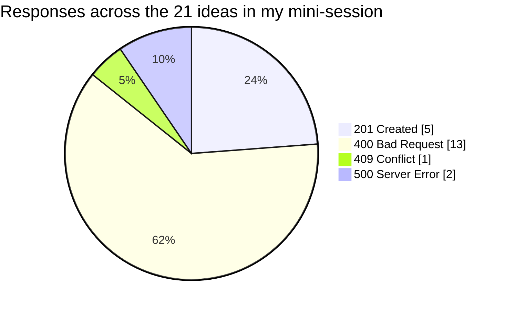

A pie chart of status codes is a nice picture, but notice what it *can't* tell me. Thirteen `400`s doesn't mean thirteen healthy rejections: eight of them were date-related, and seven of *those* were silent. The count looks reassuring; the content is the story. That's a good reminder that **exploratory testing is about reading the details, not counting the results**.

### The notes, as a map

Finally, the chapter uses colour on mind maps: green for answered questions, yellow for follow-ups, red for discoveries such as bugs. `notes_to_mermaid` produces the same convention. Here's the map generated by the demo:

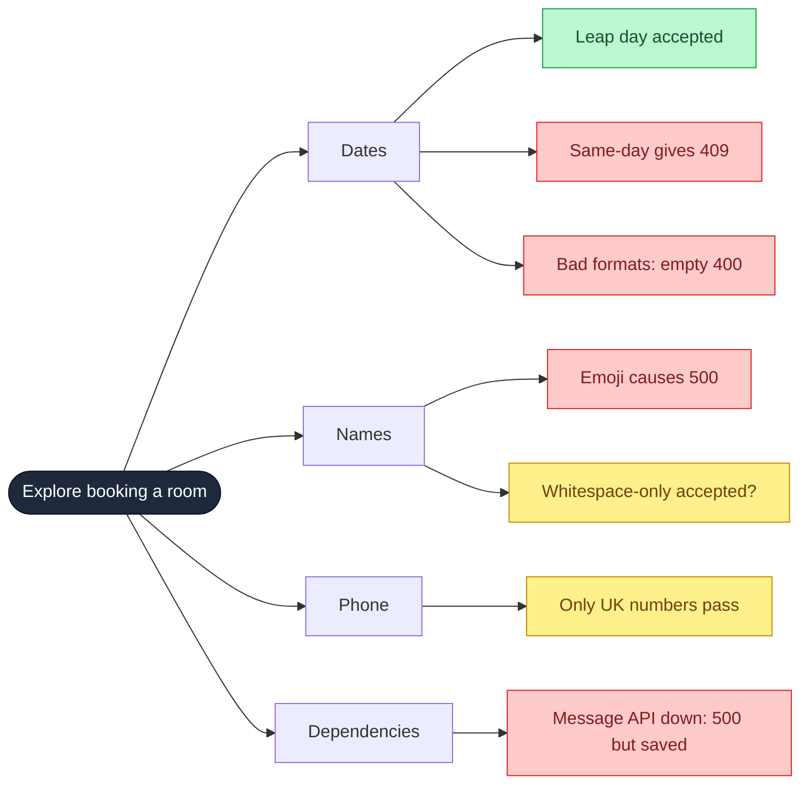

A quick glance tells me where the red is clustering (dates and the dependency), exactly the kind of "snapshot of the session" a map is good for.

> **⚠️ Caution:** Notice that I wrote the *notes* by hand, and only the *formatting* is generated. That's deliberate. If a tool wrote my notes, they'd only record what the tool noticed. The thinking, "why did I try that?", has to come from me, or the map degenerates into the "checklist in a different format" that critics of mind maps warn about.

---

## Note-taking

Whatever I discover must eventually be shared, and notes also help me **track my testing and trigger new ideas** while I'm in it. How I take notes is up to me, as long as they serve those jobs. Here are the common approaches:

| Approach | How it works | Strengths | Watch out for |
|---|---|---|---|
| **Mind map** | Charter at the root; branches for threads of exploration; colours and icons for status | Grows organically, shows relationships between testing and findings, easy to snapshot | Can degrade into a plain checklist. Keep nodes short (a tip I like: three words max) so the thinking gets out |
| **Pen and paper** | Free-form, Cornell method, or sketch-noting (pictures, icons, short phrases) | Looking away from the screen shifts me from *observing* to *formulating ideas*; very flexible | Needs discipline and a consistent visual language; too much detail breaks my focus, too little makes sharing hard |
| **Screen recording** | Record the whole session as video | Captures what I *didn't* notice, defeating "functional fixedness" (being so fixed on one event you miss another) | Laborious to review, especially for long sessions; captures the screen but not my *thinking* |

> **💡 Tip:** Experiment. Try a different note-taking style each session and reflect on what worked. The best approach is the one that doesn't distract me from testing but still leaves enough detail to share later.

---

## Knowing when to stop

Every session has to end. My goal is to learn as much as is *reasonably possible* about the charter, and I'm the one who judges when that's happened. A few cues help:

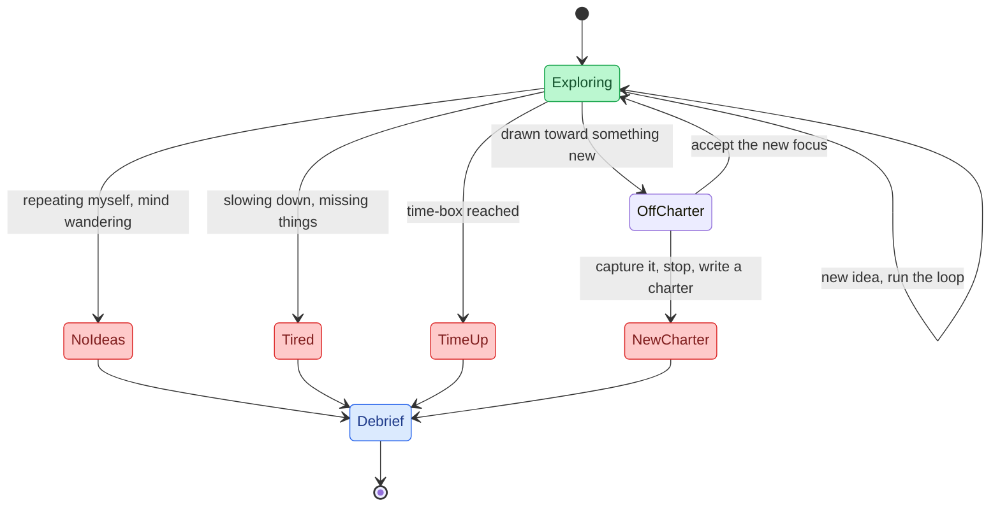

| Cue | What it looks like | Why stopping is fine |
|---|---|---|
| **No more test ideas** | My mind wanders; I repeat ideas with minor tweaks | I'll never test everything. A later reflection may bring new ideas, and then I simply run another session. |
| **Fatigue** | I'm slowing down, tired, low energy | Tired explorers miss things in their observations. I can stop, reflect, and run another session later using my old notes. |
| **Time-boxing** | A fixed duration, often with some give | Combats fatigue, makes sessions easy to prioritise. In session-based test management (James and Jon Bach), a medium session might be an hour, give or take fifteen minutes. |
| **Going off charter** | I'm exploring something unrelated to the charter | It's allowed. I can accept the new focus, or capture it as a *new* charter and stop to step back. |

I added a tiny `session_window(60, 15)` to `charters.py`, which returns `(45, 75)`, to make the "hour, give or take" idea concrete. It's trivial code, but it's the kind of thing that stops a "just a few more minutes" turning into a whole afternoon.

> **📝 Note:** A little off-charter work is normal, and good session notes record it. The danger isn't wandering. It's wandering *without noticing*, so the debrief can't tell the team what the session really covered.

### Running my own session

The best way to get comfortable is to practise. Take a charter you wrote earlier and run a real session, experimenting with different heuristics, different tools and different note-taking styles.

---

## Sharing what I learned

Discoveries only matter if the team knows about them and acts on them. So after a session I hold a **debrief** with teammates, supported by my notes. A debrief can follow a structured checklist or be an informal ten-minute chat. Questions I like to cover:

| Question | Why it matters |
|---|---|
| What was the focus of the session? | Re-anchors everyone to the charter |
| What testing was done? | Shows coverage, and what wasn't covered |
| What issues were found? | The headline, but not the whole story |
| What blockers got in the way? | Reveals environment and data problems |
| Did I stay on charter? | Surfaces off-charter findings worth a new charter |
| Are more sessions needed? | Turns the debrief into planning |

A debrief also lets me **reflect on the quality of my own testing**: gaps, missed opportunities, things to do differently. That's how I grow as an explorer. And by sharing, I help the team reflect on the quality of what they've built.

> **🧪 Activity:** Find a colleague and tell them about a session: what you learned, the ideas you tried, and how good you think the testing was. Ask them to probe. Afterwards, note how the conversation changed your view of your own work.

---

## Where exploratory testing sits in a strategy

Back to the model from the first post, which came from James Lyndsay's work. He used it to explain why **scripted** and **exploratory** testing come from different risks, and why a successful strategy needs both.

Look back at my two walks from A to B. The scripted walk checked only what the script mentioned. Translate that into the model: **test scripts only ever focus on the overlap** of imagination and implementation. They need an expectation, often derived from requirements, and the implementation is derived from the *same* requirements. So if a requirement says "accept valid phone numbers", the script checks valid phone numbers, nothing more, nothing less.

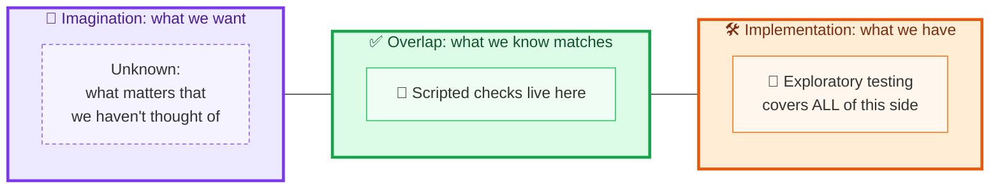

That leaves a lot untested. With the phone field I'd also want other valid formats, invalid numbers, letters and symbols, different ranges, overflows, repeated submissions, and more. Exploratory testing covers **the whole implementation side**, going beyond expectations to find out what's *actually* happening.

| | Scripted checks | Exploratory testing |
|---|---|---|
| Source of expectation | Requirements and prior knowledge | Charter, oracles, heuristics, curiosity |
| Where it focuses | The overlap only | The whole implementation side |
| Finds | Whether known things are still true | Things nobody expected |
| Repeatable? | Very, which makes it a good candidate for automation | Never identical twice, by design |
| Best at | Regression | Discovery |

A good strategy uses **both**. In the next post I'll look at automation, because scripts tend to be algorithmic, which makes them excellent candidates. But to truly understand how an application works, I also want to give my team the chance to **explore with purpose, with just enough structure** to plan where exploration pays off most.

---

## Pitfalls, cheat sheet and summary

### Pitfalls I try to avoid

| Pitfall | Why it hurts | What I do instead |
|---|---|---|
| Treating exploratory testing as "just poking around" | No focus, no way to report or repeat | Write a charter first |
| Over-prescriptive charters | They turn into scripts | Aim for a goal, not steps |
| Vague charters ("test the API") | I can't tell if I succeeded or went off charter | Name a target and a risk |
| Raising every oddity as a bug | I lose credibility | Use oracles, then triage with the team |
| Trusting one oracle | Oracles are fallible | Cross-check; talk to people |
| Treating heuristics as a checklist | I stop thinking | Use them as triggers; drop the ones that don't help |
| Letting tools do the thinking | Tools only notice what I told them to | Keep the questions human |
| Poor or no notes | I can't share or revisit | Pick a note style and experiment |
| Ignoring fatigue | I miss things | Time-box and stop |
| Skipping the debrief | Findings die in my head | Always share, even for ten minutes |

### Cheat sheet

| Stage | Question to ask | Output |
|---|---|---|
| Risk | What could go wrong? | A prioritised risk list |
| Charter | What will I explore, with what, to discover what? | A short, measurable statement |
| Plan | How many sessions, in what order? | A visible schedule and a list of unexplored charters |
| Session | Design → execute → analyse → learn, repeat | Observations and new ideas |
| Judge | Does this violate an oracle? | Potential issues |
| Triage | Is it real? | Confirmed issues |
| Note | What do I need to share, and remember? | A map, paper notes or a recording |
| Stop | Out of ideas? Tired? Time up? Off charter? | A clean end |
| Debrief | What did we learn, and what's next? | Shared understanding and new charters |

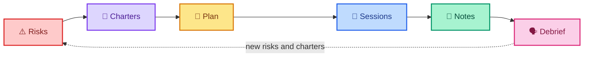

### Key takeaways

- **Exploratory testing is structured freedom.** It's a loop of design, execute, analyse and learn, steered by a charter.
- **Charters** are short, specific, measurable statements of intent that turn risks into sessions. Templates from Hendrickson, Dan Ashby and Michael D. Kelly all work.
- **Sessions** are time-boxed runs; one charter may need several sessions, because every session differs.
- **Charters organise work**, make trade-offs visible, show what I *won't* explore, and can drive regression decisions.
- **Oracles** (product, standards, familiarity, and many more) tell me when something isn't right, but they're fallible, so I triage with the team.
- **Heuristics and mnemonics** such as the Test Heuristic Cheat Sheet, BINMEN and POISED trigger ideas when mine run out, and they're triggers, not checklists.
- **Tools** such as data-driven runners, proxies and mocks let me run ideas that would be impractical by hand.
- **Notes** (mind maps, pen and paper, recordings) serve both tracking and sharing. Experiment to find what suits me.
- **Stop** when ideas run out, I'm tired, time's up, or I've drifted off charter. I can always run another session.
- **Debrief** to share findings and reflect on my testing.
- **Scripted checks cover the overlap; exploration covers the whole implementation side.** A strategy needs both.

### Quick glossary

| Term | Meaning |
|---|---|
| **Exploratory testing** | Simultaneously learning about a system while designing and executing tests, using each result to inform the next |
| **Charter** | A short, specific, measurable goal that guides an exploratory session |
| **Session** | A single time-boxed run of exploratory testing guided by a charter |
| **Off charter** | Exploring something unrelated to the session's charter |
| **Oracle** | A source of information used to judge whether an observation is a potential issue |
| **Heuristic** | A fallible cognitive shortcut that helps solve problems or generate test ideas |
| **Mnemonic** | A memory aid used as a heuristic (for example BINMEN or POISED) |
| **Data-driven testing** | Running the same test repeatedly with different data from a table |
| **Mock / stub** | A stand-in for a service, giving me control over its responses |
| **Session-based test management** | A technique, from James and Jon Bach, for managing exploratory sessions with time-boxes |
| **Debrief** | A conversation after a session to share findings and reflect on the testing |
| **Functional fixedness** | A bias in which focusing on one event makes me miss another |

### Where I go next

Exploration tells me how the system *really* behaves. But some of what I learn is worth keeping as a repeatable confirmation, so I don't have to rediscover it by hand every release. That's where **automation** comes in: capturing the overlap of what I want and what I have, and letting a machine re-check it tirelessly while I get on with exploring.

If I could leave you with one habit, it would be this: **write the charter before you start, and hold the debrief before you forget.** A charter without a session is a wish; a session without a debrief is a secret. Do both, and your exploration will carry real weight with your team.

---

*Source and credits:* this post is based on the chapter "Exploratory testing APIs". The testing loop and charter template come from Elisabeth Hendrickson's *Explore It!*; the other charter templates are credited there to Dan Ashby and Michael D. Kelly; the Test Heuristic Cheat Sheet to Elisabeth Hendrickson, James Lyndsay and Dale Emery; BINMEN to Gwen Diagram and Ash Winter; POISED to Amber Race; FEW HICCUPPS to Michael Bolton; session-based test management to James and Jon Bach; and the testing model to James Lyndsay. The Python charter tools, mock APIs, oracle assistants and tests are my own illustrations, written and run for this post, and the mock's behaviours are seeded by me.
