# From Strategy to Plan: How I Decide What to Test First, and How to Make It Happen

> **TL;DR:** I can't test everything, and neither can you. A **strategy** tells me *where I'm heading*: it comes from the pattern *quality characteristics → risks → testing activities*. A **plan** tells me *how I'll get there*, and it has to survive contact with reality, which is where **testability** (the 10 Ps), a **one-page test plan**, **small experiments** and regular **reflection** come in. In this post I walk through all of it using the `restful-booker-platform` sandbox and a hypothetical stocks platform, and I back it up with a small tested toolkit (24 passing tests) that turns the pattern into something I can actually run.

---

## Table of Contents

1. [Nobody can test everything](#nobody-can-test-everything)
2. [Recap: my two models](#recap-my-two-models)
3. [Identifying what's a priority](#identifying-whats-a-priority)
4. [Different contexts, different strategies](#different-contexts-different-strategies)
5. [Hands-on: the strategy pattern as code](#hands-on-the-strategy-pattern-as-code)
6. [From strategy to plan](#from-strategy-to-plan)
7. [Understanding testability: the 10 Ps](#understanding-testability-the-10-ps)
8. [Hands-on: testability changes the plan](#hands-on-testability-changes-the-plan)
9. [Organising and documenting a plan](#organising-and-documenting-a-plan)
10. [Executing and reflecting](#executing-and-reflecting)
11. [Evolving the strategy](#evolving-the-strategy)
12. [Pitfalls, cheat sheet and summary](#pitfalls-cheat-sheet-and-summary)

---

## Nobody can test everything

There's a sentence nearly every tester has said at some point: **"you can't test everything."** Budgets, deadlines, complexity and skills all squeeze the time I have to test and to learn. There is never enough of it. So I have to be *strategic* about what I test and, just as importantly, what I don't.

Over the last few posts I've explored three testing activities: testing API designs, exploratory testing and automated checks. Each focuses on a different part of the software lifecycle and a different kind of risk. But my talk about *strategy* has stayed abstract. How do I decide which activity comes first? How do I make sure the steps I choose actually get carried out? And since what works on one project often fails on another, what should I look for in my own context?

That's what this post is about: why there's **no one-size-fits-all strategy**, and the steps I take to find mine and start putting it into practice.

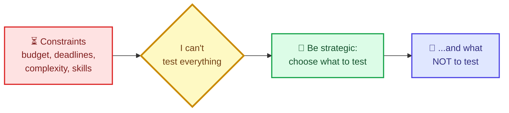

---

## Recap: my two models

I've leaned on two models throughout this series. This post puts them to work together, so a quick refresher.

**Model 1: imagination and implementation.** The purpose of testing is to learn about two things: what I *want* to build (imagination) and what I *have* built (implementation). The more I learn about both, the more the two circles overlap. Each activity works in a different place:

| Activity | Where it works | What it reveals |
|---|---|---|
| Testing API designs | **Imagination** | What the team wants, and whether it's shared |
| Exploratory testing | **Implementation** | What the system *really* does |
| Automated checks | **Overlap** | Whether what I already know is still true |

**Model 2: quality and risk.** From the quality and risk post: I define which **quality characteristics** matter to users and the business, then identify **risks** to those characteristics. Each risk is a stepping stone toward my strategy's goal of improving quality.

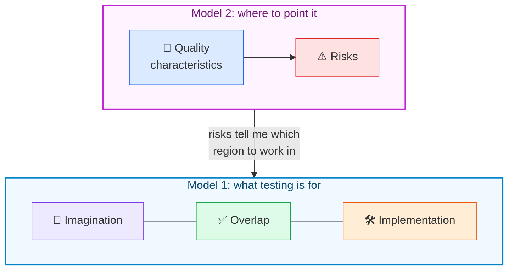

Neither model is a complete catalogue. There are more activities than I've covered, and later parts of the book add some. But with just these three I can already see the challenge: *what do I do first, and why?*

---

## Identifying what's a priority

It would be lovely to say "let's do all of it!". It's also unsustainable. A strategy helps me see what's available, what takes priority, and what to plan for in the short and medium term. Model 2 supplies the priority: **the higher the priority of a risk, the stronger the case for the activity that mitigates it.**

Here's the book's example. These are the top three risks I'd pick for the sandbox:

| Rank | Risk | Quality characteristic |
|---|---|---|
| 1 | Incorrect status codes or responses are sent on successful requests | Intuitiveness |
| 2 | Validation on APIs doesn't work as expected | Completeness |
| 3 | The admin is unable to update the look and feel of the guest pages | Completeness |

Now I ask, for each risk: *is this likely to come from a misunderstanding on the imagination side, or an unexpected side effect on the implementation side?* That takes skill and practice, but it's the key judgement. In the book, risk 1 points to **testing API designs** (agree what the right status codes and responses are, before they're built), while risks 2 and 3 point to **exploratory testing**. The result is a numbered strategy:

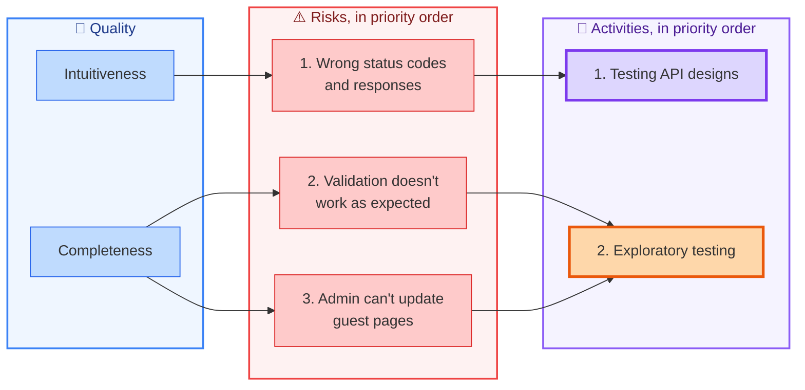

Notice the labels on the activities. **Testing API designs comes first** because it addresses my number-one risk. **Exploratory testing comes second** because it covers the other two. That pattern, using quality to guide which testing I do, is the heart of this chapter.

> **📝 Note:** The mapping from risk to activity is a *judgement*, not a lookup. Someone else might argue that risk 1 is best caught by automated checks. The value of writing it down is that the argument becomes visible and can be had.

---

## Different contexts, different strategies

The pattern is the same everywhere:

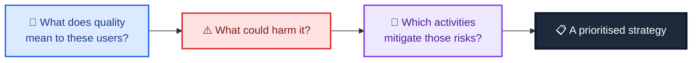

But the *answers* change with context. Quality depends on the industry (health care is not e-commerce) and on the domain (the Internet of Things is not Software as a Service). Following the pattern gives me a strategy that **reacts to what my users want and to my working context**.

To see that, consider a very different product: a **stocks and shares buying platform**. Its quality characteristics are likely to be things like:

- **Accuracy:** the right number of shares gets bought.
- **Responsiveness:** purchases happen quickly.
- **Auditability:** there's a trustworthy record of what happened.

Those produce different risks:

| Quality characteristic | Example risk |
|---|---|
| Accuracy | The number of shares purchased is too low or too high |
| Auditability | Laws and regulations are broken because audit logs hold incorrect purchase and sale details |
| Responsiveness | Shares aren't bought in a timely manner, so someone else buys them first |

And different risks lead to a different strategy, with a different priority and focus. The book calls this an oversimplification of a hypothetical project, and it is. But it shows that the *same* pattern produces the *right* strategy for each product and team.

> **⚠️ Caution:** Never copy someone else's strategy wholesale, including mine. A strategy that's perfect for a B&B booking site could be reckless for a trading platform. Copy the *pattern*, not the *answer*.

---

## Hands-on: the strategy pattern as code

Patterns are easier to trust when I can run them. I wrote a small module that takes risks (each with a quality characteristic, a priority rank and the activity I judge best placed to mitigate it) and produces a prioritised list of activities, plus a colour-coded Mermaid diagram like the ones above.

The rule is simple and deliberately explicit: **an activity's priority comes from the most worrying risk it mitigates.** Ties go to the activity covering more risks, then to the name, so the order is always deterministic.

> **⚠️ Caution: the judgements are mine.** The sandbox risks come from the book. The stocks risks come from the book's hypothetical, but *I* assigned the ranks and chose which activity mitigates each one. The book doesn't tell you what the stocks strategy looks like in detail, so treat that example as an illustration of *how the pattern behaves*, not as advice for trading platforms.

### `strategy.py`

```python
"""Quality characteristics -> risks -> testing activities -> a prioritised strategy."""
from collections import defaultdict
from dataclasses import dataclass

# Which circle of the imagination / implementation model each activity mostly works in
ACTIVITY_CIRCLE = {
    "Testing API designs": "imagination",
    "Contract testing": "imagination",
    "Exploratory testing": "implementation",
    "Performance testing": "implementation",
    "Automated API checks": "overlap",
}


@dataclass(frozen=True)
class Risk:
    name: str
    characteristic: str
    rank: int          # 1 = the risk I worry about most
    activity: str      # the activity I judge best able to mitigate it


def validate(risks):
    ranks = [r.rank for r in risks]
    if len(set(ranks)) != len(ranks):
        raise ValueError("Each risk needs its own rank: a tie hides a decision")
    for r in risks:
        if r.rank < 1:
            raise ValueError(f"Rank must be 1 or more: {r.name}")
        if r.activity not in ACTIVITY_CIRCLE:
            raise ValueError(f"Unknown activity {r.activity!r} for risk {r.name!r}")


def rank_activities(risks):
    """An activity's priority comes from the MOST worrying risk it mitigates.
    Ties go to the activity that covers more risks, then to the name."""
    validate(risks)
    groups = defaultdict(list)
    for r in risks:
        groups[r.activity].append(r)
    rows = [{"activity": a, "best_rank": min(x.rank for x in rs), "covers": len(rs),
             "risks": [x.name for x in sorted(rs, key=lambda x: x.rank)]}
            for a, rs in groups.items()]
    rows.sort(key=lambda row: (row["best_rank"], -row["covers"], row["activity"]))
    for position, row in enumerate(rows, 1):
        row["priority"] = position
    return rows


def strategy_mermaid(risks) -> str:
    """Characteristics -> risks (stepping stones) -> numbered activities."""
    rows = rank_activities(risks)
    priority = {row["activity"]: row["priority"] for row in rows}
    clean = lambda s: s.replace('"', "'")
    lines = ["flowchart LR"]
    for i, r in enumerate(sorted(risks, key=lambda r: r.rank)):
        lines.append(f'    Q{i}["{clean(r.characteristic)}"]:::quality --> R{i}["{r.rank}. {clean(r.name)}"]:::risk')
    for j, row in enumerate(rows):
        lines.append(f'    A{j}["{row["priority"]}. {clean(row["activity"])}"]:::{ACTIVITY_CIRCLE[row["activity"]]}')
    for i, r in enumerate(sorted(risks, key=lambda r: r.rank)):
        j = [row["activity"] for row in rows].index(r.activity)
        lines.append(f"    R{i} --> A{j}")
    lines += ["    classDef quality fill:#dbeafe,stroke:#2563eb,color:#1e3a8a",
              "    classDef risk fill:#fee2e2,stroke:#dc2626,color:#7f1d1d",
              "    classDef imagination fill:#ede9fe,stroke:#7c3aed,color:#4c1d95",
              "    classDef implementation fill:#ffedd5,stroke:#ea580c,color:#7c2d12",
              "    classDef overlap fill:#dcfce7,stroke:#16a34a,color:#14532d"]
    return "\n".join(lines)


# ---- Two contexts, one pattern. Ranks, characteristics-to-risk links and activity choices are MY judgement. ----
SANDBOX = [
    Risk("Incorrect status codes or responses on successful requests", "Intuitiveness", 1, "Testing API designs"),
    Risk("Validation on APIs doesn't work as expected", "Completeness", 2, "Exploratory testing"),
    Risk("Admin is unable to update the look and feel of guest pages", "Completeness", 3, "Exploratory testing"),
]

STOCKS = [
    Risk("Number of shares bought is too low or too high", "Accuracy", 1, "Automated API checks"),
    Risk("Audit logs hold incorrect purchase details, breaking regulations", "Auditability", 2, "Testing API designs"),
    Risk("Shares aren't bought in time, so someone else gets them", "Responsiveness", 3, "Performance testing"),
]
```

The same code, fed two different sets of risks, produces two different strategies:

| | Sandbox (B&B platform) | Stocks platform (my illustration) |
|---|---|---|
| Priority 1 | Testing API designs | Automated API checks |
| Priority 2 | Exploratory testing (covers two risks) | Testing API designs |
| Priority 3 | none | Performance testing |
| Why it differs | The top risk is about *agreeing what's right* | The top risk is a *calculation that must stay correct* |

Here is the stocks strategy as a diagram. This is the generator's output for the stocks risks, pasted in exactly as produced:

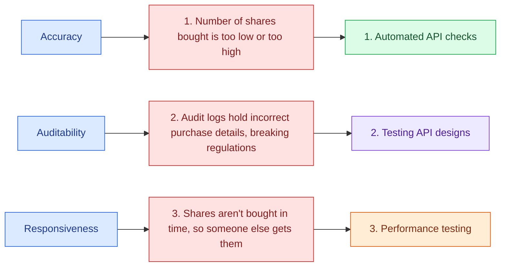

Look at the activity colours. Purple means the activity works on the **imagination** side, orange on the **implementation** side, and green in the **overlap**. A glance at the diagram tells me whether a strategy is lopsided: all purple means I'm only talking and never checking; all orange means I'm discovering without ever agreeing what "right" means.

> **💡 Tip:** I like that `rank_activities` *refuses* two risks with the same rank. A tie isn't neutrality, it's a decision I haven't made yet, and the tool makes me make it.

---

## From strategy to plan

A strategy maps the path I intend to take, but it lacks detail. It's the *vision*. To reach it I need a **plan**, because the vision will collide with reality almost immediately. I might want a new automation framework and discover the team lacks the skills to build it. I might want to run API design sessions and find the team is spread across too many time zones.

So planning means doing four things:

| Principle | What it means | Why |
|---|---|---|
| **Identify my constraints** | Understand how easy or hard testing is in this context | No point planning API design sessions if the team is remote and has no design meetings |
| **Organise and communicate** | Share the *right amount* of detail | Others can only help with a plan they understand |
| **Plan iteratively, in small chunks** | Implement specific activities, not the whole strategy at once | Less upfront investment, easier to track, easier to change course |
| **Reflect and react** | Learn as I go and adapt | Plans rarely survive unchanged |

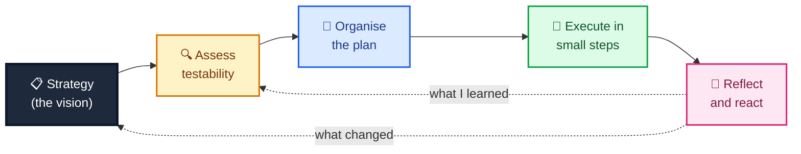

---

## Understanding testability: the 10 Ps

**Testability** is anything that affects my ability to test, from the product I'm testing to the people involved in the project. Each aspect makes a given testing activity either harder or easier. If I assess testability, I can promote the positive influences and reduce or remove the negative ones.

The best starting point I know is the **10 Ps of Testability**, created by Rob Meaney and Ash Winter and explored in their *Team Guide to Software Testability*. Here are the ten, with the questions each one prompts:

| P | What it covers | A question I ask |
|---|---|---|
| **People** | Individual skills, knowledge and mindset about testing | Can the people here actually carry out the activity I'm planning? |
| **Philosophy** | The team's shared beliefs and attitudes | Does the team believe in quality and the value of testing? |
| **Product** | How it's built, the technology, ease of deployment and access | Is it hard to deploy, hard to reach, or constantly crashing? |
| **Process** | How work is delivered, in small chunks or large releases | Do rare, huge releases make automation fragile and testing frantic? |
| **Project** | Length, deadlines and funding | Do I have the time and budget, including for any training I need? |
| **Problem** | Understanding what the software solves and how users use it | Do I really understand the problem and the users? |
| **Pipeline** | Where testing happens as the product is built and shipped | Do we even have a pipeline? Where would automation run? |
| **Productivity** | How productive the team is at finding issues, in the long and short term | What's draining us: culture, illness, meetings, mental health? |
| **Production issues** | How often problems reach production and how well we handle them | Do few issues mean spare time, or poor feedback loops? |
| **Proactivity** | How open the team is to improving testing regularly | Are there chances to reflect and improve, or do I need to create them? |

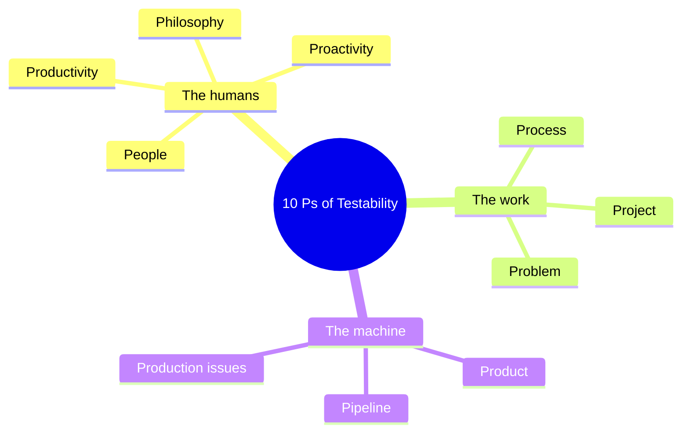

(The grouping above is mine, just to make ten items easier to hold in my head. The model itself doesn't group them.)

### The problem is rarely where it first appears

The book tells a story I think is worth remembering. A project had trouble establishing a test environment, which looks like a **Pipeline** problem. Digging deeper, the real cause was two senior executives competing for next year's budget and deliberately disrupting each other's departments. That's a **Philosophy** problem. Not every testability issue is that extreme, but the lesson holds: the cause often sits in a different "P" from the symptom.

> **📝 Note:** Testability analysis takes time, and I won't uncover everything up front. That's fine. I assess enough to plan sensibly, then keep learning as I go.

### Other models

The 10 Ps isn't the only way to look at testability. Others include James Bach's *Heuristics of Software Testability* and Maria Kedemo and Ben Kelly's *Dimensions of Testability*. They overlap, but each frames things a little differently, which can prompt different questions about my own context. I'd explore more than one.

### Using what I learn

Testability findings become **actions** in my plan. If the team has limited automation experience and I want a new tool, I factor in training or time to get familiar.

It can also make me **reprioritise**. If an activity is going to need heavy investment in a low-testability context, I can weigh the cost against the risk and ask whether other risks are quicker and cheaper to address. That doesn't mean giving up on the original idea. It means acknowledging that some streams need long-term investment so I don't put all my eggs in one basket and end up back at square one.

---

## Hands-on: testability changes the plan

This is the part I most wanted to try in code, because it turns "testability affects my plan" from a slogan into a visible consequence.

I added a small module where I (or my team) score each of the 10 Ps from 1 to 5. For each activity, it averages only the Ps that matter for *that* activity, flags the weak ones as concerns, and then re-orders my plan by combining **value** (how much worry the activity addresses) with **readiness**.

> **⚠️ Caution: heuristics, not science.** Three things here are my own choices, and you should challenge them: (1) **which Ps matter for which activity**, (2) the **value formula**: each risk is weighted `2 ** (n − rank)`, so the top risk counts double the next, and (3) the **thresholds**: a score of 2 or less is a "concern", and 3.5 or more is "start now". The book gives no formula. Change mine to suit you. The point is the *conversation* it starts.

### `testability.py`

```python
"""The 10 Ps of Testability as a scoring aid, and what it does to my plan."""
from strategy import rank_activities

PS = ["People", "Philosophy", "Product", "Process", "Project",
      "Problem", "Pipeline", "Productivity", "Production issues", "Proactivity"]

# Which Ps I think matter most for each activity. This mapping is MY judgement, for illustration.
ACTIVITY_NEEDS = {
    "Testing API designs": ["People", "Philosophy", "Process", "Proactivity", "Problem"],
    "Exploratory testing": ["People", "Product", "Productivity", "Problem"],
    "Automated API checks": ["People", "Product", "Pipeline", "Project", "Process"],
    "Performance testing": ["People", "Product", "Pipeline", "Project"],
    "Contract testing": ["Philosophy", "Process", "Pipeline", "Product"],
}

CONCERN_AT_OR_BELOW = 2     # a score of 1 or 2 out of 5 is a concern
READY_AT_OR_ABOVE = 3.5     # my threshold for "start now"


def check_scores(scores: dict):
    for p, s in scores.items():
        if p not in PS:
            raise ValueError(f"Not one of the 10 Ps: {p!r}")
        if not isinstance(s, int) or not 1 <= s <= 5:
            raise ValueError(f"Score for {p} must be a whole number from 1 to 5, got {s!r}")


def readiness(activity: str, scores: dict) -> dict:
    """How ready is this context for this activity? (average of the Ps it needs)."""
    check_scores(scores)
    needs = ACTIVITY_NEEDS[activity]
    known = [p for p in needs if p in scores]
    average = round(sum(scores[p] for p in known) / len(known), 2) if known else None
    return {"score": average,
            "concerns": [p for p in known if scores[p] <= CONCERN_AT_OR_BELOW],
            "unknown": [p for p in needs if p not in scores]}


def plan_order(risks, scores):
    """Value of an activity = the worry it addresses, with each risk weighted 2 ** (n - rank), so
    the top risk counts double the next one. Weighted by readiness: effective = value * readiness / 5.
    A heuristic to start a conversation, not a rule."""
    rows = rank_activities(risks)
    n = len(risks)
    out = []
    for row in rows:
        value = sum(2 ** (n - r.rank) for r in risks if r.activity == row["activity"])
        ready = readiness(row["activity"], scores)
        if ready["score"] is None:
            raise ValueError(f"No scores at all for the Ps that {row['activity']} needs")
        effective = round(value * ready["score"] / 5, 2)
        out.append({"activity": row["activity"], "risk_priority": row["priority"], "value": value,
                    "readiness": ready["score"], "effective": effective,
                    "concerns": ready["concerns"],
                    "advice": "start now" if ready["score"] >= READY_AT_OR_ABOVE else "invest in the concerns first"})
    out.sort(key=lambda r: (-r["effective"], r["risk_priority"]))
    return out
```

### What the same strategy looks like in two teams

I ran the sandbox strategy through two imaginary teams. One is **co-located and willing**, scoring 4 on every P. The other is **remote with no design sessions**: the same scores, except Process 1, Philosophy 2 and Proactivity 2.

The output below is from the real run of `demo.py`, shown in full near the end of this post. The important part:

| Team | 1st | 2nd | Why |
|---|---|---|---|
| Co-located, willing | **Testing API designs** (effective 3.2) | Exploratory testing (2.4) | Design testing addresses my top risk, and the team is ready for it |
| Remote, no design sessions | **Exploratory testing** (2.4) | Testing API designs (2.08), *invest in the concerns first (Philosophy, Process, Proactivity)* | The same risk is still the top priority, but I can't act on it yet |

That reordering is the whole idea of this section. My *strategy* didn't change: design testing still mitigates my most worrying risk. But my *plan* changed, because I can't do design testing well tomorrow in a team without the culture or the meetings for it. So I start with exploration while I invest in the three weak Ps.

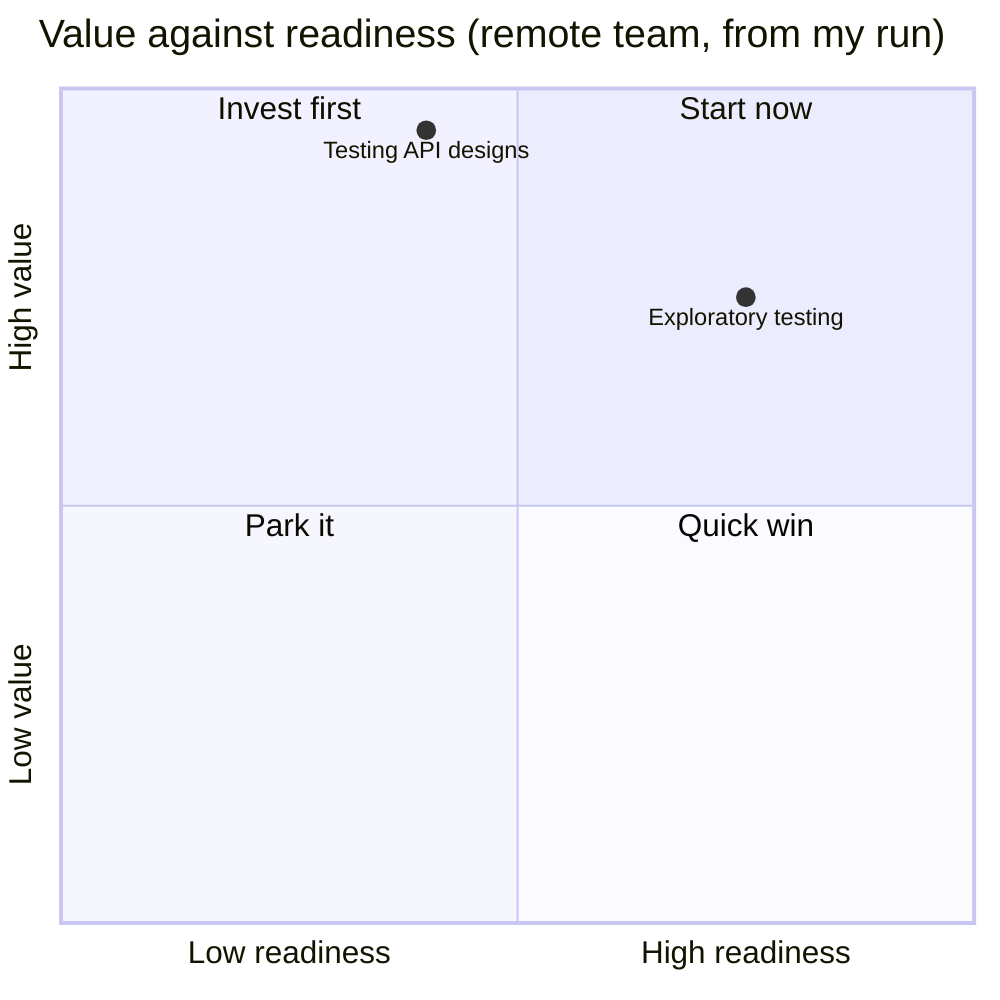

*(Positions are approximate: readiness is scaled from the 1 to 5 scores, and value from 0 to the maximum of 4.)*

Testing API designs lands in **"invest first"**: high value, low readiness. Exploratory testing lands in **"start now"**. That's a much more useful picture than a flat to-do list.

> **💡 Tip:** I like the "invest in the concerns first" advice because it turns a gloomy finding into a task. "Our Process score is 1" is a complaint. "Run a two-week experiment to get design discussions into an existing meeting" is an action I can put in my plan.

> **⚠️ Caution:** Scores are opinions. If I score my own team alone, I'll probably mislead myself. Scoring together, with disagreements recorded rather than averaged away, is where the real information is.

---

## Organising and documenting a plan

Test plans have a bad reputation, and I understand why. Traditionally they were large, detailed documents trying to capture everything. Thorough, yes, but also dense, hard to read and impossible to keep up to date as things inevitably changed. So many teams abandon test plans altogether, usually citing the agile principle of **working software over comprehensive documentation**.

But that principle is often misread. It isn't a call to abandon documentation. It's a call for a sober, **value-driven** approach to it: some documentation is fine, provided it helps us deliver working software first. The same applies to my test plan. I can strike a balance between too much detail and too vague.

Lisa Crispin and Janet Gregory make this case in *Agile Testing*: keep the plan lightweight, covering the necessities and no extras, and they suggest a plan can fit on a single page. Claire Reckless develops the idea in "The One-Page Test Plan", with formats ranging from a one-page Word document to a dashboard. Her argument, paraphrased: a busy manager handed a many-page document may never read it, but a short one they can take in at a glance has a far better chance. Whatever the format, the goal is the same: **a plan that clearly states my intent to the team**, and that I make my own.

### What goes in it

For my example (getting my team to adopt *testing API designs*), I can use six sections, taking all or only some of them:

| Section | What it holds | Example for my plan |
|---|---|---|
| **Introduction** | What the plan is about and covers | A plan for a team-based approach to testing web API designs |
| **Risks** | Risks to the *plan* itself, often found while assessing testability | The team is unfamiliar with collaborative sessions; a remote team may struggle to connect |
| **Assumptions** | What I'm assuming about how well I can test | The team already has informal API design conversations I can join |
| **Tools** | What I intend to use | Swagger tooling, from the API design post |
| **Resources** | Time, training, budget | Coaching from an outside source, perhaps |
| **Scope** | What's in and out | In: APIs we design ourselves. Out: APIs we merely depend on |

Notice that the **Risks** and **Assumptions** sections come straight from the testability analysis. That's the thread connecting the whole chapter: I assess testability, so I know what to write down.

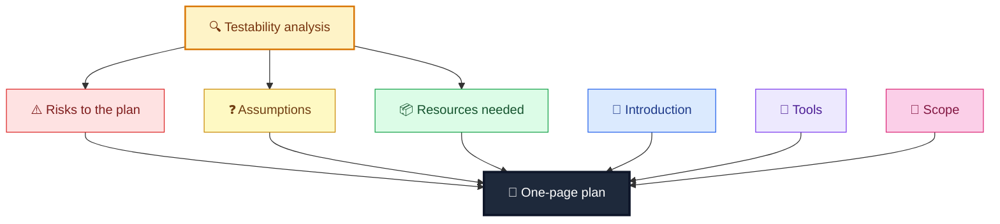

### The plan, as a checkable template

If a plan is meant to be short, I can *check* that it is. I wrote a tiny renderer that insists on the six sections (in order), refuses sections that don't belong, and reports whether the result fits my own one-page limit.

> **⚠️ Caution:** The 350-word limit is arbitrary. It's *my* rule of thumb for "one page", so change it. And a plan that fits the limit isn't necessarily a *good* plan. The check catches bloat, not bad thinking.

```python
"""A lightweight test plan: six sections, kept deliberately short."""
SECTIONS = ["Introduction", "Risks", "Assumptions", "Tools", "Resources", "Scope"]
MAX_WORDS = 350   # my own limit for 'fits on one page'; pick yours


class PlanError(ValueError):
    pass


def _as_lines(value):
    return value if isinstance(value, list) else [value]


def validate(plan: dict):
    missing = [s for s in SECTIONS if not plan.get(s)]
    if missing:
        raise PlanError(f"Missing or empty sections: {', '.join(missing)}")
    unknown = [s for s in plan if s not in SECTIONS]
    if unknown:
        raise PlanError(f"Not part of a one-page plan: {', '.join(unknown)}")


def render(plan: dict, title: str) -> str:
    validate(plan)
    out = [f"# {title}", ""]
    for section in SECTIONS:
        lines = _as_lines(plan[section])
        out.append(f"## {section}")
        out += [f"- {line}" for line in lines] if len(lines) > 1 else [lines[0]]
        out.append("")
    return "\n".join(out).rstrip() + "\n"


def word_count(text: str) -> int:
    return len(text.split())


def fits_on_one_page(plan: dict, title: str = "Plan") -> bool:
    return word_count(render(plan, title)) <= MAX_WORDS


API_DESIGN_PLAN = {
    "Introduction": "A plan to introduce team-based testing of web API designs for the sandbox.",
    "Risks": ["The team is unfamiliar with collaborative design sessions.",
              "Remote team members may struggle to connect at the same time."],
    "Assumptions": ["Informal conversations about API designs already happen and we can join them."],
    "Tools": ["Swagger / OpenAPI to capture designs", "A whiteboard or diagram tool for sketches"],
    "Resources": ["About two hours a week from me and one developer",
                  "Possible outside coaching on running design sessions"],
    "Scope": ["In: APIs we design ourselves", "Out: APIs we merely depend on"],
}
```

Rendered from the sample data, the plan is 110 words, comfortably one page. You'll see the full text in the demo output below.

---

## Executing and reflecting

The poet Robert Burns reminded us that the best-laid plans often go awry. I can't test everything, and I can't plan for everything either. Contexts change: budgets move, deadlines shift, people leave and join. Analysing testability takes time, so I won't have found everything in advance. What I can do is **execute in a way that lets me spot problems and react quickly.**

### Execution: small experiments

Rather than adopting a new activity wholesale, with a full process and a launch meeting, I treat each step as a **short, small experiment**. Convening an entire team for a formal "let's talk API design" meeting can be hard to organise and, as the author notes from experience, can be met with open hostility if it goes badly. Smaller steps ease people in and let me react to resistance. For testing API designs, that might be:

1. **Tell** the team I'd like to start testing API designs, and **survey** for interest.
2. Run an **informal session** with interested people, framed as an experiment.
3. **Reflect**, tweak, and run another.
4. **Share successes**, aim to make the sessions part of the regular process, and invite others.

Each step can take several iterations, and this glosses over the complexity of influencing change in a team. But the benefit is clear: after each step I can reflect and replan. If at step 1 nobody is interested, I need a different approach, and I find out in days, not months.

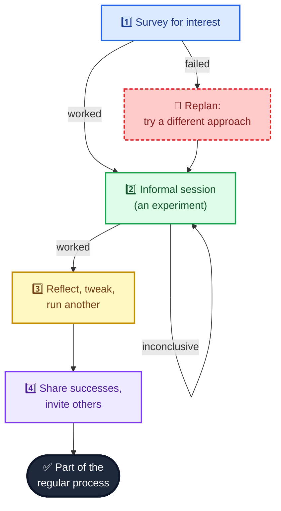

I wrote an **experiment tracker** that models exactly this. Each step has a status. Recording an outcome (*worked*, *failed* or *inconclusive*) moves things along: *worked* advances; *inconclusive* leaves the step pending so I tweak and try again; and *failed* **forces a replan** before anything else can happen.

```python
"""Small steps, with a built-in moment to reflect and replan."""
from dataclasses import dataclass, field

OUTCOMES = ("worked", "failed", "inconclusive")


@dataclass
class Step:
    text: str
    status: str = "pending"      # pending | worked | failed | replaced
    attempts: int = 0
    notes: list = field(default_factory=list)


class ExperimentPlan:
    def __init__(self, texts):
        self.steps = [Step(t) for t in texts]
        self.history = []        # every reflection, in order

    def next_action(self):
        """('replan', step) after a failure, ('do', step) for the next pending step, else ('done', None)."""
        for step in self.steps:
            if step.status == "failed":
                return "replan", step
        for step in self.steps:
            if step.status == "pending":
                return "do", step
        return "done", None

    def record(self, step: Step, outcome: str, note: str = ""):
        if outcome not in OUTCOMES:
            raise ValueError(f"Outcome must be one of {OUTCOMES}")
        if step.status not in ("pending",):
            raise ValueError("Only a pending step can be reflected on")
        step.attempts += 1
        step.notes.append(note)
        self.history.append((step.text, outcome, note))
        if outcome == "worked":
            step.status = "worked"
        elif outcome == "failed":
            step.status = "failed"
        # inconclusive: stays pending, so I tweak and try again

    def replan(self, step: Step, alternative: str):
        if step.status != "failed":
            raise ValueError("Only a failed step can be replanned")
        step.status = "replaced"
        self.steps.insert(self.steps.index(step) + 1, Step(alternative))
        self.history.append((step.text, "replanned", alternative))

    def summary(self):
        return [(s.text, s.status, s.attempts) for s in self.steps]


API_DESIGN_STEPS = [
    "Tell the team I'd like to start testing API designs, and survey for interest",
    "Run an informal session with interested people, labelled as an experiment",
    "Reflect on the session, tweak, and run another",
    "Share the successes, make sessions part of the regular process, invite others",
]
```

> **📝 Note:** The tracker deliberately won't let me quietly skip a failed step. In real life it's tempting to ignore the survey nobody answered and move on to the session anyway. The tool makes the failure a decision point.

### Reflection

Small steps are worthless if I never look at how they're going. So I build in ways to assess progress and change course:

| Mechanism | How I use it |
|---|---|
| **Retrospectives** | The team is already together, so I ask how my plans are helping, and share my own gut feeling about whether quality has improved and whether my changes contributed |
| **Experiment models** (e.g., Claudio Perrone's *Popcorn Flow*) | A structured way to introduce ideas, measure them and learn, in a lean mindset, though it needs some investment and buy-in from the team |
| **Conversations** | Simply talking: showing others what I'm doing and asking for feedback. Testing is often poorly communicated, which hides its complexity and value. Sharing invites them to show me how I can help. |

> **💡 Tip:** My testing goal is to help the team improve quality. So the question to bring to a retrospective isn't "how many tests did I run?" but "**is the team's quality getting better, and is what I'm doing helping?**"

---

## Evolving the strategy

By assessing testability, organising a plan, executing it and reflecting, the vision of my strategy starts to become real. But the work changes, and so do the risks that affect it. So my strategy and plans have to **adapt constantly**. As I regularly revisit what quality means to users and which risks follow from that, the priority of which testing to do when will change. Whether I'm introducing a new activity or maintaining an old one, following the pattern tells me where to spend my energy now and where to hold back until it's needed.

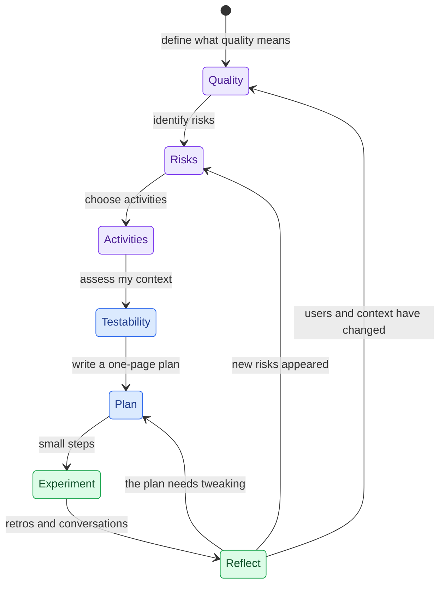

### Tests for the toolkit, and the full run

All five modules above are covered by one test file. Highlights:

- The sandbox strategy ranks API design testing first and exploratory second, exactly as the chapter describes.
- The stocks risks produce a *different* ordering from the same code.
- Two risks with the same rank are refused, and unknown activities too.
- A weak testability score on the right Ps changes what I start with (and a weak score on a P that *doesn't* matter for an activity doesn't).
- Missing scores are reported as unknown, never guessed.
- The plan renderer refuses missing sections, unknown sections and bloat.
- A failed experiment forces a replan, an inconclusive one repeats the step, and history is kept.

```python
import unittest

import experiments as exp
import one_page_plan as opp
import strategy as st
import testability as tb


class StrategyTests(unittest.TestCase):
    def test_sandbox_strategy_matches_the_chapters_priorities(self):
        rows = st.rank_activities(st.SANDBOX)
        self.assertEqual([r["activity"] for r in rows], ["Testing API designs", "Exploratory testing"])
        self.assertEqual(rows[1]["covers"], 2)

    def test_same_pattern_different_context_gives_a_different_strategy(self):
        sandbox = [r["activity"] for r in st.rank_activities(st.SANDBOX)]
        stocks = [r["activity"] for r in st.rank_activities(st.STOCKS)]
        self.assertNotEqual(sandbox, stocks)
        self.assertEqual(stocks, ["Automated API checks", "Testing API designs", "Performance testing"])

    def test_a_higher_priority_risk_lifts_its_activity(self):
        risks = [st.Risk("a", "X", 1, "Exploratory testing"), st.Risk("b", "X", 2, "Testing API designs"),
                 st.Risk("c", "X", 3, "Testing API designs")]
        self.assertEqual(st.rank_activities(risks)[0]["activity"], "Exploratory testing")

    def test_ties_on_rank_are_refused_and_unknown_activities_too(self):
        with self.assertRaises(ValueError):
            st.rank_activities([st.Risk("a", "X", 1, "Exploratory testing"), st.Risk("b", "X", 1, "Exploratory testing")])
        with self.assertRaises(ValueError):
            st.rank_activities([st.Risk("a", "X", 1, "Astrology")])

    def test_mermaid_is_numbered_and_colour_coded(self):
        text = st.strategy_mermaid(st.SANDBOX)
        self.assertTrue(text.startswith("flowchart LR"))
        self.assertIn('"1. Testing API designs"]:::imagination', text)
        self.assertIn('"2. Exploratory testing"]:::implementation', text)
        self.assertEqual(text.count(":::risk"), 3)

    def test_quotes_cannot_break_the_diagram(self):
        text = st.strategy_mermaid([st.Risk('a "quoted" risk', "X", 1, "Exploratory testing")])
        self.assertNotIn('"quoted"', text)


GOOD = {p: 4 for p in tb.PS}
REMOTE = {**GOOD, "Process": 1, "Philosophy": 2, "Proactivity": 2}


class TestabilityTests(unittest.TestCase):
    def test_readiness_averages_only_the_relevant_ps(self):
        r = tb.readiness("Testing API designs", {**GOOD, "Pipeline": 1})
        self.assertEqual(r["score"], 4.0)         # Pipeline isn't needed for design testing
        self.assertEqual(r["concerns"], [])

    def test_concerns_name_the_weak_ps(self):
        r = tb.readiness("Testing API designs", REMOTE)
        self.assertEqual(sorted(r["concerns"]), ["Philosophy", "Proactivity", "Process"])
        self.assertLess(r["score"], tb.READY_AT_OR_ABOVE)

    def test_bad_scores_are_rejected(self):
        for bad in ({"People": 0}, {"People": 6}, {"Pizza": 3}, {"People": 3.5}):
            with self.assertRaises(ValueError):
                tb.check_scores(bad)

    def test_missing_scores_are_reported_not_guessed(self):
        r = tb.readiness("Automated API checks", {"People": 4, "Product": 4})
        self.assertEqual(r["unknown"], ["Pipeline", "Project", "Process"])
        self.assertEqual(r["score"], 4.0)

    def test_good_testability_keeps_the_risk_order(self):
        order = [r["activity"] for r in tb.plan_order(st.SANDBOX, GOOD)]
        self.assertEqual(order, ["Testing API designs", "Exploratory testing"])

    def test_low_testability_can_change_what_I_start_with(self):
        order = tb.plan_order(st.SANDBOX, REMOTE)
        self.assertEqual(order[0]["activity"], "Exploratory testing")
        design = next(r for r in order if r["activity"] == "Testing API designs")
        self.assertEqual(design["advice"], "invest in the concerns first")

    def test_no_data_at_all_is_an_error(self):
        with self.assertRaises(ValueError):
            tb.plan_order(st.SANDBOX, {})


class PlanTests(unittest.TestCase):
    def test_sample_plan_has_every_section_in_order(self):
        text = opp.render(opp.API_DESIGN_PLAN, "API design testing plan")
        positions = [text.index(f"## {s}") for s in opp.SECTIONS]
        self.assertEqual(positions, sorted(positions))

    def test_sample_plan_fits_on_one_page(self):
        self.assertTrue(opp.fits_on_one_page(opp.API_DESIGN_PLAN, "API design testing plan"))

    def test_missing_or_unknown_sections_are_refused(self):
        broken = {k: v for k, v in opp.API_DESIGN_PLAN.items() if k != "Scope"}
        with self.assertRaises(opp.PlanError):
            opp.render(broken, "x")
        with self.assertRaises(opp.PlanError):
            opp.render({**opp.API_DESIGN_PLAN, "Appendix A": "..."}, "x")

    def test_a_bloated_plan_is_flagged(self):
        bloated = {**opp.API_DESIGN_PLAN, "Introduction": "word " * 500}
        self.assertFalse(opp.fits_on_one_page(bloated))


class ExperimentTests(unittest.TestCase):
    def setUp(self):
        self.plan = exp.ExperimentPlan(exp.API_DESIGN_STEPS)

    def test_steps_come_in_order(self):
        action, step = self.plan.next_action()
        self.assertEqual(action, "do")
        self.assertIn("survey", step.text)

    def test_success_moves_on(self):
        _, step = self.plan.next_action()
        self.plan.record(step, "worked", "five people interested")
        self.assertIn("informal session", self.plan.next_action()[1].text)

    def test_inconclusive_means_try_again_not_move_on(self):
        _, step = self.plan.next_action()
        self.plan.record(step, "inconclusive", "only one reply")
        action, same = self.plan.next_action()
        self.assertEqual((action, same.attempts), ("do", 1))
        self.assertIs(same, step)

    def test_failure_forces_a_replan_before_anything_else(self):
        _, step = self.plan.next_action()
        self.plan.record(step, "failed", "nobody is interested")
        action, failed = self.plan.next_action()
        self.assertEqual(action, "replan")
        self.plan.replan(failed, "Pair with one developer on a single story")
        action, nxt = self.plan.next_action()
        self.assertEqual((action, nxt.text), ("do", "Pair with one developer on a single story"))
        self.assertEqual(self.plan.summary()[0][1], "replaced")

    def test_cannot_replan_a_step_that_has_not_failed(self):
        with self.assertRaises(ValueError):
            self.plan.replan(self.plan.steps[0], "anything")

    def test_finishing_everything_is_done_and_history_is_kept(self):
        while True:
            action, step = self.plan.next_action()
            if action == "done":
                break
            self.plan.record(step, "worked", "ok")
        self.assertEqual(len(self.plan.history), 4)

    def test_unknown_outcomes_are_rejected(self):
        with self.assertRaises(ValueError):
            self.plan.record(self.plan.steps[0], "shrugged")


if __name__ == "__main__":
    unittest.main(verbosity=2)
```

```bash
python3 test_strategy_chapter.py
```

```text
test_cannot_replan_a_step_that_has_not_failed  ... ok
test_failure_forces_a_replan_before_anything_else  ... ok
test_finishing_everything_is_done_and_history_is_kept  ... ok
test_inconclusive_means_try_again_not_move_on  ... ok
test_steps_come_in_order  ... ok
test_success_moves_on  ... ok
test_unknown_outcomes_are_rejected  ... ok
test_a_bloated_plan_is_flagged  ... ok
test_missing_or_unknown_sections_are_refused  ... ok
test_sample_plan_fits_on_one_page  ... ok
test_sample_plan_has_every_section_in_order  ... ok
test_a_higher_priority_risk_lifts_its_activity  ... ok
test_mermaid_is_numbered_and_colour_coded  ... ok
test_quotes_cannot_break_the_diagram  ... ok
test_same_pattern_different_context_gives_a_different_strategy  ... ok
test_sandbox_strategy_matches_the_chapters_priorities  ... ok
test_ties_on_rank_are_refused_and_unknown_activities_too  ... ok
test_bad_scores_are_rejected  ... ok
test_concerns_name_the_weak_ps  ... ok
test_good_testability_keeps_the_risk_order  ... ok
test_low_testability_can_change_what_I_start_with  ... ok
test_missing_scores_are_reported_not_guessed  ... ok
test_no_data_at_all_is_an_error  ... ok
test_readiness_averages_only_the_relevant_ps  ... ok

----------------------------------------------------------------------
Ran 24 tests in 0.01s

OK
```

And the demo that produced the tables above:

```python
import experiments as exp
import one_page_plan as opp
import strategy as st
import testability as tb

for name, risks in (("Sandbox (B&B platform)", st.SANDBOX), ("Stocks and shares platform", st.STOCKS)):
    print(f"== {name}")
    for row in st.rank_activities(risks):
        print(f"  {row['priority']}. {row['activity']:<22} covers {row['covers']} risk(s); top risk rank {row['best_rank']}")

GOOD = {p: 4 for p in tb.PS}
REMOTE = {**GOOD, "Process": 1, "Philosophy": 2, "Proactivity": 2}
for label, scores in (("co-located, willing team", GOOD), ("remote team, no design sessions", REMOTE)):
    print(f"\n== Sandbox plan order, {label}")
    print(f"  {'activity':<22}{'value':>6}{'ready':>7}{'effective':>11}  advice")
    for r in tb.plan_order(st.SANDBOX, scores):
        extra = f" (concerns: {', '.join(r['concerns'])})" if r["concerns"] else ""
        print(f"  {r['activity']:<22}{r['value']:>6}{r['readiness']:>7}{r['effective']:>11}  {r['advice']}{extra}")

print("\n== One-page plan")
text = opp.render(opp.API_DESIGN_PLAN, "Testing API designs: plan")
print(text, end="")
print(f"({opp.word_count(text)} words; limit {opp.MAX_WORDS})")

print("\n== Experiment walk-through")
plan = exp.ExperimentPlan(exp.API_DESIGN_STEPS)
script = [("failed", "survey: nobody replied"), ("worked", "pairing on one story went well"),
          ("inconclusive", "first informal session was too short"), ("worked", "second session found two issues"),
          ("worked", "team agreed to try it for a sprint")]
for outcome, note in script:
    action, step = plan.next_action()
    if action == "replan":
        plan.replan(step, "Pair with one developer on a single story")
        action, step = plan.next_action()
    print(f"  {action:<7}{step.text[:64]:<66}-> {outcome}")
    plan.record(step, outcome, note)
print("  next:", plan.next_action()[0])
for text_, status, attempts in plan.summary():
    print(f"  [{status:<8}] x{attempts}  {text_[:70]}")
```

```text
== Sandbox (B&B platform)
  1. Testing API designs    covers 1 risk(s); top risk rank 1
  2. Exploratory testing    covers 2 risk(s); top risk rank 2
== Stocks and shares platform
  1. Automated API checks   covers 1 risk(s); top risk rank 1
  2. Testing API designs    covers 1 risk(s); top risk rank 2
  3. Performance testing    covers 1 risk(s); top risk rank 3

== Sandbox plan order, co-located, willing team
  activity               value  ready  effective  advice
  Testing API designs        4    4.0        3.2  start now
  Exploratory testing        3    4.0        2.4  start now

== Sandbox plan order, remote team, no design sessions
  activity               value  ready  effective  advice
  Exploratory testing        3    4.0        2.4  start now
  Testing API designs        4    2.6       2.08  invest in the concerns first (concerns: Philosophy, Process, Proactivity)

== One-page plan
# Testing API designs: plan

## Introduction
A plan to introduce team-based testing of web API designs for the sandbox.

## Risks
- The team is unfamiliar with collaborative design sessions.
- Remote team members may struggle to connect at the same time.

## Assumptions
Informal conversations about API designs already happen and we can join them.

## Tools
- Swagger / OpenAPI to capture designs
- A whiteboard or diagram tool for sketches

## Resources
- About two hours a week from me and one developer
- Possible outside coaching on running design sessions

## Scope
- In: APIs we design ourselves
- Out: APIs we merely depend on
(110 words; limit 350)

== Experiment walk-through
  do     Tell the team I'd like to start testing API designs, and survey   -> failed
  do     Pair with one developer on a single story                         -> worked
  do     Run an informal session with interested people, labelled as an e  -> inconclusive
  do     Run an informal session with interested people, labelled as an e  -> worked
  do     Reflect on the session, tweak, and run another                    -> worked
  next: do
  [replaced] x1  Tell the team I'd like to start testing API designs, and survey for in
  [worked  ] x1  Pair with one developer on a single story
  [worked  ] x2  Run an informal session with interested people, labelled as an experim
  [worked  ] x1  Reflect on the session, tweak, and run another
  [pending ] x0  Share the successes, make sessions part of the regular process, invite
```

That last block is the part I find most convincing. I scripted a rough experiment in which the survey failed, the pairing alternative worked, the first informal session was inconclusive and the second worked. The tracker records one replaced step and one step with two attempts, which is a fair picture of how real adoption goes: never a straight line.

---

## Pitfalls, cheat sheet and summary

### Pitfalls I try to avoid

| Pitfall | Why it hurts | What I do instead |
|---|---|---|
| Copying another team's strategy | Their quality and risks aren't mine | Follow the pattern, then fill in my own answers |
| Treating risk-to-activity mapping as obvious | Hidden disagreements surface mid-project | Write the mapping down and argue about it early |
| Adopting every activity at once | Unsustainable, and impossible to tell what's working | Pick the top priorities and plan small |
| Ignoring testability | The plan collides with reality on day one | Score the 10 Ps before committing |
| Fixing the symptom's "P" | The cause may sit elsewhere (Pipeline versus Philosophy) | Keep asking why, and talk to people |
| Putting all my eggs in one basket | One failure sends me back to square one | Balance quick wins against long-term investments |
| Writing a giant test plan | Nobody reads it, nobody updates it | One page, six sections |
| Skipping the plan because "agile" | The principle was about *value*, not abandoning documents | Keep the plan lightweight, not absent |
| A big-bang rollout | Hostility and no way to adjust | Small experiments with a reflection step |
| Never reflecting | I can't tell whether the plan is working | Use retros, experiments and conversations |
| A strategy that never changes | Users, risks and context move | Revisit quality and risks regularly |
| Trusting a formula too much | My weights and thresholds are heuristics | Use them to start conversations, not end them |

### Cheat sheet

| Stage | Question | Output |
|---|---|---|
| Quality | What does quality mean to these users, in this context? | Ordered quality characteristics |
| Risk | What could harm those characteristics? | A ranked risk list |
| Activities | Which activity best mitigates each risk? | A prioritised strategy |
| Testability | What helps or hinders testing here? (10 Ps) | Concerns, actions, a reality check |
| Plan | What exactly will I do, and how will I say so? | A one-page plan |
| Execute | What's the smallest useful step? | An experiment |
| Reflect | Did it work, and is quality improving? | Tweaks, replans, new risks |
| Evolve | What has changed? | An updated strategy |

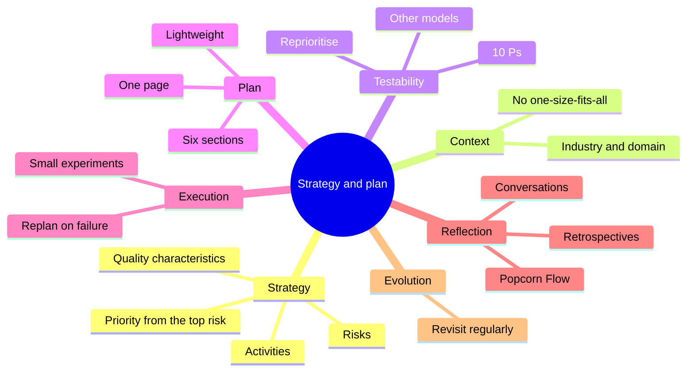

### Key takeaways

- **I can't test everything**, so a strategy is how I choose, and a plan is how I make the choice real.
- **Combine the two models.** Imagination and implementation tell me *where* an activity works; quality and risk tell me *which* to pick.
- **The pattern is: quality characteristics, then risks, then activities.** The higher the risk's priority, the stronger the case for the activity that mitigates it.
- **Different contexts need different strategies.** The pattern is universal, the answers are not.
- **A strategy is a vision. A plan makes it real**, and it has to cope with constraints.
- **Testability is anything that helps or hinders testing.** The 10 Ps give me a structured way to look: People, Philosophy, Product, Process, Project, Problem, Pipeline, Productivity, Production issues, Proactivity.
- **Low testability can change my plan**, not my strategy: start where I'm ready and invest in the weak Ps for the rest.
- **A test plan can be one page.** Introduction, Risks, Assumptions, Tools, Resources, Scope.
- **Execute in small experiments** and build in moments to reflect, using retrospectives, experiment models and conversations.
- **Keep evolving.** As users, risks and context change, so does what I test and when.

### Quick glossary

| Term | Meaning |
|---|---|
| **Test strategy** | The vision for my testing: what to test and why, guided by quality and risk |
| **Test plan** | The detailed steps for achieving that vision in a real context |
| **Testability** | Anything that makes testing easier or harder in a given context |
| **10 Ps of Testability** | A model by Rob Meaney and Ash Winter covering ten influences on testability |
| **One-page test plan** | A deliberately short plan stating intent, risks, assumptions, tools, resources and scope |
| **Experiment** | A small, time-limited step used to test whether an approach works in a given team |
| **Retrospective** | A regular team meeting to reflect on how work is going |
| **Popcorn Flow** | An experimentation model by Claudio Perrone for introducing and measuring improvements |
| **Effective score (my tool)** | Value × readiness ÷ 5: my heuristic for ordering activities in a real context |
| **Readiness (my tool)** | The average testability score of the Ps that matter for an activity |

### Where I go next

With a strategy, a plan and a way of reflecting, I've reached the end of this part of the book. The next part explores **more testing activities** (the book hints at things like contract, performance and security testing, and testing in production) so that when I come back to my strategy, I have a much bigger menu to choose from. Each new activity is a new answer to the question "which risks does this reduce, and how ready am I to do it?"

If I could leave you with one habit, it would be this: **before I commit to an activity, I write down which risk it's for and what I'd need to be true for it to work.** Those two lines are most of a strategy and most of a plan, and writing them down is what turns "we should do more testing" into something a team can actually act on.

---

*Source and credits:* this post is based on the chapter "Establishing and implementing a testing strategy". The 10 Ps of Testability come from Rob Meaney and Ash Winter; the other testability models mentioned are James Bach's *Heuristics of Software Testability* and the *Dimensions of Testability* by Maria Kedemo and Ben Kelly; the lightweight plan ideas come from Lisa Crispin and Janet Gregory (*Agile Testing*) and Claire Reckless ("The One-Page Test Plan"); *Popcorn Flow* is Claudio Perrone's. The Python strategy tool, readiness scoring, one-page plan checker, experiment tracker and tests are my own illustrations, written and run for this post. Their ranks, scores, weights, thresholds and mappings are my own judgements, not the book's.
