# Performance Testing Without the Panic: Planning, Building, Running and Reading a Test

---

I used to treat performance testing as the thing you do in the last week before release, when somebody senior asks, "Has anyone checked if it's fast?" That approach produced exactly what you'd expect: a pile of graphs nobody could interpret, a couple of panicked "fixes" based on guesses, and a second test run that contradicted the first.

Over time I've come to see performance testing as a *thinking* activity first and a *tooling* activity second. The tool (I'll use Apache JMeter as the running example) is the easy part. The hard parts are deciding what question you're asking, building a test that behaves like real people, and reading the results without fooling yourself.

This post is the guide I wish I'd had. I'll walk through the whole lifecycle: planning, implementing, executing and analysing a performance test. Along the way I'll share code that I actually ran, tables you can steal, and warnings about the traps that cost me the most time.

> [!NOTE]
> **How the code in this post is verified.** Everything labelled "Tested" was executed in a Python 3.12 environment, and the outputs shown are the real outputs. The JMeter-specific commands (GUI steps, CLI flags) are standard JMeter usage but I could **not** run JMeter itself while writing this, so I mark those as "Not run here". Treat them as a starting point and confirm against the JMeter docs for your version.

## Table of contents

1. [Why performance deserves a seat at the strategy table](#1-why-performance-deserves-a-seat-at-the-strategy-table)
2. [The big picture](#2-the-big-picture)
3. [Planning: the part most people skip](#3-planning-the-part-most-people-skip)
4. [Modelling real users with user flows](#4-modelling-real-users-with-user-flows)
5. [Implementing the test in JMeter](#5-implementing-the-test-in-jmeter)
6. [A hands-on lab you can run anywhere](#6-a-hands-on-lab-you-can-run-anywhere)
7. [Preparing and executing the run](#7-preparing-and-executing-the-run)
8. [Analysing results without fooling yourself](#8-analysing-results-without-fooling-yourself)
9. [Common mistakes](#9-common-mistakes)
10. [Cheat sheet and summary](#10-cheat-sheet-and-summary)

---

## 1. Why performance deserves a seat at the strategy table

Performance is usually filed under "non-functional requirements." I understand why the label exists, but I think it quietly does damage. It implies a pecking order: *functional* things first, *non-functional* things when there's time.

A colleague of mine put the problem neatly: if every feature of an application works but each click takes over a minute to respond, it doesn't feel very functional to the person using it. I agree completely. A correct answer that arrives too late is, for the user, often indistinguishable from a wrong one.

So I prefer to think in terms of **quality characteristics** such as completeness, stability, maintainability, privacy, availability, and performance, and to ask which ones matter most for *this* product and *these* users. For a small booking platform used by bed-and-breakfast owners, availability and stability might outrank almost everything else. For a trading system, response time might be everything. Once performance is a named characteristic with a priority, it stops being an end-of-project scramble and becomes something you can plan, test early, and improve iteratively.

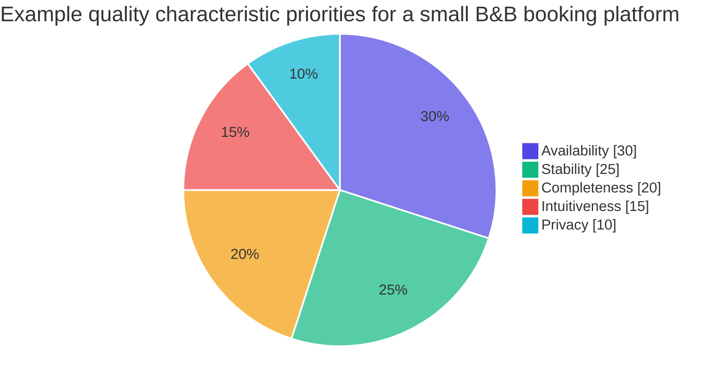

*The weights above are an illustration of how a team might rank characteristics, not a universal truth. Your context decides.*

> [!TIP]
> If you're ever unsure whether performance matters for your product, ask: "What would a user say if this took ten times longer than it does today?" If the honest answer is "they'd leave," performance is a first-class characteristic.

---

## 2. The big picture

Before I dive into details, here's the whole process on one page. Every step feeds the next, and the dotted line shows what I think is the most important habit: **iterate**.

```mermaid
flowchart LR
    A([Pick a quality<br/>characteristic]):::start --> B[Choose test type<br/>load / stress / soak / baseline]:::plan
    B --> C[Choose measurements<br/>and write a goal]:::plan
    C --> D[Pick KPIs<br/>to explain the 'why']:::plan
    D --> E[Capture user flows]:::build
    E --> F[Implement script<br/>in a tool]:::build
    F --> G{Dress rehearsal<br/>passes?}:::decision
    G -- no --> F
    G -- yes --> H[Prepare environment<br/>and notify people]:::run
    H --> I[Execute with<br/>monitoring on]:::run
    I --> J[Analyse results<br/>against KPIs]:::analyse
    J --> K{Goal met?}:::decision
    K -- no --> L[Investigate and fix]:::analyse
    L -.-> I
    K -- yes --> M([Extend flows,<br/>raise the bar]):::start
    M -.-> E

    classDef start fill:#4F46E5,stroke:#312E81,color:#ffffff,stroke-width:2px
    classDef plan fill:#DBEAFE,stroke:#2563EB,color:#1E3A8A
    classDef build fill:#DCFCE7,stroke:#16A34A,color:#14532D
    classDef run fill:#FEF3C7,stroke:#D97706,color:#78350F
    classDef analyse fill:#FCE7F3,stroke:#DB2777,color:#831843
    classDef decision fill:#FFE4E6,stroke:#E11D48,color:#881337,stroke-width:2px
```

I'll go through each box in turn.

---

## 3. Planning: the part most people skip

The most common trap I see is not planning. A performance test generates a *lot* of data. If you don't know what you want to learn, you can't tell whether the numbers mean "good" or "bad," and you end up making assumptions that have no evidence behind them. That leads to fixes that don't help and test runs that disagree with each other.

Three questions anchor my planning:

1. What **type** of performance test do I want to run?
2. What **metrics** do I want to measure?
3. What **goal** do I want the product to achieve?

### 3.1 The four common test types

"Performance test" is an umbrella term. The types differ less in *what* you test and more in *how much load you apply, and for how long*.

| Test type | Question it answers | Typical load shape | Typical duration | Watch for |
|---|---|---|---|---|
| **Baseline** | How does the system behave with almost no load? | 1 virtual user, repeated | Minutes | Reference numbers to compare other tests against |
| **Load** | Can we handle the traffic we *expect*? | Target number of users, based on estimates or production stats | Often an hour or two | Does it meet response time, availability, throughput targets? |
| **Stress** | Where does it break, and how does it fail? | Ramp up gradually until it strains | Until breaking point | Capacity limit, degrade-vs-fail behaviour |
| **Soak** | Does it fall over after running for a long time? | Modest load, sustained | Many hours | Memory leaks, disk filling up, creeping response times |

Here's how I picture the load shapes. Same script, different "ramp-up profile":

```mermaid
gantt
    title Same script, different injection profiles (illustrative, not to scale)
    dateFormat  HH:mm
    axisFormat  %H:%M
    section Baseline
    1 virtual user                    :done, b1, 00:00, 10m
    section Load
    Ramp to expected users            :active, l1, 00:00, 15m
    Hold at expected load             :active, l2, after l1, 60m
    section Stress
    Slow ramp past expected load      :crit, s1, 00:00, 90m
    Keep going until it strains       :crit, s2, after s1, 30m
    section Soak
    Modest steady load for hours      :soak1, 00:00, 480m
```

> [!NOTE]
> Because the tests differ mainly in load and duration, you can usually reuse the same script and just change the **Thread Group** settings (number of threads, ramp-up period, loop count or duration). That's one of the biggest practical benefits of building the script once, properly.

#### A note on load tests and "think time"

A load test aims to approximate real use, so it deliberately includes pauses: a person filling in a form, another system waiting between calls. If you strip those out, you're not running a load test any more; you're hammering the system, which is closer to a stress test or a denial-of-service simulation. I'll come back to think time because it's central to realism.

#### A note on baseline tests

I find baselines underrated. If one virtual user uses 30% CPU and 100 virtual users peak at 35%, then the system scales well even though 30% for a single user isn't pretty. Without the baseline you'd only see "35%" and have no idea whether that is a lot or a little. The comparison tells the story.

### 3.2 The four common measurements

Once I know the test type, I choose what to measure. These are the four I reach for most:

| Measurement | What it tells me | Example |
|---|---|---|
| **Availability** | Is the system up and serving requests under load? | Count of 4xx/5xx responses, or error percentage over time |
| **Response time** | How long does a request take, from sending to receiving the response? | Average, plus percentiles such as the 90th or 95th |
| **Throughput** | How much work is completed per unit of time? | Requests per second, or data processed per second |
| **Utilization** | How much of a resource is consumed? | CPU %, memory, network bandwidth |

Two practical remarks:

- **Averages hide pain.** If 90% of requests take 50 ms and 10% take 3 seconds, the average looks fine while one in ten users is miserable. I always look at percentiles alongside the mean.
- **Throughput that flattens while load rises is a signal.** If you add users but requests per second stops climbing, something is saturated.

> [!CAUTION]
> It's tempting to switch on every metric and "see what happens." Don't. The volume becomes overwhelming and you lose the thread. A clear goal tells you what to track now and what to ignore *for now*.

### 3.3 Writing a goal that can actually fail

A good performance goal combines a **measurement**, a **threshold**, and a **load condition**. Here are three shapes I use:

| Goal | Implied test type |
|---|---|
| Availability should be above 99% when 5,000+ concurrent virtual users are connected | Stress test |
| Average response time should stay under 1,000 ms with 200 concurrent virtual users over 24 hours | Soak test |
| Network utilization should be under 50% with 2,000 concurrent virtual users | Load test |

Notice that each goal quietly tells you which type of test to run. That's a nice side effect.

For a small booking platform aimed at B&B owners, my reasoning could go like this:

1. The quality characteristics that matter most are **stability** and **availability**. If the system starts throwing errors under load, both suffer.
2. So the measurement is **availability**.
3. Conversations with users and analytics suggest around **40 concurrent users** is typical, because the product serves small businesses with small user bases.
4. Clients expect the system to be available **at least 95%** of the time.

That produces a goal I can test:

> **The availability should be above 95% when 40 virtual users are connected to the system.**

It's specific, numeric, and it can fail. That last property matters most. A goal like "the system should be fast" can never fail, so it can never tell you anything.

### 3.4 KPIs: the "why" behind the numbers

Here's something that took me a while to appreciate. The metrics your load tool records, such as response times and error counts, show **symptoms**. They rarely show **causes**. If response times double, the tool can't tell you whether the CPU is pinned, the database is locking, or the network is saturated.

That's the job of **key performance indicators (KPIs)** collected from the system itself:

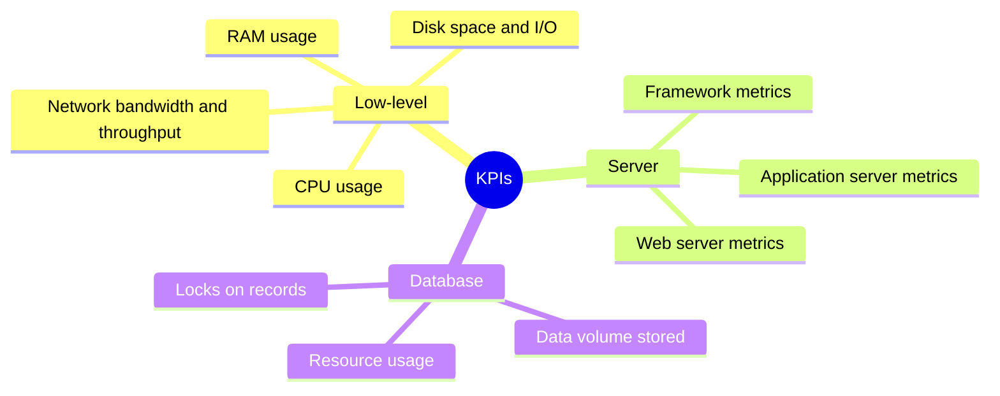

Which KPIs you can collect depends on your stack. If the application runs in Docker, for example, you can poll the container runtime for CPU, memory usage versus its limit, and network I/O. Do this investigation *during planning*, because discovering on test day that you can't see database metrics is a sad way to spend an afternoon.

> [!TIP]
> Start with low-level KPIs. They're available almost everywhere and they answer the first diagnostic question: "Is some resource maxed out when things go wrong?"

**Mini-exercise:** write down your own goal. Which test type? Which measurement? Which three KPIs would you track? If you can fill in all three, you're ready for the next step.

---

## 4. Modelling real users with user flows

There's one principle I repeat in every performance testing conversation:

> **A performance test should reflect real user behaviour in production as closely as is reasonably possible.**

The naive alternative is to list every endpoint and fire a huge number of requests at each. That tells you how the system copes with an artificial pattern that never happens in real life, which leads to fixing the wrong things. (It might be informative if you're simulating an attack, but that's a different goal.)

Instead, I capture **user flows**: short documents describing how a type of user moves through the system.

### 4.1 Anatomy of a user flow

I split every flow into three sections.

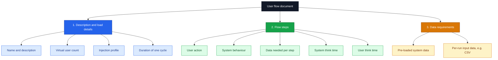

#### Section 1: description and load details

This holds the flow's name, a plain-English description, and how much load it gets. A few terms deserve explanation:

- **Virtual user count**: how many simulated users run this flow. A single flow might get a small number, because the full test is made of *many* flows running at once. As you add flows, total load grows.
- **Injection profile**: *how* users arrive. A "big bang" adds everyone at once. A steady ramp adds them gradually. Real systems rarely see everyone log in on the same second, so a ramp is often more realistic.
- **Duration**: the estimated time for one cycle of the flow, including random variation. You can use it to estimate total run time, or you can loop the flow indefinitely and stop manually after a fixed period.

A worked example: with 2 virtual users and a 120-second ramp-up, JMeter starts one user roughly every 60 seconds. That matches a profile of "one virtual user added per minute."

#### Section 2: flow steps

Each step describes what the user does and how the system responds, at a level that technical and business people can both read. "Admin completes booking" is enough; it doesn't need to specify headers. A developer reading it knows it maps to something like `POST /booking/`.

Each step also records the **test data** it depends on (for example, a list of rooms), and two kinds of delay:

- **System think time**: how long I allow the application to take. Early on I use a conservative placeholder (say 2,000 ms) because I don't know the real figure yet.
- **User think time**: how long a human takes before sending the next request.

User think time is the realism lever. No real person fires six requests in under 10 ms each. I record it as a base plus a deviance:

```
5000 (Deviance 2500)   →   a random wait between 2.5 and 7.5 seconds
```

| Notation | Meaning | Resulting range |
|---|---|---|
| `5000 (Deviance 2500)` | 5 s ± 2.5 s | 2,500 to 7,500 ms |
| `2000 (Deviance 1000)` | 2 s ± 1 s | 1,000 to 3,000 ms |
| `5000 (Deviance 0)` | exactly 5 s | 5,000 ms |

Randomness means no two runs are identical, which is a feature: real traffic isn't identical either.

#### Section 3: data requirements

At the bottom I list the data each flow needs, using named sets such as `<Rooms>` or `<Bookings>` that the steps refer to. Some data must exist in the system before the script starts; some is fed into requests during the run (typically from CSV files). Online generators such as Mockaroo can produce realistic fake names, emails and phone numbers; later I'll show a tiny script that does the same job.

### 4.2 Why flows pay off

Capturing flows gives me:

- the steps for the script,
- an approximate cycle time to plan the run,
- the data I need to prepare, and
- a living document I can update as the product changes.

That last point is the real prize. I don't have to wait for the whole product before I start. If only booking creation exists today, I write that flow and test it. When a branding feature lands, I add a branding flow. The performance suite grows alongside the product.

### 4.3 The "admin creates a booking" flow as a sequence

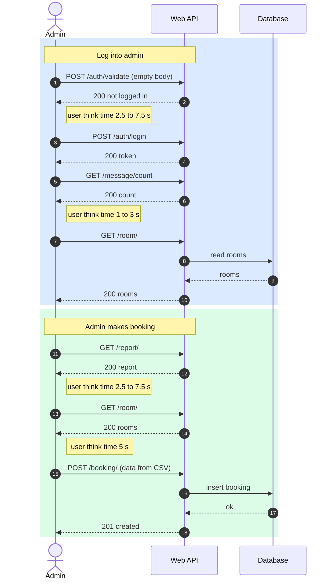

> [!NOTE]
> The diagram above shows the *user-visible* sequence. In the real flow I'd add the think times as a column in the steps table, as described earlier.

**Mini-exercise:** sketch a flow for a *guest* who logs on, finds a room and makes a booking. Think carefully about which data must pre-exist and which must change on every iteration.

---

## 5. Implementing the test in JMeter

With flows in hand, translating them into a script is mostly mechanical. I'll use **Apache JMeter**, an open-source tool that's been around for a long time and includes what a first script needs:

- HTTP samplers to make requests
- variable management
- cookie and header managers
- logic controllers
- CSV data loaders

> [!NOTE]
> **Not run here.** The steps in this section describe JMeter's GUI and file-based configuration. I couldn't execute JMeter in my environment, so I'm describing standard usage rather than showing output I captured.

### 5.1 Installing JMeter

1. Make sure you have a recent Java runtime installed (JMeter runs on the JVM).
2. Download the **binary** release (`.zip` or `.tgz`) from the Apache JMeter site and extract it somewhere convenient.
3. Open the `bin` folder and start it: `jmeter.bat` on Windows, `jmeter.sh` on macOS or Linux.
4. You'll land on an empty **Test Plan**.

### 5.2 Distributed load generation

Generating load is itself resource-hungry: CPU, RAM, and network I/O. If my load generator maxes out its own network card, I'll record slow responses that aren't the system's fault at all. That is a nasty way to waste a day.

JMeter's answer is a distributed setup: one controller instance sends the script to several `jmeter-server` worker nodes, each of which generates part of the load and reports results back.

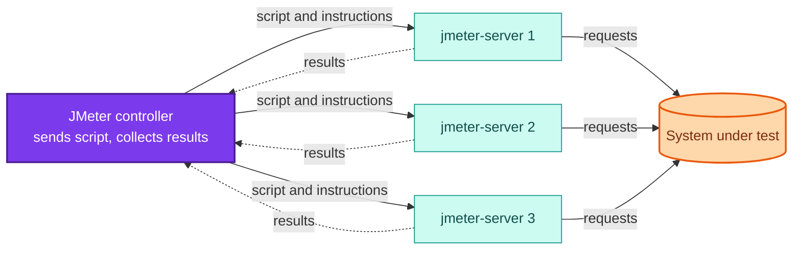

> [!WARNING]
> Two gotchas with distributed mode:
> 1. **Each worker runs its own copy of the script.** If a Thread Group says 40 threads and you have 4 workers, you'd generate 160 virtual users. Divide the thread count by the number of workers.
> 2. **Data files must exist on every worker.** Each `jmeter-server` looks for CSV files on *its own* disk, not over the network. Copy them across.

### 5.3 Anatomy of the script

Here's the structure I build for the admin flow:

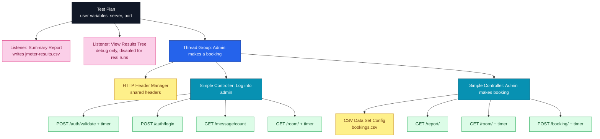

### 5.4 Step by step

**Step 1: Test Plan and variables.** Click the Test Plan, rename it, and add two user-defined variables:

| Name | Value |
|---|---|
| `server` | `localhost` |
| `port` | `80` |

These make it painless to point the same script at different environments.

**Step 2: Thread Group.** Right-click the Test Plan, then *Add → Threads → Thread Group*, and name it after the flow ("Admin makes a booking"). One Thread Group per user flow keeps things tidy, and the group is also where load is configured.

**Step 3: Simple Controllers.** Add two (*Add → Logic Controller → Simple Controller*) called "Log into admin" and "Admin makes booking". They only organise requests; they don't change behaviour.

**Step 4: HTTP Header Manager.** Add it directly under the Thread Group (not inside a controller) so it applies to every request:

| Header | Value |
|---|---|
| `Host` | `${server}:${port}` |
| `Accept` | `application/json` |
| `Accept-Language` | `en-GB,en;q=0.5` |
| `Accept-Encoding` | `gzip, deflate, br` |
| `Content-Type` | `application/json` |

`${server}:${port}` expands to `localhost:80` using the variables from the Test Plan.

**Step 5: HTTP Request samplers.** Under "Log into admin":

| Name | Method | Path | Body |
|---|---|---|---|
| `POST /auth/validate` | POST | `/auth/validate` | `{}` |
| `POST /auth/login` | POST | `/auth/login` | `{"username":"admin","password":"password"}` |
| `GET /message/count` | GET | `/message/count` | none |
| `GET /room/` | GET | `/room/` | none |

For every sampler, set *Server name or IP* to `${server}` and *Port number* to `${port}`.

> [!NOTE]
> GraphQL APIs work too. Because GraphQL runs over HTTP, you send the same kind of HTTP sampler with a query in the body instead of plain JSON. Parsing GraphQL responses is trickier, but JMeter's GraphQL support has been improving.

**Step 6: Constant Timers for think time.** Add a *Constant Timer* (*Add → Timers → Constant Timer*) as a child of a sampler, and put a random expression in *Thread Delay*:

```text
${__Random(2500,7500)}
```

That waits between 2.5 and 7.5 seconds before the request runs, matching the `5000 (Deviance 2500)` notation from the user flow.

> [!CAUTION]
> A timer is scoped to the sampler it's attached to (or, if placed higher in the tree, to every sampler in its scope). A timer at the wrong level can quietly add delays to requests you didn't intend. Check the tree after adding timers.

**Step 7: The booking request.** Under "Admin makes booking", add `GET /report/` and `GET /room/`, then `POST /booking/` with this body:

```json
{
  "depositpaid": ${depositpaid},
  "firstname": "${firstname}",
  "lastname": "${lastname}",
  "roomid": 2,
  "bookingdates": {
    "checkin": "${checkin}",
    "checkout": "${checkout}"
  }
}
```

Nearly every value is a variable. That's deliberate: real users don't submit the same booking repeatedly, and the application is likely to reject duplicates anyway. Each iteration needs fresh data.

**Step 8: Feed the variables from a CSV.** Add a *CSV Data Set Config* (*Add → Config Element → CSV Data Set Config*) to the controller:

| Field | Value |
|---|---|
| Filename | `./bookings.csv` |
| File encoding | `utf-8` |
| Variable names | `firstname,lastname,email,phone,depositpaid,checkin,checkout` |

The variable names must line up with the CSV columns, *in order*, and match the names used in the request body. Each iteration takes the next row.

**Step 9: Timers for the booking section.** Add timers to `GET /room/` and `POST /booking/` to match your flow's think times.

> [!TIP]
> Look closely at a delay expression such as `${__Random(5000,5000)}`. When the minimum and maximum are equal, the "random" delay is a constant 5 seconds. That's valid if the flow says "5000, deviance 0," but if you meant to include variation, double-check both numbers.

**Step 10: Listeners.** Add two directly under the Test Plan so they capture every Thread Group:

| Listener | Purpose | Use during real runs? |
|---|---|---|
| View Results Tree | Shows every request and response in detail; superb for debugging | **No.** It's resource-hungry. Disable it. |
| Summary Report | Aggregates response times, errors and throughput per sampler name | Yes. Set a filename such as `jmeter-results.csv` |

> [!WARNING]
> Leaving View Results Tree enabled during a real run can distort your results, because the tool itself consumes the resources you're trying to leave for load generation. Right-click it and choose *Toggle* to disable it.

### 5.5 The dress rehearsal

Scripts that imitate complex behaviour become complex themselves. Before a real run I always do a **dress rehearsal**: all data loaded, one virtual user per Thread Group, short duration.

It catches script bugs that would otherwise look like performance problems. In one rehearsal I've seen, a wall of 400 errors turned out to be one Thread Group deleting rooms that another Thread Group was trying to book. That's a test design clash, not a system fault, and finding it with one user is a lot cheaper than finding it with a hundred.

Run a rehearsal every time you make significant changes to the script.

---

## 6. A hands-on lab you can run anywhere

Not everyone has JMeter, a target API and a monitoring stack ready on day one. So I built a small lab in plain Python that mirrors the same ideas: virtual users, ramp-up, randomised think time, a looping flow, a results CSV, and an analysis step that checks a goal.

> [!NOTE]
> **Tested.** All the scripts in this section were run under Python 3.12. The only third-party dependency is `psutil` (for the KPI sampler); everything else is standard library. The output blocks are copied from real runs.

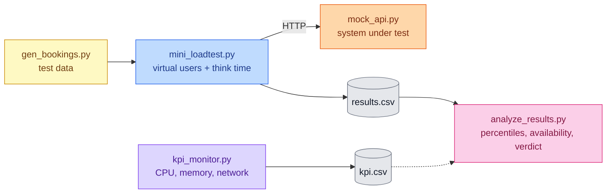

### 6.1 Generating test data

This script creates the equivalent of `bookings.csv`. It's seeded so runs are reproducible, and every row gets its own pair of dates so bookings never collide. There's deliberately **no header row**, because JMeter's CSV Data Set Config takes variable names from its own settings.

```python
#!/usr/bin/env python3
"""Generate a bookings.csv for JMeter's CSV Data Set Config.
Columns: firstname,lastname,email,phone,depositpaid,checkin,checkout
Every row gets its own date window so bookings never collide.
"""
import csv, random, sys
from datetime import date, timedelta

FIRST = ["Silvie", "Ambros", "Maya", "Tomas", "Ingrid", "Kofi", "Lena", "Ravi", "Chloe", "Mateo"]
LAST = ["Alyonov", "Eary", "Okafor", "Brandt", "Singh", "Moreau", "Tanaka", "Silva", "Novak", "Hughes"]

def generate(rows: int, seed: int = 42, start: date = date(2030, 1, 1)):
    rnd = random.Random(seed)          # seeded => reproducible runs
    for i in range(rows):
        f, l = rnd.choice(FIRST), rnd.choice(LAST)
        checkin = start + timedelta(days=2 * i)
        checkout = checkin + timedelta(days=1)
        yield [f, l, f"{f[0].lower()}{l.lower()}{i}@example.com",
               f"07{rnd.randint(100000000, 999999999)}",
               rnd.choice(["true", "false"]), checkin.isoformat(), checkout.isoformat()]

if __name__ == "__main__":
    n = int(sys.argv[1]) if len(sys.argv) > 1 else 1000
    out = sys.argv[2] if len(sys.argv) > 2 else "bookings.csv"
    with open(out, "w", newline="") as fh:
        csv.writer(fh, lineterminator="\n").writerows(generate(n))
    print(f"wrote {n} rows to {out}")
```

Run it:

```bash
python3 gen_bookings.py 3 bookings.csv
cat bookings.csv
```

Actual output from my run (names and phone numbers are random but reproducible with the seed):

```text
Ambros,Alyonov,aalyonov0@example.com,07896233790,false,2030-01-01,2030-01-02
Tomas,Brandt,tbrandt1@example.com,07249827706,true,2030-01-03,2030-01-04
Chloe,Eary,ceary2@example.com,07734036506,false,2030-01-05,2030-01-06
```

> [!CAUTION]
> Use a generous number of rows. If a Thread Group loops indefinitely and your CSV has only 100 rows, JMeter will, by default, loop back to the start of the file and re-send the same bookings. Estimate: `users × (iterations per user)` and generate comfortably more than that.

### 6.2 A stand-in system under test

This mock API gets slower and starts returning `503` once too many requests are in flight at the same time. It's *not* a model of any real system; it just gives the analysis something realistic to find.

```python
#!/usr/bin/env python3
"""A tiny stand-in for a booking API so the load script can be tried anywhere.
It slows down and starts returning 503s once too many requests are in flight,
which gives the analysis script something realistic to find."""
import json, random, threading, time
from http.server import BaseHTTPRequestHandler, ThreadingHTTPServer

in_flight = 0
lock = threading.Lock()
OVERLOAD_AT = 4           # concurrent requests before things degrade

class Handler(BaseHTTPRequestHandler):
    def _respond(self, code, body):
        data = json.dumps(body).encode()
        self.send_response(code)
        self.send_header("Content-Type", "application/json")
        self.send_header("Content-Length", str(len(data)))
        self.end_headers()
        self.wfile.write(data)

    def _handle(self):
        global in_flight
        with lock:
            in_flight += 1
            current = in_flight
        try:
            if self.command == "POST":                      # drain request body
                self.rfile.read(int(self.headers.get("Content-Length", 0)))
            time.sleep(random.uniform(0.01, 0.03) + max(0, current - 2) * 0.01)
            if current > OVERLOAD_AT and random.random() < 0.5:
                self._respond(503, {"error": "overloaded"})
            else:
                self._respond(200, {"ok": True, "path": self.path})
        finally:
            with lock:
                in_flight -= 1

    do_GET = do_POST = _handle
    def log_message(self, *a):            # keep the console quiet
        pass

if __name__ == "__main__":
    ThreadingHTTPServer(("127.0.0.1", 8080), Handler).serve_forever()
```

### 6.3 A miniature load generator

This is the heart of the lab. It echoes the JMeter concepts we've been discussing:

| JMeter idea | Where it appears in the script |
|---|---|
| Thread Group → number of threads | `users` argument |
| Ramp-up period | `start_delay = i * ramp / users` |
| Constant Timer with `__Random` | `random.uniform(think - dev, think + dev)` |
| Loop Count: Infinite | `while not stop.is_set()` |
| Summary Report listener / JTL file | CSV written at the end |

```python
#!/usr/bin/env python3
"""A miniature load test in plain Python (stdlib only).
Mirrors the ideas in a JMeter plan: virtual users, ramp-up, think time
with deviance, a looping flow, and a JTL-style CSV of results.
Usage: mini_loadtest.py USERS RAMP_SECONDS DURATION_SECONDS OUT.csv
"""
import csv, json, random, sys, threading, time, urllib.request, urllib.error

BASE = "http://127.0.0.1:8080"
FLOW = [  # (label, method, path, body, think_ms, deviance_ms)
    ("POST /auth/login", "POST", "/auth/login", {"username": "admin", "password": "password"}, 200, 100),
    ("GET /report/",     "GET",  "/report/",     None, 300, 150),
    ("GET /room/",       "GET",  "/room/",       None, 300, 150),
    ("POST /booking/",   "POST", "/booking/",    {"roomid": 2}, 200, 0),
]
rows, rows_lock, stop = [], threading.Lock(), threading.Event()

def call(method, path, body):
    data = json.dumps(body).encode() if body is not None else None
    req = urllib.request.Request(BASE + path, data=data, method=method,
                                 headers={"Content-Type": "application/json"})
    try:
        with urllib.request.urlopen(req, timeout=10) as r:
            r.read(); return r.status
    except urllib.error.HTTPError as e:
        return e.code
    except Exception:
        return 599                          # connection-level failure

def virtual_user(name, start_delay):
    if stop.wait(start_delay):              # ramp-up: each user starts later
        return
    while not stop.is_set():                # loop forever, like "Infinite" loop count
        for label, method, path, body, think, dev in FLOW:
            # same idea as ${__Random(min,max)} in a Constant Timer
            wait = random.uniform(think - dev, think + dev) / 1000
            if stop.wait(wait):
                return
            t0 = time.time()
            code = call(method, path, body)
            elapsed = int((time.time() - t0) * 1000)
            with rows_lock:
                rows.append([int(t0 * 1000), elapsed, label, code,
                             "OK" if code < 400 else "ERR", name,
                             "text", str(code < 400).lower()])

def main(users, ramp, duration, out):
    threads = [threading.Thread(target=virtual_user,
               args=(f"VU {i+1}", i * ramp / users), daemon=True) for i in range(users)]
    for t in threads: t.start()
    time.sleep(duration); stop.set()
    for t in threads: t.join(timeout=15)
    with open(out, "w", newline="") as fh:
        w = csv.writer(fh, lineterminator="\n")
        w.writerow(["timeStamp", "elapsed", "label", "responseCode",
                    "responseMessage", "threadName", "dataType", "success"])
        w.writerows(sorted(rows))
    print(f"{len(rows)} samples written to {out}")

if __name__ == "__main__":
    u, r, d = int(sys.argv[1]), float(sys.argv[2]), float(sys.argv[3])
    main(u, r, d, sys.argv[4])
```

### 6.4 The analysis script

This reads a results CSV (the column names follow JMeter's JTL format, so it also works on real JMeter output that includes `timeStamp`, `elapsed`, `label`, `responseCode` and `success`) and reports per-label statistics, overall availability, the worst rolling error rate, and a pass/fail verdict. Its exit code is `0` for pass and `1` for fail, so you can drop it into a CI pipeline.

```python
#!/usr/bin/env python3
"""Analyse a JMeter-style results CSV (JTL) and check an availability goal.
Needs at least: timeStamp, elapsed, label, responseCode, success columns.
Usage: analyze_results.py results.csv [--goal 95] [--window 30]
"""
import argparse, csv, statistics
from collections import defaultdict

def percentile(values, p):
    """Nearest-rank percentile; fine for test reporting."""
    if not values:
        return 0
    s = sorted(values)
    k = max(0, min(len(s) - 1, int(round(p / 100 * len(s) + 0.5)) - 1))
    return s[k]

def load(path):
    with open(path, newline="") as fh:
        rows = list(csv.DictReader(fh))
    for r in rows:
        r["timeStamp"] = int(r["timeStamp"]); r["elapsed"] = int(r["elapsed"])
        r["ok"] = r["success"].strip().lower() == "true"
    return sorted(rows, key=lambda r: r["timeStamp"])

def per_label(rows):
    groups = defaultdict(list)
    for r in rows: groups[r["label"]].append(r)
    span = max(1, (rows[-1]["timeStamp"] - rows[0]["timeStamp"]) / 1000)
    out = []
    for label, g in groups.items():
        el = [r["elapsed"] for r in g]
        out.append(dict(label=label, n=len(g),
                        err=100 * sum(not r["ok"] for r in g) / len(g),
                        avg=statistics.mean(el), p90=percentile(el, 90),
                        p95=percentile(el, 95), mx=max(el), tput=len(g) / span))
    return out

def rolling_error(rows, window):
    """% of errors across the last N requests: the idea behind figure 10.10."""
    flags = [0 if r["ok"] else 1 for r in rows]
    return [100 * sum(flags[max(0, i - window + 1): i + 1]) / min(window, i + 1)
            for i in range(len(flags))]

def main():
    ap = argparse.ArgumentParser()
    ap.add_argument("csv"); ap.add_argument("--goal", type=float, default=95.0)
    ap.add_argument("--window", type=int, default=30)
    a = ap.parse_args()
    rows = load(a.csv)
    print(f"{'label':<18}{'n':>6}{'err%':>8}{'avg':>7}{'p90':>7}{'p95':>7}{'max':>7}{'req/s':>8}")
    for s in per_label(rows):
        print(f"{s['label']:<18}{s['n']:>6}{s['err']:>8.1f}{s['avg']:>7.0f}"
              f"{s['p90']:>7.0f}{s['p95']:>7.0f}{s['mx']:>7.0f}{s['tput']:>8.2f}")
    avail = 100 * sum(r["ok"] for r in rows) / len(rows)
    roll = rolling_error(rows, a.window)
    worst = max(range(len(roll)), key=roll.__getitem__)
    t0 = rows[0]["timeStamp"]
    print(f"\nOverall availability: {avail:.2f}%  (goal: {a.goal}%)")
    print(f"Worst rolling error rate ({a.window} reqs): {roll[worst]:.1f}% "
          f"at +{(rows[worst]['timeStamp'] - t0) / 1000:.0f}s")
    print("RESULT:", "PASS" if avail >= a.goal else "FAIL")
    raise SystemExit(0 if avail >= a.goal else 1)

if __name__ == "__main__":
    main()
```

### 6.5 A KPI sampler

Load tool metrics tell you *what* happened; KPIs help explain *why*. This sampler records CPU, memory and network counters once per interval. Run it on the machine hosting the system under test, not on the load generator.

```python
#!/usr/bin/env python3
"""Sample low-level KPIs (CPU %, memory %, network bytes) once per interval.
Usage: kpi_monitor.py OUT.csv SECONDS [INTERVAL]
Run it on the machine that hosts the system under test, not the load generator."""
import csv, sys, time
import psutil

def main(out, seconds, interval=1.0):
    net0 = psutil.net_io_counters()
    with open(out, "w", newline="") as fh:
        w = csv.writer(fh, lineterminator="\n")
        w.writerow(["timeStamp", "cpu_percent", "mem_percent", "net_sent_kb", "net_recv_kb"])
        end = time.time() + seconds
        while time.time() < end:
            cpu = psutil.cpu_percent(interval=interval)        # blocks for `interval`
            net = psutil.net_io_counters()
            w.writerow([int(time.time() * 1000), cpu, psutil.virtual_memory().percent,
                        round((net.bytes_sent - net0.bytes_sent) / 1024, 1),
                        round((net.bytes_recv - net0.bytes_recv) / 1024, 1)])
            fh.flush()

if __name__ == "__main__":
    main(sys.argv[1], float(sys.argv[2]), float(sys.argv[3]) if len(sys.argv) > 3 else 1.0)
```

Install the dependency and try it:

```bash
pip install psutil
python3 kpi_monitor.py kpi.csv 3 1
cat kpi.csv
```

```text
timeStamp,cpu_percent,mem_percent,net_sent_kb,net_recv_kb
1791876991094,0.0,5.1,0.0,0.0
1791876992095,0.0,5.1,0.0,0.0
1791876993096,0.0,5.1,0.0,0.0
```

### 6.6 Running the lab: baseline, then stress

I ran two experiments against the mock API. First a **baseline** with 4 virtual users, then a **stress** run with 80.

```bash
# terminal 1
python3 mock_api.py

# terminal 2
python3 mini_loadtest.py 4 4 10 base.csv
python3 analyze_results.py base.csv

python3 mini_loadtest.py 80 15 25 stress.csv
python3 analyze_results.py stress.csv
```

**Baseline output (real run):**

```text
121 samples written to base.csv
label                  n    err%    avg    p90    p95    max   req/s
POST /auth/login      31     0.0     23     30     34     61    3.18
GET /report/          31     0.0     19     26     30     30    3.18
GET /room/            30     0.0     22     29     29     36    3.08
POST /booking/        29     0.0     20     27     29     29    2.98

Overall availability: 100.00%  (goal: 95.0%)
Worst rolling error rate (30 reqs): 0.0% at +0s
RESULT: PASS
```

**Stress output (real run):**

```text
2258 samples written to stress.csv
label                  n    err%    avg    p90    p95    max   req/s
POST /auth/login     592    45.3    372    580    591    616   23.88
GET /report/         573    46.4    378    576    587    613   23.11
GET /room/           556    43.7    386    578    586    619   22.43
POST /booking/       537    45.3    394    577    588    621   21.66

Overall availability: 54.83%  (goal: 95.0%)
Worst rolling error rate (30 reqs): 73.3% at +7s
RESULT: FAIL
```

Here's the comparison, which is exactly why I run baselines:

| Metric | Baseline (4 users) | Stress (80 users) | Change |
|---|---|---|---|
| Average response time (ms), roughly | ~21 | ~380 | about 18x slower |
| 95th percentile (ms), roughly | ~30 | ~590 | about 20x slower |
| Availability | 100.00% | 54.83% | goal of 95% **missed** |
| Worst rolling error rate | 0% | 73.3% | errors appear early in the ramp |

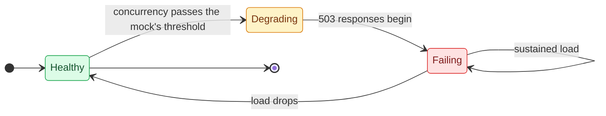

> [!CAUTION]
> **A limitation I want to be upfront about.** My load generator is a single Python process using threads, running on the same machine as the mock server. That means the generator itself was probably *a* bottleneck in the stress run, which is the very problem the distributed setup exists to prevent. The absolute numbers above are illustrative and tell you about my sandbox, not about any real system. What matters is the *method*: baseline first, then load, then compare using the same analysis.

> [!NOTE]
> Notice that the worst rolling error rate appeared about 7 seconds in, before all 80 users had even finished ramping up. A single "overall availability" figure would have hidden *when* trouble started. That's why I like a rolling window.

### 6.7 A quick sanity check on expected throughput

When I plan a load test I like to estimate expected request rate so I can spot nonsense results. A simple relationship from queueing theory (Little's Law, applied to a closed system with think time) says:

```text
throughput ≈ users / (response time + think time)
```

Say 40 virtual users, each spending about 5 seconds thinking and 0.5 seconds waiting per request:

```text
40 / (5 + 0.5) ≈ 7.3 requests per second
```

If my test reports 70 requests per second for that configuration, my script is probably missing its think times. If it reports 1, something is blocking. It's a cheap smell test, and it has saved me from trusting a broken script more than once.

---

## 7. Preparing and executing the run

Pressing "start" is the smallest part of executing a test. The preparation decides whether the numbers mean anything.

### 7.1 Make the environment look like production

If production uses containers, load balancers and replicated databases, then testing against one small server with a single process won't predict much. I try to match production in as many respects as the budget allows. Beyond infrastructure, these details matter:

| Preparation | Why it matters |
|---|---|
| **Load the database with realistic data** | Production databases are rarely empty; query performance depends on data volume |
| **Warm the caches** | Users usually hit warm caches; a cold start gives unrepresentatively slow early responses |
| **Start queues and scheduled jobs sensibly** | Switching on every background process at once creates artificial spikes |
| **Match configuration** | Connection pools, timeouts, memory limits, and similar settings change behaviour dramatically |

### 7.2 Tell people before you start

Imagine this: you launch a long test and discover half an hour in that a colleague deployed a new build to the same environment, or another tester wiped the data your script depends on. You've lost the run, and possibly your afternoon.

So before every test I notify everyone with a claim on the environment: when I'll start, how long it will take, and that I'll tell them when it's done. It takes five minutes and saves hours.

### 7.3 Final setup checklist

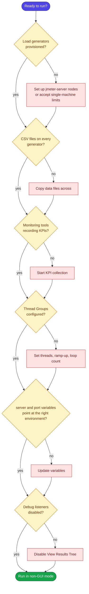

For the "admin makes a booking" flow, the Thread Group settings I'd use from the user flow are:

| Setting | Value | Reason |
|---|---|---|
| Number of Threads | 2 | From the flow's load details |
| Ramp-up period | 120 s | One user added per minute |
| Loop Count | Infinite | Stop manually after the planned duration |

### 7.4 Run in non-GUI mode

JMeter's GUI is for building and debugging. For real runs, use the command line. The GUI consumes resources and can skew your results.

> [!NOTE]
> **Not run here.** This is standard JMeter CLI usage, but I couldn't execute it myself.

```bash
jmeter -n -t ./example-performance-test.jmx -l ./perfstats.csv
```

| Flag | Meaning |
|---|---|
| `-n` | Non-GUI (headless) mode |
| `-t` | Path to the test plan (`.jmx`) |
| `-l` | File to write the results log to |

Two further options I find handy. First, if you define your variables with the property function (for example `${__P(server,localhost)}` instead of a hard-coded variable value), you can override them at launch without editing the script:

```bash
jmeter -n -t ./example-performance-test.jmx -l ./perfstats.csv -Jserver=staging.example.com -Jport=443
```

Second, JMeter can generate an HTML report from the results log (`-e -o ./report-folder`). Check the documentation for your version for the exact requirements, such as the output folder needing to be empty or nonexistent.

> [!WARNING]
> **Don't point a load test at something you don't own or control.** High-volume traffic against a third-party or production system can disrupt real users, violate terms of service, or trigger security responses. Use a dedicated test environment, or get explicit permission.

> [!TIP]
> For your very first attempt, don't aim for the full distributed setup. Run the application locally, run the script in CLI mode for about five minutes, and watch CPU alongside it. You'll learn the mechanics, and you'll have sample data to practise analysing.

---

## 8. Analysing results without fooling yourself

This is the hardest part, and I don't think anyone gets good at it without practice. The difficulty is that your load tool reports **symptoms**, many different things can produce the same symptom, and your brain will happily grab the first explanation that fits.

### 8.1 Pairing symptoms with places to look

| What I see | Compare it with | What it might suggest |
|---|---|---|
| Response times climbing as users increase | Server CPU and memory, network KPIs | A resource is saturating at that point in the test |
| Throughput flattening while users keep rising | Error rates, connection counts | A bottleneck or queue; users may be waiting to connect |
| More traffic leaving the application than entering | Network KPIs | Caching problems, or larger-than-expected payloads |
| Sudden jump in CPU or memory | Timeline of events during the run | A specific operation, request type, or leak |
| Appearance of 404, 500, 503 | Server KPIs at the same timestamps | The server may have become unresponsive, or the script is wrong (see the dress rehearsal) |

### 8.2 Reading the story in a real analysis

Recall the goal: **availability above 95% with 40 virtual users.** In the example analysis, the approach is:

1. Graph the percentage of error responses over the last 30 requests across the test. This directly answers the goal.
2. Graph CPU usage per API over time.
3. Overlay them.

The result in that example: a clear spike near the 7.5-minute mark, visible in both response time and in the booking API's CPU usage (the CPU spike being the larger one). When the booking API's CPU jumps under load, the API begins returning errors, so the availability goal is **not met**. The next step is not "fix it" but "look at the booking API in detail to find out what's consuming CPU."

That last sentence matters. The analysis doesn't tell you the *cause*, only *where to dig*. A profiler, logs, or a targeted re-test of that endpoint comes next.

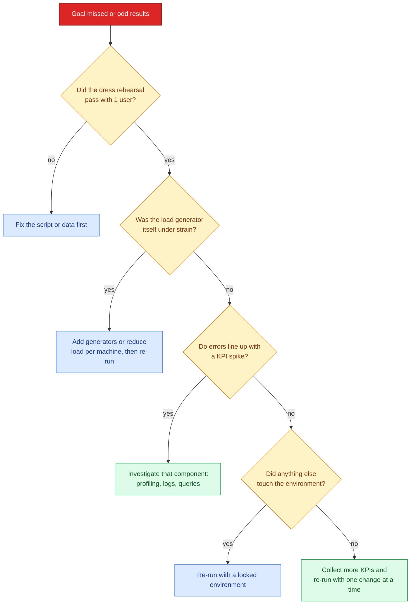

### 8.3 Habits that keep my analysis honest

- **Change one thing at a time.** If I alter the code, the data volume and the load profile between runs, I can't attribute the difference to anything.
- **Compare against a baseline.** A single run in isolation has no reference point.
- **Repeat important runs.** One result can be noise. If the finding matters, see whether it reproduces.
- **Record the context.** Build version, environment, data volume, and Thread Group settings belong next to the results.
- **Look at the timeline, not just totals.** A good overall average can hide a catastrophic five minutes.

> [!CAUTION]
> Beware **confirmation bias**. If I already suspect the database, I'll notice every database blip and ignore the CPU spike on another service. Let the data narrow the search before I let a theory do it.

---

## 9. Common mistakes

Here are mistakes I've made or watched others make, along with the fix for each.

| Mistake | Why it hurts | Better approach |
|---|---|---|
| No goal before running | Results can't be judged | Write a numeric goal that can fail |
| Hitting endpoints with no think time | Doesn't resemble real use | Model flows with realistic waits |
| Running in the GUI | The tool steals resources | Use non-GUI mode for real runs |
| Leaving View Results Tree enabled | Same problem, plus memory growth | Disable it outside debugging |
| Skipping the dress rehearsal | Script errors look like system errors | Rehearse with one user per Thread Group |
| Empty database and cold caches | Unrealistically fast or slow results | Load realistic data, warm caches |
| Forgetting to copy CSVs to workers | Missing data causes errors | Distribute data files to each worker |
| Dividing users incorrectly in distributed mode | Load is multiplied by the number of workers | Divide thread counts across workers |
| Not telling anyone | Environment changes mid-test | Notify stakeholders in advance |
| Only looking at averages | Hides tail latency | Check percentiles and error timelines |
| Treating the symptom as the cause | Wrong fix, wasted time | Correlate with KPIs, then investigate |
| Running performance tests only at the end | No time to fix what you find | Grow flows and tests alongside the product |

---

## 10. Cheat sheet and summary

### 10.1 One-page cheat sheet

| Topic | Remember |
|---|---|
| **Why** | Performance is a quality characteristic, not an afterthought |
| **Test types** | Baseline (1 user), Load (expected), Stress (to the limit), Soak (long and steady) |
| **Measurements** | Availability, response time, throughput, utilization |
| **Goal shape** | measurement + threshold + load condition, written so it can fail |
| **KPIs** | Low-level, server, database. They explain the "why" |
| **Realism** | User flows, think time with deviance, varied data |
| **Script structure** | Test Plan, Thread Groups, Simple Controllers, samplers, timers, config elements, listeners |
| **Data** | CSV Data Set Config; names must match columns in order |
| **Before a run** | Realistic environment, rehearsal, notify people, monitoring on |
| **During a run** | Non-GUI mode, debug listeners off |
| **After a run** | Compare with KPIs and baseline; locate, then diagnose |

### 10.2 A suggested learning path

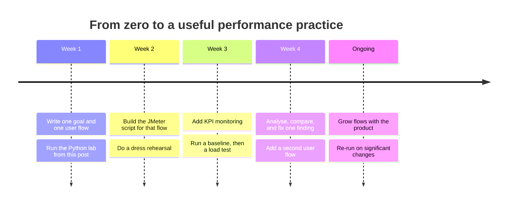

### 10.3 Summary

If I had to compress this entire post into a handful of sentences, they'd be these.

Performance testing tells you things other testing doesn't, but only if you ask a clear question. Pick a test type that matches the question, pick measurements that can answer it, and write a goal that can genuinely fail. Collect KPIs so you can explain symptoms rather than just observe them. Build your script from user flows so the load looks like people, with think time, varied data and realistic arrival patterns. Rehearse with one user before you unleash many. Prepare an environment that resembles production, tell everyone before you start, and run headless. Then read the results as a detective rather than a judge: correlate, compare to a baseline, change one thing at a time, and let the evidence, not your first hunch, point to the cause.

Most of all, don't wait. Start with one flow, one goal and one small run, and let your performance testing grow alongside the product it protects.

---

### Appendix: file listing for the lab

| File | Purpose | Status |
|---|---|---|
| `gen_bookings.py` | Generates `bookings.csv` test data | Tested |
| `mock_api.py` | Stand-in system under test | Tested |
| `mini_loadtest.py` | Python load generator with ramp-up and think time | Tested |
| `analyze_results.py` | Statistics, rolling error rate, pass/fail | Tested |
| `kpi_monitor.py` | CPU, memory and network sampler (needs `psutil`) | Tested |
| JMeter GUI steps and CLI commands | Standard JMeter usage | Not run here |
