# Quality and Risk: How I Decide What to Test (and What to Ignore)

> **TL;DR:** A testing strategy without a goal is just a pile of activities. I get my goal by working out what *quality* means to the people who matter, expressed as a short, ordered list of **quality characteristics**. I get my plan by listing **risks** to those characteristics, using playful techniques like the Headline game, Oblique testing and RiskStorming, and then ranking them by **likelihood** and **severity**. In this post I walk through the whole process with the `restful-booker-platform` sandbox, and I back it up with a small risk-register tool that I wrote and tested.

---

## Table of Contents

1. [Why I start with goals](#why-i-start-with-goals)
2. [Defining quality](#defining-quality)
3. [Quality characteristics](#quality-characteristics)
4. [Getting to know my users](#getting-to-know-my-users)
5. [Turning characteristics into strategy goals](#turning-characteristics-into-strategy-goals)
6. [What a risk really is](#what-a-risk-really-is)
7. [Three techniques for finding risks](#three-techniques-for-finding-risks)
8. [RiskStorming on the sandbox: the results](#riskstorming-on-the-sandbox-the-results)
9. [Prioritising risks](#prioritising-risks)
10. [Hands-on: a tested risk register](#hands-on-a-tested-risk-register)
11. [Matching risks to testing activities](#matching-risks-to-testing-activities)
12. [Pitfalls, cheat sheet and summary](#pitfalls-cheat-sheet-and-summary)

---

## Why I start with goals

By this point I know my product. In the previous posts I explored the `restful-booker-platform` sandbox, mapped its APIs and built a model of it. Now I have to start thinking about the strategy itself, and two questions need answers before I touch a single testing activity:

1. **What goals do I want my strategy to achieve?**
2. **How am I going to achieve them?**

If I skip these, my testing will be, at best, inconsistent, and at worst a waste of time. There's a Japanese proverb I like here: *"Vision without action is a daydream. Action without vision is a nightmare."* Testing is easy to start. Anyone can pick up a tool and begin poking an API. The hard part, and the part that decides whether my effort helps anyone, is testing **with purpose and direction**.

So I need exactly two ingredients:

- **A clear goal**, which I get by finding out what quality means to my users.
- **A list of opportunities to test**, which I get by identifying *risks* to that quality.

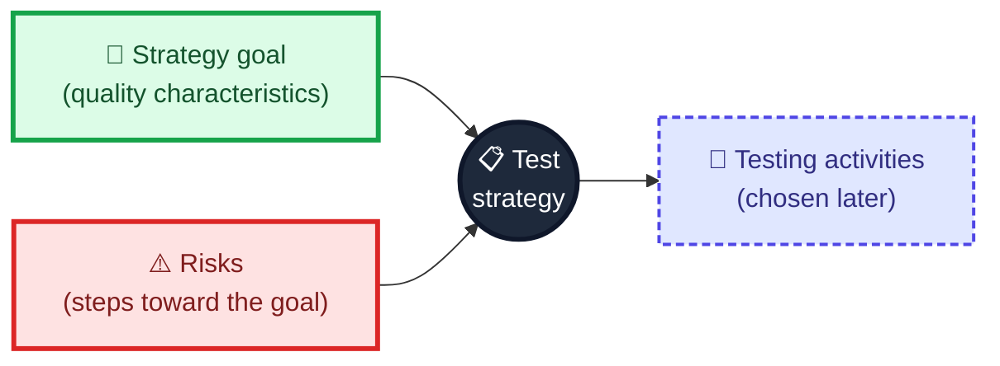

A clear goal also gives me something else I badly need: a way to **judge whether my strategy is working**. Without a target, I can't tell success from busywork.

---

## Defining quality

Let me start with an experiment. Search for something like "10 greatest albums" and open the first few results. You'll see overlap and differences, and some truly excellent records. But the thing that jumps out is that nobody agrees. Different people have different opinions about what's good. People even disagree with *themselves* over time. The book I'm drawing on points out that Rolling Stone's list of the greatest albums of all time shifted noticeably between 2003 and 2020, with a famous Beatles record falling from the very top to the mid-twenties. Different authors, perhaps, but the lesson stands: **time affects how we judge quality.**

Software quality works the same way. It's subjective and fluid. The definition I lean on captures this neatly:

> **"Quality is value to some person who matters at some point in time."**

It was built up in three layers by three different people, and each layer teaches me something:

| Layer | Contributor | What it adds | What I take from it |
|---|---|---|---|
| "Quality is value to some person" | Jerry Weinberg | Quality isn't a property of the product alone; it depends on people | User A may love my product while User B hates it |
| "...who matters" | James Bach and Michael Bolton | Some people matter more than others | I prioritize the people who keep the lights on |
| "...at some point in time" | David Greenlees | Context changes, so quality changes | A user's view today may not be their view tomorrow |

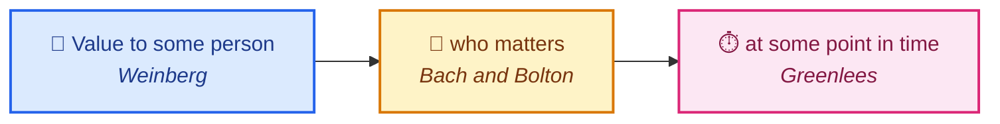

The "point in time" part is easiest to see with **situational disabilities**: situations that temporarily reduce a user's abilities. Think of a voice assistant like Siri. In the quiet of your living room it can feel brilliant. On a noisy street, the same assistant can feel useless. Same product, same person, different moment, different quality.

> **📝 Note:** This isn't a license to throw up my hands and say "quality is just opinion". It's the opposite. Because quality is subjective, I can *use* that subjectivity: by learning what quality means to the people who matter, I get a principled way to decide what to test and what to leave alone.

---

## Quality characteristics

If everyone's view of quality is different, how do I capture it, analyse it and distil it into goals? I need to strike a balance: enough detail to keep me on track, but not so much that I can't see the forest for the trees. The tool for that is the **quality characteristic**.

A quality characteristic describes *one aspect* of quality at a high level. A few examples:

| Characteristic | A product is high quality if... | Who might prize it |
|---|---|---|
| **Look and feel** | It looks good or feels good to use, with well-designed layouts, branding and sleek design | Consumer hardware and design-led products |
| **Security** | It keeps people protected: data stored safely, privacy respected | A password manager |
| **Accuracy** | It processes information correctly and returns precise results | A medical diagnosis tool |

There are many to choose from, and I can combine them to build a robust picture. The Test Eye Software Quality Characteristics list, by Rikard Edgren, Henrik Emilsson and Martin Jansson, includes **over 100** characteristics and is available as a PDF. When I've used it, the biggest benefit is that it surfaces characteristics I'd never have thought of unprompted.

For instance, users of a personal tax-filing service on an API platform might care about:

- **Intuitiveness:** the filing process should be as simple as possible.
- **Accuracy:** taxes must be calculated correctly.
- **Availability:** it must not go down on filing day.

That tells me to prioritize testing that teaches me about those characteristics over the rest.

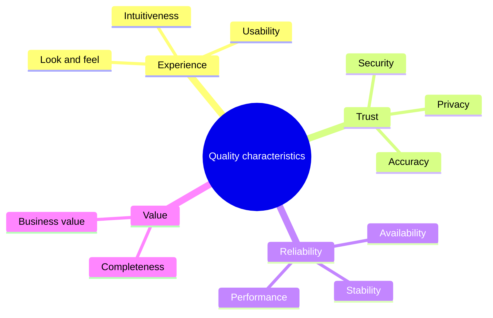

> **🧪 Activity:** Pick a product you use daily. Skim a quality characteristics list and write down a handful that matter to *you*. Put them in priority order. Are any of them ones you'd have thought of without the list?

---

## Getting to know my users

I can't choose the right characteristics without knowing my users. User research is a huge field in its own right, and if your organisation has people who do it, collaborate with them. If not, here are three approachable ways to learn.

### 1. Interview stakeholders and users

Asking is the fastest route, whether it's a formal interview or a chat over coffee. One piece of advice from experience: **let the characteristics emerge from a normal conversation.** Don't hand someone a list and ask them to pick. If you do, they'll tell you *everything* matters equally, which tells you nothing.

### 2. Talk to a proxy

Sometimes I can't reach real users. But feedback reaches my team through *some* channel, or I'd never know what to build. So I talk to the proxy: a product owner, a business analyst or another stakeholder. As a bonus, those conversations let me advocate for quality characteristics and nudge the organisation toward exploring quality with end users.

### 3. Observe live behaviour

Monitoring tools can reveal needs without a conversation. High traffic volume suggests performance characteristics matter. A feature that triggers a big drop-off in users makes me ask why: was it hard to use, ugly or broken? Those answers map to characteristics such as usability, attractiveness or completeness.

| Technique | Strength | Weakness | Characteristics it tends to reveal |
|---|---|---|---|
| Interviews | Rich, direct, explains *why* | Slow, small sample | Whatever users volunteer, often intuitiveness and value |
| Proxy conversations | Fast, usually available | Second-hand view | Business-facing priorities |
| Live behaviour | Large-scale, honest | Shows *what*, not *why* | Performance, usability, completeness |

> **⚠️ Caution:** Don't treat any single technique as the truth. Interviews can be polite, proxies can be wrong about users, and analytics can mislead about *why* people behave as they do. Triangulate.

Whatever I choose, the aim is to settle into a habit of actively seeking out what users want. Products grow and users change, so I build time into my strategy to **correct my course**: revisit conversations, reflect, and update characteristic priorities.

---

## Turning characteristics into strategy goals

Once I've gathered information, I analyse it to find which characteristics matter and use them as goals. The sandbox's users are hypothetical, but I can imagine them. Here's what a **guest** might want:

| Characteristic | What the guest wants |
|---|---|
| Completeness | Complete features to post bookings and get rooms |
| Intuitiveness | APIs that are easy to interact with |
| Stability | No crashes and no lost bookings (nobody wants to turn up to a B&B with no booking) |
| Privacy | Booking details kept secure |

And an **administrator**:

| Characteristic | What the admin wants |
|---|---|
| Completeness | All standard features to administer bookings and rooms |
| Intuitiveness | Administrative features that are easy to use |
| Stability | A site that doesn't crash when they make changes |
| Availability | A site that's always up |

Some characteristics match across both groups; some don't. As a team I'd decide a priority order. One sensible approach: put characteristics that matter to **both** groups first, then the guest's (a larger user base), then the admin's. That yields this goal:

> **My strategy aims to help the team improve the Intuitiveness, Completeness, Stability, Privacy and Availability of restful-booker-platform, in that order.**

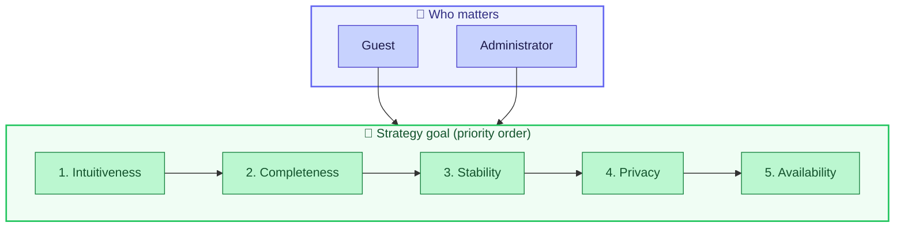

> **📝 Note:** This list is a *proposal*, not a law. Another team could reasonably put Privacy first. What matters is that the order is **explicit and agreed**, because it becomes my tie-breaker when I have to choose between risks.

> **🧪 Activity:** Put yourself in a guest's or admin's shoes. What would you add or remove? Write your list and keep it. It's worth revisiting later.

---

## What a risk really is

My goals tell me where I'm headed. Now I need steps to get there, and I find them by asking: *when could my quality characteristics be harmed?* Each such situation is a **risk**.

In software, a risk is simply **the possibility of something negatively impacting my product's quality**. It might be an off-by-one error that makes me accept bad data. It might be data corruption.

The most important thing to understand is that **a risk is a bet.** When I identify one, I don't know whether it'll ever materialize. Testing is how I find out. By pointing my attention at an area where a risk could bite, I get information that tells me whether it's real and needs mitigating.

And since I'll never have time to test every risk, I have to be selective. I choose the risks that matter most, test those, and place a bet that the others matter less. That's how risk becomes a *guide* for my strategy.

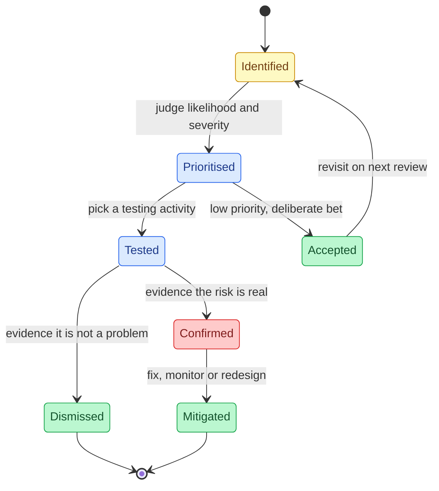

### The skeptical mindset

Spotting risks takes a **skeptical mindset**: analysing what I know and asking questions that challenge my assumptions. Take the "search results ordered by relevance" feature from the first post. I might ask:

- Can I be sure the results are relevant?
- What if search doesn't work the way I expected?
- Which search operators do we intend to support, and why?

Skepticism is *not* negativity. Testing sometimes earns a reputation for tearing down other people's hard work, and that's not the intent. I'm questioning unknowns so they don't hide unpleasant surprises. Being skeptical means caring about the **truth** of things, not about proving something right or wrong.

> **💡 Tip:** I find it helps to focus on what I **don't know**. Risks live in the unknowns. "What am I assuming here?" is one of the most productive questions in testing.

---

## Three techniques for finding risks

This can feel abstract, so there are techniques to focus attention. I'll cover three.

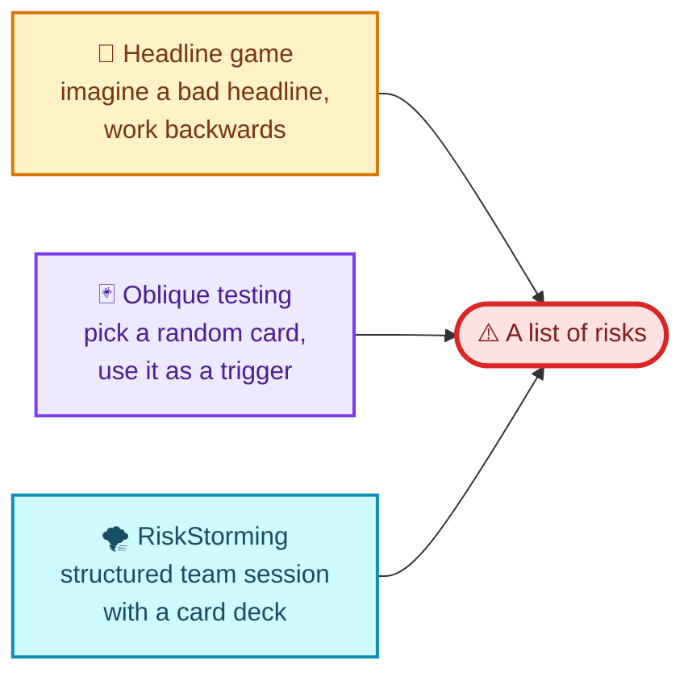

### The Headline game

Popularised by Elisabeth Hendrickson in her book *Explore It!*, this technique has you imagine made-up headlines, then work backwards to the risks that could cause each one. For the sandbox, a headline might be:

> *"Embarrassment for local business as B&B is overrun with double-booked guests."*

Working back, I can ask what could cause that:

- The double-booking validation feature is broken.
- Bookings are saved incorrectly.
- Stored bookings are cancelled without telling the guest.

Each headline is a trigger. Combined with my quality characteristics, it's a great way to find risks that matter. In RiskStorming, as we'll see, a characteristic can even be the trigger for the headline.

### Oblique testing

The Headline game takes imagination, and that suits some people more than others. **Oblique testing** is for those who want a more tangible trigger. It's based on Brian Eno's Oblique Strategies, cards that nudge artists toward fresh directions. Mike Talks adapted the idea into a deck of **28 cards**, each carrying a fake one-star review that you draw at random. One card reads:

> *"I thought this would make things easier to do! ONE STAR!!!"*

I use it as a prompt: how might my product earn a review like that? For the sandbox, it could be poor API documentation, unhelpful feedback, or too many calls needed to do one thing. The cards work because they're specific enough to start an idea but not so specific that repeated use produces the same ideas every time.

### RiskStorming

Both techniques above assume at least *some* skill with risk analysis. For teams new to it, **RiskStorming** provides structure. It's built on **TestSphere**, a deck of 100 cards in five categories, created by Beren Van Daele with Marcel Gehlen and Andrea Jensen. It guides a team through three phases:

1. Identify the **quality characteristics** that might affect the product or feature.
2. Identify the **risks** that could affect those characteristics.
3. Identify ideas for **how to test** those risks.

It's effective because it gives enough structure to keep the session on track but not so much that it chokes good ideas.

| Technique | Needs imagination? | Group or solo? | Best when | Watch out for |
|---|---|---|---|---|
| Headline game | High | Either | You want vivid, business-flavoured risks | Can wander off topic |
| Oblique testing | Medium | Either | You're stuck or ideas feel repetitive | Random cards may not fit every context |
| RiskStorming | Low (structure helps) | Group | A team is new to risk analysis | Needs time and cards or the online tool |

> **📝 Note:** These techniques combine well. During RiskStorming's risk phase, I can use the Headline game to generate risks for a particular aspect.

---

## RiskStorming on the sandbox: the results

Let me apply the first two RiskStorming phases to the sandbox.

### Phase 1: quality

I choose **six of the 20 quality aspect cards** from the TestSphere deck. They should represent what quality means to my users, so I start from my five characteristics and pick the closest cards:

| My characteristic | Closest TestSphere aspect(s) I used |
|---|---|
| Intuitiveness | User-friendliness |
| Completeness | Functionality, Business value capability |
| Stability | Stability |
| Privacy | Security and permission |
| Availability | Availability |

> **📝 Note:** That mapping is my reading of how the book's lists line up. Two cards map to Completeness, and the cards don't match my characteristic names one-to-one. That's normal. The deck is a prompt, not a rulebook.

### Phase 2: risks

For each of the six aspects I generate risks, and I **time-box** it, limiting myself to three per aspect. Time-boxing matters: without it the list balloons, and I can't test everything anyway.

| Aspect | Risk |
|---|---|
| **User-friendliness** | Incorrect status codes or responses are sent on successful requests |
| | Vague or incorrect error messages are sent when a user makes a mistake |
| | Documentation for API requests is hard to decipher |
| **Functionality** | Existing features break when new changes are implemented |
| | Implemented features don't match what the user requested |
| | Validation on APIs doesn't work as expected |
| **Availability** | APIs fail under the stress of too many users |
| | Memory leaks cause APIs to fail |
| | Bookings can't be made on days that say they are available |
| **Stability** | APIs in the platform send incorrect HTTP requests and responses to one another |
| | The API fails to deploy correctly |
| | Intermittent failures come from APIs |
| **Business value capability** | The admin is unable to update the look and feel of the guest pages |
| | Details that the admin sets aren't saved or shared correctly |
| | Existing features don't match an admin's requirements |
| **Security and permission** | Functionality that is only for the admin is accessible to others |
| | Private data can be stolen |
| | The site can be manipulated to attack users |

Those 18 risks are the steps toward my strategy's goals. My strategy model is now complete in outline:

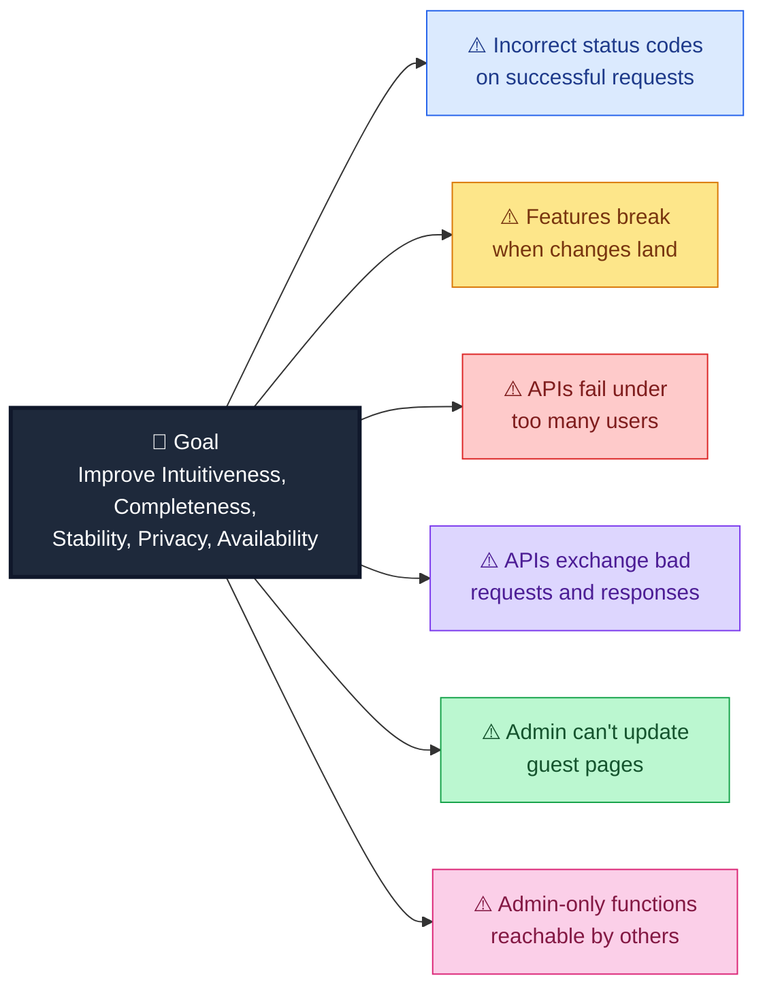

*(One risk per aspect, to keep the picture readable.)*

> **🧪 Activity:** Try RiskStorming yourself. The Ministry of Testing offers activity PDFs and a free online version of the tool. Run the first two phases and see what you come up with.

Like quality characteristics, risks need regular review. Revisiting them keeps my list current and, just as important, sharpens my own risk-spotting skills. There's no substitute for practice.

---

## Prioritising risks

Eighteen risks is too many to chase at once, so I rank them with three factors.

**1. The quality characteristic.** If intuitiveness is my number one characteristic, risks that threaten it deserve attention first.

**2. Likelihood.** How probable is it that this risk will actually hurt quality? If the forecast says 80% chance of rain, I take a coat. At 20%, maybe not.

**3. Severity.** If it does happen, how big is the damage?

Likelihood and severity work together:

| | **Low severity** | **High severity** |
|---|---|---|
| **High likelihood** | Annoying: fix when cheap | **Act now** |
| **Low likelihood** | Let it slide | Plan mitigation: rare but painful |

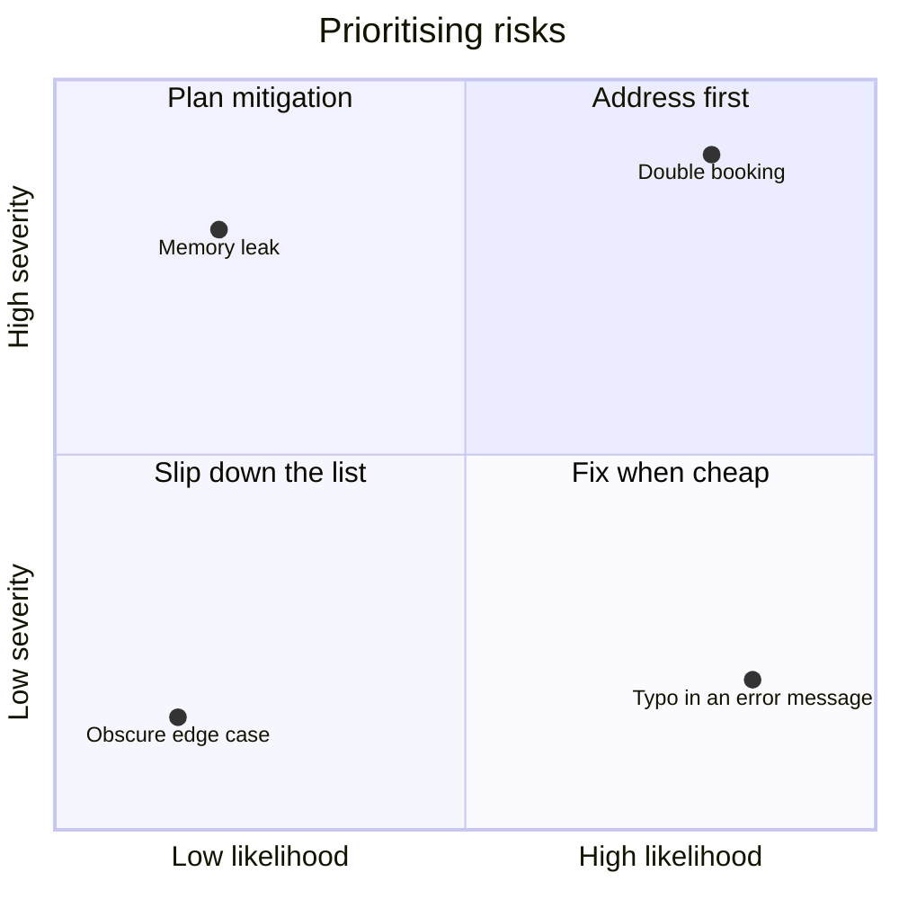

Here's where the three factors interact. Suppose I have two risks:

- A booking made in the past returns an unclear error message (*intuitiveness*).
- The admin is unable to add rooms to be booked (*completeness*).

Intuitiveness outranks completeness in my characteristic order. But if the second risk has high likelihood *and* high severity, it makes sense to deal with it first. If admins can't add rooms, there's nothing to book at all.

> **⚠️ Caution:** Prioritisation is ultimately a **guessing game**. My ratings are estimates, and real likelihood and severity aren't binary. The best defence is to make each guess as *informed* as I can and to re-evaluate regularly as I learn.

> **🧪 Activity:** Take the 18 risks and put them in priority order. Notice how you judge likelihood and severity: gut feeling, or high/medium/low grades? Then compare with the tool in the next section.

---

## Hands-on: a tested risk register

Spreadsheets are fine for a risk list, but I wanted to see the logic written down and **testable**. So I wrote a small risk register in pure Python (standard library only). It:

- validates every risk (unknown characteristics and out-of-range ratings are rejected),
- scores risks as likelihood × severity (each from 1 to 3),
- ranks them, using characteristic order as the tie-breaker,
- checks RiskStorming-style **coverage** and the three-per-aspect time-box,
- groups risks by testing activity,
- emits a Markdown table and a Mermaid quadrant chart.

> **⚠️ Caution: the numbers are mine.** The 18 risks come from the chapter. But the **likelihood and severity ratings, the mapping from aspects to characteristics, and the testing-activity assignments are my own illustrative guesses.** The book doesn't provide them, and your product would get different numbers. Don't treat my output as a finding about the sandbox.

### `risk_register.py`

```python
"""A small risk register: quality characteristics -> risks -> priorities."""
from collections import Counter, defaultdict
from dataclasses import dataclass

# Strategy goal, in priority order (illustrative, from the chapter's example)
CHARACTERISTICS = ["Intuitiveness", "Completeness", "Stability", "Privacy", "Availability"]

LEVELS = {1: "Low", 2: "Medium", 3: "High"}
MAX_RISKS_PER_ASPECT = 3  # time-boxing, as in RiskStorming phase 2


@dataclass(frozen=True)
class Risk:
    rid: str
    name: str
    characteristic: str   # must be one of CHARACTERISTICS
    likelihood: int       # 1 (low) .. 3 (high)
    severity: int         # 1 (low) .. 3 (high)
    activity: str = "unassigned"
    aspect: str = ""      # the RiskStorming card the risk came from

    def __post_init__(self):
        if self.characteristic not in CHARACTERISTICS:
            raise ValueError(f"Unknown characteristic: {self.characteristic}")
        for label, value in (("likelihood", self.likelihood), ("severity", self.severity)):
            if value not in LEVELS:
                raise ValueError(f"{label} must be 1, 2 or 3, got {value!r}")

    @property
    def score(self) -> int:
        return self.likelihood * self.severity

    @property
    def bucket(self) -> str:
        if self.score >= 6:
            return "Act now"
        if self.score >= 3:
            return "Plan"
        return "Watch"


def prioritise(risks):
    """Highest score first. Ties go to the more important quality
    characteristic, then to the name, so the order is deterministic."""
    rank = {c: i for i, c in enumerate(CHARACTERISTICS)}
    return sorted(risks, key=lambda r: (-r.score, rank[r.characteristic], r.name))


def coverage(risks, aspects):
    """Which aspects have no risks yet, and which blew the time-box?"""
    counts = Counter(r.aspect for r in risks)
    return {
        "counts": {a: counts.get(a, 0) for a in aspects},
        "missing": [a for a in aspects if counts.get(a, 0) == 0],
        "over_limit": [a for a in aspects if counts.get(a, 0) > MAX_RISKS_PER_ASPECT],
    }


def group_by_activity(risks):
    groups = defaultdict(list)
    for r in prioritise(risks):
        groups[r.activity].append(r.rid)
    return dict(groups)


def to_markdown_table(risks) -> str:
    rows = ["| Rank | ID | Risk | Characteristic | L | S | Score | Bucket |",
            "|---|---|---|---|---|---|---|---|"]
    for i, r in enumerate(prioritise(risks), 1):
        rows.append(f"| {i} | {r.rid} | {r.name} | {r.characteristic} | "
                    f"{LEVELS[r.likelihood]} | {LEVELS[r.severity]} | {r.score} | {r.bucket} |")
    return "\n".join(rows)


def to_quadrant_mermaid(risks) -> str:
    """Likelihood (x) against severity (y). Risks that share a cell are
    nudged apart so their labels do not sit on top of each other."""
    seen = Counter()
    lines = ["quadrantChart",
             "    title Risk priority: likelihood vs severity",
             "    x-axis Low likelihood --> High likelihood",
             "    y-axis Low severity --> High severity",
             "    quadrant-1 Act now",
             "    quadrant-2 Plan mitigation",
             "    quadrant-3 Watch",
             "    quadrant-4 Fix when cheap"]
    for r in risks:
        cell = (r.likelihood, r.severity)
        k = seen[cell]
        seen[cell] += 1
        x = 0.15 + (r.likelihood - 1) * 0.35 + ((k % 3) - 1) * 0.08
        y = 0.15 + (r.severity - 1) * 0.35 - (k // 3) * 0.06
        lines.append(f"    {r.rid}: [{x:.2f}, {y:.2f}]")
    return "\n".join(lines)


# ---- The chapter's 18 RiskStorming risks. Likelihood/severity are MY
# illustrative guesses, and so are the aspect -> characteristic mapping
# and the activity assignments. ----
ASPECTS = ["User-friendliness", "Functionality", "Availability", "Stability",
           "Business value capability", "Security and permission"]

ASPECT_TO_CHARACTERISTIC = {
    "User-friendliness": "Intuitiveness",
    "Functionality": "Completeness",
    "Availability": "Availability",
    "Stability": "Stability",
    "Business value capability": "Completeness",
    "Security and permission": "Privacy",
}

_RAW = [
    # aspect, name, L, S, activity
    ("User-friendliness", "Incorrect status codes or responses on successful requests", 3, 2, "automated checks"),
    ("User-friendliness", "Vague or incorrect error messages when a user makes a mistake", 3, 2, "API design testing"),
    ("User-friendliness", "Documentation for API requests is hard to decipher", 2, 1, "API design testing"),
    ("Functionality", "Existing features break when new changes are implemented", 3, 3, "automated checks"),
    ("Functionality", "Implemented features don't match what the user requested", 2, 3, "API design testing"),
    ("Functionality", "Validation on APIs doesn't work as expected", 2, 3, "exploratory testing"),
    ("Availability", "APIs fail under the stress of too many users", 2, 3, "performance testing"),
    ("Availability", "Memory leaks cause APIs to fail", 1, 3, "performance testing"),
    ("Availability", "Bookings can't be made on days that say they are available", 2, 3, "exploratory testing"),
    ("Stability", "APIs send incorrect HTTP requests and responses to one another", 2, 3, "contract testing"),
    ("Stability", "An API fails to deploy correctly", 2, 2, "automated checks"),
    ("Stability", "Intermittent failures come from APIs", 3, 2, "exploratory testing"),
    ("Business value capability", "Admin is unable to update the look and feel of guest pages", 1, 2, "exploratory testing"),
    ("Business value capability", "Details the admin sets aren't saved or shared correctly", 2, 2, "automated checks"),
    ("Business value capability", "Existing features don't match an admin's requirements", 2, 2, "API design testing"),
    ("Security and permission", "Admin-only functionality is accessible to others", 2, 3, "exploratory testing"),
    ("Security and permission", "Private data can be stolen", 1, 3, "exploratory testing"),
    ("Security and permission", "The site can be manipulated to attack users", 1, 3, "exploratory testing"),
]


def default_risks():
    return [Risk(f"R{i}", name, ASPECT_TO_CHARACTERISTIC[aspect], l, s, activity, aspect)
            for i, (aspect, name, l, s, activity) in enumerate(_RAW, 1)]
```

A few design choices I want to be upfront about:

| Choice | Why I made it | Alternative |
|---|---|---|
| Three levels (1 to 3) | Fast to agree on in a workshop | Five levels, or numeric probabilities |
| Score = likelihood × severity | Simple and widely used | Weighted or lookup-table scoring |
| Score first, characteristic as tie-break | Matches the book's example where a high-impact risk beats a higher-ranked characteristic | Rank by characteristic first |
| Frozen dataclass | A risk's rating shouldn't change silently | Mutable objects with an audit trail |

### `test_risk_register.py`

I wanted the tests to describe the *ideas* in the chapter, so several of them are the chapter's own scenarios in code. The most important one encodes the unclear-error-message versus admin-can't-add-rooms example.

```python
import unittest

from risk_register import (ASPECTS, CHARACTERISTICS, Risk, coverage, default_risks,
                           group_by_activity, prioritise, to_markdown_table, to_quadrant_mermaid)


def mk(rid, char="Stability", l=1, s=1, aspect="Stability", name=None):
    return Risk(rid, name or rid, char, l, s, "x", aspect)


class RiskTests(unittest.TestCase):
    def test_invalid_inputs_are_rejected(self):
        with self.assertRaises(ValueError):
            Risk("R", "n", "Sparkliness", 1, 1)
        with self.assertRaises(ValueError):
            Risk("R", "n", "Stability", 4, 1)
        with self.assertRaises(ValueError):
            Risk("R", "n", "Stability", 1, 0)

    def test_score_and_bucket(self):
        self.assertEqual((mk("a", l=3, s=3).score, mk("a", l=3, s=3).bucket), (9, "Act now"))
        self.assertEqual(mk("a", l=2, s=3).bucket, "Act now")      # 6
        self.assertEqual(mk("a", l=2, s=2).bucket, "Plan")         # 4
        self.assertEqual(mk("a", l=1, s=2).bucket, "Watch")        # 2

    def test_high_score_beats_a_more_important_characteristic(self):
        # The chapter's example: unclear error message (intuitiveness, #1)
        # versus admin unable to add rooms (completeness, #2) with high L and S.
        unclear = mk("unclear", "Intuitiveness", 1, 1)
        no_rooms = mk("no_rooms", "Completeness", 3, 3)
        self.assertEqual([r.rid for r in prioritise([unclear, no_rooms])], ["no_rooms", "unclear"])

    def test_ties_go_to_the_more_important_characteristic(self):
        a = mk("avail", "Availability", 2, 2)
        b = mk("intuit", "Intuitiveness", 2, 2)
        c = mk("stab", "Stability", 2, 2)
        self.assertEqual([r.rid for r in prioritise([a, b, c])], ["intuit", "stab", "avail"])

    def test_ordering_is_deterministic(self):
        risks = default_risks()
        self.assertEqual(prioritise(risks), prioritise(list(reversed(risks))))

    def test_coverage_finds_missing_and_over_limit(self):
        risks = [mk(f"r{i}", aspect="Stability") for i in range(4)]
        report = coverage(risks, ["Stability", "Availability"])
        self.assertEqual(report["missing"], ["Availability"])
        self.assertEqual(report["over_limit"], ["Stability"])

    def test_default_data_matches_the_chapter_shape(self):
        risks = default_risks()
        self.assertEqual(len(risks), 18)
        self.assertEqual(len({r.rid for r in risks}), 18)
        report = coverage(risks, ASPECTS)
        self.assertEqual(report["missing"], [])
        self.assertEqual(report["over_limit"], [])
        self.assertTrue(all(n == 3 for n in report["counts"].values()))
        self.assertTrue(all(r.characteristic in CHARACTERISTICS for r in risks))

    def test_group_by_activity_keeps_every_risk_once(self):
        groups = group_by_activity(default_risks())
        flat = [rid for ids in groups.values() for rid in ids]
        self.assertEqual(sorted(flat), sorted(r.rid for r in default_risks()))

    def test_markdown_table_has_header_plus_one_row_per_risk(self):
        lines = to_markdown_table(default_risks()).splitlines()
        self.assertEqual(len(lines), 2 + 18)
        self.assertTrue(lines[2].startswith("| 1 |"))

    def test_quadrant_is_well_formed_and_in_bounds(self):
        text = to_quadrant_mermaid(default_risks())
        self.assertTrue(text.startswith("quadrantChart"))
        points = [l for l in text.splitlines() if l.strip().startswith("R")]
        self.assertEqual(len(points), 18)
        for line in points:
            x, y = [float(v) for v in line.split("[")[1].rstrip("]").split(",")]
            self.assertTrue(0 <= x <= 1 and 0 <= y <= 1, line)
        coords = [l.split(": ")[1] for l in points]
        self.assertEqual(len(set(coords)), 18, "labels should not sit exactly on top of each other")


if __name__ == "__main__":
    unittest.main(verbosity=2)
```

Running them:

```bash
python3 test_risk_register.py
```

```text
test_coverage_finds_missing_and_over_limit  ... ok
test_default_data_matches_the_chapter_shape  ... ok
test_group_by_activity_keeps_every_risk_once  ... ok
test_high_score_beats_a_more_important_characteristic  ... ok
test_invalid_inputs_are_rejected  ... ok
test_markdown_table_has_header_plus_one_row_per_risk  ... ok
test_ordering_is_deterministic  ... ok
test_quadrant_is_well_formed_and_in_bounds  ... ok
test_score_and_bucket  ... ok
test_ties_go_to_the_more_important_characteristic  ... ok

----------------------------------------------------------------------
Ran 10 tests in 0.00s

OK
```

### The demo and what it taught me

```python
from risk_register import (ASPECTS, coverage, default_risks, group_by_activity,
                           prioritise, to_quadrant_mermaid)
from collections import Counter

risks = default_risks()
print("Top 6 risks:")
for r in prioritise(risks)[:6]:
    print(f"  {r.rid:<4} score={r.score} [{r.bucket}] ({r.characteristic}) {r.name}")

print("\nBuckets:", dict(Counter(r.bucket for r in risks)))
print("Coverage:", coverage(risks, ASPECTS)["counts"])
print("\nBy activity:")
for activity, ids in sorted(group_by_activity(risks).items()):
    print(f"  {activity:<20} {len(ids)} risks: {', '.join(ids)}")
print()
print(to_quadrant_mermaid(risks))
```

```text
Top 6 risks:
  R4   score=9 [Act now] (Completeness) Existing features break when new changes are implemented
  R1   score=6 [Act now] (Intuitiveness) Incorrect status codes or responses on successful requests
  R2   score=6 [Act now] (Intuitiveness) Vague or incorrect error messages when a user makes a mistake
  R5   score=6 [Act now] (Completeness) Implemented features don't match what the user requested
  R6   score=6 [Act now] (Completeness) Validation on APIs doesn't work as expected
  R10  score=6 [Act now] (Stability) APIs send incorrect HTTP requests and responses to one another

Buckets: {'Act now': 10, 'Watch': 2, 'Plan': 6}
Coverage: {'User-friendliness': 3, 'Functionality': 3, 'Availability': 3, 'Stability': 3, 'Business value capability': 3, 'Security and permission': 3}

By activity:
  API design testing   4 risks: R2, R5, R15, R3
  automated checks     4 risks: R4, R1, R14, R11
  contract testing     1 risks: R10
  exploratory testing  7 risks: R6, R12, R16, R9, R17, R18, R13
  performance testing  2 risks: R7, R8

quadrantChart
    title Risk priority: likelihood vs severity
    x-axis Low likelihood --> High likelihood
    y-axis Low severity --> High severity
    quadrant-1 Act now
    quadrant-2 Plan mitigation
    quadrant-3 Watch
    quadrant-4 Fix when cheap
    R1: [0.77, 0.50]
    R2: [0.85, 0.50]
    R3: [0.42, 0.15]
    R4: [0.77, 0.85]
    R5: [0.42, 0.85]
    R6: [0.50, 0.85]
    R7: [0.58, 0.85]
    R8: [0.07, 0.85]
    R9: [0.42, 0.79]
    R10: [0.50, 0.79]
    R11: [0.42, 0.50]
    R12: [0.93, 0.50]
    R13: [0.07, 0.50]
    R14: [0.50, 0.50]
    R15: [0.58, 0.50]
    R16: [0.58, 0.79]
    R17: [0.15, 0.85]
    R18: [0.23, 0.85]
```

I rendered that quadrant output with some colours added (the points are exactly the generated ones):

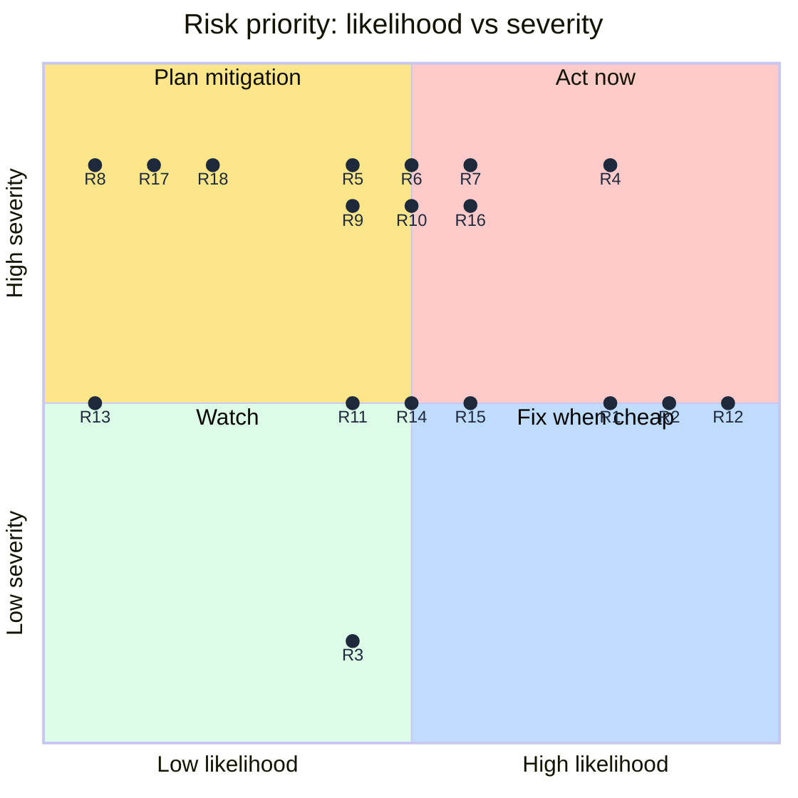

And how the buckets split:

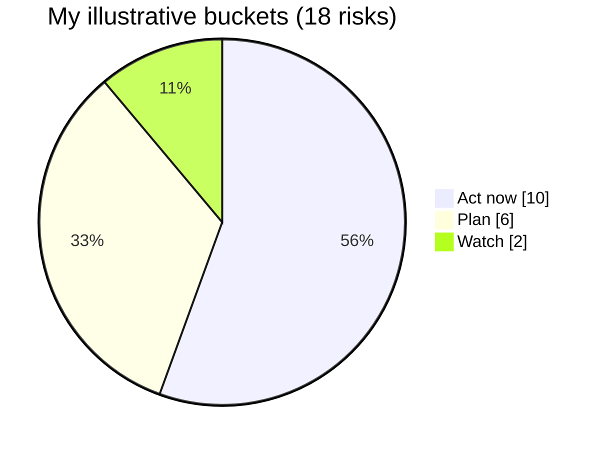

Here is the lesson I took from running it, and it's the part I find most useful. **Ten of my eighteen risks landed in "Act now."** That's more than half. I didn't engineer that; it fell out of my honest guesses and a threshold of 6. But it exposes a real problem: *if most things are urgent, the ranking isn't helping me decide.*

| Symptom | Likely cause | What I'd try |
|---|---|---|
| More than half the risks are "Act now" | Three-level scale is too coarse, or thresholds too loose | Add levels, or raise the threshold |
| Many ties at the same score | Score = L × S collapses different combinations (2×3 and 3×2 both give 6) | Break ties on severity, or add a third factor such as detectability |
| Quadrant labels overlap | Several risks share a cell | Nudge points apart (the tool does this) or filter the chart |

> **💡 Tip:** Notice that 2×3 and 3×2 both score 6, but they're not the same risk. "Rare but catastrophic" and "frequent but moderate" call for different testing. The score is a *summary*, so I always look at the two inputs too.

> **📝 Note:** If your register says everything is a priority, that's information about your register, not about your product. Rescale, discuss, and decide what you're prepared to *not* test.

---

## Matching risks to testing activities

Once I have goals and a prioritised risk list, I can think about *what testing to do and where*. The book gives one example: for the risk "vague or incorrect error messages are sent when a user makes a mistake", which threatens intuitiveness, I might use **API design testing**, so that error messages are discussed and clarified before they exist.

That's one example, and my project will have many risks needing different approaches. Some activities will cover many risks at once. Choosing well needs familiarity with the range of activities, from automation tools to testing abstract ideas, which is the subject of the next part of the book.

To show how the pairing *might* look, my register assigns an activity to each risk. These assignments are my own first guesses, not the book's:

| Risk (abbreviated) | Characteristic | Activity I'd lean on | My reasoning |
|---|---|---|---|
| Vague or incorrect error messages | Intuitiveness | API design testing | Fix wording before it's built (this is the book's example) |
| Existing features break with new changes | Completeness | Automated checks | Repeatable confirmation catches regressions |
| Features don't match what was requested | Completeness | API design testing | Clarify expectations up front |
| Validation doesn't work as expected | Completeness | Exploratory testing | Humans find odd inputs |
| APIs send bad requests to one another | Stability | Contract testing | Verifies APIs still agree |
| APIs fail under too many users | Availability | Performance testing | Directly measures behaviour under load |
| Admin-only functions reachable by others | Privacy | Exploratory testing | Probing permissions with curiosity |

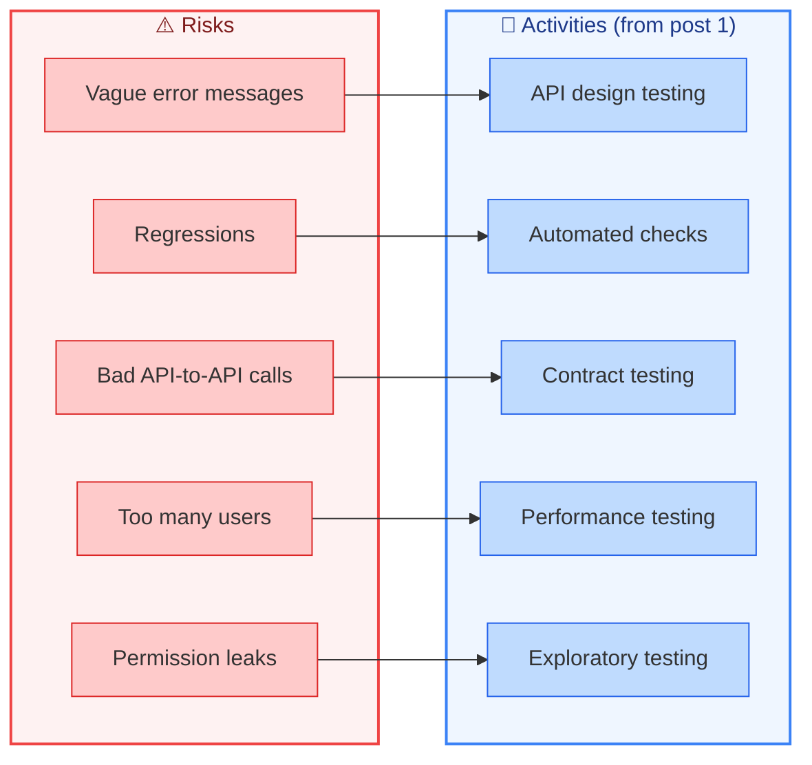

> **⚠️ Caution:** Don't read this as a one-to-one lookup table. Real risks often need *several* activities, and one activity (exploratory testing, say) covers many risks. Also, an activity can *reveal* new risks, which sends me back to the start of the cycle.

For now I'm pausing the strategy. Before I commit to anything, I want to learn what each activity can and can't do. Then I'll return and decide what to test and when.

---

## Pitfalls, cheat sheet and summary

### Pitfalls I try to avoid

| Pitfall | Why it hurts | What I do instead |
|---|---|---|
| Starting with activities, not goals | I can't tell whether my work is succeeding | Define characteristics first |
| Showing users a list and asking them to pick | They say "all of them" | Have a conversation and let characteristics emerge |
| Treating my guess about users as fact | I optimise for people who don't exist | Talk to users or their proxies |
| Skipping the "who matters" question | I chase the loudest voice | Prioritise the people who sustain the product |
| Listing risks without a time-box | The list balloons and nobody acts | Cap risks per aspect |
| Trying to test every risk | Impossible and exhausting | Accept that some risks are a deliberate bet |
| Rating likelihood and severity once and forgetting | Context and users change | Re-review on a schedule |
| Confusing skepticism with negativity | Teammates get defensive | Frame risks as questions about the unknown |
| Trusting a score blindly | Different inputs can produce the same number | Look at likelihood and severity separately |

### Cheat sheet

| Step | Question I ask | Output |
|---|---|---|
| 1. Define quality | Who matters, and what is valuable to them *now*? | A shared definition |
| 2. Learn about users | What do they say, and what do they do? | Evidence about priorities |
| 3. Pick characteristics | Which aspects of quality matter most, in what order? | Ordered goal list |
| 4. Find risks | When could those characteristics be harmed? | Risk list (time-boxed) |
| 5. Prioritise | How likely, and how bad, and which characteristic? | Ranked risk list |
| 6. Choose activities | What testing best reduces each top risk? | Strategy inputs |
| 7. Review | What has changed since last time? | Updated goals and risks |

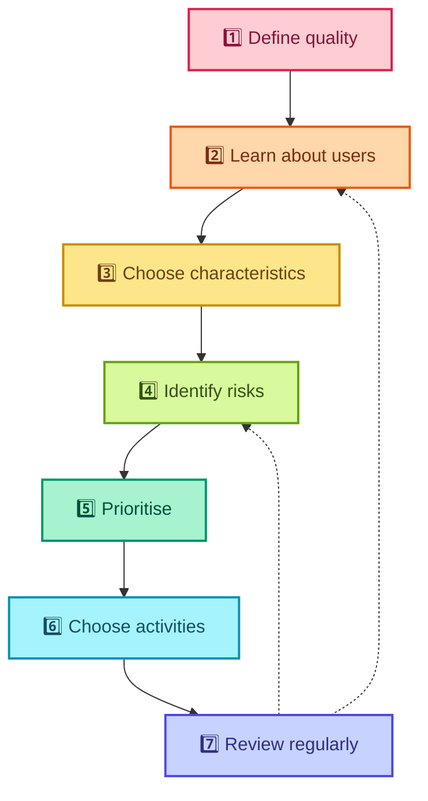

### Key takeaways

- **A strategy needs a goal.** Without one, it becomes directionless, and I can't judge its success.
- **My goal is to help improve quality**, and quality means different things to different people.
- **"Quality is value to some person who matters at some point in time."** Each phrase makes me ask a question: which person, why do they matter, and when?
- **Quality characteristics** turn a fuzzy idea into a short, ordered list I can act on.
- **Risks are bets**, and they're my opportunities to test. I can't test them all, so I choose.
- **Be skeptical, not negative.** Hunt in the unknowns.
- **Headline game, Oblique testing and RiskStorming** are three different ways to trigger risk ideas.
- **Prioritise with three factors:** quality characteristic, likelihood and severity, and remember it's an informed guess.
- **Then match activities to risks**, which is where the next part of the journey begins.

### Quick glossary

| Term | Meaning |
|---|---|
| **Quality** | Value to some person who matters at some point in time |
| **Quality characteristic** | A high-level description of one aspect of quality (e.g. availability) |
| **Situational disability** | A temporary reduction in ability caused by circumstances |
| **Risk** | The possibility of something negatively impacting quality |
| **Likelihood** | How probable it is that a risk will occur |
| **Severity** | How large the impact is if it does |
| **Headline game** | Imagining bad headlines and working back to the risks that cause them |
| **Oblique testing** | Using random one-star-review cards as risk triggers |
| **RiskStorming** | A three-phase team technique using TestSphere cards: quality, risks, test ideas |
| **TestSphere** | A 100-card deck covering quality aspects, techniques and patterns |
| **Time-box** | A fixed limit on time or quantity, to stop work expanding |

### Where I go next

With goals and a prioritised risk list in hand, the next step is to learn the **menu of testing activities**: how each one works, what it's good at, and which risks it reduces. Only then can I return to the strategy and decide what to test, and when.

If you take one habit from this post, make it this: **before you test anything, be able to say who you're testing for, what they value, and what could go wrong.** If you can say those three things clearly, you're already testing with purpose.

---

*Source and credits:* this post is based on the chapter "Quality and risk". The definition of quality is credited there to Jerry Weinberg, James Bach and Michael Bolton, and David Greenlees. The Headline game comes from Elisabeth Hendrickson, Oblique testing from Mike Talks (after Brian Eno), and RiskStorming and TestSphere from Beren Van Daele with Marcel Gehlen and Andrea Jensen. The Python risk register, its tests and its ratings are my own illustrations, written and run for this post.
