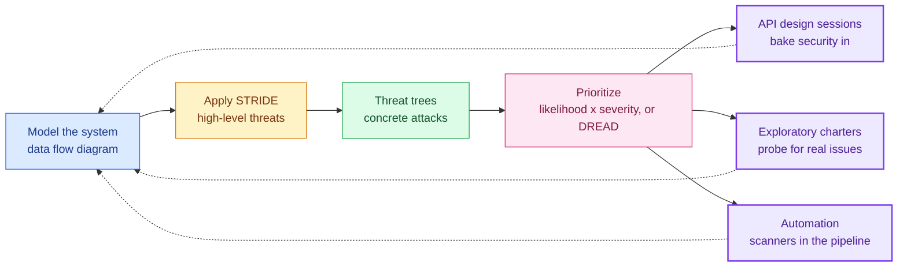
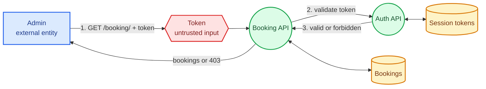
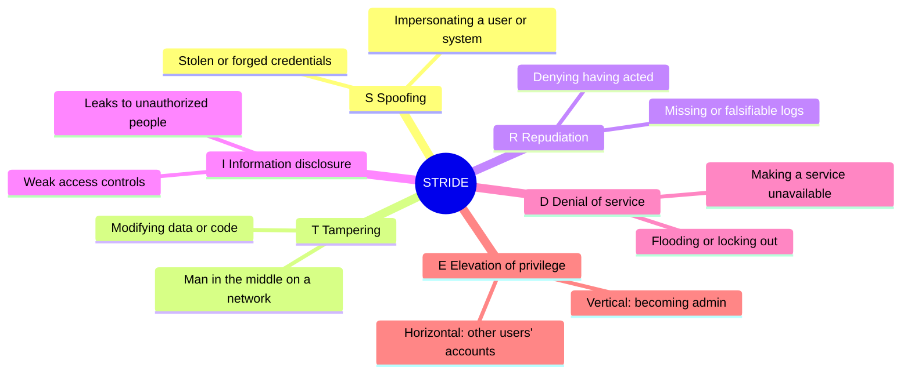
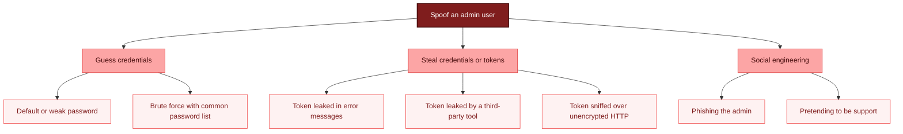
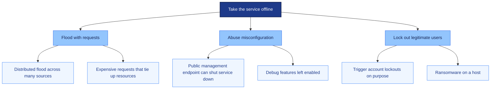
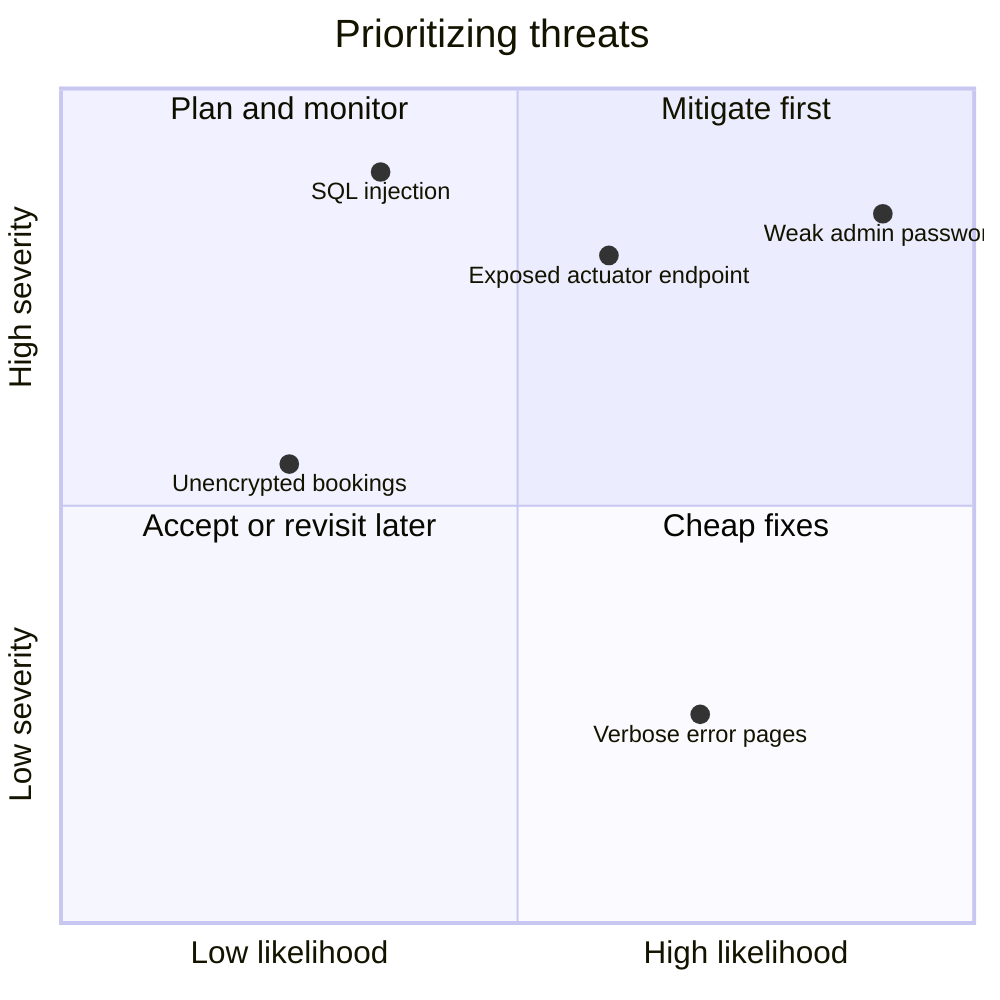
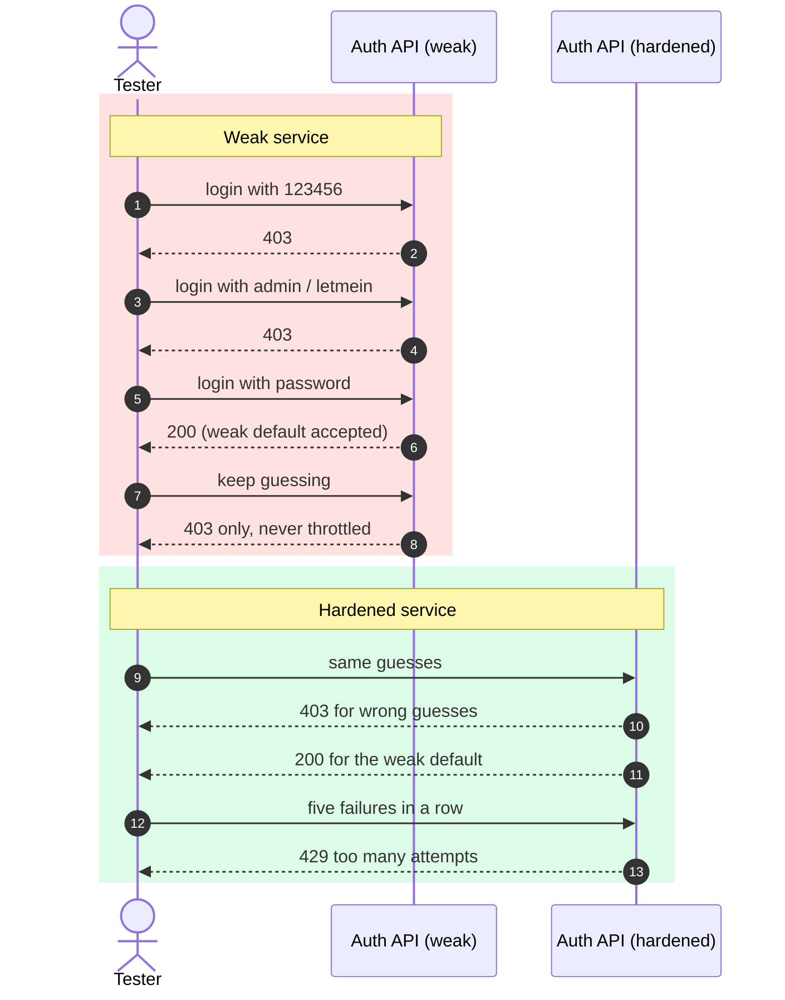
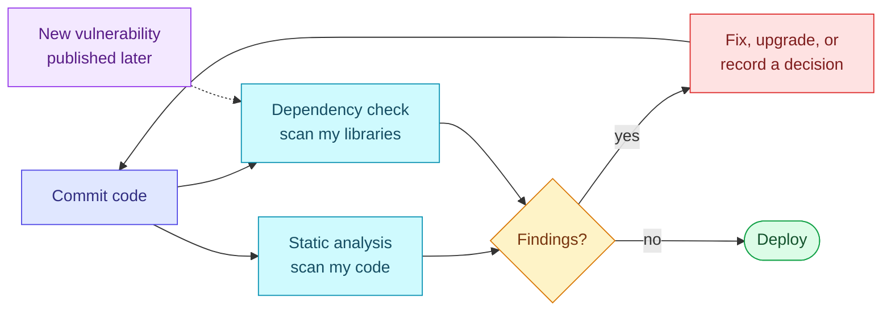
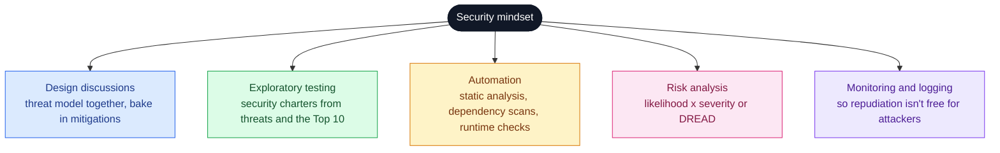
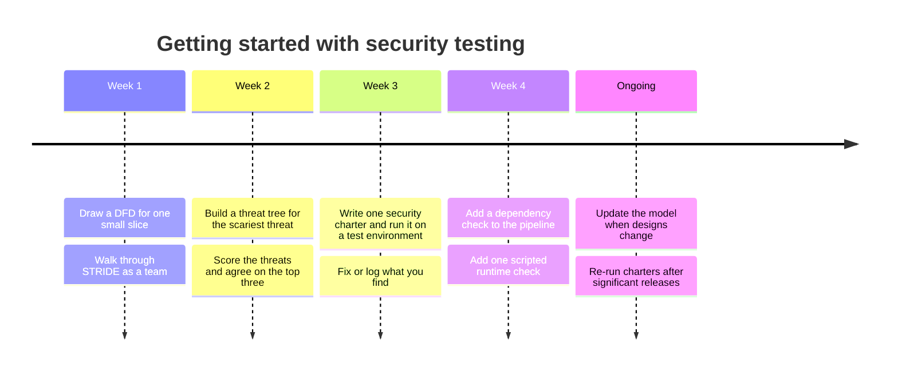

# Security Testing Is Not a Secret Club: Threat Modeling, STRIDE, DREAD and a Security Mindset


For years I assumed security testing belonged to someone else. I pictured people in dark rooms chaining together obscure exploits, and I filed the whole field under "needs superhuman technical skills, not for me."

That assumption was wrong, and it kept me from contributing to something I care about. Security testing *does* involve deep technical knowledge at the expert end, but at its core it is the same job I already do as a tester: understand a system, find the risks that threaten its quality, rank them, and reduce them. The only difference is the quality characteristics in the spotlight, which here are **security** and **privacy**.

In this post I'll show you how I reuse skills I already had (modeling, risk analysis, heuristics, exploratory testing, automation) to start doing useful security testing. I'll cover threat modeling with data flow diagrams, the STRIDE heuristic, threat trees, DREAD prioritization, and how to thread a security mindset through design sessions, exploratory testing, and pipelines.

> [!NOTE]
> **How the code here was verified.** The Python scripts were run on Python 3.12 using only the standard library, and the output blocks are real. They target a tiny deliberately weak service that binds to `127.0.0.1`. Commands for third-party tools (Burp Suite, SpotBugs, Dependency-Check) are described from standard usage and are marked **Not run here**, because I couldn't execute them in my environment.

> [!CAUTION]
> **Only test systems you own or have explicit written permission to test.** Probing someone else's login page, even gently, can be illegal and can lock real people out. Everything in this post is designed for your own machine or a dedicated test environment.

## Table of contents

1. [The big picture](#1-the-big-picture)
2. [Threat modeling in three steps](#2-threat-modeling-in-three-steps)
3. [Step 1: model the system with a data flow diagram](#3-step-1-model-the-system-with-a-data-flow-diagram)
4. [Step 2: find threats with STRIDE](#4-step-2-find-threats-with-stride)
5. [Step 3: dig deeper with threat trees](#5-step-3-dig-deeper-with-threat-trees)
6. [Prioritizing with likelihood, severity and DREAD](#6-prioritizing-with-likelihood-severity-and-dread)
7. [Security in API design sessions](#7-security-in-api-design-sessions)
8. [Exploratory security testing](#8-exploratory-security-testing)
9. [Automation: static analysis and dependency checks](#9-automation-static-analysis-and-dependency-checks)
10. [Security across the whole strategy](#10-security-across-the-whole-strategy)
11. [Cheat sheet and summary](#11-cheat-sheet-and-summary)

---

## 1. The big picture

Here's how the pieces fit together. Threat modeling sits in the middle and feeds everything else.



The dotted lines matter. Every discovery should loop back to improve the model, so the model gets better over time instead of going stale in a wiki page.

### Why this is more accessible than it looks

| Security activity | The testing skill it reuses |
|---|---|
| Threat modeling | Modeling a system to understand it |
| Prioritizing threats | Risk analysis (likelihood and severity) |
| STRIDE | Heuristics and mnemonics |
| Security charters | Exploratory testing |
| Dependency and static scanning | Automated checks as change indicators |
| Threat modeling in design sessions | Collaborative API design discussions |

If you've done any of the left-hand column, you've already done the right.

---

## 2. Threat modeling in three steps

A threat model is just a structured way to answer: *what are we protecting, and what could go wrong?* I follow three steps:

1. **Create a model** of the system I can analyze.
2. **Analyze the model** for high-level threats.
3. **Deep-dive** into each threat with a threat tree.

My example throughout is a small booking API. The slice I'll model is a single endpoint: `GET /booking/`, which should only be available to admin users.

> [!TIP]
> Don't model the whole system at once. Small slices are easier to digest, and you'll often spot issues that would be invisible in a sprawling diagram.

---

## 3. Step 1: model the system with a data flow diagram

Security cares about *data*: where sensitive information lives, how it moves, and which processes touch it. That's why most threat models use a **data flow diagram (DFD)**.

In a classic DFD, each symbol has a meaning:

| Element | What it represents | Example in my slice |
|---|---|---|
| **External entity** | A person or system outside my control that interacts with mine | Admin user |
| **Process** | Something that transforms or handles data | Booking API, Auth API |
| **Data store** (asset) | Data I want to protect at rest | Bookings, session tokens |
| **Data flow** | Data moving between elements | Request with token, token validation |
| **Trust boundary / untrusted input** | Where untrusted data enters | The token sent in the request |

Here's the flow for `GET /booking/`:

1. The admin sends a request carrying a login token.
2. The booking API extracts the token and sends it to the auth API for validation.
3. If the token confirms admin access, booking details come back. Otherwise the response is a forbidden status.



Drawing this forces useful questions. Who exactly is the external entity? What happens if the token is forged? Which store is most sensitive? The diagram doesn't answer them, but it makes them hard to avoid.

> [!NOTE]
> A DFD isn't the only option. It focuses on data, so it won't show frameworks or infrastructure. If those matter to your threats, try another model, or add notes to the DFD. The goal is a diagram that *triggers ideas* about what could go wrong.

**Try it yourself:** pick a small slice of your own application and draw its DFD. Ask a teammate to fill in the gaps. Disagreements are valuable data.

---

## 4. Step 2: find threats with STRIDE

One reason security feels intimidating is the sheer variety of threats and attackers, from criminals selling stolen data to activists taking sites offline. **STRIDE** is a mnemonic that tames this by giving me six categories to walk through, the same way heuristics guided my exploratory testing.



### What each letter means

| Letter | Threat | Plain-English question I ask | Example |
|---|---|---|---|
| **S** | Spoofing | Can someone pretend to be someone they're not? | Presenting a stolen login token |
| **T** | Tampering | Can data or code be changed without permission? | Altering a request in transit |
| **R** | Repudiation | Could an attacker deny what they did, or could we fail to notice? | No logging on the auth service |
| **I** | Information disclosure | Can data reach people who shouldn't see it? | Unencrypted bookings leaked from a backup |
| **D** | Denial of service | Can someone stop legitimate users getting in? | Flooding the auth API |
| **E** | Elevation of privilege | Can someone gain more access than intended? | A guest reaching admin functions |

The categories combine. Spoofing might be the way in, and information disclosure the payoff. That interplay is what makes security testing tricky: a weakness in one part of the system can have a big impact somewhere else.

### Applying STRIDE to my DFD

I walk the diagram element by element and ask which letters apply. For my slice, I might conclude:

- **Spoofing:** the admin entity could be spoofed. The token might come from an attacker instead of the real admin.
- **Denial of service:** both the booking and auth APIs could be targeted. Auth is especially critical, because if it goes down, much of the system becomes inaccessible.
- **Repudiation:** if someone tampers with or spoofs tokens, the lack of logging and monitoring in the auth API means the attack might never be noticed or attributed.
- **Information disclosure:** bookings are unencrypted at rest, so stolen data would be trivial to read.

### A tested helper: STRIDE-per-element

A common refinement is "STRIDE-per-element," which says not every letter applies to every symbol. External entities are mainly subject to spoofing and repudiation, data stores to tampering, repudiation, disclosure and denial of service, and so on. This tiny script applies that mapping to my DFD so I don't forget a category:

```python
#!/usr/bin/env python3
"""Suggest STRIDE threat categories for each element of a DFD.
Uses the common 'STRIDE-per-element' mapping so no category is forgotten."""
S, T, R, I, D, E = "Spoofing", "Tampering", "Repudiation", "Information disclosure", \
                   "Denial of service", "Elevation of privilege"

APPLIES = {
    "external_entity": [S, R],
    "process":         [S, T, R, I, D, E],
    "data_store":      [T, R, I, D],
    "data_flow":       [T, I, D],
}

DFD = [  # (element name, element type) for GET /booking/
    ("Admin", "external_entity"),
    ("Booking API", "process"),
    ("Auth API", "process"),
    ("Bookings", "data_store"),
    ("Session tokens", "data_store"),
    ("Token in request", "data_flow"),
    ("Token validation call", "data_flow"),
]

def analyse(dfd):
    for name, kind in dfd:
        for threat in APPLIES[kind]:
            yield name, kind, threat

if __name__ == "__main__":
    rows = list(analyse(DFD))
    for name, kind, threat in rows:
        print(f"{name:<22}{kind:<17}{threat}")
    print(f"\n{len(rows)} candidate threats to review")
```

Real output (trimmed to the first few lines and the last line):

```text
Admin                 external_entity  Spoofing
Admin                 external_entity  Repudiation
Booking API           process          Spoofing
Booking API           process          Tampering
Booking API           process          Repudiation
...
Token validation call data_flow        Information disclosure
Token validation call data_flow        Denial of service

28 candidate threats to review
```

> [!NOTE]
> 28 candidates from seven elements looks like a lot, and that's the point. This is a *checklist of questions*, not a list of confirmed vulnerabilities. Most candidates will be dismissed quickly ("this flow is internal and encrypted"); the value is in the few that make the team go quiet.

**Try it yourself:** label each element of your DFD with the STRIDE letters that might apply, then discuss how you currently mitigate each one.

---

## 5. Step 3: dig deeper with threat trees

STRIDE categories are broad. "Spoofing" tells me *what kind* of problem to worry about, but not *how* it could happen. A **threat tree** (or attack tree) breaks a threat down from abstract to concrete, level by level.

### Spoofing an admin



### Denial of service

Threat trees capture variety, too. A DoS tree includes the familiar distributed flood, but also self-inflicted routes such as misconfiguration, for example accidentally leaving a management endpoint publicly reachable that can switch a service off. (Spring Boot's actuator module is one example of a framework feature that can be exposed this way if not locked down.)



> [!WARNING]
> Notice that a lockout policy appears in the DoS tree as an *attack route*. Defenses create new attack surface. If an attacker can deliberately trigger lockouts for an admin, the "fix" for brute forcing becomes a DoS weapon. Mitigations deserve their own threat analysis.

### Habits for good threat trees

- **Build them collaboratively.** Different people imagine different attacks.
- **Research how others were attacked.** Public write-ups from security researchers are a goldmine.
- **Check known vulnerabilities in your own tools and libraries**, and ask how each could be used against you.
- **Let your imagination run.** Pruning comes later during prioritization.

---

## 6. Prioritizing with likelihood, severity and DREAD

A threat is just a particular kind of risk, so I can prioritize it like any other: by **likelihood** and **severity**. High likelihood plus high severity means mitigate first.



*These placements are illustrative. Your team's context decides where each threat lands.*

### DREAD for finer-grained scoring

DREAD, a technique promoted by OWASP and originally from Microsoft, scores each threat from 1 to 10 on five dimensions and averages them:

| Letter | Question | Higher score means |
|---|---|---|
| **D**amage | How bad is the harm to us and our users? | More damage |
| **R**eproducibility | How easily can an attacker repeat it? | Easier to repeat |
| **E**xploitability | How easy is it to carry out? | Easier to exploit |
| **A**ffected users | How many people are hit? | More users |
| **D**iscoverability | How easy is it for an attacker to find? | Easier to find |

The worked example is a SQL injection that reveals privileged data:

| Dimension | Score | Reason |
|---|---|---|
| Damage | 7 | Hidden sensitive data could be revealed |
| Reproducibility | 8 | Once found, it's easy to repeat |
| Exploitability | 3 | Needs strong SQL injection skills and knowledge of the database structure |
| Affected users | 10 | Losing the database affects everyone |
| Discoverability | 8 | Injection probes against the APIs could reveal it |

Add them up (7 + 8 + 3 + 10 + 8 = 36) and divide by five: **7.2**.

### A tested DREAD calculator

```python
#!/usr/bin/env python3
"""Score and rank threats with DREAD (average of five 1-10 scores)."""
from dataclasses import dataclass

@dataclass
class Threat:
    name: str
    damage: int
    reproducibility: int
    exploitability: int
    affected_users: int
    discoverability: int

    def __post_init__(self):
        for field, value in vars(self).items():
            if field != "name" and not 1 <= value <= 10:
                raise ValueError(f"{field} must be 1-10, got {value}")

    @property
    def score(self) -> float:
        total = (self.damage + self.reproducibility + self.exploitability
                 + self.affected_users + self.discoverability)
        return round(total / 5, 1)

def rank(threats):
    return sorted(threats, key=lambda t: t.score, reverse=True)

if __name__ == "__main__":
    threats = [
        Threat("SQL injection reveals data", 7, 8, 3, 10, 8),   # the worked example: 7.2
        Threat("Admin password brute-forced", 9, 9, 8, 10, 9),
        Threat("Actuator endpoint shuts service down", 6, 9, 7, 10, 5),
        Threat("Bookings stored unencrypted", 6, 4, 3, 8, 3),
    ]
    print(f"{'Score':<7}Threat")
    for t in rank(threats):
        print(f"{t.score:<7}{t.name}")
```

Real output:

```text
Score  Threat
9.0    Admin password brute-forced
7.4    Actuator endpoint shuts service down
7.2    SQL injection reveals data
4.8    Bookings stored unencrypted
```

The first threat reproduces the 7.2 from the worked example. The scores for the other three are numbers I made up to demonstrate ranking; they aren't measurements of anything. I also added input validation, so a score of 11 raises an error rather than silently skewing results (I tested that too).

> [!CAUTION]
> DREAD looks objective, but every number is a judgment call. Two people can score the same threat very differently, and "Discoverability" is especially slippery, since assuming attackers won't find something is risky. Some teams avoid DREAD for that reason. I treat it as a conversation starter: the *discussion* about why we disagree on a score is where the learning happens. Score as a group, and write down the reasoning.

---

## 7. Security in API design sessions

Threat modeling works best as a team activity, and the natural place for it is the API design discussion. In those sessions the team already aims to understand why a feature is being built, make sure everyone shares the same picture, and capture risks before coding starts. Threats are just one more kind of risk to capture.

The payoff is that security gets **baked in** rather than bolted on. A concrete example: while discussing a password reset feature, someone realizes an attacker could repeatedly trigger resets to lock a victim out of their account. The team adds a confirmation email step and a time limit on reset links *before* the feature ships, which is far cheaper than retrofitting after an incident.

You don't need a full threat model for every change. I use a simple rule of thumb:

| Change type | My threat modeling depth |
|---|---|
| Touches authentication, authorization, or personal data | Full session with a DFD and STRIDE |
| New endpoint with sensitive output | Quick STRIDE pass on an existing diagram |
| Cosmetic or low-risk change | Skip it, or just ask "what could go wrong?" |
| Existing feature revisited | Update the previous model rather than starting over |

> [!TIP]
> Keep your models in version control next to the code (a Mermaid diagram in the repo works nicely). Iterating on an old model is much faster than starting from a blank page, and it builds the habit.

---

## 8. Exploratory security testing

Threat models are abstract: they say what *could* happen. To find out what *does* happen in the real product, I use exploratory testing: time-boxed, charter-driven sessions focused on a specific risk, just with security as the topic.

### Where charters come from

1. **My threat trees.** Pick a leaf and turn it into a charter.
2. **The OWASP Top 10.** It lists the most common web application threats and gives me a different perspective from my own model. A threat model is only as good as the people who built it, and the Top 10 helps make sure the gaps I leave aren't the most common ones.

Not every entry applies to every product. Cross-site scripting, for example, is moot for an API with no front end to render it. I pick the relevant ones.

A charter inspired by *Identification and Authentication Failures* looks like this:

```text
Explore the auth API
With a list of common passwords and a testing tool
To discover whether a password can be brute forced
```

### Running the charter with a tool (Burp Suite)

> [!NOTE]
> **Not run here.** The steps below describe standard Burp Suite Community Edition usage. Menu names can differ between versions, so check the current documentation.

1. Start the application under test (the whole system, or just the auth service).
2. Open Burp Suite Community Edition and use a temporary project with default settings.
3. In **Intruder → Target**, set the host and port of the application.
4. In **Positions**, paste a login request and mark only the password value as the position to vary:

```http
POST /auth/login HTTP/1.1
Host: localhost:8080
Content-Type: application/json

{
  "username": "admin",
  "password": "fuzzme"
}
```

5. In **Payloads**, choose a *Simple list* and paste in a list of common passwords.
6. Start the attack and review the status codes returned for each attempt.

> [!WARNING]
> **Port clash.** Burp Suite's built-in proxy listens on port 8080 by default, the same port many local web apps use. If you open your app and see a Burp response, change or disable the proxy listener (or move the app to another port) and restart.

Paid and free alternatives exist; OWASP ZAP is an open-source option with a steeper learning curve.

### A tested, safe equivalent you can run on your own machine

Because I can't hand you a vulnerable system to point Burp at, I built a deliberately weak local login service and a tiny charter script. The service listens only on `127.0.0.1`. It accepts `admin` / `password` and, in its default "weak" mode, never limits attempts. Started with `--hardened`, it locks an account after 5 consecutive failures and sets protective cookie flags.

```python
#!/usr/bin/env python3
"""A deliberately weak local login service for practising security checks.
Run it with --hardened to see the same checks pass.
Binds to 127.0.0.1 only. Never expose it, and never reuse these ideas as real auth."""
import json, sys, time
from http.server import BaseHTTPRequestHandler, ThreadingHTTPServer

HARDENED = "--hardened" in sys.argv
MAX_FAILS, LOCK_SECONDS = 5, 30
fails = {}            # username -> (count, locked_until)

class Handler(BaseHTTPRequestHandler):
    def _send(self, code, body, cookie=None):
        data = json.dumps(body).encode()
        self.send_response(code)
        self.send_header("Content-Type", "application/json")
        self.send_header("Content-Length", str(len(data)))
        if cookie:
            self.send_header("Set-Cookie", cookie)
        self.end_headers()
        self.wfile.write(data)

    def do_POST(self):
        if self.path != "/auth/login":
            return self._send(404, {})
        creds = json.loads(self.rfile.read(int(self.headers["Content-Length"])))
        user, now = creds.get("username"), time.time()
        count, locked_until = fails.get(user, (0, 0))
        if HARDENED and now < locked_until:
            return self._send(429, {"error": "too many attempts"})
        if creds.get("username") == "admin" and creds.get("password") == "password":
            fails.pop(user, None)
            flags = "; HttpOnly; Secure; SameSite=Strict" if HARDENED else ""
            return self._send(200, {"ok": True}, cookie=f"token=abc123; Path=/{flags}")
        count += 1
        fails[user] = (count, now + LOCK_SECONDS if count >= MAX_FAILS else 0)
        self._send(403, {"error": "bad credentials"})

    def log_message(self, *a):
        pass

if __name__ == "__main__":
    ThreadingHTTPServer(("127.0.0.1", 8090), Handler).serve_forever()
```

And the charter script. It tries a short list of common passwords, tallies the status codes, and reports findings. It **refuses to run against anything except localhost**, which is a guardrail I'd recommend building into any practice tooling:

```python
#!/usr/bin/env python3
"""Charter: explore the auth API with a short common-password list to learn
whether a password can be brute forced. LOCALHOST ONLY by design."""
import json, sys, urllib.request, urllib.error
from collections import Counter
from urllib.parse import urlparse

PASSWORDS = ["123456", "admin", "letmein", "password", "qwerty", "welcome",
             "iloveyou", "monkey", "dragon", "football"]

def attempt(url, user, pw):
    req = urllib.request.Request(url, method="POST",
        data=json.dumps({"username": user, "password": pw}).encode(),
        headers={"Content-Type": "application/json"})
    try:
        with urllib.request.urlopen(req, timeout=5) as r:
            return r.status
    except urllib.error.HTTPError as e:
        return e.code

def run(url, user="admin"):
    host = urlparse(url).hostname
    if host not in ("localhost", "127.0.0.1"):
        sys.exit("Refusing to run: this practice script only targets localhost.")
    codes, cracked = Counter(), None
    for pw in PASSWORDS:
        code = attempt(url, user, pw)
        codes[code] += 1
        if code == 200 and cracked is None:
            cracked = pw
    print("status codes seen:", dict(codes))
    findings = []
    if cracked:
        findings.append(f"weak credential accepted: '{cracked}'")
    if not any(c in codes for c in (429, 423)):
        findings.append("no lockout or rate limiting observed")
    print("FINDINGS:" if findings else "No findings from this session.")
    for f in findings:
        print(" -", f)
    return findings

if __name__ == "__main__":
    sys.exit(1 if run(sys.argv[1] if len(sys.argv) > 1 else "http://127.0.0.1:8090/auth/login") else 0)
```

**Run against the weak service (real output):**

```text
status codes seen: {403: 9, 200: 1}
FINDINGS:
 - weak credential accepted: 'password'
 - no lockout or rate limiting observed
```

**Run against the `--hardened` service (real output):**

```text
status codes seen: {403: 8, 200: 1, 429: 1}
FINDINGS:
 - weak credential accepted: 'password'
```

**Pointed at a non-local address (real output):**

```text
Refusing to run: this practice script only targets localhost.
```

Two lessons jump out of those results:

1. The weak service reproduces the same two findings an exploratory session would surface: an easily guessed default credential, and no control that slows or stops guessing. Every wrong guess just returned `403`, never anything that suggested the system was pushing back.
2. The hardened service *did* start returning `429` after repeated failures, but the weak password **still worked**, because `password` was only the fourth guess, before the lockout threshold. A lockout is not a substitute for strong credentials. Both fixes are needed.



### Cookie flags: another quick check

The chapter's static analysis tool flagged cookies set without the `HttpOnly` and `Secure` flags. I wrote a small check for that same class of issue, which inspects the `Set-Cookie` header from a login response:

```python
#!/usr/bin/env python3
"""Check a login response's Set-Cookie header for HttpOnly / Secure / SameSite.
The same class of issue static analysis flagged in the chapter."""
import json, sys, urllib.request

def check_cookie(header: str):
    parts = [p.strip() for p in header.split(";")]
    attrs = {p.split("=")[0].lower() for p in parts[1:]}
    return [msg for flag, msg in (("httponly", "missing HttpOnly: scripts can read it"),
                                  ("secure", "missing Secure: may travel over plain HTTP"),
                                  ("samesite", "missing SameSite: weaker CSRF protection"))
            if flag not in attrs]

if __name__ == "__main__":
    url = sys.argv[1] if len(sys.argv) > 1 else "http://127.0.0.1:8090/auth/login"
    req = urllib.request.Request(url, method="POST",
        data=json.dumps({"username": "admin", "password": "password"}).encode(),
        headers={"Content-Type": "application/json"})
    with urllib.request.urlopen(req) as r:
        header = r.headers.get("Set-Cookie", "")
    problems = check_cookie(header)
    print("Set-Cookie:", header)
    print("\n".join(" - " + p for p in problems) if problems else "cookie flags look good")
    sys.exit(1 if problems else 0)
```

Against the weak service:

```text
Set-Cookie: token=abc123; Path=/
 - missing HttpOnly: scripts can read it
 - missing Secure: may travel over plain HTTP
 - missing SameSite: weaker CSRF protection
```

Against the hardened service:

```text
Set-Cookie: token=abc123; Path=/; HttpOnly; Secure; SameSite=Strict
cookie flags look good
```

Both scripts exit with `1` when they find something and `0` when they don't, so they can be dropped into a CI job.

> [!NOTE]
> **What these flags do.** `HttpOnly` stops page scripts from reading the cookie, which limits damage from script injection. `Secure` tells browsers to send it only over HTTPS. `SameSite` restricts cross-site sending, which helps against cross-site request forgery. Whether a cookie is even the right mechanism for your API depends on how clients authenticate.

### More charter ideas

| Area to explore | Idea | STRIDE link |
|---|---|---|
| Message endpoint | Send content that looks like SQL to see how input is handled | Tampering, Information disclosure |
| Booking listing | Vary the `roomid` query string with unexpected values | Information disclosure, Elevation of privilege |
| Login payload | Send malformed or oversized bodies, watch for server errors and stack traces | Denial of service, Information disclosure |
| Admin-only endpoint | Call it with no token, an expired token, and a regular user's token | Spoofing, Elevation of privilege |

> [!CAUTION]
> Even on your own systems, think before you fuzz. Injection probes can corrupt data or crash services. Use a disposable environment with throwaway data, and take a note of what you did so you can reproduce and explain it.

---

## 9. Automation: static analysis and dependency checks

Exploratory sessions are one-off and human. But vulnerabilities also *appear over time*: a library I use gets a newly disclosed flaw, or a pattern I relied on turns out to be unsafe. Automation helps me notice those changes, the same way regression checks tell me when behavior changes.



### Static analysis

Static analysis inspects code without running it. For a Java/Maven project, one combination is **SpotBugs** with the **Find Security Bugs** plugin. Added to the project's `pom.xml`:

> [!NOTE]
> **Not run here.** I couldn't execute Maven. The versions below are the ones used in the source chapter, which is several years old. **Check for current versions before using them.**

```xml
<plugin>
  <groupId>com.github.spotbugs</groupId>
  <artifactId>spotbugs-maven-plugin</artifactId>
  <version>4.5.0.0</version>
  <configuration>
    <plugins>
      <plugin>
        <groupId>com.h3xstream.findsecbugs</groupId>
        <artifactId>findsecbugs-plugin</artifactId>
        <version>1.10.1</version>
      </plugin>
    </plugins>
  </configuration>
</plugin>
```

Running `mvn spotbugs:check` analyzes the code and lists warnings. The chapter's run reported two medium-severity items about a cookie set without the HttpOnly flag and without the secure flag, which is exactly the class of problem my `cookie_check.py` looks for at runtime. Static analysis finds it in source; the runtime check confirms what actually goes over the wire. Having both is stronger than either.

### Dependency checking

Modern software is mostly other people's code. **OWASP Dependency-Check** scans project dependencies against databases of known vulnerabilities and can run locally, before code is pushed, which suits teams who don't want to depend only on a hosting platform's scanner. Added to `pom.xml`:

```xml
<plugin>
  <groupId>org.owasp</groupId>
  <artifactId>dependency-check-maven</artifactId>
  <version>6.5.0</version>
  <executions>
    <execution>
      <goals>
        <goal>check</goal>
      </goals>
    </execution>
  </executions>
</plugin>
```

Running `mvn verify` produces a report at `target/dependency-check-report.html`. In the chapter's example it flagged a critical vulnerability in the `jackson-databind` library, and the fix was to upgrade to a patched version.

### What automation can and can't do

| Tool type | Good at | Blind spots |
|---|---|---|
| Static analysis | Insecure patterns in my own code | Logic flaws, business rules, runtime configuration |
| Dependency scanning | Known flaws in libraries | Unknown (zero-day) flaws, flaws in my own code |
| Scripted runtime checks | Specific, repeatable issues (cookie flags, lockouts) | Anything I didn't think to check |
| Scanners in a pipeline | Fast, consistent feedback | Context: they can't judge what matters to *my* users |

> [!CAUTION]
> **Green doesn't mean secure.** Automated security scans, like automated regression checks, won't find every problem. A clean report is evidence about the things the tool knows to look for, nothing more. Don't let it lull you into a false sense of security.

> [!TIP]
> Triage scanner output rather than blindly chasing zero findings. Some warnings won't apply to how you use a library. Record those decisions with reasons so the next person doesn't redo the analysis.

---

## 10. Security across the whole strategy

The final lesson is the one I find most freeing: security isn't a separate discipline I must master before contributing. It's a *mindset* applied across everything I already do.



Here's a realistic starter plan for a team that has done none of this before:



### Common mistakes

| Mistake | Why it hurts | Better approach |
|---|---|---|
| Thinking security needs hacker-level skills before you start | Nobody starts, and risks go unexamined | Start with modeling and risk analysis you already know |
| Modeling the whole system at once | Overwhelming, and details get missed | Model small slices and iterate |
| Doing threat modeling alone | One perspective, many gaps | Make it collaborative |
| Treating scanner results as the whole story | False confidence | Combine scanners with modeling and exploration |
| Trusting DREAD numbers literally | Scores are subjective | Use scoring as a discussion aid |
| Fixing a threat without analyzing the fix | Mitigations can create new threats (such as lockout-based DoS) | Threat-model your mitigations |
| Testing systems without permission | Legal and ethical risk | Only test what you own or are authorized to test |
| Ignoring logging | Attacks go unnoticed and unprovable | Treat repudiation as a real threat |

---

## 11. Cheat sheet and summary

| Topic | Remember |
|---|---|
| **Mindset** | Security testing reuses modeling, risk analysis, exploratory testing and automation |
| **Threat model steps** | Model, apply STRIDE, build threat trees |
| **DFD symbols** | External entities, processes, data stores, data flows, untrusted input |
| **STRIDE** | Spoofing, Tampering, Repudiation, Information disclosure, Denial of service, Elevation of privilege |
| **Threat trees** | Break a broad threat into concrete attacks, level by level |
| **Prioritization** | Likelihood x severity, or DREAD (average of five 1-10 scores) |
| **Design sessions** | Threat model together so mitigations are built in |
| **Charters** | Draw from threat trees and the OWASP Top 10 |
| **Automation** | Static analysis and dependency checks, plus small scripted runtime checks |
| **Warning** | Scanners don't find everything; always have permission to test |

### Summary

If you remember only a few things from this post, let them be these.

Security testing isn't a secret club. It's the testing you already do, aimed at security and privacy risks. Start by modeling a small slice of your system as a data flow diagram so you can see where valuable data lives and where untrusted data enters. Walk it with STRIDE so you don't overlook a whole category of threat, then use threat trees to turn vague worries into concrete attacks. Rank those threats using likelihood and severity or DREAD, treating the numbers as a way to start discussion rather than end it.

Then spread the mindset: discuss threats in design sessions so fixes are built in, run charter-based exploratory sessions to see what is really true of your running system, and add scanners and scripted checks to your pipeline so you hear about new problems early. Remember that no tool gives you a guarantee, and that every defense deserves the same suspicious eye as the system it protects.

You don't need to be a hacker to make your product harder to hack. You need curiosity, a diagram, and a willingness to ask "what could go wrong?" out loud with your team.

---

### Appendix: files in the lab

| File | Purpose | Status |
|---|---|---|
| `stride_per_element.py` | Maps DFD elements to candidate STRIDE threats | Tested |
| `dread.py` | DREAD scoring, validation and ranking | Tested |
| `mock_auth.py` | Weak (and `--hardened`) local login service on 127.0.0.1:8090 | Tested |
| `bruteforce_check.py` | Localhost-only charter script for credential guessing and lockouts | Tested |
| `cookie_check.py` | Checks cookie flags in a login response | Tested |
| Burp Suite steps, `mvn` commands, `pom.xml` snippets | Standard tool usage from the chapter | Not run here |
