# Testing API Designs: How I Find Bugs Before There Is Any Code

> **TL;DR:** The cheapest bug to fix is the one that never gets built. Before a single line of an API exists, I test the *ideas*: I ask questions with techniques like "five Ws and an H", "else" questions, funnel questions and data type analysis; I draw pictures; and I write the design down in OpenAPI so that everyone is arguing about the same thing. In this post I walk through that whole process using the `restful-booker-platform` sandbox, and I back it up with a small toolkit that I wrote and ran. It turned up several contradictions hiding inside a perfectly *valid* design document.

---

## Table of Contents

1. [A story about a 500 error](#a-story-about-a-500-error)
2. [Where this fits: the chicken and the egg](#where-this-fits-the-chicken-and-the-egg)
3. [Testing something that doesn't exist yet](#testing-something-that-doesnt-exist-yet)
4. [Five Ws and an H](#five-ws-and-an-h)
5. [Questioning is a thinking skill](#questioning-is-a-thinking-skill)
6. [Expanding my toolkit: else, funnel, data types, pictures](#expanding-my-toolkit-else-funnel-data-types-pictures)
7. [Documenting the design with OpenAPI 3](#documenting-the-design-with-openapi-3)
8. [Hands-on: testing the design document itself](#hands-on-testing-the-design-document-itself)
9. [Beyond documentation: Swagger tools](#beyond-documentation-swagger-tools)
10. [Getting my team to do this](#getting-my-team-to-do-this)
11. [Where design testing sits in a strategy](#where-design-testing-sits-in-a-strategy)
12. [Pitfalls, cheat sheet and summary](#pitfalls-cheat-sheet-and-summary)

---

## A story about a 500 error

Imagine someone is evaluating our `restful-booker-platform` sandbox to decide whether it's good enough for their B&B. They discover that the room API must be called to create a room that guests can book. They read the API documentation, build a request from it, and send it:

```http
POST /room/ HTTP/1.1
Host: automationintesting.online
Accept: application/json
Cookie: token=r76BXGVy8rlASuZB

{
  "roomNumber": 100,
  "type": "Single",
  "accessible": false,
  "description": "Please enter a description for this room",
  "image": "https://www.mwtestconsultancy.co.uk/img/room1.jpg",
  "roomPrice": "100",
  "features": ["WiFi"]
}
```

Instead of a newly created room, they get a **`500 Server Error`**. They go back to the documentation, find nothing new, conclude the API is broken, and walk away. We just lost a customer.

What went wrong? From the developers' side, nothing: the API was built to its requirements and deployed cleanly. The problem is hiding in the team's *expectations*. While building the endpoint, the team made a design choice:

> *The room identifier must always be a String, because some users use non-integers to identify rooms.*

Perfectly reasonable! But nobody asked the obvious follow-up questions:

- **What if someone sends an integer?** The team might have decided to return `400 Bad Request` with a message saying a string is required.
- **Is `roomNumber` even the right name?** If rooms can be called "Penthouse A", then *number* is misleading, and `roomName` would be clearer.

Those two questions, asked in a ten-minute conversation, might have been the difference between a customer and a lost customer.

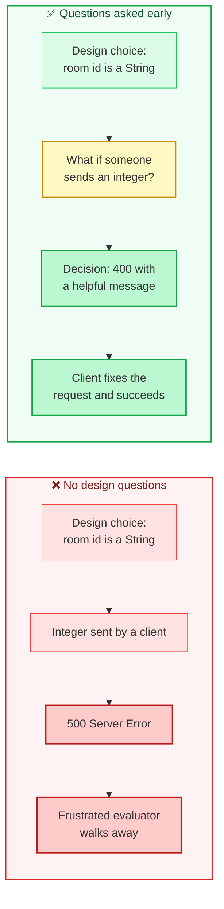

The moral is that most problems that show up in our systems don't come from *wrong code*. They come from risks like:

| Risk | What it looks like |
|---|---|
| Misinterpreting user requirements | Building exactly what was written, which isn't what was wanted |
| Making incorrect assumptions | "Obviously nobody will send an integer" |
| Violating architectural guidelines | An endpoint that doesn't fit the platform's patterns |

Ignoring these produces products that don't behave the way users expect, strains the team, and leaves surprise bugs and vulnerabilities behind. So part of building a quality product is making sure **everyone has a clear, shared understanding of what is being built**. That's the job of testing API designs.

---

## Where this fits: the chicken and the egg

There's a bit of a chicken-and-egg problem with test strategies. I want to understand my context *before* I pick activities, but I can't pick sensible activities without knowing how they work. The book resolves this by pausing the strategy to walk through three key activities, each of which spans a different part of the lifecycle:

| Chapter | Activity | When it happens | What it reveals |
|---|---|---|---|
| 4 (this post) | Testing API designs | Before implementation | Whether the *idea* is clear and shared |
| 5 | Exploratory testing | Against the running API | How the API *really* behaves |
| 6 | Automation | Alongside development | Whether what we know is *still true* |

After those, the strategy comes back together. For now, I'm starting with the earliest, and, I'd argue, cheapest, activity.

---

## Testing something that doesn't exist yet

Testing a design is different from testing an application. There's nothing to run. Instead I use my testing skills to question **less tangible things**: ideas, documents, diagrams and conversations.

Before code is written, a team will ideally gather to talk about the problem or feature and agree on a design. It's in those discussions that I can **listen, learn and question**. My aims are to help the team build a shared understanding and to catch issues while they're still cheap.

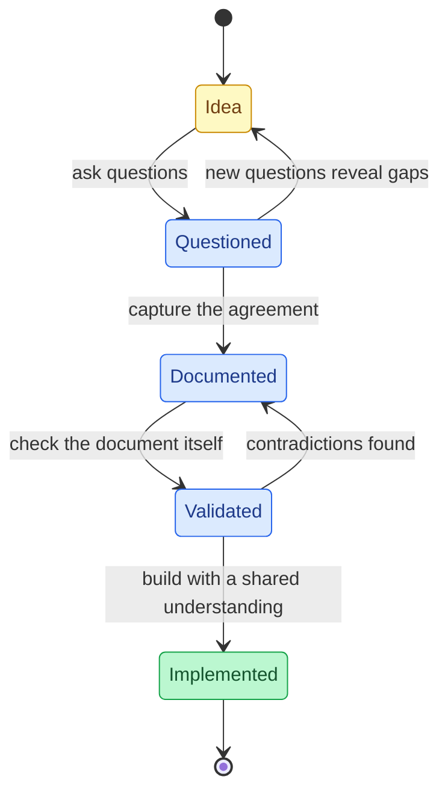

The key challenge is **asking the right questions at the right time**. That takes practice, but there are techniques that get me started immediately.

---

## Five Ws and an H

The simplest technique I know is "five Ws and an H": **Who, What, Where, When, Why, How**. I pick one word and use it as a trigger to see what questions come to mind. The order doesn't imply priority. Each word just opens a different door.

To practice, let me take a user story and a proposed design for the sandbox:

> *In order to allow bookings to be made for a room, as a B&B owner, I want the ability to create a room.*

And the team's proposed design for the request and response:

```http
POST /room/ HTTP/1.1
Host: example.com
Accept: application/json
Cookie: token=abc123

{
  "roomName": "102",
  "type": "Double",
  "accessible": "true",
  "description": "This is a description for the room",
  "image": "/img/room1.jpg",
  "roomPrice": 200,
  "features": ["TV", "Safe"]
}
```

```http
HTTP/1.1 201 OK
Content-Type: application/json

{
  "roomid": 3,
  "roomName": 102,
  "type": "Double",
  "accessible": true,
  "image": "/img/room1.jpg",
  "description": "This is a description for the room",
  "features": ["TV", "Safe"],
  "roomPrice": 200
}
```

> **📝 Note on these samples:** In the text I was working from, the `features` array in the request appeared without its key, which isn't valid JSON, and the HTTP status line read "201 OK". I've written the request as `"features": [...]` and the response header as `Content-Type`. Keep your eyes open as you read on: the design has some more serious issues, and finding them is the whole point.

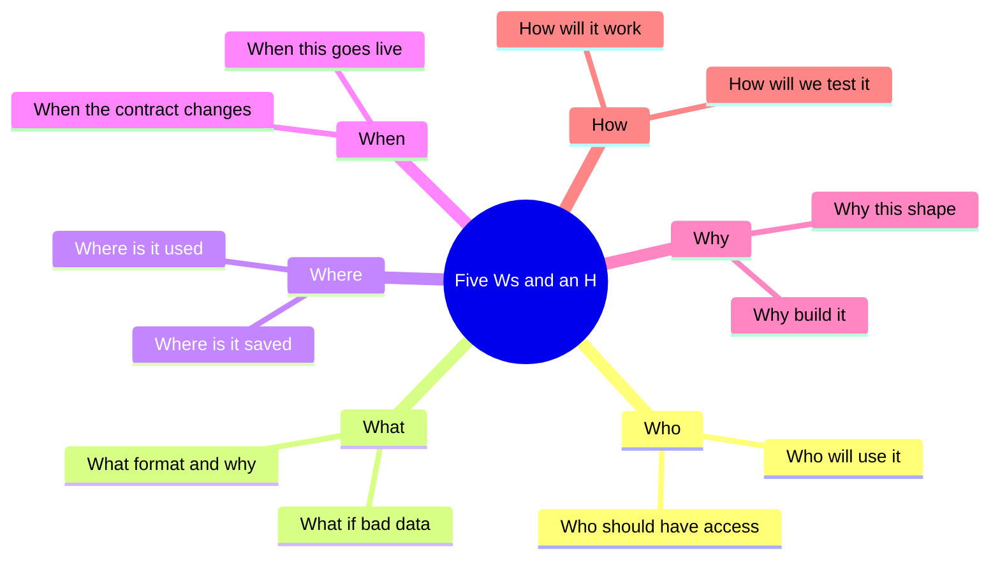

Here's how I apply each word to `POST /room/`.

### Who

*Who* questions teach me about the people or systems that interact with the API, and therefore what they need.

| Question | Why I ask it |
|---|---|
| Who is going to use this? | The consumer might be another API, a UI library or a person. If it's another API, I'll ask more architectural questions. |
| Who should have access? | The design mentions a `token` cookie. That's a surface-level security question, but the answer leads to deeper ones about how the API is secured. |

### What

*What* questions are great for hypotheticals: *what if X happens?* A good trick is to take something already said and push it one step further.

| Question | Why I ask it |
|---|---|
| What if we send incorrect details? | Not every hypothetical has a happy ending, and I need to discuss how to minimise damage and how to give readable feedback. |
| What format will the payload be in, and why? | "JSON" is an answer, but the *why* exposes assumptions about who will consume it. |

### Where

*Where* questions widen my view and reveal dependencies and consequences for consumers.

| Question | Why I ask it |
|---|---|
| Where will the room be saved? | Reveals implementation details. In a microservice platform, does this mean a new API? |
| Where will the room be used? | A different angle from "who will use it". It exposes other features or APIs that will rely on this design. |

### When

*When* puts the focus on time, on future events and what happens during them.

| Question | Why I ask it |
|---|---|
| When the API contract changes, will we version the URI? | Versioning has consequences for design, documentation and how I tell consumers about changes. |
| When this goes live, do we want to cache the requests? | If yes, the design might need to avoid random values in URIs that would defeat caching. |

### Why

*Why* questions probe the reasoning behind decisions and the value of the work.

| Question | Why I ask it |
|---|---|
| Why are we building this? | It sounds contrarian, but it builds empathy with the user's real problem. |
| Why are features a simple array? | If there's a fixed menu of features, why not a sub-object? I'm not criticising. I'm exploring alternatives. |

### How

*How* questions explore how something will work and what delivering it involves.

| Question | Why I ask it |
|---|---|
| How will it work? | It *feels* naive, but it's brilliant at surfacing conflicting understandings in the team. Sometimes the basic questions work best. |
| How will we test this? | Exposes blockers early. If a feature depends on a scheduled job, I can start a conversation about controlling the clock. |

> **💡 Tip:** I'm never asking questions to catch anyone out. The goal is shared understanding, and the tone matters as much as the content. "Help me understand why..." lands very differently from "Why on earth..."

> **🧪 Activity:** Look at `POST /room/` again and write at least **three questions for each W and H**. Don't censor yourself: the "silly" ones are often the most productive.

---

## Questioning is a thinking skill

Techniques are a launchpad, but what actually powers good questions is **thinking**. Two kinds matter most.

| Skill | What it does | In one phrase | Example |
|---|---|---|---|
| **Critical thinking** | Digs into the truth and meaning behind ideas, exposing motives and hidden assumptions | Go **deeper** | "Why must the identifier be a string?" |
| **Lateral thinking** | Explores consequences and connections nobody has considered | Go **broader** | "Who else might call this endpoint?" |

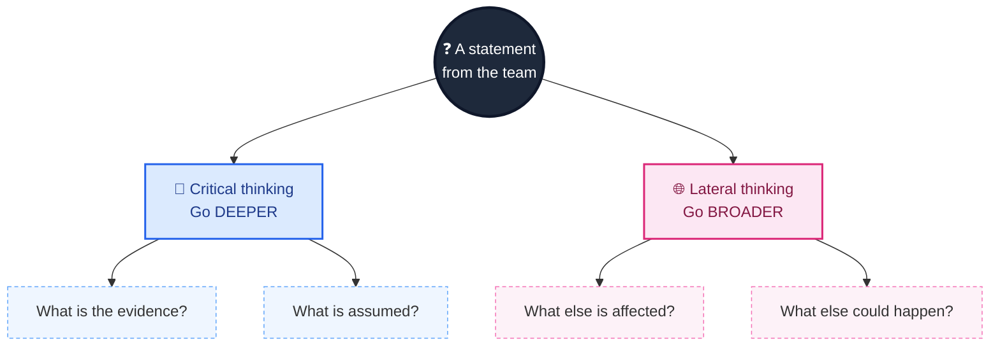

Connect this back to my two-circle model of testing from the first post. When I test an *application*, I ask things like "what if I click that Add button a thousand times?" When I test an *idea*, I ask "who will consume this API response?" The subject changes (code versus concept), but the engine is the same: critical and lateral thinking.

The honest truth about improving at them is that they feel abstract. The best advice I know is to treat them like a **muscle**: exercise them by testing ideas and code regularly.

> **📝 Note:** Eventually the well of questions runs dry. That's not a failure. It's a clear sign I've exhausted the avenues I can see, and it might be time to stop. When I want a fresh angle before stopping, I reach for the tools in the next section.

---

## Expanding my toolkit: else, funnel, data types, pictures

Five Ws and an H is the fundamental technique. These four extend it.

### Else questions (go broader)

Add the word **else** after a keyword and you nudge everyone toward lateral thinking:

- *Who else* is going to use this?
- *What else* might happen?
- *How else* could an error occur?

> **🧪 Activity:** Take your earlier questions and rewrite each with "else". Notice how each one changes.

### Funnel questions (go deeper)

Where the other techniques use trigger words, **funnel questions** react to the previous answer and dig further. Here's the shape, using the image field:

> **Q:** How does a user add an image?
> **A:** By supplying a URL as a string in the payload.
> **Q:** Why a URL and not an upload?
> **A:** We don't have an upload feature yet.
> **Q:** When will we build one?
> **A:** ...maybe we should prioritise that now.

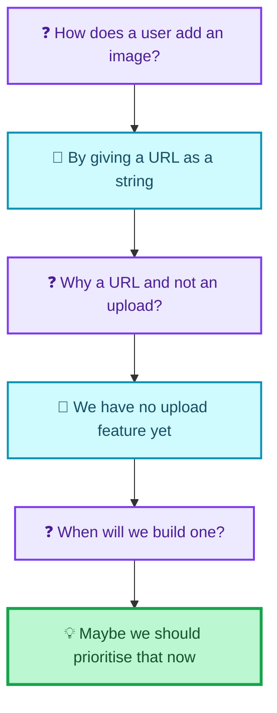

Two ingredients make funnel questions work. The first is **active listening**: I genuinely take in each answer and react to it. The second is **phrasing**: inquisitive, never combative. The aim isn't to make the answerer look foolish. It's to uncover the reasoning behind a decision.

> **💡 Tip:** If you struggle to remember all the question techniques, or want to randomise your approach, Hindsight Software offers free Discovery Cards that work as questioning cue cards.

### Data type analysis

Here I look at the data types in the proposed payload and ask questions *specific to each type*. The design sends `roomPrice` as an integer, so I can ask two flavours of question:

| Flavour | Examples for `roomPrice` |
|---|---|
| **General rules of the type** | What if we send a float? What if the number overflows? |
| **Business rules behind the type** | What if the price is zero or negative? What if it isn't sent at all? |

Each data type has its own quirks, and cheat sheets exist for this. Elisabeth Hendrickson's *Test Heuristics Cheat Sheet* is a handy source of prompts. I'll come back to heuristics when I get to exploratory testing.

This technique is also **mechanical enough to automate**, which is exactly what I do in the hands-on section below.

### Visualisations

A picture really is worth a thousand words, especially when the aim is to expose assumed knowledge. Imagine that when I ask "how will it work?", a teammate walks to a whiteboard and draws this:

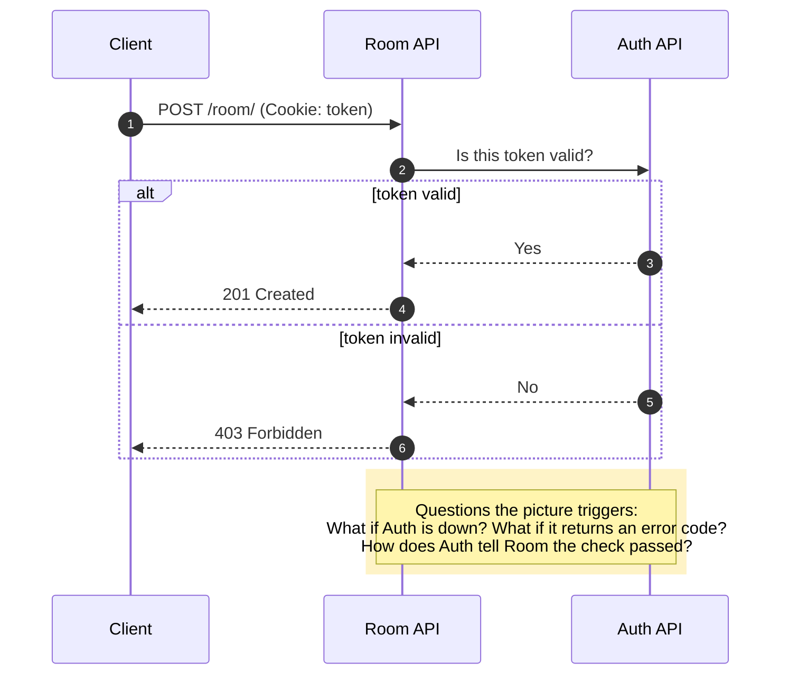

It isn't elaborate, yet it shares dependencies between APIs and a security mechanism, and it springs new questions: *What if the Auth API connection fails? What if it returns an error code? How does it tell the room API the check passed?*

Visualisations work in two directions. They're a source of questions, and they're a way to *check my own understanding*. Drawing my version and asking the team "is this how it works?" invites them to correct me, and the corrections show me exactly where our mental models differ.

> **🧪 Activity:** Using your model from the earlier post, sketch a stripped-down picture of the `POST /booking/` process, then add the questions it triggers.

---

## Documenting the design with OpenAPI 3

"Documentation" can be a loaded word. Some people dismiss it as wasteful, hard to maintain and rarely read, picturing hundred-page specifications. But *good* documentation is lightweight, easy to maintain, and captures what we intend to build. It becomes a source of agreement within the team and a way to communicate with people outside it.

When I test designs I'm not just finding issues. I'm helping the team capture the shared understanding, so that we:

1. **remove assumptions and ambiguity** by stating how the API should behave,
2. **create fresh material** for more questions, and
3. **tell consumers clearly** how the API works, whether they're a teammate or a stranger on the other side of the world.

### Swagger and OpenAPI

The toolset I use is **Swagger**, and specifically the **OpenAPI 3** schema for writing designs. A short history: OpenAPI began as part of Swagger, but to help create an industry standard, the Swagger team donated it to the OpenAPI Initiative, which evolved it into the OpenAPI 3 specification. It's open and easy to validate, which helps mitigate misinterpretation.

| Where to write the design | Notes |
|---|---|
| Any editor, in YAML | Preferred format; add linter plugins for your editor |
| SwaggerHub | Online editor, free to sign up, advanced features are paid |
| Swagger Editor in Docker | Pull the image if you're comfortable with Docker |
| Alternatives | Postman's API design tools and Stoplight both support OpenAPI |

### Anatomy of my design document

Here's the structure, built up the way I'd explain it to a colleague.

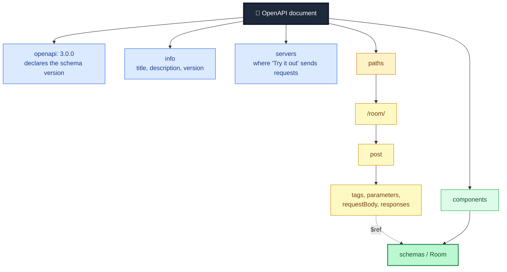

- **`openapi: 3.0.0`** declares the schema type. It's essential for validating the format and for using the design with other Swagger tools.
- **`info`** holds context: description, version and title.
- **`servers`** lists where the interactive documentation should send requests.
- **`paths`** describes each URI. For `/room/` I specify the `post` operation with four parts: `tags` (a name that makes it easy to find), `parameters` (such as the `token` cookie), `requestBody` (content type plus a reference to a schema) and `responses` (each status code with extra detail).
- **`components/schemas`** is where the shape of a `Room` lives. The `$ref: '#/components/schemas/Room'` path ties a schema to the place that uses it.

Inside the `Room` schema, each property gets a type and rules. For `roomPrice` the book uses `minimum`, `maximum`, `exclusiveMinimum` and `exclusiveMaximum` to set boundaries. With `minimum: 0` and `exclusiveMinimum: true`, anything below 1 is out of bounds. The `required` list says which properties must be present.

Here's the complete design document, exactly as the book builds it up. I've restored the YAML indentation, which didn't survive in the text I worked from. I saved it as `room_design_as_printed.yaml`:

```yaml
openapi: 3.0.0
info:
  description: An example API design
  version: 1.0.0
  title: SandBox Room service
  contact:
    name: Mark Winteringham
servers:
  - url: example.com
servers:
  - url: https://example.com/
paths:
  /room/:
    post:
      tags:
        - room
      parameters:
        - in: cookie
          name: token
          required: true
          schema:
            type: string
      requestBody:
        content:
          application/json:
            schema:
              $ref: '#/components/schemas/Room'
        description: roomPayload
        required: true
      responses:
        '201':
          description: Created
          content:
            application/json:
              schema:
                $ref: '#/components/schemas/Room'
        '403':
          description: Forbidden
components:
  schemas:
    Room:
      title: Room
      type: object
      properties:
        accessible:
          type: boolean
        description:
          type: string
        features:
          type: array
          items:
            type: string
            pattern: Single|Double|Twin|Family|Suite
        image:
          type: string
        roomName:
          type: string
        roomPrice:
          type: integer
          format: int32
          minimum: 0
          maximum: 999
          exclusiveMinimum: true
          exclusiveMaximum: false
        roomid:
          type: integer
          format: int32
      required:
        - accessible
        - description
        - features
        - image
        - roomName
        - roomPrice
```

Looking at it, I can already apply data type analysis to every property and ask about the error responses. The design is no longer inside one person's head. It's concrete, and the whole team can review it.

> **🧪 Activity:** Write an OpenAPI design for the `POST /booking/` endpoint. Include the dates object, `depositpaid`, names, `roomid`, email and phone.

> **⚠️ Caution:** Keep that "as printed" file in mind. Before I show you why I gave it that name, see if you can spot anything that bothers you. I'll tell you what I found.

---

## Hands-on: testing the design document itself

Here's the thought that led me to write some code. An OpenAPI document is *data*. If it's data, I can test it. And I noticed that a design document makes several claims that should agree with each other: the schema says what a room *is*, the examples show what a room *looks like*, and the response codes say what *happens*. If those disagree, the team will build from a contradiction.

So I built a small toolkit, in Python, using `PyYAML` and `jsonschema` (plus `openapi-spec-validator` for one comparison). Install them with:

```bash
pip install pyyaml jsonschema openapi-spec-validator
```

It does five things:

| Tool | What it does | Technique it automates |
|---|---|---|
| `load_strict` | Loads YAML but **refuses duplicate keys** | Reviewing the document |
| `problems` | Validates a payload against the schema and returns readable errors | Checking examples against rules |
| `probe` | Tries one value for one property, with everything else held valid | Data type / boundary analysis |
| `questions_for` | Generates data-type questions from the schema | Data type analysis |
| `create_room` | Implements the *behaviour* the revised design asks for | The opening story |

> **⚠️ Caution:** My findings below come from the YAML **as it appears in the text I worked from**, with the indentation restored by me. It's possible that some of these issues are simplifications made for teaching, or artefacts of how the text reached me. Treat them as an illustration of *what design testing finds*, not a verdict on the book. If you're looking at the original, check whether it agrees.

### `design_checks.py`

```python
"""Tools for testing an API design document before any code exists."""
import yaml
from jsonschema import Draft4Validator   # OpenAPI 3.0 schemas follow Draft 4 semantics

# ---- Payloads taken from the proposed /room/ design ----
PROPOSED_REQUEST = {
    "roomName": "102", "type": "Double", "accessible": "true",
    "description": "This is a description for the room",
    "image": "/img/room1.jpg", "roomPrice": 200, "features": ["TV", "Safe"],
}
PROPOSED_RESPONSE = {
    "roomid": 3, "roomName": 102, "type": "Double", "accessible": True,
    "image": "/img/room1.jpg", "description": "This is a description for the room",
    "features": ["TV", "Safe"], "roomPrice": 200,
}
# The request from the chapter's opening story (the one that earned a 500)
STORY_REQUEST = {
    "roomNumber": 100, "type": "Single", "accessible": False,
    "description": "Please enter a description for this room",
    "image": "https://www.mwtestconsultancy.co.uk/img/room1.jpg",
    "roomPrice": "100", "features": ["WiFi"],
}


class DuplicateKeyError(ValueError):
    pass


class _StrictLoader(yaml.SafeLoader):
    """A YAML loader that refuses duplicate keys instead of silently
    keeping the last one (which is what plain yaml.safe_load does)."""


def _no_duplicates(loader, node, deep=False):
    seen = set()
    for key_node, _ in node.value:
        key = loader.construct_object(key_node, deep=deep)
        if key in seen:
            raise DuplicateKeyError(f"Duplicate key {key!r} on line {key_node.start_mark.line + 1}")
        seen.add(key)
    return yaml.SafeLoader.construct_mapping(loader, node, deep)


_StrictLoader.add_constructor(yaml.resolver.BaseResolver.DEFAULT_MAPPING_TAG, _no_duplicates)


def load_strict(text: str) -> dict:
    return yaml.load(text, Loader=_StrictLoader)


def room_schema(doc: dict) -> dict:
    return doc["components"]["schemas"]["Room"]


def problems(schema: dict, payload) -> list[str]:
    """Human-readable list of everything wrong with a payload."""
    errors = sorted(Draft4Validator(schema).iter_errors(payload),
                    key=lambda e: [str(p) for p in e.absolute_path])
    return [f"{'.'.join(str(p) for p in e.absolute_path) or '(body)'}: {e.message}" for e in errors]


def probe(schema: dict, prop: str, value) -> bool:
    """Does the design accept this one value for one property?
    Everything else is held at a known-good baseline."""
    baseline = {"roomName": "101", "type": "Single", "accessible": False,
                "description": "A room", "image": "/img/a.jpg", "roomPrice": 100,
                "features": ["WiFi"]}
    return not problems(schema, {**baseline, prop: value})


def questions_for(schema: dict) -> list[str]:
    """Data type analysis: turn each property's type and rules into questions."""
    qs = []
    for name, rule in schema["properties"].items():
        kind = rule.get("type")
        if kind == "integer":
            qs += [f"{name}: what if we send a float instead of an integer?",
                   f"{name}: what if we send an overflowing number?"]
            if "minimum" in rule:
                qs.append(f"{name}: what happens at and just beyond the minimum ({rule['minimum']})?")
            if "maximum" in rule:
                qs.append(f"{name}: what happens at and just beyond the maximum ({rule['maximum']})?")
        elif kind == "string":
            qs += [f"{name}: what if it is empty, very long, or contains unusual characters?",
                   f"{name}: what if we send a number instead of a string?"]
            if "enum" in rule:
                qs.append(f"{name}: what if the value is not one of {rule['enum']}?")
        elif kind == "boolean":
            qs.append(f"{name}: what if we send the string \"true\" instead of a boolean?")
        elif kind == "array":
            qs += [f"{name}: what if the list is empty?", f"{name}: what if it contains duplicates?"]
        if name in schema.get("required", []):
            qs.append(f"{name}: what if it is not sent at all?")
    return qs
```

### What I found

I ran the as-printed design through the tools. This is real output from `demo.py`, which I'll show in full at the end, but here are the findings in a table so you can see how they map to the questions I'd ask a team:

| # | Finding | How I found it | The question it raises |
|---|---|---|---|
| 1 | `servers:` appears **twice**. A normal YAML load silently keeps the last one | `load_strict` raised `Duplicate key 'servers' on line 10` | Which server URL did the team *mean*? (One lacks `https://`.) |
| 2 | The proposed request has `"accessible": "true"` (a string), but the schema says **boolean** | `problems` on the request | Is the client or the schema wrong? |
| 3 | The `pattern: Single\|Double\|Twin\|Family\|Suite` is attached to **`features` items**, not to a `type` property. So `"TV"` and `"Safe"` fail validation | `problems` on request *and* response | Was this meant to constrain the room `type`? |
| 4 | There is **no `type` property** in the schema at all, so `"Penthouse"` would be accepted | A test that sends `type: "Penthouse"` | Is the room type free text or a fixed list? |
| 5 | The proposed response returns `"roomName": 102` (integer) but the schema says **string** | `problems` on the response | The very bug from the opening story, in the design itself |
| 6 | The request is shown with `"roomPrice": 200` in one place and `"roomPrice": "200"` in another | Reading the two listings side by side | Is the price a number or a string? |
| 7 | The status line reads `201 OK`, but 201's standard reason phrase is "Created" (and the YAML itself says *Created*) | Reading the status line against the YAML | Cosmetic, but sloppy documents breed sloppy implementations |

And here's the part that made me stop and think:

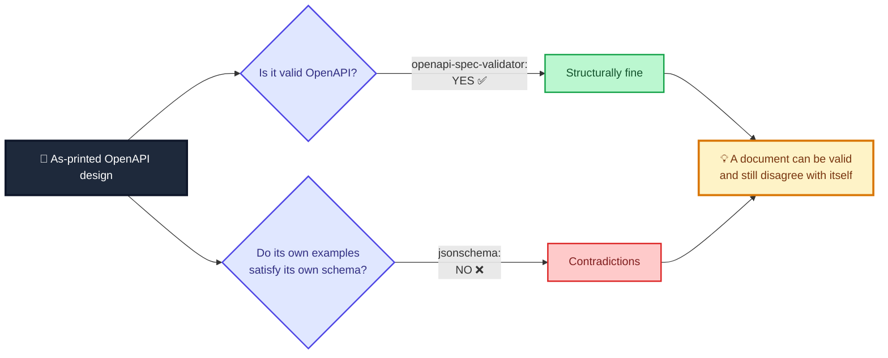

The as-printed document **passes** `openapi-spec-validator`. It's perfectly legal OpenAPI. Yet its own example request and response **fail its own schema**. A validator checks the *shape of the document*. It doesn't check whether the document's examples, schema and prose *agree*. That's a human (or at least a questioning) job, and it's why design testing is more than running a linter.

> **💡 Tip:** Whenever I review a design, I check that every example in it validates against its own schema. It takes seconds with a tool and it has found something every single time I've done it.

### The revised design

After questioning, here's the version I'd bring back to the team. These are **proposals for discussion**, not facts. Each change is really a question I'd put to the team:

```yaml
openapi: 3.0.0
info:
  description: An example API design (revised after questioning)
  version: 1.0.1
  title: SandBox Room service
servers:
  - url: https://example.com/
paths:
  /room/:
    post:
      tags:
        - room
      parameters:
        - in: cookie
          name: token
          required: true
          schema:
            type: string
      requestBody:
        content:
          application/json:
            schema:
              $ref: '#/components/schemas/Room'
        required: true
      responses:
        '201':
          description: Created
          content:
            application/json:
              schema:
                $ref: '#/components/schemas/Room'
        '400':
          description: Bad request, with a list of what was wrong
        '403':
          description: Forbidden
components:
  schemas:
    Room:
      title: Room
      type: object
      properties:
        roomid:
          type: integer
          format: int32
        roomName:
          type: string
          minLength: 1
        type:
          type: string
          enum: [Single, Double, Twin, Family, Suite]
        accessible:
          type: boolean
        description:
          type: string
        image:
          type: string
        roomPrice:
          type: integer
          format: int32
          minimum: 0
          maximum: 999
          exclusiveMinimum: true
          exclusiveMaximum: false
        features:
          type: array
          uniqueItems: true
          items:
            type: string
      required:
        - roomName
        - type
        - accessible
        - description
        - image
        - roomPrice
        - features
```

| Change I made | The decision it embodies | Who should confirm |
|---|---|---|
| Added a constrained `type` property (`enum`) | Room type is a fixed list | Product owner |
| Moved the "free text" to `features`, with `uniqueItems` | Features are arbitrary strings, no duplicates | Product owner, developers |
| Added `type` and others to `required` | A room can't be created without a type | Product owner |
| Added a `400` response | Bad input gets a descriptive error, not a 500 | Developers |
| Removed the duplicate `servers` key | One server URL | Developers |
| Kept `roomName` as string, `accessible` as boolean, `roomPrice` as integer | Examples must follow the schema | Whole team |

> **📝 Note:** I deliberately did **not** add `additionalProperties: false`. Without it, a request that sends `roomNumber` instead of `roomName` doesn't fail on the extra field. It fails because `roomName` is *missing*. Whether to reject unknown fields is a real design decision (strict feedback versus tolerance for newer clients), and it belongs to the team, not to me. It's a great *what if* question: "What if a client sends a field we don't know?"

### `room_service.py`: the opening story, replayed

The revised design asks for clear `400`s. This tiny function implements that behaviour using the revised schema, so I can replay the story from the start of this post:

```python
"""The behaviour the revised design asks for: clear 400s instead of a 500."""
from design_checks import load_strict, problems, room_schema

with open("room_design_revised.yaml") as f:
    _SCHEMA = room_schema(load_strict(f.read()))


def create_room(payload, token, rooms: list):
    if not token:
        return 403, {"error": "Forbidden"}
    errors = problems(_SCHEMA, payload)
    if errors:
        return 400, {"errors": errors}
    room = {**payload, "roomid": len(rooms) + 1}
    rooms.append(room)
    return 201, room
```

### `test_designs.py`

The tests describe the findings above as executable facts. Notice that the first group *documents the problems* in the as-printed design. They pass because the problems are really there.

```python
import unittest

from openapi_spec_validator import validate
import yaml

import design_checks as dc
from room_service import create_room


def read(path):
    with open(path) as f:
        return f.read()


PRINTED = read("room_design_as_printed.yaml")
REVISED = read("room_design_revised.yaml")


class AsPrintedDesign(unittest.TestCase):
    def test_a_plain_yaml_load_hides_the_duplicate_servers_key(self):
        doc = yaml.safe_load(PRINTED)                    # silently keeps the last one
        self.assertEqual(doc["servers"], [{"url": "https://example.com/"}])

    def test_a_strict_load_catches_it(self):
        with self.assertRaises(dc.DuplicateKeyError) as ctx:
            dc.load_strict(PRINTED)
        self.assertIn("servers", str(ctx.exception))

    def test_the_document_is_valid_openapi_yet_still_contradicts_itself(self):
        validate(yaml.safe_load(PRINTED))                # structure is fine: no exception
        schema = dc.room_schema(yaml.safe_load(PRINTED))
        found = dc.problems(schema, dc.PROPOSED_REQUEST)
        self.assertTrue(any(p.startswith("accessible:") for p in found), found)
        self.assertTrue(any(p.startswith("features.0:") for p in found), found)  # "TV" fails the pattern

    def test_the_proposed_response_breaks_its_own_schema(self):
        schema = dc.room_schema(yaml.safe_load(PRINTED))
        found = dc.problems(schema, dc.PROPOSED_RESPONSE)
        self.assertIn("roomName: 102 is not of type 'string'", found)

    def test_type_is_never_constrained_and_the_pattern_sits_on_features(self):
        schema = dc.room_schema(yaml.safe_load(PRINTED))
        self.assertNotIn("type", schema["properties"])
        base = {"roomName": "1", "accessible": False, "description": "d", "image": "i", "roomPrice": 100}
        # any room type is accepted...
        self.assertEqual(dc.problems(schema, {**base, "type": "Penthouse", "features": []}), [])
        # ...while the room-type pattern polices the features list instead
        self.assertEqual(dc.problems(schema, {**base, "features": ["Single"]}), [])
        self.assertNotEqual(dc.problems(schema, {**base, "features": ["WiFi"]}), [])


class RevisedDesign(unittest.TestCase):
    def setUp(self):
        self.doc = dc.load_strict(REVISED)
        self.schema = dc.room_schema(self.doc)

    def test_document_is_strictly_loadable_and_valid_openapi(self):
        validate(self.doc)

    def test_corrected_examples_pass(self):
        req = {**dc.PROPOSED_REQUEST, "accessible": True}
        resp = {**dc.PROPOSED_RESPONSE, "roomName": "102"}
        self.assertEqual(dc.problems(self.schema, req), [])
        self.assertEqual(dc.problems(self.schema, resp), [])

    def test_room_price_boundaries(self):
        cases = {0: False, 1: True, 999: True, 1000: False, -1: False,
                 1.5: False, "200": False, None: False}
        for value, expected in cases.items():
            with self.subTest(value=value):
                self.assertEqual(dc.probe(self.schema, "roomPrice", value), expected)

    def test_room_type_is_now_constrained(self):
        self.assertTrue(dc.probe(self.schema, "type", "Suite"))
        self.assertFalse(dc.probe(self.schema, "type", "Penthouse"))

    def test_duplicate_features_are_rejected(self):
        self.assertFalse(dc.probe(self.schema, "features", ["WiFi", "WiFi"]))

    def test_questions_cover_the_data_types(self):
        qs = dc.questions_for(self.schema)
        self.assertIn("roomPrice: what happens at and just beyond the minimum (0)?", qs)
        self.assertIn("accessible: what if we send the string \"true\" instead of a boolean?", qs)
        self.assertIn("features: what if the list is empty?", qs)
        self.assertEqual(len(qs), len(set(qs)))
        self.assertGreaterEqual(len(qs), 20)


class OpeningStory(unittest.TestCase):
    """The request that earned a 500 now earns an explanation."""

    def test_story_request_gets_a_400_that_explains_itself(self):
        status, body = create_room(dc.STORY_REQUEST, "token", [])
        self.assertEqual(status, 400)
        joined = " ".join(body["errors"])
        self.assertIn("roomName", joined)          # missing: it was sent as roomNumber
        self.assertIn("roomPrice: '100' is not of type 'integer'", body["errors"])

    def test_integer_room_name_is_explained(self):
        good = {**dc.PROPOSED_REQUEST, "accessible": True}
        status, body = create_room({**good, "roomName": 102}, "token", [])
        self.assertEqual((status, body["errors"]), (400, ["roomName: 102 is not of type 'string'"]))

    def test_missing_token_is_403(self):
        self.assertEqual(create_room({}, None, [])[0], 403)

    def test_valid_room_is_created_and_matches_the_response_schema(self):
        good = {**dc.PROPOSED_REQUEST, "accessible": True}
        rooms = []
        status, body = create_room(good, "token", rooms)
        self.assertEqual(status, 201)
        self.assertEqual(body["roomid"], 1)
        schema = dc.room_schema(dc.load_strict(REVISED))
        self.assertEqual(dc.problems(schema, body), [])


if __name__ == "__main__":
    unittest.main(verbosity=2)
```

```bash
python3 test_designs.py
```

```text
test_a_plain_yaml_load_hides_the_duplicate_servers_key  ... ok
test_a_strict_load_catches_it  ... ok
test_the_document_is_valid_openapi_yet_still_contradicts_itself  ... ok
test_the_proposed_response_breaks_its_own_schema  ... ok
test_type_is_never_constrained_and_the_pattern_sits_on_features  ... ok
test_integer_room_name_is_explained  ... ok
test_missing_token_is_403  ... ok
test_story_request_gets_a_400_that_explains_itself  ... ok
test_valid_room_is_created_and_matches_the_response_schema  ... ok
test_corrected_examples_pass  ... ok
test_document_is_strictly_loadable_and_valid_openapi  ... ok
test_duplicate_features_are_rejected  ... ok
test_questions_cover_the_data_types  ... ok
test_room_price_boundaries  ... ok
test_room_type_is_now_constrained  ... ok

----------------------------------------------------------------------
Ran 15 tests in 0.10s

OK
```

### The demo

```python
import yaml
import design_checks as dc
from room_service import create_room

printed = dc.room_schema(yaml.safe_load(open("room_design_as_printed.yaml").read()))
revised = dc.room_schema(dc.load_strict(open("room_design_revised.yaml").read()))

print("1) Strict load of the as-printed design:")
try:
    dc.load_strict(open("room_design_as_printed.yaml").read())
except dc.DuplicateKeyError as e:
    print("   ", e)

print("\n2) The proposed REQUEST checked against its own as-printed schema:")
for p in dc.problems(printed, dc.PROPOSED_REQUEST):
    print("    -", p)

print("\n3) The proposed RESPONSE checked against its own as-printed schema:")
for p in dc.problems(printed, dc.PROPOSED_RESPONSE):
    print("    -", p)

print("\n4) roomPrice boundaries in the revised design:")
for v in (-1, 0, 1, 999, 1000, 1.5, "200", None):
    print(f"    {v!r:>6} -> {'accepted' if dc.probe(revised, 'roomPrice', v) else 'rejected'}")

print("\n5) The opening story's request, now:")
status, body = create_room(dc.STORY_REQUEST, "r76BXGVy8rlASuZB", [])
print("   ", status)
for e in body["errors"]:
    print("    -", e)

qs = dc.questions_for(revised)
print(f"\n6) {len(qs)} data-type questions generated; first five:")
for q in qs[:5]:
    print("    -", q)
```

```text
1) Strict load of the as-printed design:
    Duplicate key 'servers' on line 10

2) The proposed REQUEST checked against its own as-printed schema:
    - accessible: 'true' is not of type 'boolean'
    - features.0: 'TV' does not match 'Single|Double|Twin|Family|Suite'
    - features.1: 'Safe' does not match 'Single|Double|Twin|Family|Suite'

3) The proposed RESPONSE checked against its own as-printed schema:
    - features.0: 'TV' does not match 'Single|Double|Twin|Family|Suite'
    - features.1: 'Safe' does not match 'Single|Double|Twin|Family|Suite'
    - roomName: 102 is not of type 'string'

4) roomPrice boundaries in the revised design:
        -1 -> rejected
         0 -> rejected
         1 -> accepted
       999 -> accepted
      1000 -> rejected
       1.5 -> rejected
     '200' -> rejected
      None -> rejected

5) The opening story's request, now:
    400
    - (body): 'roomName' is a required property
    - roomPrice: '100' is not of type 'integer'

6) 25 data-type questions generated; first five:
    - roomid: what if we send a float instead of an integer?
    - roomid: what if we send an overflowing number?
    - roomName: what if it is empty, very long, or contains unusual characters?
    - roomName: what if we send a number instead of a string?
    - roomName: what if it is not sent at all?
```

Look at output 5. The request from the opening story, the one that earned a `500` and lost a customer, now earns a `400` that says *exactly* what's wrong: `roomName` is missing (the client sent `roomNumber`) and `roomPrice` should be an integer. That's the difference two questions can make.

And output 6 shows the data type analysis technique automated: 25 questions generated from the schema, without a meeting. They're a *starting point* for human conversation, not a replacement for it.

| What the tools are good at | What they can't do |
|---|---|
| Finding mechanical contradictions fast | Knowing what the business actually wants |
| Generating exhaustive type-based questions | Asking "why are we building this?" |
| Making findings repeatable (they run in CI) | Noticing a missing feature nobody mentioned |
| Checking examples against schemas | Deciding which of two contradictory parts is right |

> **⚠️ Caution:** Don't let tooling replace the conversation. A schema validator can tell me that `"TV"` fails a pattern. Only a person can tell me the pattern was meant for room *types*. The tool shortens the distance to the question. It doesn't answer it.

---

## Beyond documentation: Swagger tools

One reward of writing the design in OpenAPI is what you can do afterwards.

**Swagger UI** turns the design into easy-to-read, interactive documentation. If configured correctly, you can even build requests from it and send them to your API. It's a quick way to *test*, and it shares accurate documentation with users of the API, which reduces the risk of someone dismissing a working API as broken because they misunderstood it. (Recall the opening story.)

**Swagger Codegen** turns the design into code. That can save time and helps ensure that what was agreed is what gets built, while leaving room for business logic. The catch: you're trusting a third-party tool to generate production code, and that introduces risks that other testing activities should cover.

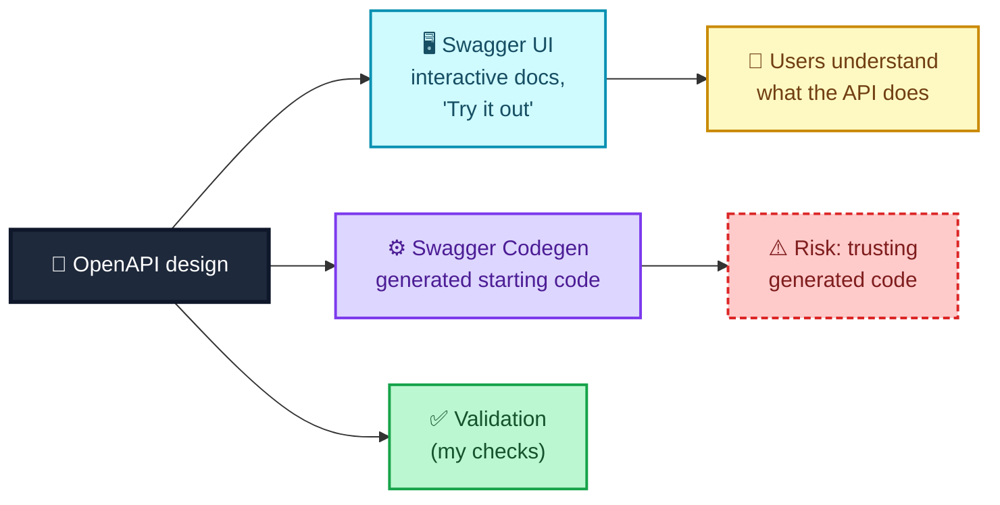

> **📝 Note on GraphQL:** The Swagger toolset (at the time the book was written) doesn't support GraphQL, which doesn't use OpenAPI. Community libraries such as `graphql-playground` and `graphiql` provide a comparable experience, and the questioning techniques in this post apply equally to GraphQL designs.

---

## Getting my team to do this

Knowing how to question a design is only half of it. Without a chance to do it, I can't help. I *can* test designs asynchronously, reading documents, jotting questions and sending them over. But that's slow, issues surface after implementation has begun, and I lose the nuance of conversation. The real value comes from **collaborative discussion**, with different roles bringing different information. A question about the product might trigger a conversation about architecture. A clarification might expose differing assumptions.

### Getting buy-in

Culture matters. Some teams exclude certain roles from design discussions, deliberately or by accident. "Just invite yourself" is easy to say, but it doesn't guarantee buy-in. A gentler route is **experimentation**:

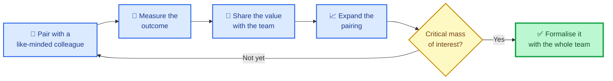

### Using sessions that already exist

| Approach | Examples | Strengths | Limitations |
|---|---|---|---|
| **Formal** | Sprint planning, story kick-offs | People from different roles are already there, informally testing | Can be long and tiring; larger groups make some people hold back |
| **Informal: pairing** | A pair agrees to spend time questioning *before* implementing | Deep, low-pressure thinking | A pair focused on implementation gets biased by the task at hand |
| **Informal: ad hoc chats** | Backend and frontend developers discussing an API; teams that provide and consume data | Natural, spontaneous | You need to notice them and join |

### Creating my own sessions: Three Amigos

When existing sessions don't fit, I can create one. A popular option is **Three Amigos**: a tester, a developer and a product owner (or similar) meet when a new story is ready to be considered, to talk through how it'll be delivered. Everyone leaves with a clear, shared understanding.

It's flexible. You can make it a formal step (for example, an *Analysis* column on a Kanban board) or keep it informal ("come and find me when you need to"). It doesn't have to be three, either: you might invite one person per discipline, or someone from UX. As long as you're collaborating and discussing, there's value.

> **⚠️ Caution:** Whatever format you use, protect the *questioning*. A Three Amigos that becomes a status meeting, or a sprint planning session that rushes through stories to hit a time-box, will stop testing the design and merely approve it.

---

## Where design testing sits in a strategy

Testing API designs can feel like a strange place to start learning about API testing. But it shows how dynamic testing can fit into many situations and add value, and a good strategy is *holistic*, covering the many places risk can creep in.

Recall my model from the first post: the goal is for what we **want** to build to match what we're **actually** building. That requires a good understanding of what we want in the first place. If the team is misinformed, we get rework, or we deliver something the user doesn't want.

So design testing focuses on two specific areas of the model:

1. **What the team knows** (the area where the imagination overlaps implementation), and
2. **What the team doesn't know but should** (the rest of the imagination circle).

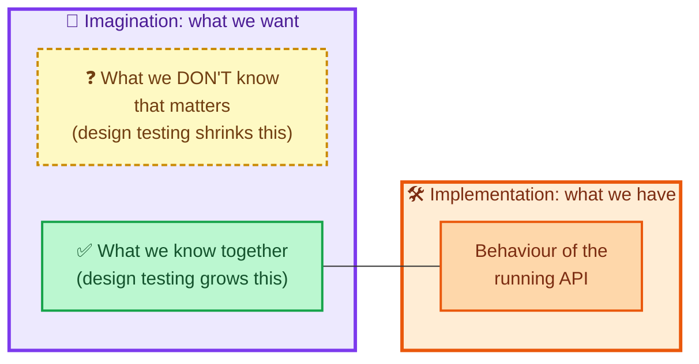

Which of my risks from the previous post does this help with? Plenty:

| Risk (from the quality and risk post) | How design testing helps |
|---|---|
| Vague or incorrect error messages | Agree the wording and the status codes before building |
| Incorrect status codes on successful requests | Check examples against the design (my `201 OK` finding) |
| Implemented features don't match the user's request | Build a shared picture of the request first |
| Documentation is hard to decipher | Write it in OpenAPI and validate it |
| Validation doesn't work as expected | Decide the boundaries (`roomPrice` limits) in the design |

The more we collaborate, question and discuss, the more we expand what we know as a team and reduce what we don't. The result is a better-informed team with a clearer idea of how to improve quality.

---

## Pitfalls, cheat sheet and summary

### Pitfalls I try to avoid

| Pitfall | Why it hurts | What I do instead |
|---|---|---|
| Testing the design only after coding starts | Issues are expensive and rework is annoying | Join the conversation early |
| Asking questions to prove people wrong | Defensive teams share less | Phrase questions as curiosity |
| Skipping "basic" questions | The basic ones often expose conflicting views | Ask "how will it work?" anyway |
| Trusting a valid document | Validity isn't agreement | Check examples against the schema |
| Letting documentation rot | Out-of-date docs mislead | Keep it lightweight and versioned |
| Relying only on asynchronous review | Slow, and loses nuance | Talk it through as a group |
| Trusting generated code blindly | It's third-party code in production | Test it like any other code |
| Over-trusting tools | Tools find contradictions, not intent | Use them to prompt conversations |

### Cheat sheet

| Technique | Trigger | Example question |
|---|---|---|
| Who | People and systems | Who should have access? |
| What | Hypotheticals | What if we send incorrect details? |
| Where | Dependencies | Where will the room be saved? |
| When | Time and events | When the contract changes, do we version the URI? |
| Why | Reasons and value | Why are features an array? |
| How | Mechanics | How will we test this? |
| Else | Go broader | Who else will use this? |
| Funnel | Go deeper | Why a URL and not an upload? |
| Data types | Types and boundaries | What happens at the minimum price? |
| Visualise | Pictures | What if the Auth API is down? |

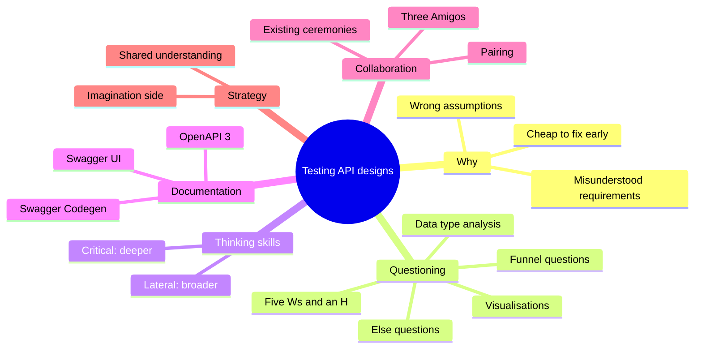

### Key takeaways

- **Most bugs are born in assumptions.** Missed questions at design time become failures in production.
- **Testing designs means questioning ideas.** The material is conversations, diagrams and documents, not running code.
- **Five Ws and an H** gets me asking useful questions immediately. **Else**, **funnel**, **data type analysis** and **visualisations** take me wider and deeper.
- **Critical thinking digs deeper, lateral thinking goes broader.** Both are muscles that grow with use.
- **OpenAPI 3 makes the design concrete.** It removes ambiguity and gives the whole team something to review.
- **A valid document can still contradict itself.** Check that its examples satisfy its own schema.
- **Swagger UI and Codegen** extend a design into interactive documentation and starter code, with the caveat about trusting generated code.
- **Collaboration is where the value is.** Use existing ceremonies, pairing, or a Three Amigos session.
- **Design testing sits in the imagination circle.** It grows what the team knows together and shrinks what it doesn't.

### Quick glossary

| Term | Meaning |
|---|---|
| **Five Ws and an H** | Who, What, Where, When, Why, How: six triggers for questions |
| **Else question** | A question with "else" added, to think more broadly |
| **Funnel question** | A follow-up that digs deeper into the previous answer |
| **Data type analysis** | Generating questions from the data types in a payload |
| **Critical thinking** | Examining the truth and meaning behind an idea |
| **Lateral thinking** | Exploring consequences and connections beyond the obvious |
| **OpenAPI 3** | An open specification for describing web APIs, usually in YAML |
| **Swagger UI** | A tool that renders an OpenAPI design as interactive documentation |
| **Swagger Codegen** | A tool that generates code from an OpenAPI design |
| **`$ref`** | A reference that ties a schema in `components` to where it is used |
| **Three Amigos** | A short collaborative session (tester, developer, product owner) before work starts |
| **Active listening** | Consciously taking in answers and reacting to them |

### Where I go next

With the imagination side covered, the next step is the **implementation** side: exploratory testing, where I learn how the running API *really* behaves. But I'll carry one habit with me: **before I trust a design, I make it argue with itself.** If its examples, its schema and its prose all agree, I can move on with confidence. If they don't, I've just saved my team from building a contradiction.

---

*Source and credits:* this post is based on the chapter "Testing API designs", which draws on the five Ws and an H technique, Elisabeth Hendrickson's Test Heuristics Cheat Sheet, Hindsight Software's Discovery Cards and the Swagger/OpenAPI toolset. The Python toolkit, the revised YAML and the findings table are my own illustrations, written and run for this post against the YAML as it appeared in the text I worked from.
